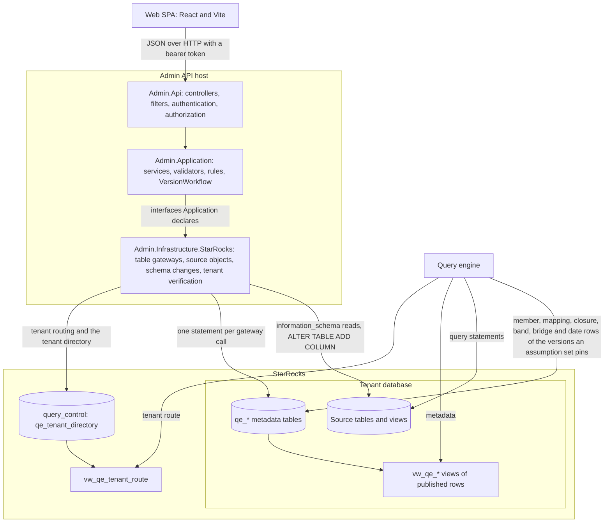
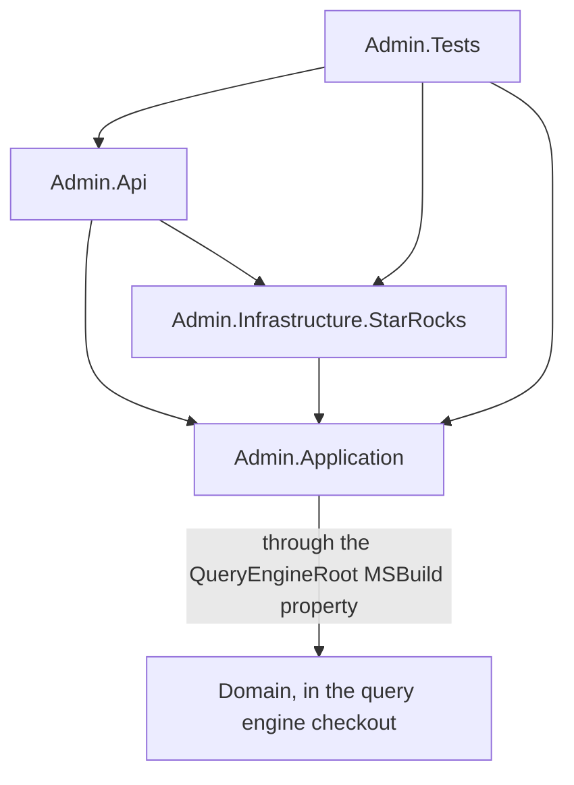
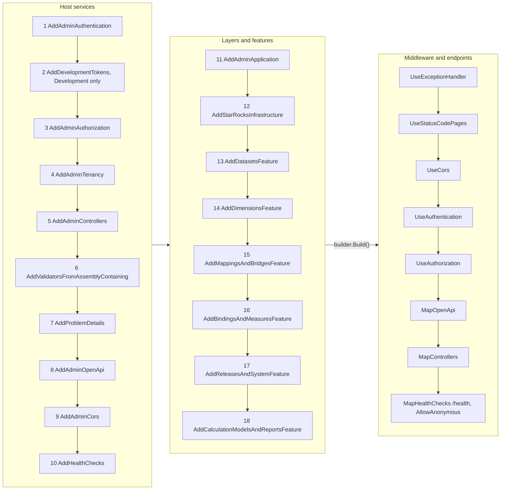

# High-level architecture

[Diagram index](README.md) · [Request pipeline](02-request-pipeline.md) · [Core classes](03-core-classes.md) · [Version lifecycle](04-version-lifecycle.md) · [Feature classes](05-feature-classes.md) · [Key actions](06-key-actions.md)

## Runtime components

The drawing follows a change from the browser through the API's three layers into StarRocks, and shows where the query engine later picks it up. The API writes the `qe_*` tables of a tenant's database directly; the engine loads metadata only through the `vw_qe_*` views, which keep published rows.

The SPA calls `/api/...` with a bearer token. In development the Vite dev server proxies `/api` and `/development` to the API's `http` profile on `http://localhost:5180`, so the browser calls its own origin. `Admin.Api` authenticates and authorizes the request, binds and validates its input, and calls an Application service. Application services reach StarRocks only through interfaces Application declares (`ITableGateway<TRecord>`, `ISourceObjectCatalog`, `ISchemaChangeExecutor`, `ITenantDatabaseVerifier`, `IConnectionStringMasker`, `IIdGenerator`), which `Admin.Infrastructure.StarRocks` implements with Dapper and MySqlConnector. A request that touches a tenant table first reads that tenant's connection string from `query_control.qe_tenant_directory`, then opens the tenant's database. Verifying a tenant connection opens the candidate connection string instead and reads that database's `qe_database_info`. Materializing a `json_path` field is the one change the API makes to a source table: it adds a generated column.

The engine resolves its route through `vw_qe_tenant_route` and loads metadata through the `vw_qe_*` views. It reads dimension, mapping, bridge, calculation model and report versions through an assumption set: the active one, which pins every published version, unless a request names a historical one. Its query statements read the dataset's source table and join the `qe_*` member, mapping, closure, range-band, bridge-mapping and date rows by the version IDs of that set. Drafts and validated versions therefore never reach a query; a published version of a living kind is live, so its edits reach the next query; and dataset versions reach one only through the release that `qe_database_info.active_release_id` points at.

**Sources:** [Program.cs](../../src/Quantalytix.QueryEngine.Admin.Api/Program.cs), [StarRocksConnectionFactory.cs](../../src/Quantalytix.QueryEngine.Admin.Infrastructure.StarRocks/Connections/StarRocksConnectionFactory.cs), [StarRocksTableGateway.cs](../../src/Quantalytix.QueryEngine.Admin.Infrastructure.StarRocks/Tables/StarRocksTableGateway.cs), [SourceObjectCatalog.cs](../../src/Quantalytix.QueryEngine.Admin.Infrastructure.StarRocks/SourceObjects/SourceObjectCatalog.cs), [SchemaChangeExecutor.cs](../../src/Quantalytix.QueryEngine.Admin.Infrastructure.StarRocks/SchemaChanges/SchemaChangeExecutor.cs), [MaterializedColumnService.cs](../../src/Quantalytix.QueryEngine.Admin.Application/Datasets/MaterializedColumnService.cs), [TenantDatabaseVerifier.cs](../../src/Quantalytix.QueryEngine.Admin.Infrastructure.StarRocks/TenantVerification/TenantDatabaseVerifier.cs), [vite.config.ts](../../../web/vite.config.ts), [API README](../../README.md); in the query engine checkout: [ControlPlaneQueries.cs](../../../../Quantalytix.QueryEngine/src/Quantalytix.QueryEngine.ControlPlane.StarRocks/Readers/ControlPlaneQueries.cs), [MetadataQueries.cs](../../../../Quantalytix.QueryEngine/src/Quantalytix.QueryEngine.Metadata.StarRocks/Readers/MetadataQueries.cs), [SemanticTables.cs](../../../../Quantalytix.QueryEngine/src/Quantalytix.QueryEngine.Provider.StarRocks/Compilation/SemanticTables.cs).

## Project dependencies

Arrows in this drawing mean project reference, not runtime call; it shows that Application depends on no infrastructure and borrows only the engine's Domain project. Names omit the common `Quantalytix.QueryEngine.` prefix.

`Directory.Build.props` defaults `QueryEngineRoot` to `../../Quantalytix.QueryEngine` from `api/`; an environment variable of the same name overrides it. Application references `$(QueryEngineRoot)src/Quantalytix.QueryEngine.Domain/Quantalytix.QueryEngine.Domain.csproj` for `ExpressionParser` and `ExpressionTree`, so the API accepts exactly the expressions the engine parses. The test project also copies the seed kit's `ddl_srdb_bi_v2_17.sql` from `SeedKitRoot`, which defaults to `../../database/srdb_ebm` from `api/`, and Application, Infrastructure.StarRocks and Api make their internals visible to it.

| Project | Main packages | Holds |
| --- | --- | --- |
| `Admin.Api` | FluentValidation.DependencyInjectionExtensions, Microsoft.AspNetCore.Authentication.JwtBearer, Microsoft.AspNetCore.OpenApi, Microsoft.Extensions.ApiDescription.Server, Microsoft.OpenApi | Controllers, authentication, authorization, filters, error results, feature registration; writes `openapi/admin-api.json` at build |
| `Admin.Application` | FluentValidation, Microsoft.Extensions.DependencyInjection.Abstractions | Feature services, input validators, publication and retirement rules, the version workflow, the 43 records and the interfaces Infrastructure implements |
| `Admin.Infrastructure.StarRocks` | Dapper, MySqlConnector, Microsoft.Extensions.Options.ConfigurationExtensions, Microsoft.Extensions.DependencyInjection.Abstractions | Table gateways, connections, ID generation, source-object introspection, schema changes, tenant verification |
| `Admin.Tests` | xunit.v3, Microsoft.AspNetCore.Mvc.Testing, Microsoft.Extensions.TimeProvider.Testing | Tests on Microsoft.Testing.Platform |

**Sources:** [Directory.Build.props](../../Directory.Build.props), [Quantalytix.QueryEngine.Admin.slnx](../../Quantalytix.QueryEngine.Admin.slnx), [Api project](../../src/Quantalytix.QueryEngine.Admin.Api/Quantalytix.QueryEngine.Admin.Api.csproj), [Application project](../../src/Quantalytix.QueryEngine.Admin.Application/Quantalytix.QueryEngine.Admin.Application.csproj), [Infrastructure.StarRocks project](../../src/Quantalytix.QueryEngine.Admin.Infrastructure.StarRocks/Quantalytix.QueryEngine.Admin.Infrastructure.StarRocks.csproj), [Tests project](../../tests/Quantalytix.QueryEngine.Admin.Tests/Quantalytix.QueryEngine.Admin.Tests.csproj), [ExpressionInspector.cs](../../src/Quantalytix.QueryEngine.Admin.Application/Expressions/ExpressionInspector.cs).

## Composition root

The drawing shows the order in which `Program.cs` registers services and then builds the request pipeline. The middleware order matters: errors are turned into problem details outside everything else, and authentication runs before authorization, which runs before any controller.

Every feature service, rule, handler and store is scoped to the request. Rules and lifecycle handlers of one kind run in registration order, so the order of the six feature calls is also the order of a dataset version's rules: Datasets, then Bindings, then Measures. `MapOpenApi` and `MapControllers` endpoints without their own `[Authorize]` fall under the fallback policy; only `/health` and `POST /development/token` (`[AllowAnonymous]`) answer without a token.

| Order | Call | Defined in | Registers |
| --- | --- | --- | --- |
| 1 | `AddAdminAuthentication` | `AdminAuthentication` | `AdminAuthenticationOptions`; JWT bearer with `MapInboundClaims = false`, role claim `role`, and issuer, audience, lifetime and signing-key validation |
| 2 | `AddDevelopmentTokens` | `DevelopmentTokenExtensions` | `DevelopmentTokenIssuer`, and a post-configuration of the bearer options that calls `DevelopmentTokenIssuer.Trust` |
| 3 | `AddAdminAuthorization` | `AdminAuthorization` | `CallerFactory`, `TenantAccessHandler`, the fallback policy (an authenticated user), and the `TenantAccess` and `SystemAdmin` policies |
| 4 | `AddAdminTenancy` | `AdminTenancyServiceCollectionExtensions` | `ITenantContext` as `RouteTenantContext` and `IRequestRoute` as `RequestRoute` |
| 5 | `AddAdminControllers` | `AdminControllersServiceCollectionExtensions` | Controllers with the global `ValidationFilter`, JSON-only camelCase formatters, `BindingErrorResults.Create` for binding errors, `JsonPropertyPaths.Resolve` as FluentValidation's name resolver, and `DevelopmentControllerFeatureProvider` outside Development |
| 6 | `AddValidatorsFromAssemblyContaining` | FluentValidation | Every public validator in the Application assembly. Validators that other validators build with arguments, such as `ClassificationInputValidator` and `ReportVersionShape`, are internal, so the scan leaves them out; Development startup refuses a registered service it cannot construct, which `StartupTests` checks |
| 7 | `AddProblemDetails` | ASP.NET Core | The problem details service the exception handler and status code pages write with |
| 8 | `AddAdminOpenApi` | `AdminOpenApiServiceCollectionExtensions` | The OpenAPI document with `BearerSecuritySchemeTransformer`, `CamelCaseParameterNamesTransformer` and `RequestBodyDescriptionTransformer` |
| 9 | `AddAdminCors` | `AdminCorsServiceCollectionExtensions` | `AdminCorsOptions` and a default policy for `Cors:AllowedOrigins`, any header and method, no credentials |
| 10 | `AddHealthChecks` | ASP.NET Core | The health check service behind `/health` |
| 11 | `AddAdminApplication` | `AdminApplicationServiceCollectionExtensions` | `AccessibleTenantsService`, `LookupService`, `CalculationLookups`, the seven `IVersionStore` implementations, `VersionStoreRegistry`, `VersionWorkflow`, a `PredecessorRetirer` per living kind, `SemanticRevision` |
| 12 | `AddStarRocksInfrastructure` | `StarRocksInfrastructureServiceCollectionExtensions` | Dapper's underscore name matching, `StarRocksOptions`, `IStarRocksConnectionFactory`, `ITableGateway<>` as `StarRocksTableGateway<>`, `IIdGenerator` (singleton), `TimeProvider.System` |
| 13 to 18 | The six feature calls | `*FeatureServiceCollectionExtensions` | Each slice's services, publication and retirement rules, lifecycle handlers and Infrastructure seams; see [Feature classes](05-feature-classes.md) |

**Sources:** [Program.cs](../../src/Quantalytix.QueryEngine.Admin.Api/Program.cs), [AdminAuthentication.cs](../../src/Quantalytix.QueryEngine.Admin.Api/Authentication/AdminAuthentication.cs), [DevelopmentTokenExtensions.cs](../../src/Quantalytix.QueryEngine.Admin.Api/Development/DevelopmentTokenExtensions.cs), [DevelopmentControllerFeatureProvider.cs](../../src/Quantalytix.QueryEngine.Admin.Api/Development/DevelopmentControllerFeatureProvider.cs), [AdminAuthorization.cs](../../src/Quantalytix.QueryEngine.Admin.Api/Authorization/AdminAuthorization.cs), [AdminTenancyServiceCollectionExtensions.cs](../../src/Quantalytix.QueryEngine.Admin.Api/Configuration/AdminTenancyServiceCollectionExtensions.cs), [AdminControllersServiceCollectionExtensions.cs](../../src/Quantalytix.QueryEngine.Admin.Api/Configuration/AdminControllersServiceCollectionExtensions.cs), [AdminOpenApiServiceCollectionExtensions.cs](../../src/Quantalytix.QueryEngine.Admin.Api/Configuration/AdminOpenApiServiceCollectionExtensions.cs), [AdminCorsServiceCollectionExtensions.cs](../../src/Quantalytix.QueryEngine.Admin.Api/Configuration/AdminCorsServiceCollectionExtensions.cs), [AdminApplicationServiceCollectionExtensions.cs](../../src/Quantalytix.QueryEngine.Admin.Application/Configuration/AdminApplicationServiceCollectionExtensions.cs), [StarRocksInfrastructureServiceCollectionExtensions.cs](../../src/Quantalytix.QueryEngine.Admin.Infrastructure.StarRocks/Configuration/StarRocksInfrastructureServiceCollectionExtensions.cs), [feature registrations](../../src/Quantalytix.QueryEngine.Admin.Api/Configuration), [DevelopmentTokenController.cs](../../src/Quantalytix.QueryEngine.Admin.Api/Development/DevelopmentTokenController.cs).

## Feature map

The table lists each feature area with the routes it serves, the services behind them and the tables they write; prefixes after the first in a row are relative to `api/tenants/{tenantId}`. Routes under `api/tenants/{tenantId}` require the `TenantAccess` policy, and `api/system/tenants` requires `SystemAdmin`.

| Feature area | Route prefix | Main services | Main tables |
| --- | --- | --- | --- |
| Datasets | `api/tenants/{tenantId}/datasets`, `dataset-versions`, and under `dataset-versions/{versionId:long}`: `fields`, `grains` | `DatasetService`, `DatasetVersionService`, `DatasetVersionCloner`, `DatasetVersionContentStore`, `FieldService`, `FieldsFromColumnsService`, `MaterializedColumnService`, `GrainService` | `qe_dataset`, `qe_dataset_version`, `qe_field`, `qe_dataset_grain`, `qe_dataset_grain_field` |
| Source objects | `api/tenants/{tenantId}/source-objects` | `SourceObjectService` over `ISourceObjectCatalog`; `ISchemaChangeExecutor` for materialized columns | `information_schema`; source tables (generated columns) |
| Dimensions | `api/tenants/{tenantId}/dimensions`, `dimensions/{dimensionId:long}/roles`, `dimensions/{dimensionId:long}/versions`, `dimension-versions/{dimensionVersionId:long}` and its `levels`, `members`, `range-bands` | `DimensionService`, `DimensionRoleService`, `DimensionVersionService`, `DimensionLevelService`, `DimensionMemberService`, `RangeBandService` | `qe_dimension`, `qe_dimension_role`, `qe_dimension_version`, `qe_dimension_level`, `qe_dimension_member`, `qe_dimension_closure`, `qe_range_band` |
| Mappings | `api/tenants/{tenantId}/mapping-sets`, `mapping-sets/{mappingSetId:long}/versions`, `mapping-versions/{versionId:long}` and its `entries` | `MappingSetService`, `MappingVersionService`, `MappingEntryService` | `qe_mapping_set`, `qe_mapping_version`, `qe_dimension_mapping` |
| Bridges | `api/tenants/{tenantId}/bridges`, `bridges/{bridgeId:long}/versions`, `bridge-versions/{versionId:long}` and its `mappings` | `BridgeService`, `BridgeVersionService`, `BridgeMappingService` | `qe_bridge`, `qe_bridge_version`, `qe_bridge_mapping` |
| Bindings | `api/tenants/{tenantId}/dataset-versions/{versionId:long}/bindings` | `BindingService` | `qe_dimension_binding`, `qe_time_binding` |
| Measures | `api/tenants/{tenantId}/dataset-versions/{versionId:long}/measures` | `MeasureService`, `MeasureDependencyDeriver` | `qe_measure`, `qe_measure_component`, `qe_measure_dependency`, `qe_measure_time_policy` |
| Releases | `api/tenants/{tenantId}/releases`, and under `releases/{releaseId:long}`: `datasets`, `activate` | `ReleaseService`, `ReleaseActivator` | `qe_semantic_release`, `qe_release_dataset`, `qe_database_info` |
| Calculation models | `api/tenants/{tenantId}/calculation-models`, `calculation-models/{modelId:long}/versions`, `model-versions/{versionId:long}` and its `variables`, `calculated-measures` | `CalculationModelService`, `CalculationModelVersionService`, `ModelVersionCloner`, one `IVersionContent<TItem, TInput>` service per content kind | `qe_calculation_model`, `qe_calculation_model_version`, `qe_variable`, `qe_calculated_measure` |
| Reports | `api/tenants/{tenantId}/reports`, `reports/{reportId:long}/versions`, `report-versions/{versionId:long}` and its `variable-sources`, `profiles`, `calculation-dimensions`, `variable-scopes`, `columns`, `lines`, `member-options` | `ReportService`, `ReportVersionService`, `ReportVersionCloner`, one `IVersionContent<TItem, TInput>` service per itemized content kind, `ReportVariableScopeService`, `ReportColumnService`, `ReportLineService`, `ReportMemberOptionService` | `qe_report`, `qe_report_version`, `qe_variable_source`, `qe_calculation_source_profile`, `qe_calculation_source_profile_variable`, `qe_calculation_dimension`, `qe_report_variable_scope`, `qe_report_column`, `qe_report_line`, `qe_report_member_option` |
| Overview | `api/tenants/{tenantId}/overview` | `OverviewService` | Reads 17 tables, writes none |
| Assumption sets | `api/tenants/{tenantId}/assumption-sets` | `AssumptionSetService`, `AssumptionPins`, and `ActiveSetPinner` on every living publish | `qe_assumption_set`, `qe_assumption_set_dimension`, `qe_assumption_set_mapping`, `qe_assumption_set_bridge`, `qe_assumption_set_model`, `qe_assumption_set_report` |
| System tenants | `api/system/tenants` | `SystemTenantService`, `TenantConnectionVerification` | `query_control.qe_tenant_directory`; reads a candidate database's `qe_database_info` |
| Version status | `api/tenants/{tenantId}/versions/{kind}/{id:long}/status` and `.../validation` | `VersionWorkflow` | The status and `published_at` of the seven versioned tables, the rows lifecycle handlers derive, the active assumption set's pins, and `qe_database_info.semantic_revision` |
| Lookups | `api/tenants/{tenantId}/lookups/{kind}` | `LookupService`, which hands the calculation and report kinds to `CalculationLookups` | Reads 28 tables, writes none |
| Vocabularies | `api/vocabularies` | `VocabularyCatalog` (static) | None |
| Tenants and session | `api/tenants`, `api/me` | `AccessibleTenantsService`, `CallerFactory` | Reads `query_control.qe_tenant_directory` |
| Development | `development/token`, Development hosts only | `DevelopmentTokenIssuer` | None |

**Sources:** [Datasets controllers](../../src/Quantalytix.QueryEngine.Admin.Api/Datasets), [SourceObjectsController.cs](../../src/Quantalytix.QueryEngine.Admin.Api/SourceObjects/SourceObjectsController.cs), [Dimensions controllers](../../src/Quantalytix.QueryEngine.Admin.Api/Dimensions), [Mappings controllers](../../src/Quantalytix.QueryEngine.Admin.Api/Mappings), [Bridges controllers](../../src/Quantalytix.QueryEngine.Admin.Api/Bridges), [BindingsController.cs](../../src/Quantalytix.QueryEngine.Admin.Api/Bindings/BindingsController.cs), [MeasuresController.cs](../../src/Quantalytix.QueryEngine.Admin.Api/Measures/MeasuresController.cs), [ReleasesController.cs](../../src/Quantalytix.QueryEngine.Admin.Api/Releases/ReleasesController.cs), [CalculationModels controllers](../../src/Quantalytix.QueryEngine.Admin.Api/CalculationModels), [Reports controllers](../../src/Quantalytix.QueryEngine.Admin.Api/Reports), [OverviewController.cs](../../src/Quantalytix.QueryEngine.Admin.Api/Overview/OverviewController.cs), [AssumptionSetsController.cs](../../src/Quantalytix.QueryEngine.Admin.Api/AssumptionSets/AssumptionSetsController.cs), [SystemTenantsController.cs](../../src/Quantalytix.QueryEngine.Admin.Api/SystemTenants/SystemTenantsController.cs), [VersionStatusController.cs](../../src/Quantalytix.QueryEngine.Admin.Api/Versioning/VersionStatusController.cs), [LookupsController.cs](../../src/Quantalytix.QueryEngine.Admin.Api/Lookups/LookupsController.cs), [LookupService.cs](../../src/Quantalytix.QueryEngine.Admin.Application/Lookups/LookupService.cs), [CalculationLookups.cs](../../src/Quantalytix.QueryEngine.Admin.Application/Lookups/CalculationLookups.cs), [VocabulariesController.cs](../../src/Quantalytix.QueryEngine.Admin.Api/Vocabulary/VocabulariesController.cs), [TenantsController.cs](../../src/Quantalytix.QueryEngine.Admin.Api/Tenancy/TenantsController.cs), [SessionController.cs](../../src/Quantalytix.QueryEngine.Admin.Api/Session/SessionController.cs), [OverviewService.cs](../../src/Quantalytix.QueryEngine.Admin.Application/Overview/OverviewService.cs), [TableCatalog.cs](../../src/Quantalytix.QueryEngine.Admin.Infrastructure.StarRocks/Tables/TableCatalog.cs).
