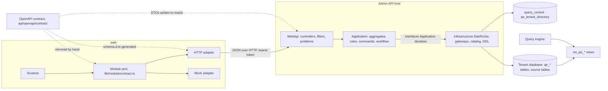
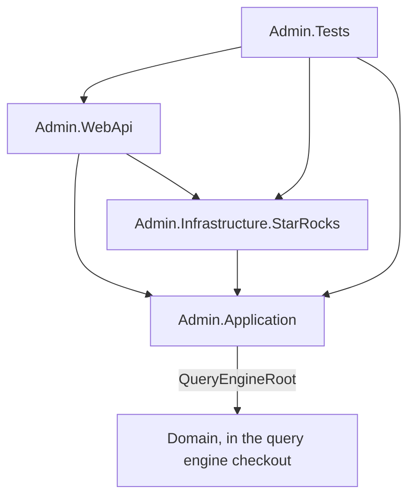

# High-level architecture

[Index](README.md) · [Request pipeline](02-request-pipeline.md) · [Core classes](03-core-classes.md) ·
[Version lifecycle](04-version-lifecycle.md) · [Feature classes](05-feature-classes.md) · [Key actions](06-key-actions.md)

## Layers

| Layer | Owns | Does not |
|---|---|---|
| WebApi | Routing, authentication, tenant access, binding, the 404 existence check, input validators, mapping refusals to problems | Hold business rules |
| Application | Read models, change-set aggregates and operations, snapshot rules, lifecycle commands, the version workflow, delete checks | Write SQL |
| Infrastructure.StarRocks | Table gateways, id generation, `information_schema` reads, managed-table and materialized-view DDL, tenant routing and verification | Hold rules |

Application reaches StarRocks only through interfaces it declares: `ITableGateway<TRecord>`, `IIdGenerator`,
`ISourceObjectCatalog`, `IManagedTables`, `IMaterializedViews`, `ITenantDatabaseVerifier` and `IConnectionStringMasker`.
A request to a tenant route reads the tenant's connection string from `query_control.qe_tenant_directory` and opens that
tenant's database. The engine loads metadata through the `vw_qe_*` views, caches it by tenant and
`qe_database_info.semantic_revision`, and reads dataset versions only through the active release.

## Projects

Names omit the common `Quantalytix.QueryEngine.` prefix. Arrows are project references.

Application references the engine's `Domain` project for `ExpressionParser`, so the API accepts exactly the expressions the
engine parses. The test project copies the seed kit's `ddl_srdb_bi_v2_27.sql` from `SeedKitRoot` and the two OpenAPI
documents into its output.

## The contract-first rule

1. The hand-authored contract in [`api/openapi/contract/`](../../openapi/contract/README.md) is the source of truth: a root
   `admin-api.yaml`, the shared kernel `common.yaml`, and one file per module (`tenant`, `datasets`, `dimensions`,
   `mappings`, `releases`, `models`, `reports`). `pnpm contract:bundle` composes and bundles them into `bundled.yaml`.
2. C# request and response types are written by hand to match the contract's schemas by name, property, type and
   nullability. No server code is generated.
3. The build generates `api/openapi/admin-api.json` from the C# code, with transformers that apply the API's conventions
   (string ids, derived 401/403/404 responses, union members; see [Request pipeline](02-request-pipeline.md#openapi-generation)).
4. `ContractConformanceTests` compares the two documents exactly: every contract operation must be generated and conform,
   and every generated operation must be in the contract. There is no allow-list.
5. `web` generates `src/lib/api/schema.d.ts` from the bundle with `pnpm contract:types`. Only HTTP adapters import it.

## Composition root

`Program.cs` registers the host services, then the layers and features, then builds the pipeline:

| Order | Call | Registers |
|---|---|---|
| 1 | `AddAdminAuthentication` | JWT bearer requiring signed, unexpired tokens, with `role` as the role claim and `AdminAuthenticationOptions` (the tenant claim type) |
| 2 | `AddDevelopmentTokens` (Development only) | `DevelopmentTokenIssuer`, whose key the bearer options trust |
| 3 | `AddAdminAuthorization` | The fallback policy (an authenticated user), `TenantAccess` and `SystemAdmin` |
| 4 | `AddAdminTenancy` | `ITenantContext` from the route's `tenantId` |
| 5 | `AddAdminControllers` | Controllers with `RouteResourceFilter` then `ValidationFilter`, JSON-only formatters, the JSON conventions, `BindingErrorResults` |
| 6 | `AddValidatorsFromAssemblyContaining` | Every FluentValidation validator in Application |
| 7 | `AddAdminOpenApi` | The OpenAPI document and its transformers |
| 8 | `AddAdminCors` | A default policy for `Cors:AllowedOrigins` |
| 9 | `AddHealthChecks` | `/health` |
| 10 | `AddAdminApplication` | The version stores, `VersionStoreRegistry`, `PublicationSet`, `VersionWorkflow`, a `PredecessorRetirer` per living kind, `SemanticRevision`, `LivingVersionFreezer` |
| 11 | `AddStarRocksInfrastructure` | Connections, `ITableGateway<>`, `IIdGenerator`, `TimeProvider` |
| 12 to 18 | `AddTenantFeature`, `AddDatasetsFeature`, `AddDimensionsFeature`, `AddMappingsAndBridgesFeature`, `AddBindingsAndMeasuresFeature`, `AddReleasesAndSystemFeature`, `AddCalculationModelsAndReportsFeature` | Each module's route resources, services, change-set aggregate, snapshot rules, publication rules, lifecycle handlers and copiers |

The middleware runs `UseExceptionHandler` and `UseStatusCodePages` (both write a `Problem`), then `UseCors`,
`UseAuthentication`, `UseAuthorization`, and maps OpenAPI, the controllers and `/health`. Services are scoped to the request.
Snapshot rules and lifecycle handlers run in registration order.

## Feature map

Paths after the first in a row are relative to `/api/tenants/{tenantId}`. Tenant routes require `TenantAccess`;
`/api/system/tenants` requires `SystemAdmin`.

| Module | Routes | Aggregate root of the change set |
|---|---|---|
| Session and tenants | `/api/me`, `/api/tenants`, `/api/vocabularies`, `catalog`, `dimensions/{id}/published-members`, `overview` | none |
| System tenants | `/api/system/tenants` | none |
| Source objects | `source-objects`, `source-objects/{kind}/{name}/columns` | none |
| Datasets | `datasets`, `datasets/{id}/versions`, `dataset-versions/{id}` with `changes`, `check`, `validate`, `publish`, `reopen`, `retire`, `fields/{id}/materialization` | dataset version (with its bindings and measures) |
| Dimensions | `dimensions`, `dimension-profiles`, `dimension-roles/{id}/delete-check`, `dimension-versions/{id}` with `check`, `freeze`, member and level delete checks | dimension with its live version |
| Mappings | `mapping-sets`, `mapping-versions/{id}` with `check`, `freeze` | mapping set with its live version |
| Bridges | `bridges`, `bridge-versions/{id}` with `check`, `freeze` | analytical bridge with its live version |
| Releases | `releases`, `releases/diff`, `releases/{id}` with `check`, `validate`, `publish`, `reopen`, `retire`, `activate`; `manifest-datasets`, `identities`, `report-reads` | draft release manifest |
| Assumption sets | `assumption-sets`, `assumption-sets/capture-preview`, `assumption-sets/compare` | none |
| Calculation models | `calculation-models`, `calculation-models/{id}/formula-check` | calculation model |
| Reports | `reports`, `reports/{id}/diagnostics`, `reports/{id}/sources/{sourceKey}/unmapped`, `reports/{id}/enabled` | report |

Every aggregate has `POST .../changes/preview` and `POST .../changes`. Datasets, dataset versions, dimensions, dimension
versions, mapping sets, mapping versions, bridges, bridge versions and calculation models have `GET .../delete-check` next
to their `DELETE`, and roles, members and levels have a delete check for the delete operation of their change set.
[Feature classes](05-feature-classes.md) describes each module.

## How web consumes the API

`web` keeps screens behind one port per module ([blueprint 02](../../../docs/blueprint/02-frontend-contract-layer.md)):

- `web/src/lib/<module>/contract.ts` declares the module's read models, inputs, operations and port interface, mirroring
  the contract's schemas by name. Screens depend only on the port and on the shared kernel `lib/api/contract.ts`.
- `lib/<module>/http/adapter.ts` implements the port over `HttpClient` (`lib/api/http.ts`), which resolves every call to an
  `ApiResult` and parses error bodies as `Problem`. It is the only code that imports `lib/api/schema.d.ts`.
- `lib/<module>/mock/adapter.ts` implements the same port in memory.
- `lib/<module>/client.tsx` picks the adapter with `apiMode` (`mock` or `http`, from `VITE_API_MODE`) in
  `lib/api/session.ts`, which also mints a development token.
- Edits are staged with `createHttpChangeSet` (`lib/api/changes.ts`): each edit appends an operation and posts all
  operations so far to `<aggregate>/changes/preview`; reads answer from the last preview's `state`; Save posts the same
  operations to `<aggregate>/changes`; discard is local. A refused edit is dropped and the `operations[n].` prefix is
  stripped from the problem's error keys.
- Each module has a parity suite, `lib/<module>/<module>-api.parity.test.ts`, that runs the same port-level tests on the
  mock adapter and, with `QE_LIVE_API=1`, on the HTTP adapter against a running API (`lib/api/live-http.ts`).
