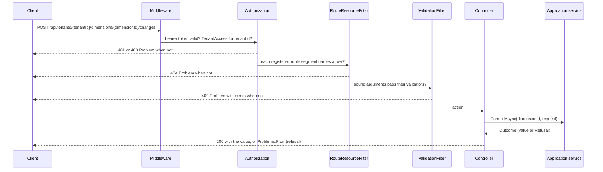

# Request pipeline

[Index](README.md) · [High-level architecture](01-architecture.md) · [Core classes](03-core-classes.md) ·
[Version lifecycle](04-version-lifecycle.md) · [Feature classes](05-feature-classes.md) · [Key actions](06-key-actions.md)

## A tenant request

1. **Exception handler and status code pages.** An unhandled exception answers a 500 `Problem` with `traceId`
   (`ProblemWriter.WriteInternalAsync`). A response that leaves with an error status and no body, such as a 401 from the
   authentication handler or a 404 for an unknown route, gets the title-only `Problem` of its status
   (`ProblemWriter.WriteStatusAsync`).
2. **CORS** admits the origins in `Cors:AllowedOrigins`.
3. **Authentication.** JWT bearer with `MapInboundClaims = false` and `role` as the role claim. `CallerFactory` reads the
   subject, the tenant (only when the token carries exactly one non-blank tenant claim) and the `SystemAdmin` role.
4. **Authorization.** The fallback policy requires an authenticated user everywhere except `/health` and the Development
   token endpoint. `TenantAccess` (every `/api/tenants/{tenantId}/...` controller) admits a system admin to every tenant
   and anyone else to the tenant their token names. `SystemAdmin` guards `/api/system/tenants`. There are no tenant-level
   roles.
5. **Tenant routing.** `RouteTenantContext` exposes the route's `tenantId` as `ITenantContext`; the StarRocks connection
   factory resolves it through `qe_tenant_directory`.
6. **Route existence (404).** `RouteResourceFilter` runs first among the global action filters. Each module registers the
   route segments it owns with `AddRouteResource<TRecord>(segment, filter)`, for example `dimension-versions` over
   `DimensionVersionRecord`. For every registered literal segment followed by a parameter in the route template, outermost
   first, the filter reads the row through the record's gateway and answers 404 when it is missing. Generic segments are
   scoped to their parent with the `(value, route) =>` overload: `members` and `levels` match within the route's dimension
   version, `fields` within the route's dataset version. A read that hides a row the table has (a report dimension in the
   dimensions module) returns null and the controller answers 404.
7. **Input validation (400).** Binding errors answer through `BindingErrorResults`, keyed by the JSON path of the value
   (`components[0].fieldId`; the body root is `''`). `ValidationFilter` then runs every registered FluentValidation
   validator of each bound argument; `JsonPropertyPaths` names properties by their camelCase path. Change-set operations are
   validated inside the pipeline instead, keyed under `operations[n]` ([Core classes](03-core-classes.md#the-change-set-pipeline)).
8. **Controller.** A controller calls one Application service and maps its `Outcome<T>` or `Refusal?` to a status:
   success to `200` (or `201` for creates, `204` for deletes), a refusal through `Problems.From(refusal)`.

## JSON conventions

`AdminControllersServiceCollectionExtensions.ConfigureJson` applies to MVC and to the OpenAPI schema generator:

- camelCase property names, `application/json` only (`text/json` and plain-text formatters are removed);
- numbers only as JSON numbers (`JsonNumberHandling.Strict`); nullable annotations enforced, so a non-nullable property
  refuses `null`; enums as camelCase strings, while vocabulary values are plain strings with the schema's snake_case values;
- **string ids.** `StringIds.Modify` gives every `long` property named `Id` or ending in `Id` a string converter, likewise
  `long?` ids, `IReadOnlyList<long>` properties ending in `Ids`, and `IReadOnlyDictionary<string, long>` properties ending
  in `IdMap` (a commit's `idMap`). Tables use `BIGINT` ids; the API reads and writes them as JSON strings. Routes use
  `{id:long}` constraints, so a non-numeric id never reaches an action;
- **union discriminators.** A change-set operation union is an abstract record with
  `[JsonPolymorphic(TypeDiscriminatorPropertyName = "op")]`. `AllowOutOfOrderMetadataProperties` lets `op` stand anywhere
  in the object, and `UnionDiscriminators` makes a missing `op` a 400 instead of a 500.

Ids that a change-set preview can show are `string` in the Application models, because a preview presents items it created
by their temporary ids (`tmp:<uuid>`); see [Temporary ids](03-core-classes.md#temporary-ids).

## The problem shape

Every error is `application/problem+json` with one body, `Problem` (`WebApi/Errors/Models/Problem.cs`), created only by the
`Problems` factory:

| Status | `type` (`urn:qe:problem:...`) | Body | Raised by |
|---|---|---|---|
| 400 | `invalid-input` | `errors`: input path to messages | Binding, `ValidationFilter`, an operation validator, `ChangeContext.Reject` |
| 401 | `unauthorized` | title only | No valid bearer token |
| 403 | `forbidden` | title only | No access to the route tenant, or `SystemAdmin` missing |
| 404 | `not-found` | title only | `RouteResourceFilter`, a hidden row, an unknown route |
| 409 | `conflict` | `detail` | A failed precondition: not a draft, not live, owned by a report, locked by a profile, key taken |
| 409 | `delete-blocked` | `detail` and `violations` (the blockers) | A delete whose `DeleteCheck` is not allowed |
| 422 | `rules-violated` | `violations` | A gate or commit rule in a change set, a failed validate, publish, freeze, enable or activate |
| 500 | `internal` | `traceId` | Unhandled exceptions |

`errors` is always present (empty unless 400); `detail`, `violations` and `traceId` are omitted when null. A violation is a
`RuleViolation` with a snake_case `code`, a display `message`, and an optional `target` (`area`, `itemId`, `itemKey`,
`filter`) that tells the client where to take the user. `Problems.From(Refusal)` maps the Application's four refusal kinds
(`Invalid`, `Conflict`, `DeleteBlocked`, `RulesViolated`) to 400, 409, 409 and 422.

Read-only rule checks (`POST .../check`) answer `200` with a `ValidationReport` and never write. `validate`, `publish` and
`freeze` answer `200` with the new state or `422` with the violations, writing nothing on a 422.

## OpenAPI generation

The build writes `api/openapi/admin-api.json` with `Microsoft.AspNetCore.OpenApi`. XML comments supply summaries and
`<response>` descriptions; controllers declare `[ProducesResponseType]` for exactly the statuses the contract lists.
Transformers registered in `AddAdminOpenApi` make the generated document follow the same conventions as the contract:

| Transformer | Effect |
|---|---|
| `AuthorizationResponsesTransformer` | Adds 401 to every non-anonymous operation and 403 to operations whose `[Authorize]` names a policy, mirroring the contract's `qe/authorization-responses` decorator. No controller or module file declares 401 or 403. |
| `NotFoundResponseTransformer` | Adds the 404 problem to every operation whose route names a registered route resource. A controller declares 404 by hand only for lookups outside the tables (profile keys, source objects, published members). |
| `StringIdParameterTransformer`, `StringIdSchemaTransformer` | Types id parameters and properties as strings. |
| `UnionMemberSchemaTransformer` | Types each operation of a union as an object that requires `op`. |
| `OmittedWhenNullSchemaTransformer` | Makes a property with `JsonIgnoreCondition.WhenWritingNull` optional and non-nullable. |
| `ScalarValueSchemaTransformer` | Types `JsonElement` values (band bounds, parameter values) as number or string. |
| `FilterNodeSchemaTransformer` | Describes the report filter unions the generator cannot derive. |
| `VocabulariesSchemaTransformer` | Describes the `Vocabularies` answer by its members. |
| `CamelCaseParameterNamesTransformer`, `RequestBodyDescriptionTransformer`, `BearerSecuritySchemeTransformer` | Parameter casing, no guessed body descriptions, the bearer scheme. |

`ContractConformanceTests` then compares this document with the bundled contract ([Core classes](03-core-classes.md#contract-conformance)).

## Vocabularies

`GET /api/vocabularies` returns every controlled vocabulary the UI renders, each term with `value`, `label` and optional
`description`, plus vocabulary relationships such as `componentRolesByKind`. `VocabularyCatalog` builds the list by
discovery: every public static field of type `Vocabulary` in the Application assembly is a vocabulary, and every concrete
`IVocabularyRelation` is a relationship. A module adds one by declaring it in its own folder (for example
`VersionKinds.Definition` in `Vocabulary/Values`, or `Tenancy/Vocabularies/ComponentRolesByKind`); nothing is listed
centrally. Values a module's contract enumerates but the endpoint does not serve are plain constants in the module's
`Values` folder, because a new discovered vocabulary changes the `Vocabularies` schema in the contract.

## Development sign-in

In Development, `POST /development/token` (`[AllowAnonymous]`) issues an eight-hour token for any tenant, signed by an
in-memory key the bearer options trust. `DevelopmentControllerFeatureProvider` removes the controller outside Development,
so it is absent from the generated document and from the contract. `GET /api/me` returns the caller's session (subject,
display name, tenant, system-admin flag) and `GET /api/tenants` the tenants the caller may open.
