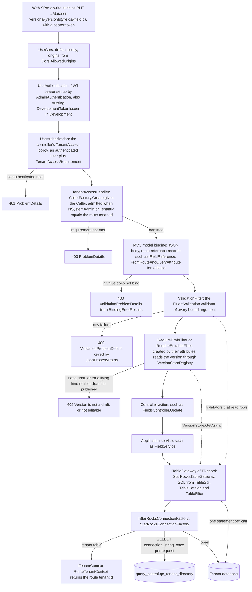
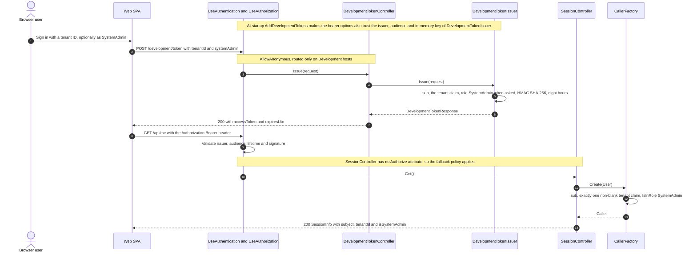
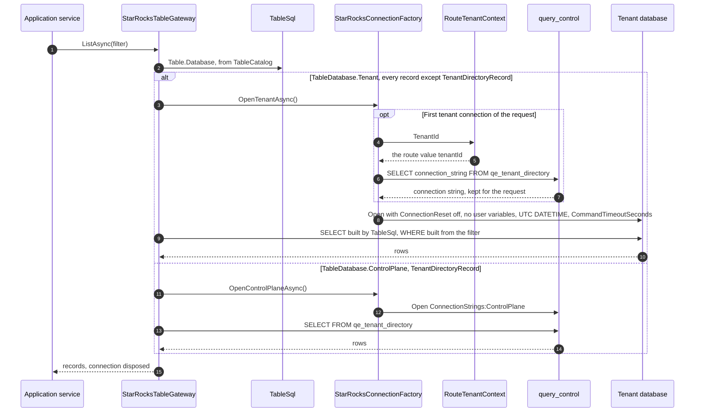

# Request pipeline

[Diagram index](README.md) · [Architecture](01-architecture.md) · [Core classes](03-core-classes.md) · [Version lifecycle](04-version-lifecycle.md) · [Feature classes](05-feature-classes.md) · [Key actions](06-key-actions.md)

## A tenant-scoped write

The drawing follows one write, such as `PUT /api/tenants/{tenantId}/dataset-versions/{versionId}/fields/{fieldId}`, from the browser to the tenant database. Each gate answers with its own error before anything is written, so a request that reaches a service is authenticated, admitted to its tenant, well-formed and, where the action carries `[RequireDraft]`, aimed at a draft.

`UseExceptionHandler` and `UseStatusCodePages` wrap every step, so an unhandled exception and an empty 401 or 403 both leave as problem details. Controllers under `api/tenants/{tenantId}` carry `[Authorize(Policy = AdminPolicies.TenantAccess)]`; endpoints without an `[Authorize]`, such as `GET /api/me`, get the fallback policy instead, which asks only for an authenticated user. `CallerFactory` trusts the tenant claim (`tenant_id` by default) only when the token carries exactly one non-blank value.

Binding errors come first: `[ApiController]` answers invalid model state with `BindingErrorResults.Create`, which keys each error by its JSON path without the `$.` root. JSON input is strict: numbers must be JSON numbers and non-nullable properties reject null. The global `ValidationFilter` then runs the validator registered for each argument, including route reference records such as `FieldReference`, which check that the child row belongs to the version in the route. Global filters run before action filters, so validation precedes the draft and editable checks. After a successful write to the published version of a living kind, `RequireEditableFilter` advances the semantic revision, because the edit is live. Validators and the two filters read rows through the same gateways the service writes with. `StarRocksTableGateway` opens one connection per call and runs one statement, or one `INSERT` per 500 rows, because StarRocks rejects `UPDATE` and `DELETE` inside transactions.

**Sources:** [Program.cs](../../src/Quantalytix.QueryEngine.Admin.Api/Program.cs), [AdminAuthentication.cs](../../src/Quantalytix.QueryEngine.Admin.Api/Authentication/AdminAuthentication.cs), [DevelopmentTokenExtensions.cs](../../src/Quantalytix.QueryEngine.Admin.Api/Development/DevelopmentTokenExtensions.cs), [AdminAuthorization.cs](../../src/Quantalytix.QueryEngine.Admin.Api/Authorization/AdminAuthorization.cs), [TenantAccessHandler.cs](../../src/Quantalytix.QueryEngine.Admin.Api/Authorization/TenantAccessHandler.cs), [CallerFactory.cs](../../src/Quantalytix.QueryEngine.Admin.Api/Authorization/CallerFactory.cs), [AdminControllersServiceCollectionExtensions.cs](../../src/Quantalytix.QueryEngine.Admin.Api/Configuration/AdminControllersServiceCollectionExtensions.cs), [FromRouteAndQueryAttribute.cs](../../src/Quantalytix.QueryEngine.Admin.Api/Binding/FromRouteAndQueryAttribute.cs), [BindingErrorResults.cs](../../src/Quantalytix.QueryEngine.Admin.Api/Errors/BindingErrorResults.cs), [ValidationFilter.cs](../../src/Quantalytix.QueryEngine.Admin.Api/Errors/ValidationFilter.cs), [JsonPropertyPaths.cs](../../src/Quantalytix.QueryEngine.Admin.Api/Errors/JsonPropertyPaths.cs), [RequireDraftAttribute.cs](../../src/Quantalytix.QueryEngine.Admin.Api/Versioning/RequireDraftAttribute.cs), [RequireDraftFilter.cs](../../src/Quantalytix.QueryEngine.Admin.Api/Versioning/RequireDraftFilter.cs), [FieldsController.cs](../../src/Quantalytix.QueryEngine.Admin.Api/Datasets/FieldsController.cs), [FieldReferenceValidator.cs](../../src/Quantalytix.QueryEngine.Admin.Application/Datasets/FieldReferenceValidator.cs), [VersionStoreRegistry.cs](../../src/Quantalytix.QueryEngine.Admin.Application/Versioning/VersionStoreRegistry.cs), [StarRocksTableGateway.cs](../../src/Quantalytix.QueryEngine.Admin.Infrastructure.StarRocks/Tables/StarRocksTableGateway.cs), [StarRocksConnectionFactory.cs](../../src/Quantalytix.QueryEngine.Admin.Infrastructure.StarRocks/Connections/StarRocksConnectionFactory.cs), [RouteTenantContext.cs](../../src/Quantalytix.QueryEngine.Admin.Api/Tenancy/RouteTenantContext.cs).

## Development sign-in and the session

The drawing shows how the web SPA gets a token on a Development host and then asks who it is. It matters because `POST /development/token` is the only way to sign in without an identity provider, and it exists only in Development.

Outside Development, `AddDevelopmentTokens` is not called and `DevelopmentControllerFeatureProvider` removes every controller in the Development namespace, so `/development/token` is not routed. The signing key lives in process memory, so development tokens stop validating when the host restarts. Tokens from an identity provider or `dotnet user-jwts` validate through the configured `Authentication:Schemes:Bearer` settings, because `DevelopmentTokenIssuer.Trust` appends to the issuers, audiences and keys rather than replacing them.

**Sources:** [DevelopmentTokenController.cs](../../src/Quantalytix.QueryEngine.Admin.Api/Development/DevelopmentTokenController.cs), [DevelopmentTokenIssuer.cs](../../src/Quantalytix.QueryEngine.Admin.Api/Development/DevelopmentTokenIssuer.cs), [DevelopmentTokenExtensions.cs](../../src/Quantalytix.QueryEngine.Admin.Api/Development/DevelopmentTokenExtensions.cs), [DevelopmentControllerFeatureProvider.cs](../../src/Quantalytix.QueryEngine.Admin.Api/Development/DevelopmentControllerFeatureProvider.cs), [SessionController.cs](../../src/Quantalytix.QueryEngine.Admin.Api/Session/SessionController.cs), [SessionInfo.cs](../../src/Quantalytix.QueryEngine.Admin.Api/Session/Models/SessionInfo.cs), [CallerFactory.cs](../../src/Quantalytix.QueryEngine.Admin.Api/Authorization/CallerFactory.cs), [AdminAuthentication.cs](../../src/Quantalytix.QueryEngine.Admin.Api/Authentication/AdminAuthentication.cs), [AdminAuthenticationOptions.cs](../../src/Quantalytix.QueryEngine.Admin.Api/Authentication/Models/AdminAuthenticationOptions.cs), [Program.cs](../../src/Quantalytix.QueryEngine.Admin.Api/Program.cs).

## Tenant routing

The drawing shows how a table gateway picks its database. `TableDefinition.Database` from `TableCatalog` decides: every record but one lives in the tenant's database, reached through the control plane, and `TenantDirectoryRecord` lives in the control plane itself.

`RouteTenantContext` only returns the route's `tenantId`; the `TenantAccess` policy has already admitted the caller to it. `StarRocksConnectionFactory` is scoped, so the tenant's connection string is read at most once per request and every later tenant connection reuses it. A filter whose collection property is empty matches nothing, so `ListAsync` returns an empty list and `DeleteAsync` returns without opening a connection. `SourceObjectCatalog` and `SchemaChangeExecutor` open tenant connections the same way; `TenantDatabaseVerifier` uses `OpenAsync` on a candidate connection string instead.

**Sources:** [StarRocksTableGateway.cs](../../src/Quantalytix.QueryEngine.Admin.Infrastructure.StarRocks/Tables/StarRocksTableGateway.cs), [TableSql.cs](../../src/Quantalytix.QueryEngine.Admin.Infrastructure.StarRocks/Tables/TableSql.cs), [TableCatalog.cs](../../src/Quantalytix.QueryEngine.Admin.Infrastructure.StarRocks/Tables/TableCatalog.cs), [TableFilter.cs](../../src/Quantalytix.QueryEngine.Admin.Infrastructure.StarRocks/Tables/TableFilter.cs), [TableDefinition.cs](../../src/Quantalytix.QueryEngine.Admin.Infrastructure.StarRocks/Tables/Models/TableDefinition.cs), [TableDatabase.cs](../../src/Quantalytix.QueryEngine.Admin.Infrastructure.StarRocks/Tables/Enums/TableDatabase.cs), [StarRocksConnectionFactory.cs](../../src/Quantalytix.QueryEngine.Admin.Infrastructure.StarRocks/Connections/StarRocksConnectionFactory.cs), [StarRocksOptions.cs](../../src/Quantalytix.QueryEngine.Admin.Infrastructure.StarRocks/Connections/Models/StarRocksOptions.cs), [RouteTenantContext.cs](../../src/Quantalytix.QueryEngine.Admin.Api/Tenancy/RouteTenantContext.cs), [ITenantContext.cs](../../src/Quantalytix.QueryEngine.Admin.Application/Tenancy/ITenantContext.cs), [SourceObjectCatalog.cs](../../src/Quantalytix.QueryEngine.Admin.Infrastructure.StarRocks/SourceObjects/SourceObjectCatalog.cs), [SchemaChangeExecutor.cs](../../src/Quantalytix.QueryEngine.Admin.Infrastructure.StarRocks/SchemaChanges/SchemaChangeExecutor.cs), [TenantDatabaseVerifier.cs](../../src/Quantalytix.QueryEngine.Admin.Infrastructure.StarRocks/TenantVerification/TenantDatabaseVerifier.cs).

## Error responses

The table lists every error shape the API answers with, who raises it and when. All are `application/problem+json`; per-endpoint status codes are in the [OpenAPI document](../../openapi/admin-api.json).

| Status | Body | Raised by | When |
| --- | --- | --- | --- |
| 400 | `ValidationProblemDetails` | `BindingErrorResults.Create`, MVC's automatic answer to invalid model state | A body, route or query value does not bind; errors are keyed by JSON path without the `$.` root |
| 400 | `ValidationProblemDetails` | `ValidationFilter` | A FluentValidation validator rejects an argument; errors are keyed by the camelCase path `JsonPropertyPaths` resolves, such as `components[0].fieldId` |
| 401 | `ProblemDetails` written by `UseStatusCodePages` | The JWT bearer challenge | The request has no valid bearer token |
| 403 | `ProblemDetails` written by `UseStatusCodePages` | The `TenantAccess` policy, through `TenantAccessHandler`, or the `SystemAdmin` policy | The token names another tenant and lacks the SystemAdmin role, or a caller without it reaches `api/system/tenants` |
| 409 | `ProblemDetails` titled "Transition not allowed" | `VersionStatusController` | `TransitionOutcome.NotAllowed`: `VersionTransitions` has no edge from the current status to the target |
| 409 | `ProblemDetails` titled "Version is not a draft" | `RequireDraftFilter` | An action marked `[RequireDraft]`, a write to a dataset version or release or any version delete, targets a version that is not a draft |
| 409 | `ProblemDetails` titled "Version is not editable" | `RequireEditableFilter` | An action marked `[RequireEditable]`, a write to a living kind's content, targets a version that is neither a draft nor published |
| 409 | `ProblemDetails` titled "Owned by a report" (`RequireAnalyticalFilter.Title`) | `RequireAnalyticalFilter` | An action marked `[RequireAnalytical]`, a generic write to a dimension, bridge or one of their versions, targets one a report owns; the detail names the report, whose editor alone changes it |
| 409 | `ProblemDetails` titled "Delete blocked" (`DeleteBlockedProblem.Title`) | The delete actions of 15 controllers | Other rows still reference the target; the detail is `DeleteBlockers.Detail()`, which names them |
| 409 | `ProblemDetails` titled "Release is not published" | `ReleasesController.Activate` | `ReleaseActivator` refused a release that is not published; nothing changed |
| 409 | `ProblemDetails` titled "Field cannot be materialized" | `FieldsController.Materialize` | The field is not a `json_path` field, the source object is a view, or the table already has the column |
| 409 | `ProblemDetails` titled "Materialized column refused" | `FieldsController.SetMaterializedColumn` | The field reads a column directly, or the source object has no such column |
| 422 | `RuleViolationProblemDetails` titled "The change breaks metadata rules", with `violations` | `RuleViolationResults.Create`, from `VersionStatusController` | `TransitionOutcome.Rejected`: publication or retirement rules reported violations, each with a snake_case `rule` and a `message` |
| 422 | `RuleViolationProblemDetails`, with `violations` | `ReportWriteResults`, through `RuleViolationResults.Create`, from the report controllers | Enabling a report that breaks the report rules, which leaves it disabled, or a write that would make an enabled report break them, which writes nothing |
| 422 | `RuleViolationProblemDetails`, with `violations` | `ModelWriteResults`, through `RuleViolationResults.Create`, from `CalculationModelsController`, `VariablesController`, `CalculatedMeasuresController` and `MetricAttributionsController` | A write to a model, its metrics or their attributions that would break one of its formulas or attributions or an enabled report over it, which writes nothing |
| 422 | `RuleViolationProblemDetails`, with `violations` | `DimensionWriteResults`, through `RuleViolationResults.Create`, from `DimensionMembersController` | A member update or move in a published dimension version that would leave a key a live object needs unresolved, such as a scenario a report's default comparison reads, which writes nothing |
| 500 | `ProblemDetails` | `UseExceptionHandler` | An unhandled exception, such as a schema change StarRocks cancelled or a key that names no row |

The 15 controllers that answer "Delete blocked" are `DatasetsController`, `DatasetVersionsController`, `FieldsController`, `GrainsController`, `DimensionsController`, `DimensionRolesController`, `DimensionLevelsController`, `DimensionMembersController`, `MappingSetsController`, `BridgesController`, `BindingsController`, `MeasuresController`, `AssumptionSetsController`, `CalculationModelsController` and `SourceProfilesController`. A report's delete is never blocked: it removes everything the report owns. A variable or calculated measure that a formula or an enabled report reads is kept by the model gate's 422 instead. Deleting a draft version of a living kind is never blocked, because nothing names a draft. No action answers 404; only a path that matches no route, such as a non-numeric ID under a `:long` constraint, gets routing's 404. Reference validators answer 400 when a child ID in the route is not in the route's version; any other ID that names no row surfaces as a 500 when a service or `RequireDraftFilter` reads it.

**Sources:** [BindingErrorResults.cs](../../src/Quantalytix.QueryEngine.Admin.Api/Errors/BindingErrorResults.cs), [ValidationFilter.cs](../../src/Quantalytix.QueryEngine.Admin.Api/Errors/ValidationFilter.cs), [JsonPropertyPaths.cs](../../src/Quantalytix.QueryEngine.Admin.Api/Errors/JsonPropertyPaths.cs), [AdminAuthorization.cs](../../src/Quantalytix.QueryEngine.Admin.Api/Authorization/AdminAuthorization.cs), [TenantAccessHandler.cs](../../src/Quantalytix.QueryEngine.Admin.Api/Authorization/TenantAccessHandler.cs), [VersionStatusController.cs](../../src/Quantalytix.QueryEngine.Admin.Api/Versioning/VersionStatusController.cs), [RequireDraftFilter.cs](../../src/Quantalytix.QueryEngine.Admin.Api/Versioning/RequireDraftFilter.cs), [DeleteBlockedProblem.cs](../../src/Quantalytix.QueryEngine.Admin.Api/Errors/DeleteBlockedProblem.cs), [DeleteBlockers.cs](../../src/Quantalytix.QueryEngine.Admin.Application/Metadata/DeleteBlockers.cs), [ReleasesController.cs](../../src/Quantalytix.QueryEngine.Admin.Api/Releases/ReleasesController.cs), [FieldsController.cs](../../src/Quantalytix.QueryEngine.Admin.Api/Datasets/FieldsController.cs), [RuleViolationResults.cs](../../src/Quantalytix.QueryEngine.Admin.Api/Errors/RuleViolationResults.cs), [RuleViolationProblemDetails.cs](../../src/Quantalytix.QueryEngine.Admin.Api/Errors/Models/RuleViolationProblemDetails.cs), [RuleViolation.cs](../../src/Quantalytix.QueryEngine.Admin.Application/Versioning/Models/RuleViolation.cs), [SchemaChangeExecutor.cs](../../src/Quantalytix.QueryEngine.Admin.Infrastructure.StarRocks/SchemaChanges/SchemaChangeExecutor.cs), [Program.cs](../../src/Quantalytix.QueryEngine.Admin.Api/Program.cs), [RequireAnalyticalFilter.cs](../../src/Quantalytix.QueryEngine.Admin.Api/Reports/RequireAnalyticalFilter.cs), [ReportWriteResults.cs](../../src/Quantalytix.QueryEngine.Admin.Api/Reports/ReportWriteResults.cs), [ModelWriteResults.cs](../../src/Quantalytix.QueryEngine.Admin.Api/CalculationModels/ModelWriteResults.cs).
