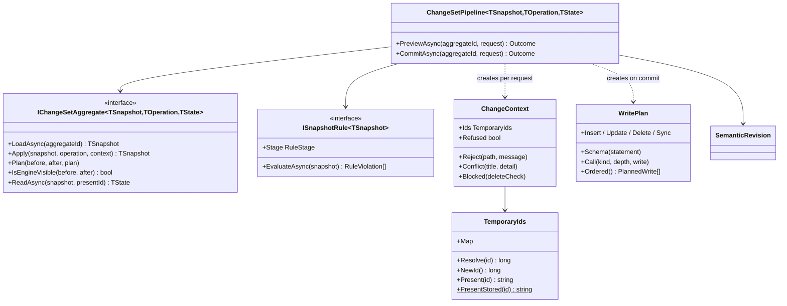

# Core classes

[Index](README.md) · [High-level architecture](01-architecture.md) · [Request pipeline](02-request-pipeline.md) ·
[Version lifecycle](04-version-lifecycle.md) · [Feature classes](05-feature-classes.md) · [Key actions](06-key-actions.md)

The shared machinery lives in `Application/Changes` (change sets), `Application/Metadata` (records, gateways, delete
checks) and `Application/Versioning` (lifecycle, described in [Version lifecycle](04-version-lifecycle.md)).

## The change-set pipeline

Every editable aggregate (a dataset version, a dimension, a mapping set, an analytical bridge, a draft release, a
calculation model, a report) is edited through one protocol ([blueprint 01](../../../docs/blueprint/01-api-conventions.md#change-set-protocol-agreed-oi-01)).
The client holds the pending operations and posts all of them on every edit:

- `POST <aggregate>/changes/preview` with `{ operations }` answers `200 { state, violations }` or a problem, and writes
  nothing.
- `POST <aggregate>/changes` with the same body applies the operations to the aggregate as stored now, writes the result,
  and answers `200 { state, idMap }` or a problem with nothing written.

Some aggregates extend the preview envelope: the report preview adds the pending report's diagnostics, and the release
preview adds the rules' report over the pending manifest and its difference from the active release.

A module implements `IChangeSetAggregate` over an immutable **snapshot**: records of every row the aggregate owns, plus
a `Surroundings` record of everything outside it that operations, rules and read models consult (usage, other keys,
sibling versions). A snapshot loader reads it once per request, because operations are synchronous and cannot read. The
module registers the aggregate with `AddChangeSetAggregate<TAggregate, TSnapshot, TOperation, TState>()`, which also
registers `ChangeSetPipeline<…>`, and its rules with `AddSnapshotRule<TSnapshot, TRule>()`. A small service per module
(`DimensionChanges`, `BridgeChanges`, `ReleaseChanges`, …) wraps the pipeline for refusals that apply before any operation
(a report-owned dimension or bridge, a release that is not a draft) and for envelope extensions.

**Preview** (`PreviewAsync`):

1. Load the snapshot.
2. For each operation in order: run its validators (`IValidator<TOperation>`); a failure refuses with 400 and the error
   keys prefixed `operations[n]`. Then `Apply` it in memory. An operation that cannot apply calls
   `context.Reject(path, message)` (400), `context.Conflict(title, detail)` (409) or `context.Blocked(deleteCheck)`
   (409 with the coded blockers), and the pipeline stops.
3. Run the `Gate` rules on the result; any violation refuses with 422.
4. Answer `ReadAsync(after, ids.Present)` as `state`, and the `Publication` and `Commit` rule violations as `violations`.

**Commit** (`CommitAsync`) repeats steps 1 to 3 on the aggregate as stored at commit time, then:

5. Runs the `Commit` rules; any violation refuses with 422.
6. Calls `Plan(before, after, plan)` and executes `plan.Ordered()`.
7. Advances `qe_database_info.semantic_revision` once when `IsEngineVisible(before, after)` is true.
8. Reloads the aggregate and answers it with stored ids as `state`, plus `idMap` from temporary to real ids.

Concurrency is last write wins: there is no revision token, so a commit replays the operations onto whatever is stored, and
an operation whose target another author deleted fails with the usual 400, 409 or 422.

### Rule stages

`ISnapshotRule<TSnapshot>.Stage` decides when a rule's violations block:

| Stage | Preview | Commit | Validate, publish, freeze | Used for |
|---|---|---|---|---|
| `Gate` | refused with 422 | refused with 422 | blocks | What the engine would read as saved: member and level key uniqueness, parents and levels in the version, hierarchy acyclic, consumers resolve, profile-required keys (dimensions); the report gate; the model gate; manifest pins that must resolve (releases) |
| `Publication` | reported in `violations` | allowed | blocks | Findings that matter only for leaving draft, freezing or enabling: every dataset rule, band and property rules of dimensions, findings of a disabled report, model findings |
| `Commit` | reported in `violations` | refused with 422 | blocks | Content that is live as soon as it is saved: every mapping set rule (`MappingRule`) and analytical bridge rule (`BridgeRule`) |

Releases register only `ReleaseGateRule` as a snapshot rule; it runs the `Gate`-stage release rules (`IReleaseRule`), and
`ReleaseChanges` adds the full release rules' report to the preview itself. Rules run in registration order. A rule targets the offending item with its stored id; the pipeline rewrites ids of items
the change set created to their temporary ids, so findings match the preview's `state`. To run the same rules on stored
versions, each module also registers one `IPublicationRule` (`DatasetVersionRules`, `DimensionVersionRules`,
`MappingVersionRules`, `BridgeVersionRules`, `ReleaseVersionRules`) that loads the stored snapshot and runs its rules; the
version workflow and `LivingVersionFreezer` call it.

### The write plan

StarRocks rejects `UPDATE` and `DELETE` inside transactions, so a commit has no transaction. `WritePlan` collects every write
first and orders them so a commit that stops midway leaves a harmless residue:

1. **Schema statements** (`plan.Schema(statement)`): DDL such as a managed table's new columns or a materialized view's
   redefinition. DDL cannot be rolled back, and rows that depend on it must not be stored without it. Modules derive DDL
   from the before and after snapshots, so a replay after a partial commit plans none.
2. **Child deletes**, deepest first.
3. **Child updates**, shallowest first.
4. **Child inserts**, shallowest first.
5. **The root row's writes** (depth `WritePlan.Root`, 0) last: deletes, updates, then inserts.

Writes at the same depth and kind keep the order they were added. `plan.Sync(gateway, depth, before, after, keyOf)` compares
one table's stored and changed rows by key and adds a delete per row gone, an update per row changed and one multi-row
insert of the new rows. Derived rows (the dimension closure) are deleted and re-inserted at the deepest depth when their
source rows change. `plan.Call(kind, depth, write)` adds a write that is not one gateway call, such as another module's
public service, and places it where a row write of that kind and depth would run. The report commit uses it for report
bridges through `ReportBridges` ([Key actions](06-key-actions.md#report-commit-with-report-bridges)).

### Temporary ids

Items created inside a change set carry client ids of the form `tmp:<uuid>`; later operations may reference them.
`context.Ids.Resolve(id)` turns a stored id (decimal digits) into its `long`, and a temporary id into a real id allocated on
first use; `context.Ids.NewId()` allocates for an item an input creates without an id. A preview presents created items by
their temporary ids (`TemporaryIds.Present`), because the real ids it allocated are discarded and the next preview must find
the items by the same names; the commit presents stored ids (`TemporaryIds.PresentStored`) and returns the `idMap`. For this
reason every id a preview's read model can carry is a `string` in the Application models. The report, model and release change sets
allocate no temporary ids, so their read models carry stored ids only.

### Outcomes and refusals

Services return `Outcome<T>` (a value or a `Refusal`) or `Refusal?` for commands without a value. `Refusal` has four kinds:
`Invalid` (errors by input path), `Conflict` (title and detail), `DeleteBlocked` (the blockers and their sentence) and
`RulesViolated` (violations). The WebApi maps them with `Problems.From` ([Request pipeline](02-request-pipeline.md#the-problem-shape)).
Lifecycle commands (create, delete, validate, publish, reopen, retire, freeze, activate, enable, capture) are services on
stored state and are never staged; the client blocks them while a change set is open.

## Delete checks

`GET <resource>/delete-check` returns a `DeleteCheck` (`allowed`, a one-sentence `message`, and `reasons`) and never writes.
`DELETE <resource>` runs the same check and answers 409 `delete-blocked` with the same reasons as `violations` when it is not
allowed. Each module has one pure delete-rules class over its snapshot (`DatasetDeleteRules`, `DimensionDeleteRules`,
`MappingDeleteRules`, `BridgeDeleteRules`, `ModelDeleteRules`) that both paths share, and deletes inside a change set
(members, levels, roles) use the same class through `context.Blocked`.

`DeleteBlockers(subject)` collects coded reasons and builds the check: `Add(code, reason)` adds one, and
`AddNamed(code, label, names)` adds one naming up to ten blocking objects. Codes come from `DeleteBlockerCodes`, which
mirrors the contract's `DeleteBlockerCode`: state codes (`not_removable`, `system_dimension`, `published_version`,
`live_version`, `has_published_versions`, `has_children`, `required_by_profile`, `assigned_by_bands`, `named_by_consumers`,
`owned_by_report`) and usage codes `referenced_by_<usage>` (`member`, `dataset_binding`, `mapping_set`, `bridge`,
`calculation_dimension`, `report_scenario`, `report_source`, `assumption_set`, `release`, `report`). A historical assumption
set's pin blocks a delete; the active set's pin goes with the deleted identity (`AssumptionPins.Unpin…`).

## Table gateways and infrastructure

`ITableGateway<TRecord>` is the only way Application touches a table: `ListAsync(filter)`, `GetAsync(key)`, `InsertAsync`,
`InsertManyAsync` (one statement per 500 rows), `UpdateAsync` and `DeleteAsync(filter)` (a filter is required). Filters are
anonymous objects of record property values. `StarRocksTableGateway<TRecord>` implements it from `TableCatalog`, which maps
each record (`Application/Metadata/Models`) to its table, key and JSON columns, and to the control-plane or tenant database.
Each call opens its own connection and runs one statement; an insert into a primary-key table is an upsert.

Other Infrastructure seams: `IdGenerator` allocates random ids in [1, 2^53); `SourceObjectCatalog` reads
`information_schema` (objects, columns, statistics, a field's distinct values, briefly cached in `SourceReadCache`);
`StarRocksManagedTables` runs managed-table DDL and waits for `ALTER TABLE ... ADD COLUMN` jobs; `StarRocksMaterializedViews`
manages the asynchronous materialized views of JSON path fields; `TenantDatabaseVerifier` probes a candidate connection
string; `StarRocksConnectionFactory` resolves the request tenant's connection through the control plane once per request.

## Tenant schema check

The API reads and writes tenant metadata schema 2.27.0, which records metadata schema version 18 in `qe_database_info`.
`TenantConnectionVerification` (run by the create and update validators of `/api/system/tenants` and by
`POST /api/system/tenants/verify`) refuses a
connection string whose database names another tenant, has a `metadata_schema_version` other than
`SupportedSchemaVersion = 18`, or does not have exactly one active assumption set.

## Contract conformance

`ContractConformanceTests` (`api/tests/.../Contract`) loads the bundled contract (`bundled.yaml`) and the generated
document (`admin-api.json`) from the test output and matches operations by method and path, ignoring parameter names:

- `ContractOperations_AreGeneratedAndConform`: every contract operation exists in the generated document, and
  `OpenApiShapes.Differences` finds no difference in status codes or body schemas (property names, types, nullability,
  union members).
- `GeneratedOperations_AreInTheContract`: every generated operation exists in the contract.

There is no allow-list in either direction, so the API implements exactly the contract. Other tests use
`Support/InMemoryTableGateway` and `FixedTenantContext` to run services and pipelines without a database; the live tests
(`QE_ADMIN_LIVE_GATEWAY=true`, `Support/LiveTenant`) run the real registrations against tenant `development`.
