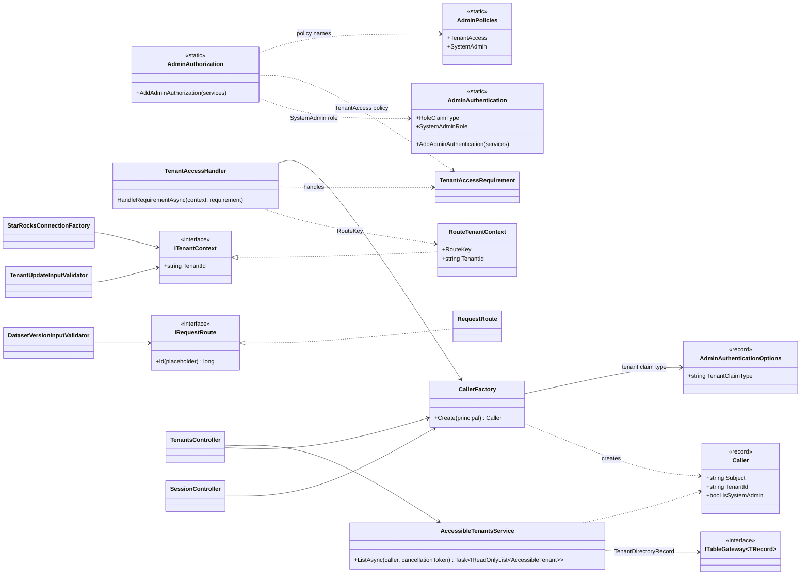
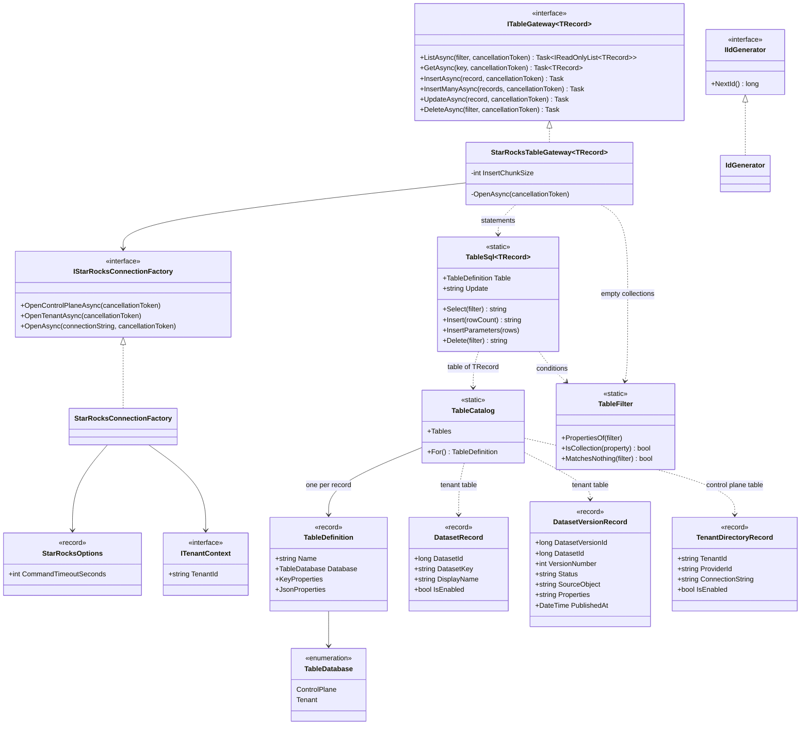
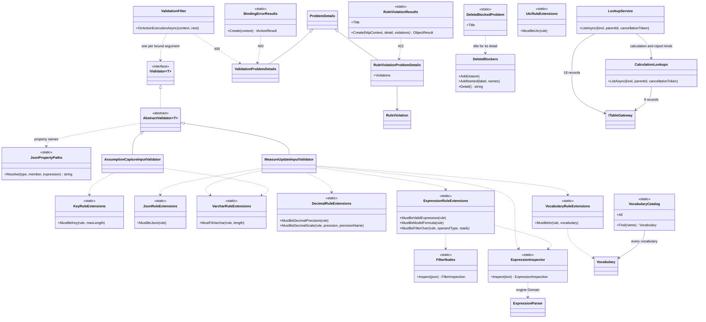

# Core classes

[Diagram index](README.md) · [Architecture](01-architecture.md) · [Request pipeline](02-request-pipeline.md) · [Version lifecycle](04-version-lifecycle.md) · [Feature classes](05-feature-classes.md) · [Key actions](06-key-actions.md)

## Authentication and tenancy

The drawing shows how a validated token becomes a `Caller`, how the `TenantAccess` policy admits that caller to the route's tenant, and how the route's values reach Application code. It matters because every tenant-scoped read and write trusts these classes for its tenant.

`CallerFactory` reads `sub` as `Subject`, the claim `AdminAuthenticationOptions.TenantClaimType` names (`tenant_id` by default) as `TenantId` only when the token carries exactly one non-blank value, and the `SystemAdmin` role through the `role` claim. `TenantAccessHandler` succeeds when the caller is a SystemAdmin or its `TenantId` equals the route's `tenantId` by ordinal comparison; the `SystemAdmin` policy only requires the role. `RouteTenantContext` and `RequestRoute` are scoped and read the current request's route values: `StarRocksConnectionFactory` routes tenant connections by `ITenantContext.TenantId`, and `TenantUpdateInputValidator` reads it as the edited tenant. `IRequestRoute.Id` lets an input validator compare a body value with the route; `DatasetVersionInputValidator`, `NewDimensionVersionInputValidator`, `NewMappingVersionInputValidator` and `NewBridgeVersionInputValidator` use it to check that a clone source belongs to the route's owner. `AccessibleTenantsService` lists every directory row for a SystemAdmin and only the caller's own otherwise, never with connection strings.

**Sources:** [AdminAuthentication.cs](../../src/Quantalytix.QueryEngine.Admin.Api/Authentication/AdminAuthentication.cs), [AdminAuthenticationOptions.cs](../../src/Quantalytix.QueryEngine.Admin.Api/Authentication/Models/AdminAuthenticationOptions.cs), [AdminAuthorization.cs](../../src/Quantalytix.QueryEngine.Admin.Api/Authorization/AdminAuthorization.cs), [AdminPolicies.cs](../../src/Quantalytix.QueryEngine.Admin.Api/Authorization/AdminPolicies.cs), [CallerFactory.cs](../../src/Quantalytix.QueryEngine.Admin.Api/Authorization/CallerFactory.cs), [TenantAccessHandler.cs](../../src/Quantalytix.QueryEngine.Admin.Api/Authorization/TenantAccessHandler.cs), [TenantAccessRequirement.cs](../../src/Quantalytix.QueryEngine.Admin.Api/Authorization/TenantAccessRequirement.cs), [Caller.cs](../../src/Quantalytix.QueryEngine.Admin.Application/Tenancy/Models/Caller.cs), [ITenantContext.cs](../../src/Quantalytix.QueryEngine.Admin.Application/Tenancy/ITenantContext.cs), [RouteTenantContext.cs](../../src/Quantalytix.QueryEngine.Admin.Api/Tenancy/RouteTenantContext.cs), [IRequestRoute.cs](../../src/Quantalytix.QueryEngine.Admin.Application/Tenancy/IRequestRoute.cs), [RequestRoute.cs](../../src/Quantalytix.QueryEngine.Admin.Api/Tenancy/RequestRoute.cs), [AdminTenancyServiceCollectionExtensions.cs](../../src/Quantalytix.QueryEngine.Admin.Api/Configuration/AdminTenancyServiceCollectionExtensions.cs), [AccessibleTenantsService.cs](../../src/Quantalytix.QueryEngine.Admin.Application/Tenancy/AccessibleTenantsService.cs), [TenantsController.cs](../../src/Quantalytix.QueryEngine.Admin.Api/Tenancy/TenantsController.cs), [SessionController.cs](../../src/Quantalytix.QueryEngine.Admin.Api/Session/SessionController.cs), [StarRocksConnectionFactory.cs](../../src/Quantalytix.QueryEngine.Admin.Infrastructure.StarRocks/Connections/StarRocksConnectionFactory.cs), [TenantUpdateInputValidator.cs](../../src/Quantalytix.QueryEngine.Admin.Application/SystemTenants/TenantUpdateInputValidator.cs), [DatasetVersionInputValidator.cs](../../src/Quantalytix.QueryEngine.Admin.Application/Datasets/DatasetVersionInputValidator.cs).

## Persistence

The drawing shows the one persistence port, `ITableGateway<TRecord>`, and how its StarRocks implementation turns a record type into SQL and a connection. It matters because every service reads and writes metadata through it, one statement per call.

A filter is an anonymous object whose property names are record property names: a value becomes `column = @Property`, a collection other than a string becomes `column IN @Property`, which Dapper expands, and an empty collection matches nothing, so `ListAsync` returns an empty list and `DeleteAsync` returns without reaching the database. `DeleteAsync` requires a filter, so no call empties a table. `GetAsync` takes every key property and expects exactly one row. `UpdateAsync` sets every non-key column of the row the record's key names. `InsertAsync` and `InsertManyAsync` are upserts into StarRocks primary-key tables, one multi-row `INSERT` per 500 rows. `TableSql<TRecord>` builds the column list from the record's properties in declaration order, converted to snake_case, and writes JSON columns through `PARSE_JSON`; `TableCatalog.For<TRecord>()` gives its table. The catalog maps 46 records, each mirroring one `qe_*` table: `TenantDirectoryRecord` in `query_control`, the other 45 in the tenant's database. `IdGenerator` returns random IDs in [1, 2^53), so every ID stays exact as a JSON number in browsers; metadata keys are plain BIGINT columns without auto-increment.

**Sources:** [ITableGateway.cs](../../src/Quantalytix.QueryEngine.Admin.Application/Metadata/ITableGateway.cs), [StarRocksTableGateway.cs](../../src/Quantalytix.QueryEngine.Admin.Infrastructure.StarRocks/Tables/StarRocksTableGateway.cs), [TableSql.cs](../../src/Quantalytix.QueryEngine.Admin.Infrastructure.StarRocks/Tables/TableSql.cs), [TableCatalog.cs](../../src/Quantalytix.QueryEngine.Admin.Infrastructure.StarRocks/Tables/TableCatalog.cs), [TableDefinition.cs](../../src/Quantalytix.QueryEngine.Admin.Infrastructure.StarRocks/Tables/Models/TableDefinition.cs), [TableDatabase.cs](../../src/Quantalytix.QueryEngine.Admin.Infrastructure.StarRocks/Tables/Enums/TableDatabase.cs), [TableFilter.cs](../../src/Quantalytix.QueryEngine.Admin.Infrastructure.StarRocks/Tables/TableFilter.cs), [DeclaredProperties.cs](../../src/Quantalytix.QueryEngine.Admin.Infrastructure.StarRocks/Tables/DeclaredProperties.cs), [SnakeCase.cs](../../src/Quantalytix.QueryEngine.Admin.Infrastructure.StarRocks/Tables/SnakeCase.cs), [IStarRocksConnectionFactory.cs](../../src/Quantalytix.QueryEngine.Admin.Infrastructure.StarRocks/Connections/IStarRocksConnectionFactory.cs), [StarRocksConnectionFactory.cs](../../src/Quantalytix.QueryEngine.Admin.Infrastructure.StarRocks/Connections/StarRocksConnectionFactory.cs), [StarRocksOptions.cs](../../src/Quantalytix.QueryEngine.Admin.Infrastructure.StarRocks/Connections/Models/StarRocksOptions.cs), [IIdGenerator.cs](../../src/Quantalytix.QueryEngine.Admin.Application/Metadata/IIdGenerator.cs), [IdGenerator.cs](../../src/Quantalytix.QueryEngine.Admin.Infrastructure.StarRocks/Identifiers/IdGenerator.cs), [records](../../src/Quantalytix.QueryEngine.Admin.Application/Metadata/Models), [StarRocksInfrastructureServiceCollectionExtensions.cs](../../src/Quantalytix.QueryEngine.Admin.Infrastructure.StarRocks/Configuration/StarRocksInfrastructureServiceCollectionExtensions.cs).

## Versioning

The drawing shows the classes that move a versioned object through its lifecycle and the extension points feature slices plug into. It matters because every status change, for all five kinds, goes through `VersionWorkflow`, and every content write to a version goes through `RequireDraftFilter` or `RequireEditableFilter` first.

```mermaid
classDiagram
    direction TB
    class VersionStatusController {
        +ChangeStatus(tenantId, version, input, cancellationToken)
        +Check(tenantId, version, cancellationToken)
    }
    class VersionWorkflow {
        +TransitionAsync(kind, id, targetStatus, cancellationToken) Task~TransitionResult~
        +PublishAsync(kind, id, cancellationToken) Task
        +CheckAsync(kind, id, cancellationToken) Task~IReadOnlyList~RuleViolation~~
    }
    class VersionTransitions {
        <<static>>
        +IsAllowed(kind, from, to) bool
        +RunsPublicationRules(from, to) bool
        +RunsRetirementRules(from, to) bool
    }
    class VersionStoreRegistry {
        +Get(kind) IVersionStore
        +GetLiving(kind) ILivingVersionStore
    }
    class IVersionStore {
        <<interface>>
        +string Kind
        +GetAsync(id, cancellationToken) Task~VersionState~
        +SetStatusAsync(id, status, publishedAt, cancellationToken) Task
    }
    class ILivingVersionStore {
        <<interface>>
        +IdentityIdAsync(id, cancellationToken) Task~long~
        +PublishedSiblingIdsAsync(id, cancellationToken) Task~IReadOnlyList~long~~
    }
    class VersionStore~TRecord~ {
        <<abstract>>
        Key(id) object
        ToState(record) VersionState
        WithStatus(record, status, publishedAt) TRecord
    }
    class LivingVersionStore~TRecord~ {
        <<abstract>>
        IdentityOf(record) long
        PublishedOf(identityId) object
    }
    class IVersionRule {
        <<interface>>
        +string Kind
        +EvaluateAsync(versionId, cancellationToken) Task~IReadOnlyList~RuleViolation~~
    }
    class IPublicationRule {
        <<interface>>
    }
    class IRetirementRule {
        <<interface>>
    }
    class IVersionLifecycleHandler {
        <<interface>>
        +string Kind
        +OnValidatingAsync(versionId, cancellationToken) Task
        +OnPublishedAsync(versionId, cancellationToken) Task
    }
    class PredecessorRetirer {
        +OnPublishedAsync(versionId, cancellationToken) Task
    }
    class SemanticRevision {
        +AdvanceAsync(cancellationToken) Task
    }
    class PublicationSet {
        +Add(kind, identityId, versionId)
        +Clear()
        +CountingAsPublished(kind, versions, identityOf, idOf, statusOf) IReadOnlyList~TVersion~
    }
    class TransitionResult {
        <<record>>
        +TransitionOutcome Outcome
        +VersionState State
        +Violations
    }
    class TransitionOutcome {
        <<enumeration>>
        Applied
        NotAllowed
        Rejected
    }
    class VersionState {
        <<record>>
        +string Kind
        +long Id
        +string Status
        +DateTime PublishedAt
    }
    class RuleViolation {
        <<record>>
        +string Rule
        +string Message
    }
    class IdRemap {
        +Map(sourceId) long
        +MapOptional(sourceId) long
        +Contains(sourceId) bool
    }
    class VersionNumbers {
        <<static>>
        +Next(existing) int
    }
    class RequireDraftFilter {
        +OnActionExecutionAsync(context, next)
    }
    class RequireEditableFilter {
        +OnActionExecutionAsync(context, next)
    }
    class ITableGateway~TRecord~ {
        <<interface>>
    }
    class IIdGenerator {
        <<interface>>
    }
    VersionStatusController --> VersionWorkflow
    VersionWorkflow --> VersionStoreRegistry
    VersionWorkflow --> IPublicationRule : every registered rule
    VersionWorkflow --> IRetirementRule : every registered rule
    VersionWorkflow --> IVersionLifecycleHandler : every registered handler
    VersionWorkflow --> SemanticRevision
    VersionWorkflow --> PublicationSet : the version whose rules run
    VersionWorkflow --> TimeProvider
    VersionWorkflow ..> VersionTransitions
    VersionWorkflow ..> TransitionResult : returns
    TransitionResult --> TransitionOutcome
    TransitionResult --> VersionState
    TransitionResult --> RuleViolation
    VersionStoreRegistry --> IVersionStore : one per kind
    IVersionStore <|-- ILivingVersionStore
    IVersionStore <|.. VersionStore
    ILivingVersionStore <|.. LivingVersionStore
    VersionStore <|-- LivingVersionStore
    VersionStore <|-- DatasetVersionStore
    VersionStore <|-- SemanticReleaseStore
    LivingVersionStore <|-- DimensionVersionStore
    LivingVersionStore <|-- MappingVersionStore
    LivingVersionStore <|-- BridgeVersionStore
    VersionStore --> ITableGateway : versioned record
    IVersionRule <|-- IPublicationRule
    IVersionRule <|-- IRetirementRule
    IVersionRule ..> RuleViolation : reports
    IVersionLifecycleHandler <|.. PredecessorRetirer
    PredecessorRetirer --> VersionStoreRegistry
    SemanticRevision --> ITableGateway : DatabaseInfoRecord
    IdRemap --> IIdGenerator
    RequireDraftFilter --> VersionStoreRegistry
    RequireEditableFilter --> VersionStoreRegistry
    RequireEditableFilter --> SemanticRevision
```

`VersionWorkflow` takes `VersionStoreRegistry`, every registered `IPublicationRule`, `IRetirementRule` and `IVersionLifecycleHandler`, `SemanticRevision` and `TimeProvider`; it filters rules and handlers by the version's `Kind` and runs them in registration order. While a version's rules run, `PublicationSet` counts a version of a living kind as its identity's published version, so rules that read published content see the content it is about to publish. `CheckAsync` runs the publication rules alone and writes nothing; `VersionStatusController.Check` serves it as the Validate check of a published living version. `PublishAsync` runs both transitions of a new draft, for the report dimension and bridges the report editor creates published. The five stores, one per `version_kind`, derive from `VersionStore<TRecord>`, which reads a row with `GetAsync` and writes its status and publication time with `UpdateAsync`; the three living ones derive from `LivingVersionStore<TRecord>`, which also finds a version's identity and the identity's other published versions, so `PredecessorRetirer` and `ActiveSetPinner` serve every living kind through `VersionStoreRegistry.GetLiving`. `[RequireDraft(kind, routeKey)]` creates a `RequireDraftFilter` per request, which answers 409 unless the version named by the route value is a draft; `[RequireEditable(kind, routeKey)]` creates a `RequireEditableFilter`, which also lets the published version through and advances the revision after a successful write to it. `SemanticRevision` adds one to `qe_database_info.semantic_revision` and stamps `updated_at`. `IdRemap` and `VersionNumbers` serve the version services and cloners rather than the workflow: an `IdRemap`, one per clone, gives each source ID one new ID so references inside a clone point at the copies, and `VersionNumbers.Next` returns the highest existing version number plus one.

**Sources:** [VersionStatusController.cs](../../src/Quantalytix.QueryEngine.Admin.Api/Versioning/VersionStatusController.cs), [VersionWorkflow.cs](../../src/Quantalytix.QueryEngine.Admin.Application/Versioning/VersionWorkflow.cs), [VersionTransitions.cs](../../src/Quantalytix.QueryEngine.Admin.Application/Versioning/VersionTransitions.cs), [IVersionStore.cs](../../src/Quantalytix.QueryEngine.Admin.Application/Versioning/IVersionStore.cs), [ILivingVersionStore.cs](../../src/Quantalytix.QueryEngine.Admin.Application/Versioning/ILivingVersionStore.cs), [VersionStore.cs](../../src/Quantalytix.QueryEngine.Admin.Application/Versioning/VersionStore.cs), [LivingVersionStore.cs](../../src/Quantalytix.QueryEngine.Admin.Application/Versioning/LivingVersionStore.cs), [VersionStoreRegistry.cs](../../src/Quantalytix.QueryEngine.Admin.Application/Versioning/VersionStoreRegistry.cs), [DatasetVersionStore.cs](../../src/Quantalytix.QueryEngine.Admin.Application/Versioning/DatasetVersionStore.cs), [DimensionVersionStore.cs](../../src/Quantalytix.QueryEngine.Admin.Application/Versioning/DimensionVersionStore.cs), [MappingVersionStore.cs](../../src/Quantalytix.QueryEngine.Admin.Application/Versioning/MappingVersionStore.cs), [BridgeVersionStore.cs](../../src/Quantalytix.QueryEngine.Admin.Application/Versioning/BridgeVersionStore.cs), [SemanticReleaseStore.cs](../../src/Quantalytix.QueryEngine.Admin.Application/Versioning/SemanticReleaseStore.cs), [PublicationSet.cs](../../src/Quantalytix.QueryEngine.Admin.Application/Versioning/PublicationSet.cs), [IVersionRule.cs](../../src/Quantalytix.QueryEngine.Admin.Application/Versioning/IVersionRule.cs), [IPublicationRule.cs](../../src/Quantalytix.QueryEngine.Admin.Application/Versioning/IPublicationRule.cs), [IRetirementRule.cs](../../src/Quantalytix.QueryEngine.Admin.Application/Versioning/IRetirementRule.cs), [IVersionLifecycleHandler.cs](../../src/Quantalytix.QueryEngine.Admin.Application/Versioning/IVersionLifecycleHandler.cs), [PredecessorRetirer.cs](../../src/Quantalytix.QueryEngine.Admin.Application/Versioning/PredecessorRetirer.cs), [TransitionResult.cs](../../src/Quantalytix.QueryEngine.Admin.Application/Versioning/Models/TransitionResult.cs), [TransitionOutcome.cs](../../src/Quantalytix.QueryEngine.Admin.Application/Versioning/Enums/TransitionOutcome.cs), [VersionState.cs](../../src/Quantalytix.QueryEngine.Admin.Application/Versioning/Models/VersionState.cs), [VersionCheck.cs](../../src/Quantalytix.QueryEngine.Admin.Application/Versioning/Models/VersionCheck.cs), [RuleViolation.cs](../../src/Quantalytix.QueryEngine.Admin.Application/Versioning/Models/RuleViolation.cs), [SemanticRevision.cs](../../src/Quantalytix.QueryEngine.Admin.Application/Versioning/SemanticRevision.cs), [IdRemap.cs](../../src/Quantalytix.QueryEngine.Admin.Application/Versioning/IdRemap.cs), [VersionNumbers.cs](../../src/Quantalytix.QueryEngine.Admin.Application/Versioning/VersionNumbers.cs), [RequireDraftAttribute.cs](../../src/Quantalytix.QueryEngine.Admin.Api/Versioning/RequireDraftAttribute.cs), [RequireDraftFilter.cs](../../src/Quantalytix.QueryEngine.Admin.Api/Versioning/RequireDraftFilter.cs), [RequireEditableAttribute.cs](../../src/Quantalytix.QueryEngine.Admin.Api/Versioning/RequireEditableAttribute.cs), [RequireEditableFilter.cs](../../src/Quantalytix.QueryEngine.Admin.Api/Versioning/RequireEditableFilter.cs), [AdminApplicationServiceCollectionExtensions.cs](../../src/Quantalytix.QueryEngine.Admin.Application/Configuration/AdminApplicationServiceCollectionExtensions.cs).

## Errors and validation

The drawing shows the classes that turn bad input, rule violations and blocked deletes into problem responses, and the shared validation rules and read services every slice reuses. It matters because input checks live in the API and nowhere else: the web SPA shows these responses on its fields rather than validating on its own.

`ValidationFilter` resolves the `IValidator<T>` of every bound argument, runs it, and answers 400 with every failure; `AddAdminControllers` sets `JsonPropertyPaths.Resolve` as FluentValidation's property and display name resolver, so failures are keyed `components[0].fieldId`, and `BindingErrorResults` keys binding errors the same way. `RuleViolationResults` builds the 422 for `VersionStatusController`, and through `ReportWriteResults` for the report writes the report rules refuse. A service that refuses a delete fills a `DeleteBlockers` with the rows still referencing the target and returns its `Detail()`; the controller answers 409 with `DeleteBlockedProblem.Title`. The shared rule extensions keep text within the VARCHAR byte length (`MustFitVarchar`), keys to a letter followed by letters, digits or underscores (`MustBeKey`), times in UTC (`MustBeUtc`), JSON parseable (`MustBeJson`), decimals within 38 digits (`MustBeDecimalPrecision`, `MustBeDecimalScale`), values within a vocabulary (`MustBeIn`), dataset expressions parseable by the engine's own parser in expression language 1.0, so with no request parameters, no `POWER` and no `YEARFRAC` (`MustBeValidExpression`), model formulas, calculated measures' formulas and attribution expressions, that read only `[m.KEY]` references and `@name` parameters (`MustBeModelFormula`; whether each parameter is `@periodDays`, `@yearDays` or a declared one read where its type belongs is the model rule `formula_parameters_resolve`, and whether the model's formula language has what they use is `formulas_fit_language`), and filters in the query contract's structured `filterNode` form whose operands are all of one type, such as fields (`MustBeFilterOver`, through `FilterNodes`). The two validators shown are examples; feature-specific extensions such as `MustBeSourceObject` and `MustRouteToTenant` sit beside their slices. `ExpressionInspector` and `VocabularyCatalog` are static; `LookupService` is the scoped service behind the web SPA's pickers: it reads 18 tenant tables and hands the calculation-model and report kinds to `CalculationLookups`, which reads 9 more.

**Sources:** [ValidationFilter.cs](../../src/Quantalytix.QueryEngine.Admin.Api/Errors/ValidationFilter.cs), [JsonPropertyPaths.cs](../../src/Quantalytix.QueryEngine.Admin.Api/Errors/JsonPropertyPaths.cs), [BindingErrorResults.cs](../../src/Quantalytix.QueryEngine.Admin.Api/Errors/BindingErrorResults.cs), [RuleViolationResults.cs](../../src/Quantalytix.QueryEngine.Admin.Api/Errors/RuleViolationResults.cs), [RuleViolationProblemDetails.cs](../../src/Quantalytix.QueryEngine.Admin.Api/Errors/Models/RuleViolationProblemDetails.cs), [DeleteBlockers.cs](../../src/Quantalytix.QueryEngine.Admin.Application/Metadata/DeleteBlockers.cs), [DeleteBlockedProblem.cs](../../src/Quantalytix.QueryEngine.Admin.Api/Errors/DeleteBlockedProblem.cs), [AdminControllersServiceCollectionExtensions.cs](../../src/Quantalytix.QueryEngine.Admin.Api/Configuration/AdminControllersServiceCollectionExtensions.cs), [KeyRuleExtensions.cs](../../src/Quantalytix.QueryEngine.Admin.Application/Metadata/KeyRuleExtensions.cs), [UtcRuleExtensions.cs](../../src/Quantalytix.QueryEngine.Admin.Application/Metadata/UtcRuleExtensions.cs), [JsonRuleExtensions.cs](../../src/Quantalytix.QueryEngine.Admin.Application/Metadata/JsonRuleExtensions.cs), [VarcharRuleExtensions.cs](../../src/Quantalytix.QueryEngine.Admin.Application/Metadata/VarcharRuleExtensions.cs), [DecimalRuleExtensions.cs](../../src/Quantalytix.QueryEngine.Admin.Application/Metadata/DecimalRuleExtensions.cs), [VocabularyRuleExtensions.cs](../../src/Quantalytix.QueryEngine.Admin.Application/Vocabulary/VocabularyRuleExtensions.cs), [ExpressionRuleExtensions.cs](../../src/Quantalytix.QueryEngine.Admin.Application/Expressions/ExpressionRuleExtensions.cs), [ExpressionInspector.cs](../../src/Quantalytix.QueryEngine.Admin.Application/Expressions/ExpressionInspector.cs), [VocabularyCatalog.cs](../../src/Quantalytix.QueryEngine.Admin.Application/Vocabulary/VocabularyCatalog.cs), [LookupService.cs](../../src/Quantalytix.QueryEngine.Admin.Application/Lookups/LookupService.cs), [MeasureUpdateInputValidator.cs](../../src/Quantalytix.QueryEngine.Admin.Application/Measures/MeasureUpdateInputValidator.cs), [AssumptionCaptureInputValidator.cs](../../src/Quantalytix.QueryEngine.Admin.Application/AssumptionSets/AssumptionCaptureInputValidator.cs), [SourceObjectRuleExtensions.cs](../../src/Quantalytix.QueryEngine.Admin.Application/SourceObjects/SourceObjectRuleExtensions.cs), [TenantConnectionRuleExtensions.cs](../../src/Quantalytix.QueryEngine.Admin.Application/SystemTenants/TenantConnectionRuleExtensions.cs).
