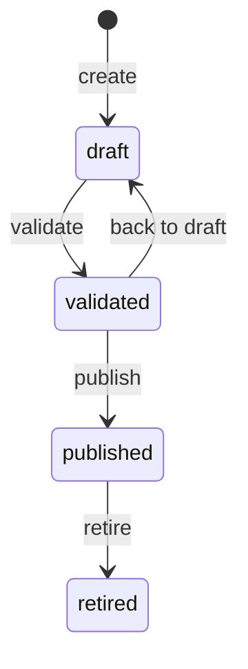
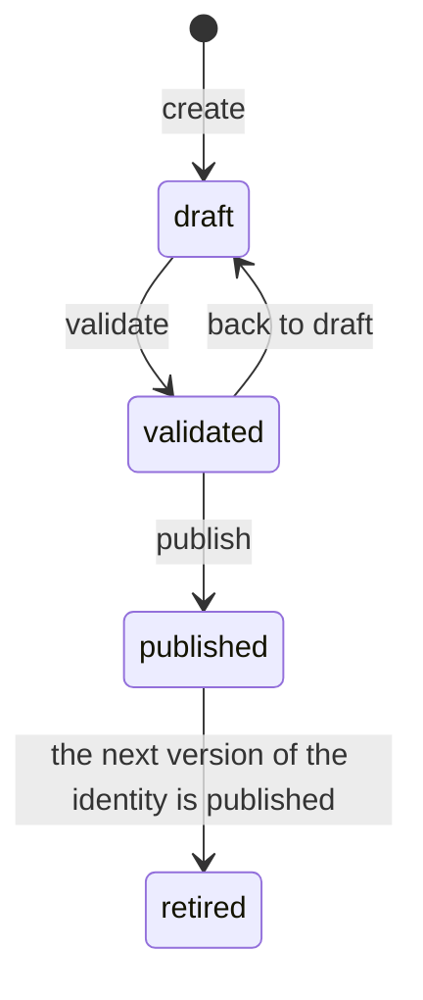
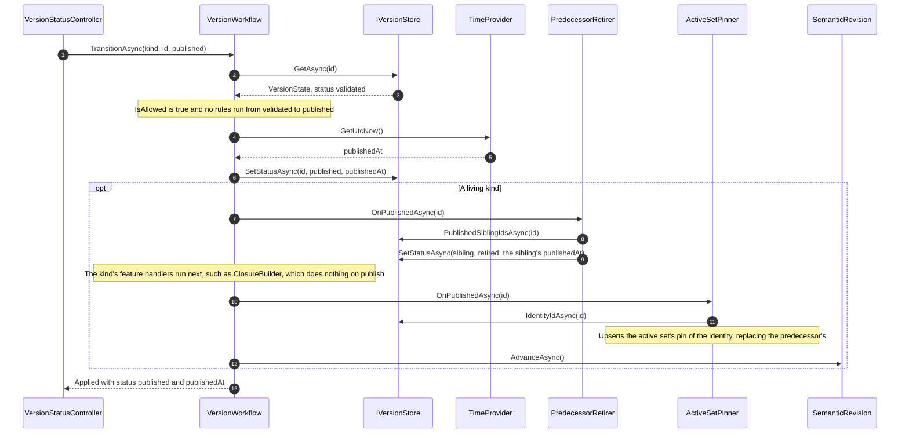
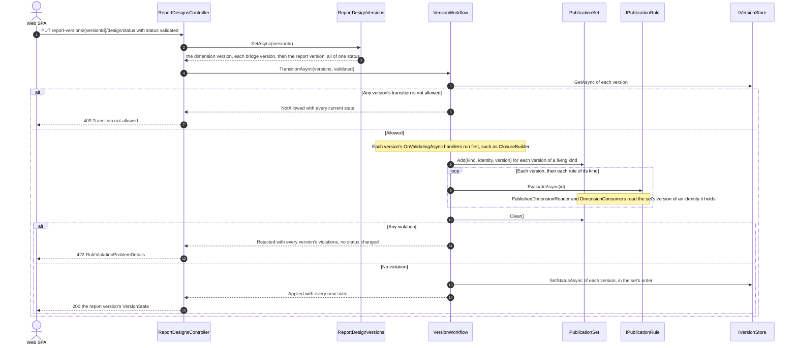
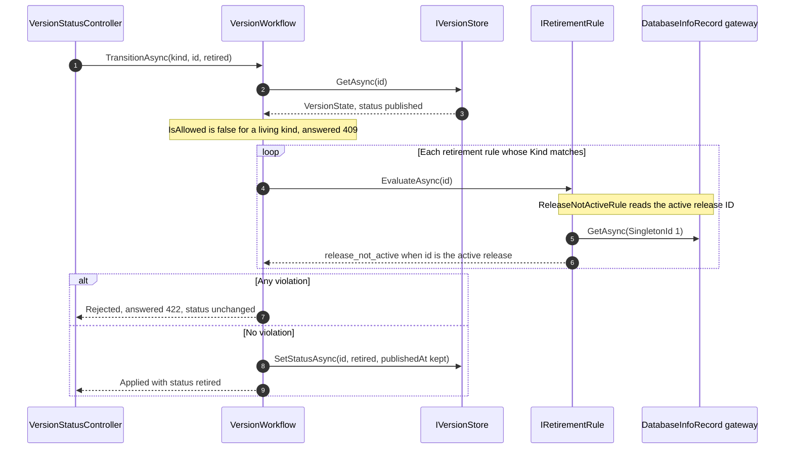

# Version lifecycle

[Diagram index](README.md) · [Architecture](01-architecture.md) · [Request pipeline](02-request-pipeline.md) · [Core classes](03-core-classes.md) · [Feature classes](05-feature-classes.md) · [Key actions](06-key-actions.md)

## Lifecycle states

The drawings show the transitions `VersionTransitions` allows for the seven versioned kinds. Every status change goes through `PUT /api/tenants/{tenantId}/versions/{kind}/{id}/status`, which `VersionStatusController` hands to `VersionWorkflow`; any other pair of statuses is refused with 409 "Transition not allowed", so a version cannot skip validation, and `retired` is final.

The kinds come in two families. The strict kinds, `dataset_version` and `semantic_release`, are versioned for reproducibility: a published version never changes, several can be published at once for releases to pin, and one is retired by hand.



The living kinds, `dimension_version`, `mapping_version`, `bridge_version`, `calculation_model_version` and `report_version`, hold the default content queries read. An identity has at most one published version, which stays editable; publishing the next version retires it, so a living version is never retired by hand.



| Kinds | Transition | Before the status is written | After the status is written |
| --- | --- | --- | --- |
| All | draft to validated | `OnValidatingAsync` of each lifecycle handler of the kind, then every publication rule of the kind; any violation rejects the change with 422 | Nothing more |
| All | validated to draft | Nothing | Nothing more |
| All | validated to published | Nothing | `published_at` from `TimeProvider`, `OnPublishedAsync` of each handler of the kind, and `SemanticRevision.AdvanceAsync` for the living kinds |
| Strict | published to retired | Every retirement rule of the kind; any violation rejects with 422 | `published_at` is kept |

`VersionTransitions.RunsPublicationRules` is true for draft to validated; `RunsRetirementRules` is true for published to retired of a strict kind. `VersionKinds.Living` lists the living kinds.

Which versions accept content writes follows the families. `[RequireDraft]` guards the strict kinds' writes and every version delete, so only a draft changes or goes away; `[RequireEditable]` guards the living kinds' writes, which a draft or the published version accepts, and answers 409 "Version is not editable" for a validated or retired one. A retired living version is frozen, because a historical assumption set may still pin it.

**Sources:** [VersionTransitions.cs](../../src/Quantalytix.QueryEngine.Admin.Application/Versioning/VersionTransitions.cs), [VersionWorkflow.cs](../../src/Quantalytix.QueryEngine.Admin.Application/Versioning/VersionWorkflow.cs), [PublicationStatuses.cs](../../src/Quantalytix.QueryEngine.Admin.Application/Vocabulary/PublicationStatuses.cs), [VersionKinds.cs](../../src/Quantalytix.QueryEngine.Admin.Application/Vocabulary/VersionKinds.cs), [VersionStatusController.cs](../../src/Quantalytix.QueryEngine.Admin.Api/Versioning/VersionStatusController.cs), [RequireDraftFilter.cs](../../src/Quantalytix.QueryEngine.Admin.Api/Versioning/RequireDraftFilter.cs), [RequireEditableFilter.cs](../../src/Quantalytix.QueryEngine.Admin.Api/Versioning/RequireEditableFilter.cs), [VersionWorkflowTests.cs](../../tests/Quantalytix.QueryEngine.Admin.Tests/Versioning/VersionWorkflowTests.cs).

## Leaving draft

The drawing shows draft to validated, the transition that derives data and runs the publication rules. It matters because leaving draft is when a version's content is checked before it reaches queries: publishing does not run the rules again.


Every rule of the kind runs, so the 422 lists all violations at once rather than the first. Handlers run before the rules and write even when a rule then rejects the change: `ClosureBuilder` rebuilds the closure of a dimension version every time it is validated. A living kind's rules check the version against what it will replace as well as on its own: a dimension version must keep every key live objects name (`dimension_consumers_resolve`), and a calculation model version must serve every published report of its model (the report rules run through those reports, see [Feature classes](05-feature-classes.md#calculation-models-and-reports)).

**Sources:** [VersionStatusController.cs](../../src/Quantalytix.QueryEngine.Admin.Api/Versioning/VersionStatusController.cs), [VersionWorkflow.cs](../../src/Quantalytix.QueryEngine.Admin.Application/Versioning/VersionWorkflow.cs), [VersionStoreRegistry.cs](../../src/Quantalytix.QueryEngine.Admin.Application/Versioning/VersionStoreRegistry.cs), [VersionStore.cs](../../src/Quantalytix.QueryEngine.Admin.Application/Versioning/VersionStore.cs), [VersionTransitions.cs](../../src/Quantalytix.QueryEngine.Admin.Application/Versioning/VersionTransitions.cs), [IVersionLifecycleHandler.cs](../../src/Quantalytix.QueryEngine.Admin.Application/Versioning/IVersionLifecycleHandler.cs), [IPublicationRule.cs](../../src/Quantalytix.QueryEngine.Admin.Application/Versioning/IPublicationRule.cs), [RuleViolationResults.cs](../../src/Quantalytix.QueryEngine.Admin.Api/Errors/RuleViolationResults.cs), [VersionReferenceValidator.cs](../../src/Quantalytix.QueryEngine.Admin.Application/Versioning/VersionReferenceValidator.cs), [StatusChangeInputValidator.cs](../../src/Quantalytix.QueryEngine.Admin.Application/Versioning/StatusChangeInputValidator.cs).

## Publishing

The drawing shows validated to published. No rules run; the workflow stamps the publication time, lets the kind's handlers cascade, and advances the semantic revision for a living kind, whose published version queries read without a release activation.



The status is written before the handlers run, so `PredecessorRetirer` finds the identity's other published version and retires it with its original publication time, and `ActiveSetPinner` repoints the active assumption set; historical sets keep pinning the version they captured, now retired. Publishing a dataset version or a semantic release changes nothing the engine reads until a release is activated, so it retires nothing and leaves the revision alone.

**Sources:** [VersionWorkflow.cs](../../src/Quantalytix.QueryEngine.Admin.Application/Versioning/VersionWorkflow.cs), [VersionStore.cs](../../src/Quantalytix.QueryEngine.Admin.Application/Versioning/VersionStore.cs), [LivingVersionStore.cs](../../src/Quantalytix.QueryEngine.Admin.Application/Versioning/LivingVersionStore.cs), [PredecessorRetirer.cs](../../src/Quantalytix.QueryEngine.Admin.Application/Versioning/PredecessorRetirer.cs), [ActiveSetPinner.cs](../../src/Quantalytix.QueryEngine.Admin.Application/AssumptionSets/ActiveSetPinner.cs), [SemanticRevision.cs](../../src/Quantalytix.QueryEngine.Admin.Application/Versioning/SemanticRevision.cs), [VersionWorkflowTests.cs](../../tests/Quantalytix.QueryEngine.Admin.Tests/Versioning/VersionWorkflowTests.cs), [AssumptionSetTests.cs](../../tests/Quantalytix.QueryEngine.Admin.Tests/AssumptionSets/AssumptionSetTests.cs).

## Editing and checking a published version

The drawing shows a write to the published version of a living kind. It matters because the edit is live: the next query reads it, so no rules gate it, and the Validate check is how an author confirms the version still passes them.

```mermaid
sequenceDiagram
    autonumber
    actor Client as Web SPA
    participant Fields as ValidationFilter
    participant Filter as RequireEditableFilter
    participant Ctl as Feature controller
    participant Rev as SemanticRevision
    participant Status as VersionStatusController
    participant Wf as VersionWorkflow
    Client->>Fields: PUT or POST or DELETE content of the published version
    Fields->>Filter: the input passes its field rules, otherwise 400
    Filter->>Filter: GetAsync of the version's state; 409 unless draft or published
    Filter->>Ctl: the action
    Ctl-->>Filter: result
    opt The version is published and the result is 2xx without an exception
        Filter->>Rev: AdvanceAsync()
    end
    Filter-->>Client: result
    Client->>Status: POST versions/{kind}/{id}/validation
    Status->>Wf: CheckAsync(kind, id)
    Note over Wf: Every publication rule of the kind; nothing is written
    Wf-->>Status: violations
    Status-->>Client: 200 VersionCheck with violations, empty when the version passes
```

A failed write, a 400 from the field rules or a 409 from a delete blocker, changed nothing, so it keeps the revision. Edits to a draft never advance it, because nothing reads drafts.

**Sources:** [RequireEditableAttribute.cs](../../src/Quantalytix.QueryEngine.Admin.Api/Versioning/RequireEditableAttribute.cs), [RequireEditableFilter.cs](../../src/Quantalytix.QueryEngine.Admin.Api/Versioning/RequireEditableFilter.cs), [VersionStatusController.cs](../../src/Quantalytix.QueryEngine.Admin.Api/Versioning/VersionStatusController.cs), [VersionWorkflow.cs](../../src/Quantalytix.QueryEngine.Admin.Application/Versioning/VersionWorkflow.cs), [VersionCheck.cs](../../src/Quantalytix.QueryEngine.Admin.Application/Versioning/Models/VersionCheck.cs), [RequireEditableFilterTests.cs](../../tests/Quantalytix.QueryEngine.Admin.Tests/Versioning/RequireEditableFilterTests.cs).

## Publishing together

The drawing shows a report design's status change, which moves a set of versions at once: the report dimension's version, each of the report's bridges' versions and the report version (see [Feature classes](05-feature-classes.md#report-designs)). It matters because such a set can't move one version at a time. A draft that removes one row and adds another breaks `dimension_consumers_resolve` while the published bridge still names the removed row. The bridge draft that maps to the new row breaks `mapping_members_in_endpoint_versions`, because the published dimension lacks that row. Validated as a set, each version counts as its identity's published version, so the drafts check against each other.



Publishing the validated set runs no rules. It writes each status and runs each version's publish handlers in the set's order: the dimension first, then the bridges, then the report. So `PredecessorRetirer` and `ActiveSetPinner` move the active assumption set to each new version before the next version that names its keys, and the semantic revision advances once for the whole transition. The single-version `TransitionAsync` and `CheckAsync` are sets of one, so every transition follows this path. `POST report-versions/{versionId}/design/validation` checks the set the same way and changes nothing. It is the Validate check of a published design, because edits to it are live.

**Sources:** [ReportDesignsController.cs](../../src/Quantalytix.QueryEngine.Admin.Api/Reports/ReportDesignsController.cs), [ReportDesignVersions.cs](../../src/Quantalytix.QueryEngine.Admin.Application/ReportDesigns/ReportDesignVersions.cs), [VersionWorkflow.cs](../../src/Quantalytix.QueryEngine.Admin.Application/Versioning/VersionWorkflow.cs), [PublicationSet.cs](../../src/Quantalytix.QueryEngine.Admin.Application/Versioning/PublicationSet.cs), [PublishedDimensionReader.cs](../../src/Quantalytix.QueryEngine.Admin.Application/Dimensions/PublishedDimensionReader.cs), [DimensionConsumers.cs](../../src/Quantalytix.QueryEngine.Admin.Application/Dimensions/DimensionConsumers.cs), [PublishTogetherTests.cs](../../tests/Quantalytix.QueryEngine.Admin.Tests/Versioning/PublishTogetherTests.cs).

## Retiring

The drawing shows published to retired of a strict kind. Retirement rules guard metadata that runtime queries still read; today the only one is `ReleaseNotActiveRule` (`release_not_active`) for `semantic_release`, which refuses to retire the release `qe_database_info.active_release_id` points at.



Retiring the active release would leave every query without one, because the engine reads the active release among published rows only; another release has to be activated first.

**Sources:** [VersionWorkflow.cs](../../src/Quantalytix.QueryEngine.Admin.Application/Versioning/VersionWorkflow.cs), [IRetirementRule.cs](../../src/Quantalytix.QueryEngine.Admin.Application/Versioning/IRetirementRule.cs), [ReleaseNotActiveRule.cs](../../src/Quantalytix.QueryEngine.Admin.Application/Releases/ReleaseNotActiveRule.cs), [ReleasesAndSystemFeatureServiceCollectionExtensions.cs](../../src/Quantalytix.QueryEngine.Admin.Api/Configuration/ReleasesAndSystemFeatureServiceCollectionExtensions.cs), [ReleaseRetirementTests.cs](../../tests/Quantalytix.QueryEngine.Admin.Tests/Releases/ReleaseRetirementTests.cs).

## Semantic revision

The engine keys its metadata cache by `qe_database_info.semantic_revision`, so the API advances it whenever rows the engine may have cached change outside a release activation. The table lists every place the code calls `SemanticRevision.AdvanceAsync`.

| Trigger | Code | What changed |
| --- | --- | --- |
| Publishing a living kind | `VersionWorkflow`, for `VersionKinds.Living`, once per transition even when a set publishes together | The published versions, which the active assumption set now pins, and their retired predecessors |
| Editing the published version of a living kind | `RequireEditableFilter`, after a successful write | Content queries read now |
| Capturing or deleting an assumption set | `AssumptionSetService.CaptureAsync` and `DeleteAsync` | The set keys requests can name |
| Activating a release | `ReleaseActivator.ActivateAsync`, after it writes `active_release_id` | The release every query runs on |
| Editing a dataset | `DatasetService.UpdateAsync`, always | `qe_dataset.display_name` and `is_enabled` |
| Editing a dimension | `DimensionService.UpdateAsync`, when `display_name` or `is_enabled` changed | `qe_dimension` identity |
| Editing a mapping set | `MappingSetService.UpdateAsync`, when the row changed | `qe_mapping_set.source_namespace` and `display_name` |
| Editing a bridge | `BridgeService.UpdateAsync`, when the row changed | `qe_bridge.display_name` and `is_enabled` |
| Editing a report | `ReportService.UpdateAsync`, when the row changed | `qe_report.display_name`, `report_type`, `is_enabled` and `payload_json`, which the engine caches with each report definition |

Publishing or retiring a `dataset_version` or `semantic_release` never advances it: these reach queries only through the release that pins them, and activating a release advances it in `ReleaseActivator`. Relabelling an assumption set does not advance it either, because the engine reads only its key and pins.

**Sources:** [SemanticRevision.cs](../../src/Quantalytix.QueryEngine.Admin.Application/Versioning/SemanticRevision.cs), [VersionWorkflow.cs](../../src/Quantalytix.QueryEngine.Admin.Application/Versioning/VersionWorkflow.cs), [RequireEditableFilter.cs](../../src/Quantalytix.QueryEngine.Admin.Api/Versioning/RequireEditableFilter.cs), [AssumptionSetService.cs](../../src/Quantalytix.QueryEngine.Admin.Application/AssumptionSets/AssumptionSetService.cs), [ReleaseActivator.cs](../../src/Quantalytix.QueryEngine.Admin.Application/Releases/ReleaseActivator.cs), [DatasetService.cs](../../src/Quantalytix.QueryEngine.Admin.Application/Datasets/DatasetService.cs), [DimensionService.cs](../../src/Quantalytix.QueryEngine.Admin.Application/Dimensions/DimensionService.cs), [MappingSetService.cs](../../src/Quantalytix.QueryEngine.Admin.Application/Mappings/MappingSetService.cs), [BridgeService.cs](../../src/Quantalytix.QueryEngine.Admin.Application/Bridges/BridgeService.cs), [ReportService.cs](../../src/Quantalytix.QueryEngine.Admin.Application/Reports/ReportService.cs).

## Lifecycle handlers

The table lists the `IVersionLifecycleHandler` implementations registered today. The workflow calls each handler of a version's kind in registration order: `OnValidatingAsync` before the publication rules, `OnPublishedAsync` after the published status is written.

| Handler | Kind | `OnValidatingAsync` | `OnPublishedAsync` | Registered in |
| --- | --- | --- | --- | --- |
| `PredecessorRetirer` | Each living kind | Nothing | Retires the identity's other published version, keeping its `published_at` | `AddAdminApplication`, one per kind |
| `ClosureBuilder` | `dimension_version` | Lists the version's members, deletes its `qe_dimension_closure` rows, and inserts one row per ancestor and descendant pair, depth 0 included; members in or below a parent cycle get none, and `hierarchy_acyclic` reports the cycle. `DimensionMemberService` calls the same rebuild after every member write, so a live edit keeps the published closure current | Nothing | `AddDimensionsFeature` |
| `ActiveSetPinner` | Each living kind | Nothing | Pins the version in the active assumption set, replacing its identity's pin | `AddReleasesAndSystemFeature`, one per kind |

**Sources:** [PredecessorRetirer.cs](../../src/Quantalytix.QueryEngine.Admin.Application/Versioning/PredecessorRetirer.cs), [ClosureBuilder.cs](../../src/Quantalytix.QueryEngine.Admin.Application/Dimensions/ClosureBuilder.cs), [DimensionMemberService.cs](../../src/Quantalytix.QueryEngine.Admin.Application/Dimensions/DimensionMemberService.cs), [ActiveSetPinner.cs](../../src/Quantalytix.QueryEngine.Admin.Application/AssumptionSets/ActiveSetPinner.cs), [AdminApplicationServiceCollectionExtensions.cs](../../src/Quantalytix.QueryEngine.Admin.Application/Configuration/AdminApplicationServiceCollectionExtensions.cs), [DimensionsFeatureServiceCollectionExtensions.cs](../../src/Quantalytix.QueryEngine.Admin.Api/Configuration/DimensionsFeatureServiceCollectionExtensions.cs), [ReleasesAndSystemFeatureServiceCollectionExtensions.cs](../../src/Quantalytix.QueryEngine.Admin.Api/Configuration/ReleasesAndSystemFeatureServiceCollectionExtensions.cs), [VersionWorkflow.cs](../../src/Quantalytix.QueryEngine.Admin.Application/Versioning/VersionWorkflow.cs).
