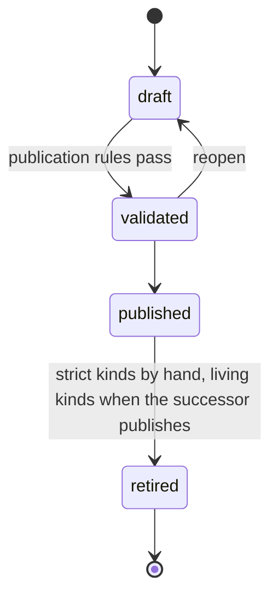

# Version lifecycle

[Index](README.md) · [High-level architecture](01-architecture.md) · [Request pipeline](02-request-pipeline.md) ·
[Core classes](03-core-classes.md) · [Feature classes](05-feature-classes.md) · [Key actions](06-key-actions.md)

Five kinds are versioned (`VersionKinds`): `dataset_version`, `semantic_release`, `dimension_version`, `mapping_version`
and `bridge_version`. Their rows carry a `status` of `draft`, `validated`, `published` or `retired`. Calculation models and
reports are not versioned: every change to them is checked by their gates instead.

## Strict and living kinds

| | Strict: datasets, releases | Living: dimensions, mapping sets, bridges |
|---|---|---|
| Edited | Only a draft's content changes; a validated or published version refuses edits with 409 | The one live (published) version is edited in place through the identity's change set |
| Reaches queries | A dataset version only through the active release; a release when it is activated | At once: the active assumption set pins the live version |
| Lifecycle endpoints | `validate`, `publish`, `reopen`, `retire`; releases also `activate` | `freeze` |
| Retired | By hand (`retire`) | Only when a successor is published (freeze) |
| New versions | Drafts created by hand, empty or cloned (datasets) | Version 1 is created live; later versions come from freezing |

## Transitions

`VersionTransitions` defines the allowed moves:

- **draft to validated** runs the kind's lifecycle handlers' `OnValidatingAsync` (the dimension closure is rebuilt), then
  every `IPublicationRule` of the kind. Any violation rejects the transition.
- **validated to published** stamps `published_at`, then runs every handler's `OnPublishedAsync` in registration order.
  For a living kind it then advances the semantic revision.
- **published to retired** is allowed only for strict kinds by hand, and runs every `IRetirementRule` of the kind.

## VersionWorkflow

`VersionWorkflow` (`Application/Versioning`) moves one version of any kind:

- `TransitionAsync(kind, id, targetStatus)` checks the transition, runs the rules it requires, writes the status through
  the kind's `IVersionStore` (found in `VersionStoreRegistry`), and runs the publish handlers. It answers `Applied`,
  `NotAllowed` or `Rejected` with the violations.
- `PublishAsync(kind, id)` takes a new draft through validated to published. Living kinds use it to create version 1 live
  (a new dimension, mapping set, analytical bridge, report dimension or report bridge) and to publish a freeze's copy.
- `CheckAsync(kind, id)` runs the publication rules on a stored version without changing it.

While the rules of a living version run, `PublicationSet` counts that version as its identity's published version, so rules
that resolve keys against published versions see the content about to be published rather than the version it replaces.

Each kind registers one `IPublicationRule` that loads the stored snapshot and runs the module's snapshot rules:
`DatasetVersionRules`, `DimensionVersionRules`, `MappingVersionRules`, `BridgeVersionRules` and `ReleaseVersionRules`.
Two kinds register an `IRetirementRule`: `ReleaseNotActiveRule` (`semantic_release`), so the active release cannot be
retired, and `ReleasePinsRetiredVersionRule` (`dataset_version`), so the dataset version the active release pins cannot be
retired.

Lifecycle handlers (`IVersionLifecycleHandler`), in registration order:

| Handler | Kind | Does |
|---|---|---|
| `PredecessorRetirer` | each living kind | On publish, retires the identity's other published version, stamping its retirement time |
| `ClosureBuilder` | `dimension_version` | On validating, rebuilds `qe_dimension_closure` from the member tree |
| `ActiveSetPinner` | each living kind | On publish, pins the new version in the active assumption set, replacing the identity's previous pin |

## Datasets

`DatasetCommands` runs the dataset transitions through `VersionWorkflow.TransitionAsync`: `validate` (draft to validated),
`publish` (validated to published; a draft is validated first in the same call), `reopen` (validated to draft) and
`retire` (published to retired). Only one open (draft or validated) version exists per dataset. Publishing a dataset version
does not advance the semantic revision, because the engine reads dataset versions only through the active release. For the
same reason `retire` runs `ReleasePinsRetiredVersionRule`: the version the active release pins is refused with 422
`release_pins_retired_version` until a release that pins another version is activated. Materializing a JSON path field
(`fields/{id}/materialization`) is allowed on any version that is not retired, because storage does not change what a
version means. Materializing and dematerializing advance the revision because the engine reads
`qe_field.materialized_column`.

## Releases

A release's manifest lists one dataset version per dataset. `ReleaseCommands` implements the release transitions itself on
the stored manifest rather than through `VersionWorkflow`:

- `validate` (draft to validated) and `publish` (validated to published) run every release rule (`ReleaseRules`) and
  answer 422 on a violation; `publish` stamps `published_at` and the manifest's content hash. Publishing activates nothing.
- `reopen` returns a validated release to draft; `retire` refuses the active release (`ReleaseNotActiveRule`).
- `activate` requires a published release, checks every enabled report against it (`ReleaseReportChecks`) and refuses with
  422 if any breaks a rule; then it writes `qe_database_info.active_semantic_release_id`, advances the semantic revision,
  and logs a `qe_release_activation` row. Activating an older release is a rollback.

## Living versions and freeze

A living identity has one live version, edited in place through the identity's change set
(`dimensions/{id}/changes`, `mapping-sets/{id}/changes`, `bridges/{id}/changes`). The change set's commit advances the
semantic revision when the engine-visible content changed. Earlier versions are frozen: read-only snapshots that a
historical assumption set can pin and that can be deleted when nothing pins them.

`POST <kind>-versions/{id}/freeze` with `{ note }` runs `LivingVersionFreezer.FreezeAsync(kind, versionId, note)`:

1. The version must be published (live); otherwise 409.
2. `VersionWorkflow.CheckAsync` runs every publication rule of the kind on it; any violation refuses with 422 and nothing
   changes.
3. The kind's `ILivingVersionCopier` copies version n into draft n+1.
4. `VersionWorkflow.PublishAsync` publishes n+1: `PredecessorRetirer` retires n, `ClosureBuilder` has rebuilt the closure
   on validating, `ActiveSetPinner` repoints the active assumption set to n+1, and the semantic revision advances.
5. Version n keeps the freeze note (`freeze_note`).

The answer is a `FreezeResult` with the clean validation report and the new live version. Dimension freeze also refuses
report dimensions and dimensions locked by their profile; bridge freeze refuses report bridges.

## Assumption sets

An assumption set pins one version per dimension, mapping set and bridge. Exactly one set is active; the tenant database
holds it and every living publish repoints it, so it always pins the live versions, which every request that names no set
reads. `AssumptionSetCommands` captures historical sets: a capture copies the active set's analytical pins (report
dimensions and report bridges are left out, because reports always run on the active set) and the active release under a
new key. Historical sets can be relabelled and deleted; the active set cannot. Capturing and deleting a set advance the
semantic revision; relabelling does not. A historical set's pin blocks deleting the version or identity it pins.

## Semantic revision

`SemanticRevision.AdvanceAsync` adds one to `qe_database_info.semantic_revision`, which the engine's metadata cache keys on.
It advances once per commit or command that changes what the engine reads:

| Advances | Does not advance |
|---|---|
| A dimension, mapping set or bridge change set that changes engine-visible content | A dataset draft's content (only a change to the dataset identity row advances) |
| Publishing a living version (create, freeze) | Publishing, reopening or retiring a dataset version |
| A change set on an enabled report; enabling or disabling a report; deleting an enabled report | A change set on, or the delete of, a disabled report |
| A model change set that changes a model an enabled report reads | A draft release's manifest change set; validating or publishing a release |
| Activating a release | Relabelling an assumption set |
| Capturing or deleting an assumption set | Refreshing a materialized field's view |
| Materializing or dematerializing a JSON path field | |

Writes that must be seen together write their rows first and advance the revision last, so the engine never caches
half-written metadata under the new revision.
