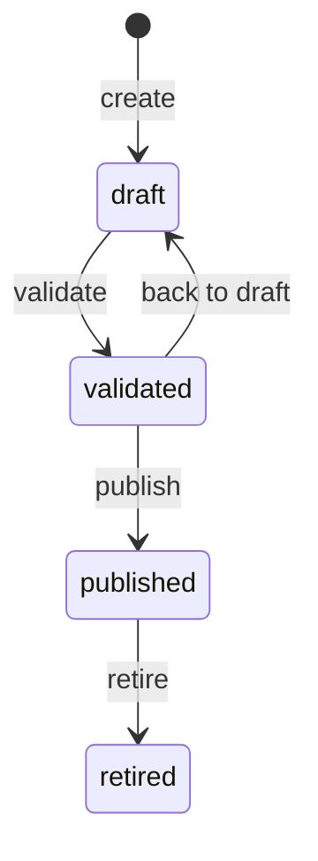
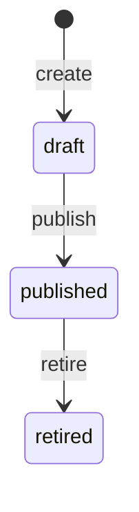
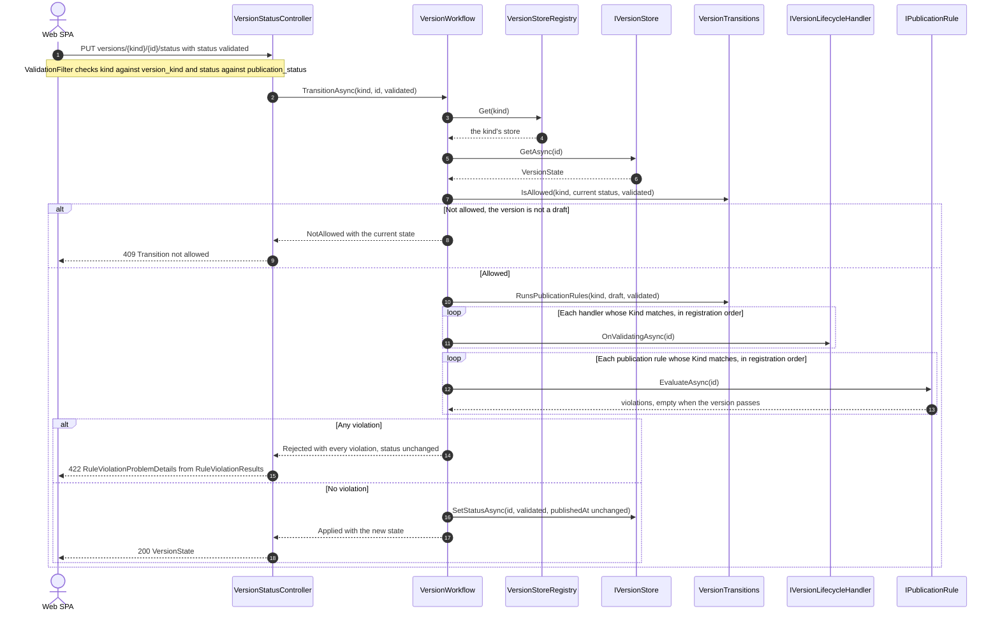
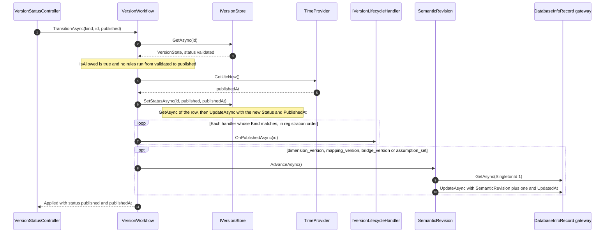
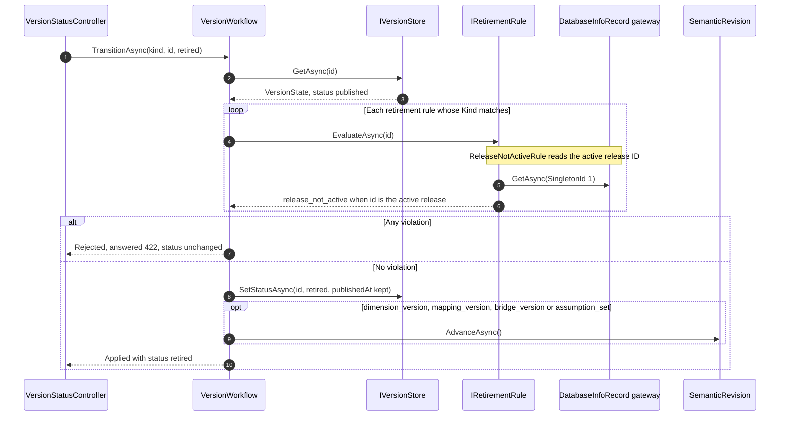

# Version lifecycle

[Diagram index](README.md) · [Architecture](01-architecture.md) · [Request pipeline](02-request-pipeline.md) · [Core classes](03-core-classes.md) · [Feature classes](05-feature-classes.md) · [Key actions](06-key-actions.md)

## Lifecycle states

The drawings show the transitions `VersionTransitions` allows for the eight versioned kinds: `dataset_version`, `dimension_version`, `mapping_version`, `bridge_version`, `semantic_release`, `assumption_set`, `calculation_model_version` and `report_version`. Every status change goes through `PUT /api/tenants/{tenantId}/versions/{kind}/{id}/status`, which `VersionStatusController` hands to `VersionWorkflow`; any other pair of statuses is refused with 409 "Transition not allowed", so a version cannot skip validation, and `retired` is final.

Dataset, dimension, mapping, bridge, calculation model and report versions, and semantic releases:

Assumption sets, which have no validated state:

| Kinds | Transition | Before the status is written | After the status is written |
| --- | --- | --- | --- |
| All but `assumption_set` | draft to validated | `OnValidatingAsync` of each lifecycle handler of the kind, then every publication rule of the kind; any violation rejects the change with 422 | Nothing more |
| All but `assumption_set` | validated to draft | Nothing | Nothing more |
| All but `assumption_set` | validated to published | Nothing | `published_at` from `TimeProvider`, `OnPublishedAsync` of each handler of the kind, and `SemanticRevision.AdvanceAsync` for the revision kinds |
| `assumption_set` | draft to published | `OnValidatingAsync` of its handlers (none are registered), then its publication rules | `published_at`, `OnPublishedAsync` of its handlers, and `SemanticRevision.AdvanceAsync` |
| All | published to retired | Every retirement rule of the kind; any violation rejects with 422 | `SemanticRevision.AdvanceAsync` for the revision kinds; `published_at` is kept |

`VersionTransitions.RunsPublicationRules` is true for draft to validated, and for draft to published of an assumption set; `RunsRetirementRules` is true for published to retired of every kind. The revision kinds are `dimension_version`, `mapping_version`, `bridge_version` and `assumption_set`.

**Sources:** [VersionTransitions.cs](../../src/Quantalytix.QueryEngine.Admin.Application/Versioning/VersionTransitions.cs), [VersionWorkflow.cs](../../src/Quantalytix.QueryEngine.Admin.Application/Versioning/VersionWorkflow.cs), [PublicationStatuses.cs](../../src/Quantalytix.QueryEngine.Admin.Application/Vocabulary/PublicationStatuses.cs), [AssumptionSetStatuses.cs](../../src/Quantalytix.QueryEngine.Admin.Application/Vocabulary/AssumptionSetStatuses.cs), [VersionKinds.cs](../../src/Quantalytix.QueryEngine.Admin.Application/Vocabulary/VersionKinds.cs), [VersionStatusController.cs](../../src/Quantalytix.QueryEngine.Admin.Api/Versioning/VersionStatusController.cs), [VersionWorkflowTests.cs](../../tests/Quantalytix.QueryEngine.Admin.Tests/Versioning/VersionWorkflowTests.cs).

## Leaving draft

The drawing shows draft to validated, the transition that derives data and runs the publication rules. It matters because leaving draft is the only time a version's content is checked: publishing does not run the rules again, and only drafts accept content writes.

Every rule of the kind runs, so the 422 lists all violations at once rather than the first. Handlers run before the rules and write even when a rule then rejects the change: `ClosureBuilder` rebuilds the closure of a dimension version every time it is validated. For an assumption set, leaving draft is draft to published: the same handler and rule steps run, then the publishing steps below.

**Sources:** [VersionStatusController.cs](../../src/Quantalytix.QueryEngine.Admin.Api/Versioning/VersionStatusController.cs), [VersionWorkflow.cs](../../src/Quantalytix.QueryEngine.Admin.Application/Versioning/VersionWorkflow.cs), [VersionStoreRegistry.cs](../../src/Quantalytix.QueryEngine.Admin.Application/Versioning/VersionStoreRegistry.cs), [VersionStore.cs](../../src/Quantalytix.QueryEngine.Admin.Application/Versioning/VersionStore.cs), [VersionTransitions.cs](../../src/Quantalytix.QueryEngine.Admin.Application/Versioning/VersionTransitions.cs), [IVersionLifecycleHandler.cs](../../src/Quantalytix.QueryEngine.Admin.Application/Versioning/IVersionLifecycleHandler.cs), [IPublicationRule.cs](../../src/Quantalytix.QueryEngine.Admin.Application/Versioning/IPublicationRule.cs), [RuleViolationResults.cs](../../src/Quantalytix.QueryEngine.Admin.Api/Errors/RuleViolationResults.cs), [VersionReferenceValidator.cs](../../src/Quantalytix.QueryEngine.Admin.Application/Versioning/VersionReferenceValidator.cs), [StatusChangeInputValidator.cs](../../src/Quantalytix.QueryEngine.Admin.Application/Versioning/StatusChangeInputValidator.cs).

## Publishing

The drawing shows validated to published. No rules run; the workflow stamps the publication time, lets the kind's handlers cascade, and advances the semantic revision when the engine resolves the kind's published rows without a release activation.

The status is written before the handlers run. `PredecessorValidityCloser` then reads the new version, lists the dimension's published versions and closes every open-ended one that starts earlier, skipping the new version itself; `CurrentBridgeVersionUpdater` moves its bridge's pointer. Publishing a dataset, calculation model or report version, or a semantic release, changes nothing the engine reads until a release is activated, so it leaves the revision alone; `CurrentModelVersionUpdater` and `CurrentReportVersionUpdater` move authoring-only pointers.

**Sources:** [VersionWorkflow.cs](../../src/Quantalytix.QueryEngine.Admin.Application/Versioning/VersionWorkflow.cs), [VersionStore.cs](../../src/Quantalytix.QueryEngine.Admin.Application/Versioning/VersionStore.cs), [SemanticRevision.cs](../../src/Quantalytix.QueryEngine.Admin.Application/Versioning/SemanticRevision.cs), [DatabaseInfoRecord.cs](../../src/Quantalytix.QueryEngine.Admin.Application/Metadata/Models/DatabaseInfoRecord.cs), [PredecessorValidityCloser.cs](../../src/Quantalytix.QueryEngine.Admin.Application/Dimensions/PredecessorValidityCloser.cs), [VersionWorkflowTests.cs](../../tests/Quantalytix.QueryEngine.Admin.Tests/Versioning/VersionWorkflowTests.cs).

## Retiring

The drawing shows published to retired. Retirement rules guard metadata that runtime queries still read; today the only one is `ReleaseNotActiveRule` (`release_not_active`) for `semantic_release`, which refuses to retire the release `qe_database_info.active_release_id` points at.

Retiring the active release would leave every query without one, because the engine reads the active release among published rows only; another release has to be activated first.

**Sources:** [VersionWorkflow.cs](../../src/Quantalytix.QueryEngine.Admin.Application/Versioning/VersionWorkflow.cs), [IRetirementRule.cs](../../src/Quantalytix.QueryEngine.Admin.Application/Versioning/IRetirementRule.cs), [ReleaseNotActiveRule.cs](../../src/Quantalytix.QueryEngine.Admin.Application/Releases/ReleaseNotActiveRule.cs), [ReleasesAndSystemFeatureServiceCollectionExtensions.cs](../../src/Quantalytix.QueryEngine.Admin.Api/Configuration/ReleasesAndSystemFeatureServiceCollectionExtensions.cs), [ReleaseRetirementTests.cs](../../tests/Quantalytix.QueryEngine.Admin.Tests/Releases/ReleaseRetirementTests.cs).

## Semantic revision

The engine keys its metadata cache by `qe_database_info.semantic_revision`, so the API advances it whenever rows the engine may have cached change outside a release activation. The table lists every place the code calls `SemanticRevision.AdvanceAsync`.

| Trigger | Code | What changed |
| --- | --- | --- |
| Publishing or retiring a revision kind | `VersionWorkflow`, whose `RevisionKinds` are `dimension_version`, `mapping_version`, `bridge_version` and `assumption_set` | Published content the engine resolves by request time or pin, without a release activation |
| Activating a release | `ReleaseActivator.ActivateAsync`, after it writes `active_release_id` | The release every query runs on |
| Editing a dataset | `DatasetService.UpdateAsync`, always | `qe_dataset.display_name` and `is_enabled` |
| Editing a dimension | `DimensionService.UpdateAsync`, when `display_name` or `is_enabled` changed | `qe_dimension` identity |
| Editing a mapping set | `MappingSetService.UpdateAsync`, when the row changed | `qe_mapping_set.source_namespace` and `display_name` |
| Editing a bridge | `BridgeService.UpdateAsync`, when the row changed | `qe_bridge.display_name` and `is_enabled` |
| Editing a report | `ReportService.UpdateAsync`, when the row changed | `qe_report.display_name`, `report_type`, `is_enabled` and `payload_json`, which the engine caches with each report definition |

Publishing or retiring a `dataset_version`, `calculation_model_version`, `report_version` or `semantic_release` never advances it: these reach queries only through the release that pins them, and activating a release advances it in `ReleaseActivator`. Editing a calculation model does not advance it either, because the engine reads only the model's key, which never changes.

**Sources:** [SemanticRevision.cs](../../src/Quantalytix.QueryEngine.Admin.Application/Versioning/SemanticRevision.cs), [VersionWorkflow.cs](../../src/Quantalytix.QueryEngine.Admin.Application/Versioning/VersionWorkflow.cs), [ReleaseActivator.cs](../../src/Quantalytix.QueryEngine.Admin.Application/Releases/ReleaseActivator.cs), [DatasetService.cs](../../src/Quantalytix.QueryEngine.Admin.Application/Datasets/DatasetService.cs), [DimensionService.cs](../../src/Quantalytix.QueryEngine.Admin.Application/Dimensions/DimensionService.cs), [MappingSetService.cs](../../src/Quantalytix.QueryEngine.Admin.Application/Mappings/MappingSetService.cs), [BridgeService.cs](../../src/Quantalytix.QueryEngine.Admin.Application/Bridges/BridgeService.cs), [ReportService.cs](../../src/Quantalytix.QueryEngine.Admin.Application/Reports/ReportService.cs).

## Lifecycle handlers

The table lists the `IVersionLifecycleHandler` implementations registered today. The workflow calls each handler of a version's kind in registration order: `OnValidatingAsync` before the publication rules, `OnPublishedAsync` after the published status is written.

| Handler | Kind | `OnValidatingAsync` | `OnPublishedAsync` | Registered in |
| --- | --- | --- | --- | --- |
| `ClosureBuilder` | `dimension_version` | Lists the version's members, deletes its `qe_dimension_closure` rows, and inserts one row per ancestor and descendant pair, depth 0 included; members in or below a parent cycle get none, and `hierarchy_acyclic` reports the cycle | Nothing | `AddDimensionsFeature`, first |
| `PredecessorValidityCloser` | `dimension_version` | Nothing | Sets `valid_to` of every open-ended published version of the dimension that starts earlier to the new version's `valid_from`, the only change ever made to a published version | `AddDimensionsFeature`, second |
| `CurrentBridgeVersionUpdater` | `bridge_version` | Nothing | Points `qe_bridge.current_bridge_version_id` at the new version; the pointer is authoring-only, because bindings pin bridge versions themselves | `AddMappingsAndBridgesFeature` |
| `CurrentModelVersionUpdater` | `calculation_model_version` | Nothing | Points `qe_calculation_model.current_model_version_id` at the new version; authoring-only, because report versions pin model versions themselves | `AddCalculationModelsAndReportsFeature`, first |
| `CurrentReportVersionUpdater` | `report_version` | Nothing | Points `qe_report.current_report_version_id` at the new version; authoring-only, because releases pin report versions themselves | `AddCalculationModelsAndReportsFeature`, second |

**Sources:** [ClosureBuilder.cs](../../src/Quantalytix.QueryEngine.Admin.Application/Dimensions/ClosureBuilder.cs), [PredecessorValidityCloser.cs](../../src/Quantalytix.QueryEngine.Admin.Application/Dimensions/PredecessorValidityCloser.cs), [DimensionValidity.cs](../../src/Quantalytix.QueryEngine.Admin.Application/Dimensions/DimensionValidity.cs), [CurrentBridgeVersionUpdater.cs](../../src/Quantalytix.QueryEngine.Admin.Application/Bridges/CurrentBridgeVersionUpdater.cs), [CurrentModelVersionUpdater.cs](../../src/Quantalytix.QueryEngine.Admin.Application/CalculationModels/CurrentModelVersionUpdater.cs), [CurrentReportVersionUpdater.cs](../../src/Quantalytix.QueryEngine.Admin.Application/Reports/CurrentReportVersionUpdater.cs), [CalculationModelsAndReportsFeatureServiceCollectionExtensions.cs](../../src/Quantalytix.QueryEngine.Admin.Api/Configuration/CalculationModelsAndReportsFeatureServiceCollectionExtensions.cs), [DimensionsFeatureServiceCollectionExtensions.cs](../../src/Quantalytix.QueryEngine.Admin.Api/Configuration/DimensionsFeatureServiceCollectionExtensions.cs), [MappingsAndBridgesFeatureServiceCollectionExtensions.cs](../../src/Quantalytix.QueryEngine.Admin.Api/Configuration/MappingsAndBridgesFeatureServiceCollectionExtensions.cs), [VersionWorkflow.cs](../../src/Quantalytix.QueryEngine.Admin.Application/Versioning/VersionWorkflow.cs).
