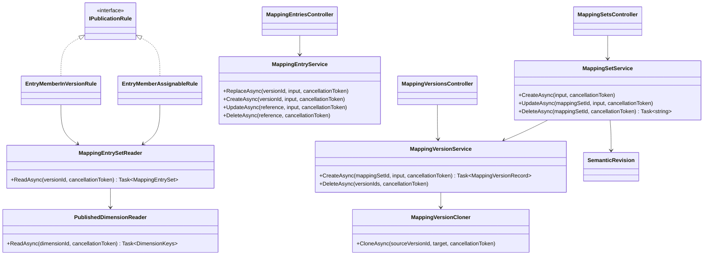
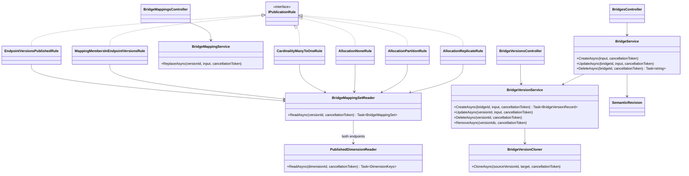
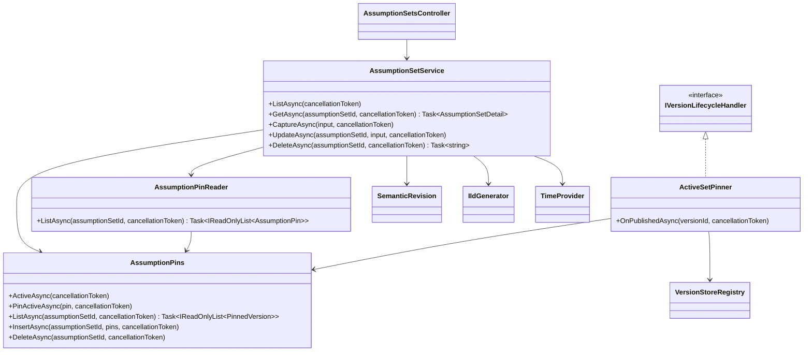

# Feature classes

[Diagram index](README.md) · [Architecture](01-architecture.md) · [Request pipeline](02-request-pipeline.md) · [Core classes](03-core-classes.md) · [Version lifecycle](04-version-lifecycle.md) · [Key actions](06-key-actions.md)

One drawing per feature area. Each shows the controllers, services, cloners, derivers, readers and executors of the area, the interfaces at its seams, and the rules that depend on them. Table gateways are left out of the drawings to keep them readable; the table under each drawing lists the records each class reads or writes through `ITableGateway<TRecord>`. Publication rules are listed in registration order, which is the order the workflow runs them; a rule's code and class name are given as `code` (`Class`). Endpoint detail is in the [OpenAPI document](../../openapi/admin-api.json).

**Sources:** [ITableGateway.cs](../../src/Quantalytix.QueryEngine.Admin.Application/Metadata/ITableGateway.cs), [VersionWorkflow.cs](../../src/Quantalytix.QueryEngine.Admin.Application/Versioning/VersionWorkflow.cs), [feature registrations](../../src/Quantalytix.QueryEngine.Admin.Api/Configuration), [Program.cs](../../src/Quantalytix.QueryEngine.Admin.Api/Program.cs).

## Datasets, source objects and schema changes

The drawing shows the dataset slice: identities, versions and their content, fields and grains, and the two Infrastructure seams that reach the physical tenant database. It matters because creating, cloning, materializing and deleting each fan out over several tables in a fixed order.

- **Routes:** `api/tenants/{tenantId}/datasets` (`DatasetsController`, including `{datasetId:long}/versions`), `api/tenants/{tenantId}/dataset-versions` (`DatasetVersionsController`), `api/tenants/{tenantId}/dataset-versions/{versionId:long}/fields` (`FieldsController`, including `from-columns`, `{fieldId:long}/materialize` and `{fieldId:long}/materialized-column`), `api/tenants/{tenantId}/dataset-versions/{versionId:long}/grains` (`GrainsController`), `api/tenants/{tenantId}/source-objects` (`SourceObjectsController`).
- **Publication rules** (`dataset_version`, the first ten of the kind): `source_object_exists` (`SourceObjectExistsRule`), `version_supports_a_mode` (`VersionSupportsAModeRule`), `default_time_binding_in_version` (`DefaultTimeBindingInVersionRule`), `field_key_unique` (`FieldKeyUniqueRule`), `field_columns_exist` (`FieldColumnsExistRule`), `expression_field_references` (`ExpressionFieldReferencesRule`), `expression_field_acyclic` (`ExpressionFieldAcyclicRule`), `grain_key_unique` (`GrainKeyUniqueRule`), `grain_fields_in_version` (`GrainFieldsInVersionRule`), `series_grain_excludes_time_field` (`SeriesGrainExcludesTimeFieldRule`).
- **Retirement rules and lifecycle handlers:** none.
- **Registration:** `AddDatasetsFeature` in [DatasetsFeatureServiceCollectionExtensions.cs](../../src/Quantalytix.QueryEngine.Admin.Api/Configuration/DatasetsFeatureServiceCollectionExtensions.cs), which also maps `ISourceObjectCatalog` to `SourceObjectCatalog` and `ISchemaChangeExecutor` to `SchemaChangeExecutor`.

`DatasetVersionContentStore` owns the order of the nine content tables: parents first when it inserts, children first when it deletes. A clone remaps every ID inside the version through one `IdRemap`, while references to other aggregates (dimensions, mapping sets and bridges) keep their IDs and level and member keys stay as they are. `SourceObjectService` hides the engine's `qe_` tables and `vw_qe_` views from the possible sources. `ExpressionFieldReferencesRule` and `ExpressionFieldAcyclicRule` parse field expressions with `ExpressionInspector`.

| Class | Records |
| --- | --- |
| `DatasetService` | `DatasetRecord`, `DatasetVersionRecord`, `ReleaseDatasetRecord`, `SemanticReleaseRecord` |
| `DatasetVersionService` | `DatasetVersionRecord`, `ReleaseDatasetRecord`, `SemanticReleaseRecord` |
| `DatasetVersionCloner` | `DatasetVersionRecord` |
| `DatasetVersionContentStore` | `FieldRecord`, `DatasetGrainRecord`, `DatasetGrainFieldRecord`, `DimensionBindingRecord`, `TimeBindingRecord`, `MeasureRecord`, `MeasureComponentRecord`, `MeasureDependencyRecord`, `MeasureTimePolicyRecord` |
| `FieldService` | `FieldRecord` |
| `FieldUsage` | `DatasetGrainRecord`, `DatasetGrainFieldRecord`, `DimensionBindingRecord`, `TimeBindingRecord`, `MeasureRecord`, `MeasureComponentRecord` |
| `FieldsFromColumnsService`, `MaterializedColumnService` | `FieldRecord`, `DatasetVersionRecord` |
| `GrainService` | `DatasetGrainRecord`, `DatasetGrainFieldRecord`, `MeasureTimePolicyRecord`, `MeasureRecord` |

**Sources:** [Datasets controllers](../../src/Quantalytix.QueryEngine.Admin.Api/Datasets), [SourceObjectsController.cs](../../src/Quantalytix.QueryEngine.Admin.Api/SourceObjects/SourceObjectsController.cs), [DatasetService.cs](../../src/Quantalytix.QueryEngine.Admin.Application/Datasets/DatasetService.cs), [DatasetVersionService.cs](../../src/Quantalytix.QueryEngine.Admin.Application/Datasets/DatasetVersionService.cs), [DatasetVersionCloner.cs](../../src/Quantalytix.QueryEngine.Admin.Application/Datasets/DatasetVersionCloner.cs), [DatasetVersionContentStore.cs](../../src/Quantalytix.QueryEngine.Admin.Application/Datasets/DatasetVersionContentStore.cs), [FieldService.cs](../../src/Quantalytix.QueryEngine.Admin.Application/Datasets/FieldService.cs), [FieldUsage.cs](../../src/Quantalytix.QueryEngine.Admin.Application/Datasets/FieldUsage.cs), [FieldsFromColumnsService.cs](../../src/Quantalytix.QueryEngine.Admin.Application/Datasets/FieldsFromColumnsService.cs), [MaterializedColumnService.cs](../../src/Quantalytix.QueryEngine.Admin.Application/Datasets/MaterializedColumnService.cs), [MaterializedColumnDdl.cs](../../src/Quantalytix.QueryEngine.Admin.Application/Datasets/MaterializedColumnDdl.cs), [GrainService.cs](../../src/Quantalytix.QueryEngine.Admin.Application/Datasets/GrainService.cs), [SourceObjectService.cs](../../src/Quantalytix.QueryEngine.Admin.Application/SourceObjects/SourceObjectService.cs), [ISourceObjectCatalog.cs](../../src/Quantalytix.QueryEngine.Admin.Application/SourceObjects/ISourceObjectCatalog.cs), [ISchemaChangeExecutor.cs](../../src/Quantalytix.QueryEngine.Admin.Application/SourceObjects/ISchemaChangeExecutor.cs), [SourceObjectCatalog.cs](../../src/Quantalytix.QueryEngine.Admin.Infrastructure.StarRocks/SourceObjects/SourceObjectCatalog.cs), [SchemaChangeExecutor.cs](../../src/Quantalytix.QueryEngine.Admin.Infrastructure.StarRocks/SchemaChanges/SchemaChangeExecutor.cs), [dataset rules](../../src/Quantalytix.QueryEngine.Admin.Application/Datasets), [DatasetsFeatureServiceCollectionExtensions.cs](../../src/Quantalytix.QueryEngine.Admin.Api/Configuration/DatasetsFeatureServiceCollectionExtensions.cs).

## Dimensions

The drawing shows the dimension slice: identities, roles, versions, levels, the member tree, range bands, the closure builder, and the readers other slices use to resolve keys. It matters because a dimension's published version is the one the active assumption set pins: bindings, mapping entries, bridge mappings and reports name its levels and members by key, and resolve those keys in it. A role is a named use of a dimension, its template, such as `servicingBranch` of `branch`: bindings, calculation dimensions and bridge sources name roles, and requests name a binding by its role's key.

- **Routes:** `api/tenants/{tenantId}/dimensions` (`DimensionsController`); `api/tenants/{tenantId}/dimensions/{dimensionId:long}/roles` (`DimensionRolesController`, including `{roleId:long}`); under `api/tenants/{tenantId}`, `dimensions/{dimensionId:long}/versions` and `dimension-versions/{dimensionVersionId:long}` (`DimensionVersionsController`); `api/tenants/{tenantId}/dimension-versions/{dimensionVersionId:long}/levels` (`DimensionLevelsController`), `.../members` (`DimensionMembersController`, including `order`) and `.../range-bands` (`RangeBandsController`). Content writes take a draft or the published version (`[RequireEditable]`); deleting a version takes a draft (`[RequireDraft]`).
- **Publication rules** (`dimension_version`): `range_data_type_matches_kind` (`RangeDataTypeMatchesKindRule`), `level_key_unique` (`LevelKeyUniqueRule`), `member_key_unique` (`MemberKeyUniqueRule`), `member_parent_in_version` (`MemberParentInVersionRule`), `member_level_in_version` (`MemberLevelInVersionRule`), `hierarchy_acyclic` (`HierarchyAcyclicRule`), `band_boundary_family` (`BandBoundaryFamilyRule`), `band_bounds_ordered` (`BandBoundsOrderedRule`), `bands_non_overlapping` (`BandsNonOverlappingRule`), `band_member_in_version` (`BandMemberInVersionRule`), `dimension_consumers_resolve` (`DimensionConsumersResolveRule`).
- **Retirement rules:** none. **Lifecycle handlers:** `ClosureBuilder` (`OnValidatingAsync`); `PredecessorRetirer` and `ActiveSetPinner` serve every living kind.
- **Registration:** `AddDimensionsFeature` in [DimensionsFeatureServiceCollectionExtensions.cs](../../src/Quantalytix.QueryEngine.Admin.Api/Configuration/DimensionsFeatureServiceCollectionExtensions.cs).

`DimensionVersionService` stores the new draft first and then lets `DimensionVersionCloner` copy the source's levels, members with their parents and levels, and range bands; closure rows are not copied, because validation rebuilds them. Mapping sets and bridges name members by key, so they follow the draft once it is published. `DimensionMemberService` rebuilds the closure after every member write, so a live edit of the published version keeps the closure the engine reads current. `DimensionVersionRemover` deletes children first: range bands, closure rows, members, levels, then the versions; nothing else references a draft, so a draft version's delete has no blockers.

Roles are not versioned. `DimensionService` creates a new dimension's first role with it, from `NewDimensionInput.DefaultRole`, which every kind but `time` requires and `time` forbids, because a time binding names its dimension. A role's key is unique in the tenant and fixed; its display name and description are editable, and a change advances the semantic revision, because the engine's catalog shows both. `DimensionDeleteChecks.RoleAsync` refuses to delete a role a binding, calculation dimension or variable source names, and deleting a dimension deletes its roles once nothing names them.

`DimensionConsumers` lists the keys live objects name in a dimension: the unknown member keys of the bindings of published dataset versions, the member keys of the entries of published mapping versions, the source or target member keys of the mappings of published bridge versions, and the member options, overlay row parents and variable scopes of published report versions over the dimension and the grouping level and ancestor keys of their calculation dimensions on its roles. `dimension_consumers_resolve` requires a version being published to hold every one of them, because it becomes the version they resolve in, and `DimensionDeleteChecks` refuses to delete a level or member of the published version that one of them names; drafts resolve nothing, so they never block. `PublishedDimensionReader` gives the binding, mapping, bridge and report rules the keys of a dimension's published version.

| Class | Records |
| --- | --- |
| `DimensionService` | `DimensionRecord`, `DimensionVersionRecord`, `DimensionRoleRecord` |
| `DimensionRoleService` | `DimensionRoleRecord` |
| `DimensionVersionService` | `DimensionVersionRecord` |
| `DimensionVersionCloner` | `DimensionLevelRecord`, `DimensionMemberRecord`, `RangeBandRecord` |
| `DimensionVersionRemover` | `DimensionVersionRecord`, `DimensionLevelRecord`, `DimensionMemberRecord`, `DimensionClosureRecord`, `RangeBandRecord` |
| `DimensionDeleteChecks` | `DimensionVersionRecord`, `DimensionMemberRecord`, `RangeBandRecord`, `DimensionRoleRecord`, `MappingSetRecord`, `BridgeRecord`, `DimensionBindingRecord`, `DatasetRecord`, `DatasetVersionRecord`, `ReportRecord`, `CalculationDimensionRecord`, `VariableSourceRecord` |
| `DimensionConsumers` | `DatasetRecord`, `DatasetVersionRecord`, `DimensionBindingRecord`, `DimensionRoleRecord`, `MappingSetRecord`, `MappingVersionRecord`, `DimensionMappingRecord`, `BridgeRecord`, `BridgeVersionRecord`, `BridgeMappingRecord`, `ReportRecord`, `ReportVersionRecord`, `ReportMemberOptionRecord`, `ReportLineRecord`, `ReportVariableScopeRecord`, `CalculationDimensionRecord` |
| `PublishedDimensionReader` | `DimensionVersionRecord`, `DimensionLevelRecord`, `DimensionMemberRecord` |
| `DimensionLevelService` | `DimensionLevelRecord` |
| `DimensionMemberService` | `DimensionMemberRecord` |
| `RangeBandService` | `RangeBandRecord` |
| `RangeBandSetReader` | `DimensionVersionRecord`, `DimensionRecord`, `RangeBandRecord`, `DimensionMemberRecord` |
| `ClosureBuilder` | `DimensionMemberRecord`, `DimensionClosureRecord` |

**Sources:** [Dimensions controllers](../../src/Quantalytix.QueryEngine.Admin.Api/Dimensions), [DimensionService.cs](../../src/Quantalytix.QueryEngine.Admin.Application/Dimensions/DimensionService.cs), [DimensionRoleService.cs](../../src/Quantalytix.QueryEngine.Admin.Application/Dimensions/DimensionRoleService.cs), [NewDimensionInputValidator.cs](../../src/Quantalytix.QueryEngine.Admin.Application/Dimensions/NewDimensionInputValidator.cs), [DimensionVersionService.cs](../../src/Quantalytix.QueryEngine.Admin.Application/Dimensions/DimensionVersionService.cs), [DimensionVersionCloner.cs](../../src/Quantalytix.QueryEngine.Admin.Application/Dimensions/DimensionVersionCloner.cs), [DimensionVersionRemover.cs](../../src/Quantalytix.QueryEngine.Admin.Application/Dimensions/DimensionVersionRemover.cs), [DimensionDeleteChecks.cs](../../src/Quantalytix.QueryEngine.Admin.Application/Dimensions/DimensionDeleteChecks.cs), [DimensionConsumers.cs](../../src/Quantalytix.QueryEngine.Admin.Application/Dimensions/DimensionConsumers.cs), [DimensionConsumersResolveRule.cs](../../src/Quantalytix.QueryEngine.Admin.Application/Dimensions/DimensionConsumersResolveRule.cs), [PublishedDimensionReader.cs](../../src/Quantalytix.QueryEngine.Admin.Application/Dimensions/PublishedDimensionReader.cs), [DimensionLevelService.cs](../../src/Quantalytix.QueryEngine.Admin.Application/Dimensions/DimensionLevelService.cs), [DimensionMemberService.cs](../../src/Quantalytix.QueryEngine.Admin.Application/Dimensions/DimensionMemberService.cs), [RangeBandService.cs](../../src/Quantalytix.QueryEngine.Admin.Application/Dimensions/RangeBandService.cs), [RangeBandSetReader.cs](../../src/Quantalytix.QueryEngine.Admin.Application/Dimensions/RangeBandSetReader.cs), [ClosureBuilder.cs](../../src/Quantalytix.QueryEngine.Admin.Application/Dimensions/ClosureBuilder.cs), [dimension rules](../../src/Quantalytix.QueryEngine.Admin.Application/Dimensions), [DimensionsFeatureServiceCollectionExtensions.cs](../../src/Quantalytix.QueryEngine.Admin.Api/Configuration/DimensionsFeatureServiceCollectionExtensions.cs), [DimensionConsumersTests.cs](../../tests/Quantalytix.QueryEngine.Admin.Tests/Dimensions/DimensionConsumersTests.cs), [DimensionRoleTests.cs](../../tests/Quantalytix.QueryEngine.Admin.Tests/Dimensions/DimensionRoleTests.cs).

## Mappings

The drawing shows the mapping slice: mapping sets, their versions, and the source-key entries. It matters because an entry names its member by key, which queries resolve in the version of the set's dimension their assumption set pins, so a mapping version carries over to a new dimension version without being copied.

- **Routes:** `api/tenants/{tenantId}/mapping-sets` (`MappingSetsController`); under `api/tenants/{tenantId}`, `mapping-sets/{mappingSetId:long}/versions` and `mapping-versions/{versionId:long}` (`MappingVersionsController`); `api/tenants/{tenantId}/mapping-versions/{versionId:long}/entries` (`MappingEntriesController`). Entry writes take a draft or the published version.
- **Publication rules** (`mapping_version`): `dimension_version_published` (`DimensionVersionPublishedRule`), `source_key_unique` (`SourceKeyUniqueRule`), `entry_member_in_version` (`EntryMemberInVersionRule`), `entry_member_assignable` (`EntryMemberAssignableRule`).
- **Retirement rules:** none. **Lifecycle handlers:** `PredecessorRetirer` and `ActiveSetPinner`, as for every living kind.
- **Registration:** the first half of `AddMappingsAndBridgesFeature` in [MappingsAndBridgesFeatureServiceCollectionExtensions.cs](../../src/Quantalytix.QueryEngine.Admin.Api/Configuration/MappingsAndBridgesFeatureServiceCollectionExtensions.cs).

A mapping set is created without versions, because its entries belong to versions. A clone copies the source's entries as they are under new entry IDs. `MappingEntrySetReader` reads a version's entries with the keys of the published version of the set's dimension; while the dimension has none, `dimension_version_published` reports it once and the member rules stay silent.

| Class | Records |
| --- | --- |
| `MappingSetService` | `MappingSetRecord`, `MappingVersionRecord`, `DimensionBindingRecord` |
| `MappingVersionService` | `MappingVersionRecord`, `DimensionMappingRecord` |
| `MappingVersionCloner` | `DimensionMappingRecord` |
| `MappingEntryService` | `DimensionMappingRecord` |
| `MappingEntrySetReader` | `MappingVersionRecord`, `MappingSetRecord`, `DimensionMappingRecord`, through `PublishedDimensionReader` the dimension's version, levels and members |

**Sources:** [Mappings controllers](../../src/Quantalytix.QueryEngine.Admin.Api/Mappings), [MappingSetService.cs](../../src/Quantalytix.QueryEngine.Admin.Application/Mappings/MappingSetService.cs), [MappingVersionService.cs](../../src/Quantalytix.QueryEngine.Admin.Application/Mappings/MappingVersionService.cs), [MappingVersionCloner.cs](../../src/Quantalytix.QueryEngine.Admin.Application/Mappings/MappingVersionCloner.cs), [MappingEntryService.cs](../../src/Quantalytix.QueryEngine.Admin.Application/Mappings/MappingEntryService.cs), [MappingEntrySetReader.cs](../../src/Quantalytix.QueryEngine.Admin.Application/Mappings/MappingEntrySetReader.cs), [mapping rules](../../src/Quantalytix.QueryEngine.Admin.Application/Mappings), [PublishedDimensionReader.cs](../../src/Quantalytix.QueryEngine.Admin.Application/Dimensions/PublishedDimensionReader.cs), [MappingsAndBridgesFeatureServiceCollectionExtensions.cs](../../src/Quantalytix.QueryEngine.Admin.Api/Configuration/MappingsAndBridgesFeatureServiceCollectionExtensions.cs), [MappingEntryRuleTests.cs](../../tests/Quantalytix.QueryEngine.Admin.Tests/Mappings/MappingEntryRuleTests.cs).

## Bridges

The drawing shows the bridge slice: bridges between two dimensions, their versions, and the member-to-member mappings. It matters because all six bridge rules read the same mapping set, through `BridgeMappingSetReader`, and its member keys resolve in the published versions of the bridge's two dimensions.

- **Routes:** `api/tenants/{tenantId}/bridges` (`BridgesController`); under `api/tenants/{tenantId}`, `bridges/{bridgeId:long}/versions` and `bridge-versions/{versionId:long}` (`BridgeVersionsController`); `api/tenants/{tenantId}/bridge-versions/{versionId:long}/mappings` (`BridgeMappingsController`). Version and mapping writes take a draft or the published version.
- **Publication rules** (`bridge_version`): `endpoint_versions_published` (`EndpointVersionsPublishedRule`), `mapping_members_in_endpoint_versions` (`MappingMembersInEndpointVersionsRule`), `cardinality_many_to_one` (`CardinalityManyToOneRule`), `allocation_none` (`AllocationNoneRule`), `allocation_partition` (`AllocationPartitionRule`), `allocation_replicate` (`AllocationReplicateRule`).
- **Retirement rules:** none. **Lifecycle handlers:** `PredecessorRetirer` and `ActiveSetPinner`, as for every living kind.
- **Registration:** the second half of `AddMappingsAndBridgesFeature` in [MappingsAndBridgesFeatureServiceCollectionExtensions.cs](../../src/Quantalytix.QueryEngine.Admin.Api/Configuration/MappingsAndBridgesFeatureServiceCollectionExtensions.cs).

A bridge is created without versions, because its mappings belong to versions. A version holds its cardinality, allocation mode and mappings; a clone copies the mappings with their factors and weights under new mapping IDs. Bindings name the bridge itself, so deleting a draft version has no blockers, and deleting the bridge is blocked by the bindings that use it.

| Class | Records |
| --- | --- |
| `BridgeService` | `BridgeRecord`, `BridgeVersionRecord`, `DimensionBindingRecord` |
| `BridgeVersionService` | `BridgeVersionRecord`, `BridgeMappingRecord` |
| `BridgeVersionCloner` | `BridgeMappingRecord` |
| `BridgeMappingService` | `BridgeMappingRecord` |
| `BridgeMappingSetReader` | `BridgeVersionRecord`, `BridgeRecord`, `BridgeMappingRecord`, through `PublishedDimensionReader` the endpoints' versions, levels and members |

**Sources:** [Bridges controllers](../../src/Quantalytix.QueryEngine.Admin.Api/Bridges), [BridgeService.cs](../../src/Quantalytix.QueryEngine.Admin.Application/Bridges/BridgeService.cs), [BridgeVersionService.cs](../../src/Quantalytix.QueryEngine.Admin.Application/Bridges/BridgeVersionService.cs), [BridgeVersionCloner.cs](../../src/Quantalytix.QueryEngine.Admin.Application/Bridges/BridgeVersionCloner.cs), [BridgeMappingService.cs](../../src/Quantalytix.QueryEngine.Admin.Application/Bridges/BridgeMappingService.cs), [BridgeMappingSetReader.cs](../../src/Quantalytix.QueryEngine.Admin.Application/Bridges/BridgeMappingSetReader.cs), [bridge rules](../../src/Quantalytix.QueryEngine.Admin.Application/Bridges), [MappingsAndBridgesFeatureServiceCollectionExtensions.cs](../../src/Quantalytix.QueryEngine.Admin.Api/Configuration/MappingsAndBridgesFeatureServiceCollectionExtensions.cs), [BridgeMappingRuleTests.cs](../../tests/Quantalytix.QueryEngine.Admin.Tests/Bridges/BridgeMappingRuleTests.cs).

## Bindings

The drawing shows the binding slice, which binds a dataset version's fields to roles of canonical dimensions, with the time extension of time bindings, which name their time dimension instead. It is small in classes but carries eight of the dataset version's publication rules. A binding names its role, mapping set or bridge by identity and its unknown member by key, so it resolves in whichever versions an assumption set pins. A version binds each role at most once, and one field may feed several roles. Bindings have no name of their own: `BindingNames` names them the way requests do, a role binding by its role's key and a time binding by its field's key, for every message, delete blocker and lookup that lists them.

- **Routes:** `api/tenants/{tenantId}/dataset-versions/{versionId:long}/bindings` (`BindingsController`).
- **Publication rules** (`dataset_version`, after the Datasets rules): `binding_fields_in_version` (`BindingFieldsInVersionRule`), `binding_source_field_groupable` (`BindingSourceFieldGroupableRule`), `bound_roles_distinct` (`BoundRolesDistinctRule`), which allows one binding per role and no field keyed like a bound role but the one its binding reads, `mapped_binding_mapping_set_dimension` (`MappedBindingMappingSetDimensionRule`), `range_binding_dimension_kind` (`RangeBindingDimensionKindRule`), `time_binding_dimension_kind` (`TimeBindingDimensionKindRule`), `bridge_binding_route` (`BridgeBindingRouteRule`), `unknown_members_in_version` (`UnknownMembersInVersionRule`), which resolves the binding's unknown member in the published version of its dimension through `PublishedDimensionReader`.
- **Retirement rules and lifecycle handlers:** none.
- **Registration:** `AddBindingsAndMeasuresFeature` in [BindingsAndMeasuresFeatureServiceCollectionExtensions.cs](../../src/Quantalytix.QueryEngine.Admin.Api/Configuration/BindingsAndMeasuresFeatureServiceCollectionExtensions.cs).

`BindingInputValidator` requires an existing role for every kind but `time`, and the time dimension for `time`. `BindingService` copies the role's template into the binding's `dimension_id`, which never changes because a role's template is fixed, so every rule that compares dimensions reads it from the binding. It writes the binding row before its time extension and deletes the extension first; a binding whose kind stops being `time` loses its extension. A delete is blocked while the binding is required, is the source binding of a bridge binding, is the required time binding of a measure's time policy, or is the version's default time binding. The bindings' rules are plain `IPublicationRule` classes over gateways, so the drawing leaves them out.

| Class | Records |
| --- | --- |
| `BindingService` | `DimensionBindingRecord`, `TimeBindingRecord`, `DimensionRoleRecord`, `DatasetVersionRecord`, `MeasureTimePolicyRecord`, `MeasureRecord` |
| `BindingNames` | `DimensionRoleRecord`, `FieldRecord` |

**Sources:** [BindingsController.cs](../../src/Quantalytix.QueryEngine.Admin.Api/Bindings/BindingsController.cs), [BindingService.cs](../../src/Quantalytix.QueryEngine.Admin.Application/Bindings/BindingService.cs), [BindingNames.cs](../../src/Quantalytix.QueryEngine.Admin.Application/Bindings/BindingNames.cs), [BindingInputValidator.cs](../../src/Quantalytix.QueryEngine.Admin.Application/Bindings/BindingInputValidator.cs), [BindingDetail.cs](../../src/Quantalytix.QueryEngine.Admin.Application/Bindings/Models/BindingDetail.cs), [binding rules](../../src/Quantalytix.QueryEngine.Admin.Application/Bindings), [BindingsAndMeasuresFeatureServiceCollectionExtensions.cs](../../src/Quantalytix.QueryEngine.Admin.Api/Configuration/BindingsAndMeasuresFeatureServiceCollectionExtensions.cs).

## Measures

The drawing shows the measure slice and how formula dependencies are derived rather than edited. It matters because the engine finds the measures a formula needs from `qe_measure_dependency`, and the API keeps those rows in step with the formulas by parsing them with the engine's own parser.

- **Routes:** `api/tenants/{tenantId}/dataset-versions/{versionId:long}/measures` (`MeasuresController`).
- **Publication rules** (`dataset_version`, after the Bindings rules): `measure_key_unique` (`MeasureKeyUniqueRule`), `component_fields_in_version` (`ComponentFieldsInVersionRule`), `component_roles_match_kind` (`ComponentRolesMatchKindRule`), `formula_references_known_measures` (`FormulaReferencesKnownMeasuresRule`), `formula_acyclic` (`FormulaAcyclicRule`), `time_policy_series_grain` (`TimePolicySeriesGrainRule`), `time_policy_time_binding_in_version` (`TimePolicyTimeBindingInVersionRule`).
- **Retirement rules and lifecycle handlers:** none.
- **Registration:** `AddBindingsAndMeasuresFeature` in [BindingsAndMeasuresFeatureServiceCollectionExtensions.cs](../../src/Quantalytix.QueryEngine.Admin.Api/Configuration/BindingsAndMeasuresFeatureServiceCollectionExtensions.cs), which also registers `MeasureDependencyDeriver`.

Every save derives the dependency rows of every formula of the version again, because a formula may name a measure created after it. A key that names no measure produces no row; `formula_references_known_measures` reports it at validation. A measure that another formula depends on cannot be deleted.

| Class | Records |
| --- | --- |
| `MeasureService` | `MeasureRecord`, `MeasureComponentRecord`, `MeasureDependencyRecord`, `MeasureTimePolicyRecord` |
| `MeasureDependencyDeriver` | `MeasureRecord`, `MeasureDependencyRecord` |

**Sources:** [MeasuresController.cs](../../src/Quantalytix.QueryEngine.Admin.Api/Measures/MeasuresController.cs), [MeasureService.cs](../../src/Quantalytix.QueryEngine.Admin.Application/Measures/MeasureService.cs), [MeasureDependencyDeriver.cs](../../src/Quantalytix.QueryEngine.Admin.Application/Measures/MeasureDependencyDeriver.cs), [MeasureDetail.cs](../../src/Quantalytix.QueryEngine.Admin.Application/Measures/Models/MeasureDetail.cs), [ExpressionInspector.cs](../../src/Quantalytix.QueryEngine.Admin.Application/Expressions/ExpressionInspector.cs), [ExpressionInspection.cs](../../src/Quantalytix.QueryEngine.Admin.Application/Expressions/Models/ExpressionInspection.cs), [MeasureUpdateInputValidator.cs](../../src/Quantalytix.QueryEngine.Admin.Application/Measures/MeasureUpdateInputValidator.cs), [measure rules](../../src/Quantalytix.QueryEngine.Admin.Application/Measures), [BindingsAndMeasuresFeatureServiceCollectionExtensions.cs](../../src/Quantalytix.QueryEngine.Admin.Api/Configuration/BindingsAndMeasuresFeatureServiceCollectionExtensions.cs); in the query engine checkout: [ExpressionParser.cs](../../../../Quantalytix.QueryEngine/src/Quantalytix.QueryEngine.Domain/Expressions/ExpressionParser.cs), [ExpressionTree.cs](../../../../Quantalytix.QueryEngine/src/Quantalytix.QueryEngine.Domain/Expressions/ExpressionTree.cs).

## Releases and overview

The drawing shows semantic releases, their manifests of pinned dataset versions, activation, and the tenant overview. It matters because activation is the only way a dataset version reaches queries, and the release rules are where every published report's keys are checked against the dataset versions they will resolve in.

```mermaid
classDiagram
    direction TB
    class ReleasesController
    class OverviewController
    class ReleaseService {
        +ListAsync(cancellationToken)
        +CreateAsync(input, cancellationToken)
        +DeleteAsync(releaseId, cancellationToken)
        +ListDatasetsAsync(releaseId, cancellationToken)
        +ReplaceDatasetsAsync(releaseId, input, cancellationToken)
    }
    class ReleaseActivator {
        +ActivateAsync(releaseId, cancellationToken) Task~ReleaseActivationResult~
    }
    class ReleaseActivationResult {
        <<record>>
        +bool Activated
        +SemanticReleaseRecord Release
        +DatabaseInfoRecord DatabaseInfo
    }
    class ReleaseManifestReader {
        +ListDatasetsAsync(releaseId, cancellationToken)
        +ListBindingsAsync(releaseId, cancellationToken)
    }
    class ReportGraphReader {
        +ScopeAsync(kind, versionId, cancellationToken) Task~ReportScope~
    }
    class OverviewService {
        +GetAsync(cancellationToken) Task~TenantOverview~
    }
    class IIdGenerator {
        <<interface>>
    }
    class IPublicationRule {
        <<interface>>
    }
    class IRetirementRule {
        <<interface>>
    }
    ReleasesController --> ReleaseService
    ReleasesController --> ReleaseActivator
    OverviewController --> OverviewService
    ReleaseService --> IIdGenerator
    ReleaseService --> TimeProvider
    ReleaseActivator --> SemanticRevision
    ReleaseActivator --> TimeProvider
    ReleaseActivator ..> ReleaseActivationResult : returns
    IRetirementRule <|.. ReleaseNotActiveRule
    IPublicationRule <|.. PinnedVersionBelongsToDatasetRule
    IPublicationRule <|.. PinnedDatasetVersionPublishedRule
    IPublicationRule <|.. BoundDimensionsResolvableRule
    IPublicationRule <|.. MappedBindingsResolvableRule
    IPublicationRule <|.. BridgeBindingsResolvableRule
    PinnedVersionBelongsToDatasetRule --> ReleaseManifestReader
    PinnedDatasetVersionPublishedRule --> ReleaseManifestReader
    BoundDimensionsResolvableRule --> ReleaseManifestReader
    MappedBindingsResolvableRule --> ReleaseManifestReader
    BridgeBindingsResolvableRule --> ReleaseManifestReader
    IPublicationRule <|.. ReportSourcesResolveRule
    ReportSourcesResolveRule --> ReportGraphReader : semantic_release scope
    ReleaseManifestReader --> BindingNames : binding names
```

- **Routes:** `api/tenants/{tenantId}/releases` (`ReleasesController`, including `{releaseId:long}/datasets` and `{releaseId:long}/activate`), `api/tenants/{tenantId}/overview` (`OverviewController`).
- **Publication rules** (`semantic_release`): `manifest_not_empty` (`ManifestNotEmptyRule`), `pinned_version_belongs_to_dataset` (`PinnedVersionBelongsToDatasetRule`), `pinned_version_published` (`PinnedDatasetVersionPublishedRule`), `bound_dimensions_resolvable` (`BoundDimensionsResolvableRule`), `mapped_bindings_resolvable` (`MappedBindingsResolvableRule`), `bridge_bindings_resolvable` (`BridgeBindingsResolvableRule`), then the report rule the Calculation models and Reports slice registers for this kind: `report_sources_resolve` (`ReportSourcesResolveRule`).
- **Retirement rules:** `release_not_active` (`ReleaseNotActiveRule`). **Lifecycle handlers:** none.
- **Registration:** `AddReleasesAndSystemFeature` in [ReleasesAndSystemFeatureServiceCollectionExtensions.cs](../../src/Quantalytix.QueryEngine.Admin.Api/Configuration/ReleasesAndSystemFeatureServiceCollectionExtensions.cs).

A release is created as a draft, optionally with a copy of another release's manifest; it pins dataset versions only. The binding rules require the dimension, mapping set and bridge each binding of a pinned dataset version names to have a published version, which the active assumption set pins. Reports are not pinned: a report runs against whichever release is active, so the release checks every published report version against its own dataset versions, through `ReportGraphReader` (see [Calculation models and reports](#calculation-models-and-reports)). Validating, publishing and retiring go through the version status endpoint with kind `semantic_release`; activation has its own endpoint, refuses a release that is not published, and advances the semantic revision. `OverviewService` only reads: the tenant's identity, schema version, revision and active release, counts, and drafts in progress.

| Class | Records |
| --- | --- |
| `ReleaseService` | `SemanticReleaseRecord`, `ReleaseDatasetRecord`, `DatabaseInfoRecord` |
| `ReleaseActivator` | `SemanticReleaseRecord`, `DatabaseInfoRecord` |
| `ReleaseManifestReader` | `ReleaseDatasetRecord`, `DatasetRecord`, `DimensionBindingRecord` |
| `ReleaseNotActiveRule` | `DatabaseInfoRecord`, `SemanticReleaseRecord` |
| `OverviewService` | `DatabaseInfoRecord`, `SemanticReleaseRecord`, `ReleaseDatasetRecord`, `DatasetRecord`, `DatasetVersionRecord`, `MeasureRecord`, `DimensionRecord`, `DimensionVersionRecord`, `MappingSetRecord`, `MappingVersionRecord`, `BridgeRecord`, `BridgeVersionRecord`, `AssumptionSetRecord`, `CalculationModelRecord`, `CalculationModelVersionRecord`, `ReportRecord`, `ReportVersionRecord` |

**Sources:** [ReleasesController.cs](../../src/Quantalytix.QueryEngine.Admin.Api/Releases/ReleasesController.cs), [OverviewController.cs](../../src/Quantalytix.QueryEngine.Admin.Api/Overview/OverviewController.cs), [ReleaseService.cs](../../src/Quantalytix.QueryEngine.Admin.Application/Releases/ReleaseService.cs), [ReleaseActivator.cs](../../src/Quantalytix.QueryEngine.Admin.Application/Releases/ReleaseActivator.cs), [ReleaseActivationResult.cs](../../src/Quantalytix.QueryEngine.Admin.Application/Releases/Models/ReleaseActivationResult.cs), [ReleaseManifestReader.cs](../../src/Quantalytix.QueryEngine.Admin.Application/Releases/ReleaseManifestReader.cs), [ReleaseNotActiveRule.cs](../../src/Quantalytix.QueryEngine.Admin.Application/Releases/ReleaseNotActiveRule.cs), [release rules](../../src/Quantalytix.QueryEngine.Admin.Application/Releases), [ReportGraphReader.cs](../../src/Quantalytix.QueryEngine.Admin.Application/Reports/ReportGraphReader.cs), [OverviewService.cs](../../src/Quantalytix.QueryEngine.Admin.Application/Overview/OverviewService.cs), [ReleasesAndSystemFeatureServiceCollectionExtensions.cs](../../src/Quantalytix.QueryEngine.Admin.Api/Configuration/ReleasesAndSystemFeatureServiceCollectionExtensions.cs).

## Assumption sets

The drawing shows assumption sets, which pin one version of each identity of the five living kinds. It matters because they decide which versions a request reads: the one active set holds the default versions and every publish repoints it, while historical sets are captured copies that let a request backtest against the versions of their time.

- **Routes:** `api/tenants/{tenantId}/assumption-sets` (`AssumptionSetsController`): `GET` lists the sets, `POST` captures a historical set (201), and `{assumptionSetId:long}` reads a set with its pins, relabels it (`PUT`) or deletes it (`DELETE`, 409 for the active set).
- **Publication and retirement rules:** none; assumption sets are not a versioned kind. **Lifecycle handlers:** `ActiveSetPinner`, one per living kind.
- **Registration:** `AddReleasesAndSystemFeature` in [ReleasesAndSystemFeatureServiceCollectionExtensions.cs](../../src/Quantalytix.QueryEngine.Admin.Api/Configuration/ReleasesAndSystemFeatureServiceCollectionExtensions.cs).

The tenant database holds the active set, with status `active` and key `active`, from the moment it is created; tenant verification refuses a database without exactly one, and the API never creates or deletes it. `ActiveSetPinner` upserts the active set's pin of the identity whose version was just published, so the active set always pins every published version. `CaptureAsync` copies the active set's pins into a new set with status `historical`, a key of its own, `captured_at` and the active release as `release_id`, whose dataset versions the engine reads for the set; the copy keeps pinning those versions after later publishes retire them, and retired versions never change, so a historical set reproduces the content of its time. Capturing and deleting advance the semantic revision, because the engine caches the set keys requests can name by revision; relabelling does not. `AssumptionPinReader` labels each pin with its identity key, version number and status for the web SPA.

| Class | Records |
| --- | --- |
| `AssumptionSetService` | `AssumptionSetRecord`, `DatabaseInfoRecord` |
| `AssumptionPins` | `AssumptionSetRecord`, `AssumptionSetDimensionRecord`, `AssumptionSetMappingRecord`, `AssumptionSetBridgeRecord`, `AssumptionSetModelRecord`, `AssumptionSetReportRecord` |
| `AssumptionPinReader` | `DimensionRecord`, `DimensionVersionRecord`, `MappingSetRecord`, `MappingVersionRecord`, `BridgeRecord`, `BridgeVersionRecord`, `CalculationModelRecord`, `CalculationModelVersionRecord`, `ReportRecord`, `ReportVersionRecord` |

**Sources:** [AssumptionSetsController.cs](../../src/Quantalytix.QueryEngine.Admin.Api/AssumptionSets/AssumptionSetsController.cs), [AssumptionSetService.cs](../../src/Quantalytix.QueryEngine.Admin.Application/AssumptionSets/AssumptionSetService.cs), [AssumptionPins.cs](../../src/Quantalytix.QueryEngine.Admin.Application/AssumptionSets/AssumptionPins.cs), [AssumptionPinReader.cs](../../src/Quantalytix.QueryEngine.Admin.Application/AssumptionSets/AssumptionPinReader.cs), [ActiveSetPinner.cs](../../src/Quantalytix.QueryEngine.Admin.Application/AssumptionSets/ActiveSetPinner.cs), [ReleasesAndSystemFeatureServiceCollectionExtensions.cs](../../src/Quantalytix.QueryEngine.Admin.Api/Configuration/ReleasesAndSystemFeatureServiceCollectionExtensions.cs), [AssumptionSetTests.cs](../../tests/Quantalytix.QueryEngine.Admin.Tests/AssumptionSets/AssumptionSetTests.cs).

## System tenants and tenant verification

The drawing shows how SystemAdmins edit the control plane's tenant directory and how a candidate connection string is verified. It matters because a tenant's connection string decides which database every one of its requests writes to.

- **Routes:** `api/system/tenants` (`SystemTenantsController`, `SystemAdmin` policy, including `{tenantId}`, `{tenantId}/enabled` and `verify`).
- **Publication rules, retirement rules and lifecycle handlers:** none; tenant directory rows are not versioned.
- **Registration:** `AddReleasesAndSystemFeature` in [ReleasesAndSystemFeatureServiceCollectionExtensions.cs](../../src/Quantalytix.QueryEngine.Admin.Api/Configuration/ReleasesAndSystemFeatureServiceCollectionExtensions.cs), which also maps `ITenantDatabaseVerifier` to `TenantDatabaseVerifier` and `IConnectionStringMasker` to `ConnectionStringMasker`.

A connection string is external input, so it is verified whenever one is supplied: `POST verify` reports the outcome as a `TenantConnectionCheck`, while create and update run the same check through `MustRouteToTenant` as a validation error on `connectionString`. The check passes when the string opens, its database's `qe_database_info` names the tenant and has metadata schema version 8, and `qe_assumption_set` holds exactly one active set, which every publish repoints. Connection strings are write-only: every response masks the password through MySqlConnector's own parser. Tenants are never deleted.

| Class | Records |
| --- | --- |
| `SystemTenantService` | `TenantDirectoryRecord` |
| `TenantCreateInputValidator` | `TenantDirectoryRecord`, to check that the tenant ID is unused |

**Sources:** [SystemTenantsController.cs](../../src/Quantalytix.QueryEngine.Admin.Api/SystemTenants/SystemTenantsController.cs), [SystemTenantService.cs](../../src/Quantalytix.QueryEngine.Admin.Application/SystemTenants/SystemTenantService.cs), [TenantConnectionVerification.cs](../../src/Quantalytix.QueryEngine.Admin.Application/SystemTenants/TenantConnectionVerification.cs), [ITenantDatabaseVerifier.cs](../../src/Quantalytix.QueryEngine.Admin.Application/SystemTenants/ITenantDatabaseVerifier.cs), [IConnectionStringMasker.cs](../../src/Quantalytix.QueryEngine.Admin.Application/SystemTenants/IConnectionStringMasker.cs), [TenantConnectionRuleExtensions.cs](../../src/Quantalytix.QueryEngine.Admin.Application/SystemTenants/TenantConnectionRuleExtensions.cs), [TenantCreateInputValidator.cs](../../src/Quantalytix.QueryEngine.Admin.Application/SystemTenants/TenantCreateInputValidator.cs), [TenantUpdateInputValidator.cs](../../src/Quantalytix.QueryEngine.Admin.Application/SystemTenants/TenantUpdateInputValidator.cs), [TenantDatabaseVerifier.cs](../../src/Quantalytix.QueryEngine.Admin.Infrastructure.StarRocks/TenantVerification/TenantDatabaseVerifier.cs), [ConnectionStringMasker.cs](../../src/Quantalytix.QueryEngine.Admin.Infrastructure.StarRocks/TenantVerification/ConnectionStringMasker.cs), [ReleasesAndSystemFeatureServiceCollectionExtensions.cs](../../src/Quantalytix.QueryEngine.Admin.Api/Configuration/ReleasesAndSystemFeatureServiceCollectionExtensions.cs).

## Calculation models and reports

The drawing shows the calculation-model slice and the report slice. A model version holds the reusable metrics: variables, with their display format and unit, and calculated measures. A report names its report dimension by identity, and a report version names its model by identity and holds everything that ties those metrics to data and rows: variable scopes, sources that classify dataset rows into the report dimension, source profiles, calculation dimensions, each a role with a default grouping, columns, overlay rows and member options. It matters because a report reads the model and dimension versions its assumption set pins and the dataset versions of the active release, so its keys are checked from every side: when the report is published, when its model's or its dimension's next version is published, and when a release is published.

```mermaid
classDiagram
    direction TB
    class CalculationModelsController
    class CalculationModelVersionsController
    class VariablesController
    class CalculatedMeasuresController
    class ReportsController
    class ReportVersionsController
    class VariableSourcesController
    class SourceProfilesController
    class CalculationDimensionsController
    class ReportVariableScopesController
    class ReportColumnsController
    class ReportLinesController
    class ReportMemberOptionsController
    class IVersionContent~TItem, TInput~ {
        <<interface>>
        +ListAsync(versionId, cancellationToken)
        +BelongsAsync(versionId, itemId, cancellationToken) Task~bool~
        +CreateAsync(versionId, input, cancellationToken)
        +UpdateAsync(versionId, itemId, input, cancellationToken)
        +DeleteAsync(itemId, cancellationToken) Task~string~
    }
    class VersionRows~TRecord, TInput~ {
        <<abstract>>
    }
    class ModelVersionRows~TRecord, TInput~ {
        <<abstract>>
    }
    class ReportVersionRows~TRecord, TInput~ {
        <<abstract>>
    }
    class VersionItemReferenceValidator~TItem, TInput~
    class ClassificationInputValidator
    class CalculationModelService
    class CalculationModelVersionService {
        +CreateAsync(modelId, input, cancellationToken)
        +DeleteAsync(versionId, cancellationToken)
        +RemoveAsync(versionIds, cancellationToken)
    }
    class ModelVersionCloner {
        +CloneAsync(sourceVersionId, targetVersionId, cancellationToken)
    }
    class ReportUses {
        +ModelReadersAsync(modelId, cancellationToken)
        +VariableUsesAsync(variable, cancellationToken)
        +MeasureUsesAsync(measure, cancellationToken)
    }
    class ModelKeys
    class FormulaGraph
    class ReportService
    class ReportVersionService {
        +CreateAsync(reportId, input, cancellationToken) Task~ReportVersionRecord~
        +RemoveAsync(versionIds, cancellationToken)
    }
    class ReportVersionCloner {
        +CloneAsync(sourceVersionId, targetVersionId, cancellationToken)
    }
    class ReportContentRemover
    class ReportVersionNames
    class ReportVariableScopeService {
        +ReplaceAsync(versionId, input, cancellationToken)
    }
    class ReportColumnService {
        +ReplaceAsync(versionId, input, cancellationToken)
    }
    class ReportLineService {
        +ReplaceAsync(versionId, input, cancellationToken)
    }
    class ReportMemberOptionService {
        +ReplaceAsync(versionId, input, cancellationToken)
    }
    class ModelMetricsReader {
        +PublishedVersionAsync(modelId, cancellationToken)
        +ForReportAsync(reportVersionId, cancellationToken)
        +ReadForReportAsync(reportVersionId, cancellationToken) Task~ModelMetrics~
    }
    class ReportGraphReader {
        +ReportsAsync(kind, versionId, cancellationToken) Task~IReadOnlyList~ReportGraph~~
        +ScopeAsync(kind, versionId, cancellationToken) Task~ReportScope~
    }
    class IPublicationRule {
        <<interface>>
    }
    CalculationModelsController --> CalculationModelService
    CalculationModelVersionsController --> CalculationModelVersionService
    VariablesController --> IVersionContent
    CalculatedMeasuresController --> IVersionContent
    VariableSourcesController --> IVersionContent
    SourceProfilesController --> IVersionContent
    CalculationDimensionsController --> IVersionContent
    IVersionContent <|.. VersionRows
    IVersionContent <|.. SourceProfileService
    VersionRows <|-- ModelVersionRows
    VersionRows <|-- ReportVersionRows
    ModelVersionRows <|-- VariableService
    ModelVersionRows <|-- CalculatedMeasureService
    ReportVersionRows <|-- VariableSourceService
    ReportVersionRows <|-- CalculationDimensionService
    VersionItemReferenceValidator --> IVersionContent : BelongsAsync
    VariableSourceInputValidator --> ClassificationInputValidator : target is the report dimension
    CalculationModelService --> CalculationModelVersionService
    CalculationModelService --> ReportUses
    CalculationModelVersionService --> ModelVersionCloner
    VariableService --> ReportUses
    CalculatedMeasureService --> ReportUses
    ReportUses --> FormulaGraph
    ReportUses --> ReportVersionNames
    VariableSourceService --> ReportContentRemover
    SourceProfileService --> ReportContentRemover
    ReportsController --> ReportService
    ReportVersionsController --> ReportVersionService
    ReportVariableScopesController --> ReportVariableScopeService
    ReportColumnsController --> ReportColumnService
    ReportLinesController --> ReportLineService
    ReportMemberOptionsController --> ReportMemberOptionService
    ReportService --> ReportVersionService
    ReportService --> SemanticRevision
    ReportVersionService --> ReportVersionCloner
    ReportVersionService --> ReportContentRemover
    ReportVersionCloner ..> IdRemap : one per clone
    ReportGraphReader --> ModelMetricsReader
    IPublicationRule <|.. FormulaReferencesResolveRule
    IPublicationRule <|.. FormulasAcyclicRule
    IPublicationRule <|.. ModelVersionPublishedRule
    IPublicationRule <|.. ReportItemsResolveRule
    IPublicationRule <|.. CalculationGroupingResolveRule
    IPublicationRule <|.. DefaultProfileEnabledRule
    IPublicationRule <|.. ReportDefaultsResolveRule
    IPublicationRule <|.. ColumnKeysDistinctRule
    IPublicationRule <|.. ReportMetricsResolveRule
    IPublicationRule <|.. ProfilesCompleteRule
    IPublicationRule <|.. ReportSourcesResolveRule
    ModelVersionPublishedRule --> ModelMetricsReader
    ReportItemsResolveRule --> ReportGraphReader
    ReportItemsResolveRule --> PublishedDimensionReader
    CalculationGroupingResolveRule --> ReportGraphReader
    CalculationGroupingResolveRule --> PublishedDimensionReader
    DefaultProfileEnabledRule --> ReportGraphReader
    ReportDefaultsResolveRule --> ReportGraphReader
    ColumnKeysDistinctRule --> ReportGraphReader
    ReportMetricsResolveRule --> ReportGraphReader
    ProfilesCompleteRule --> ReportGraphReader
    ReportSourcesResolveRule --> ReportGraphReader
```

- **Routes:** `api/tenants/{tenantId}/calculation-models` (`CalculationModelsController`); under `api/tenants/{tenantId}`, `calculation-models/{modelId:long}/versions` and `model-versions/{versionId:long}` (`CalculationModelVersionsController`); under `api/tenants/{tenantId}/model-versions/{versionId:long}`, `variables` (`VariablesController`) and `calculated-measures` (`CalculatedMeasuresController`); `api/tenants/{tenantId}/reports` (`ReportsController`); under `api/tenants/{tenantId}`, `reports/{reportId:long}/versions` and `report-versions/{versionId:long}` (`ReportVersionsController`); under `api/tenants/{tenantId}/report-versions/{versionId:long}`, `variable-sources` (`VariableSourcesController`), `profiles` (`SourceProfilesController`), `calculation-dimensions` (`CalculationDimensionsController`), each with `{itemId:long}` for an edit or delete, and `variable-scopes` (`ReportVariableScopesController`), `columns` (`ReportColumnsController`), `lines` (`ReportLinesController`) and `member-options` (`ReportMemberOptionsController`), each replaced whole by a `PUT`. Content writes take a draft or the published version.
- **Publication rules** (`calculation_model_version`): its own `formula_references_resolve` (`FormulaReferencesResolveRule`) and `formulas_acyclic` (`FormulasAcyclicRule`), then `report_metrics_resolve` (`ReportMetricsResolveRule`) and `profiles_complete` (`ProfilesCompleteRule`) for every published report of the model, against the version itself. (`report_version`): `model_version_published` (`ModelVersionPublishedRule`), `report_items_resolve` (`ReportItemsResolveRule`), `calculation_grouping_resolve` (`CalculationGroupingResolveRule`), `default_profile_enabled` (`DefaultProfileEnabledRule`), `report_defaults_resolve` (`ReportDefaultsResolveRule`), `column_keys_distinct` (`ColumnKeysDistinctRule`), `report_metrics_resolve`, `profiles_complete` and `report_sources_resolve` (`ReportSourcesResolveRule`), the last of which runs for `semantic_release` too.
- **Retirement rules:** none. **Lifecycle handlers:** `PredecessorRetirer` and `ActiveSetPinner`, as for every living kind.
- **Registration:** `AddCalculationModelsAndReportsFeature` in [CalculationModelsAndReportsFeatureServiceCollectionExtensions.cs](../../src/Quantalytix.QueryEngine.Admin.Api/Configuration/CalculationModelsAndReportsFeatureServiceCollectionExtensions.cs), which registers each content service as its `IVersionContent<TItem, TInput>` with the closed `VersionItemReferenceValidator<TItem, TInput>` that checks its `{itemId}` routes, and each report rule once per kind it serves.

Models and reports are created without versions. A report names its report dimension when it is created and a report version its model; neither changes, because every classification and row of the report depends on them. A model version holds only metrics: variables and calculated measures share one key namespace, which `ModelKeys` checks, because a formula names either as `[m.KEY]`, and they reference each other by key, so a model version clone copies them as they are with new IDs. Report content names metrics by key too: scopes, sources and profile picks name variables, columns variables or calculated measures, and formula rows calculated measures. The input checks resolve those keys in the model's published version through `ModelMetricsReader`, so one model serves several reports, each with its own data. Report content rows keep their IDs across edits, because profile picks name sources by ID; a report version clone copies every content row through one `IdRemap`. Variable scopes, columns, overlay rows and member options are replaced whole: columns as an ordered list and overlay rows as a tree in pre-order; a row that keeps its key keeps its ID. A variable scope names a member of the report dimension and a selection, `exact` or `descendants`: rows inside the member's branch read their own value, rows above it read the member's value, and other rows read nothing; a variable without a scope reads every row its sources classify.

A source classifies through a `ClassificationInput`, which `ClassificationInputValidator` checks against the report's dimension: a `direct` classification names a field whose values are its member keys, a `mapped` one a field and a mapping set into it, and a `bridge` one a role and a bridge into it whose source dimension is the role's template; a bridge names no field, because it reads the role's binding. `report_sources_resolve` checks that the release's dataset version binds the role into members with an enabled binding. A calculation dimension is a role plus a default grouping of its template's members, which a report request can replace for its own run, and which `GroupingInputValidator` checks and `calculation_grouping_resolve` resolves in the template's published version; a source reaches it through its dataset's enabled binding of the role, and the engine lets a column break out or filter by it only when every source the column reads reaches it. The pickers read the `dimension-roles` lookup, every role labeled with its template, the `bound-roles` lookup, the roles a dataset version binds into members, and the `bridges` lookup narrowed to such a role's template.

Every report rule checks report graphs, which `ReportGraphReader` builds for the kind being validated: a report version with its model's published version and the active release; a calculation model version through every published report version of its model, against the version itself, because publishing it makes it the version those reports read; a semantic release with every published report version against its own dataset versions. The model rules of a report are its consumer rules on the model version. A report has none of its own, because nothing names a report version: requests name the report by key and read the version their assumption set pins. Deletes go through `ReportUses`: a model is blocked while any report version reads it, and a variable or calculated measure of a published model version while a published report names its key, directly or through a formula; a draft's metrics are used by no report. A profile is blocked while it is its version's default. Mapping sets and bridges are blocked while a binding or report source classifies through them, roles while a binding, calculation dimension or bridge source names them, and dimensions while a report names them or one of their roles is blocked; `ReportVersionNames` names the report versions in each 409.

| Class | Records |
| --- | --- |
| `CalculationModelService` | `CalculationModelRecord`, `CalculationModelVersionRecord` |
| `CalculationModelVersionService` | `CalculationModelVersionRecord`, `VariableRecord`, `CalculatedMeasureRecord` |
| `ModelVersionCloner`, `ModelKeys` | `VariableRecord`, `CalculatedMeasureRecord` |
| `VariableService`, `CalculatedMeasureService` | Their own record each |
| `ReportUses` | `ReportVersionRecord`, `ReportColumnRecord`, `ReportLineRecord`, `VariableSourceRecord`, `ReportVariableScopeRecord`, `VariableRecord`, `CalculatedMeasureRecord`, `CalculationModelVersionRecord` |
| `ReportService` | `ReportRecord`, `ReportVersionRecord` |
| `ReportVersionService` | `ReportVersionRecord` |
| `ReportVersionNames` | `ReportRecord`, `ReportVersionRecord` |
| `ReportVersionCloner`, `ReportContentRemover` | `ReportVariableScopeRecord`, `VariableSourceRecord`, `SourceProfileRecord`, `SourceProfileVariableRecord`, `CalculationDimensionRecord`, `ReportColumnRecord`, `ReportLineRecord`, `ReportMemberOptionRecord` |
| `VariableSourceService`, `CalculationDimensionService`, `ReportVariableScopeService`, `ReportColumnService`, `ReportMemberOptionService` | Their own record each |
| `SourceProfileService` | `SourceProfileRecord`, `SourceProfileVariableRecord`, `ReportVersionRecord` |
| `ReportLineService` | `ReportLineRecord`, `ReportColumnRecord` |
| `ModelMetricsReader` | `ReportVersionRecord`, `CalculationModelVersionRecord`, `VariableRecord`, `CalculatedMeasureRecord` |
| `ReportGraphReader` | `DatabaseInfoRecord`, `ReleaseDatasetRecord`, `ReportRecord`, `ReportVersionRecord`, `ReportColumnRecord`, `ReportLineRecord`, `ReportMemberOptionRecord`, `ReportVariableScopeRecord`, `SourceProfileRecord`, `SourceProfileVariableRecord`, `VariableSourceRecord`, `CalculationDimensionRecord`, `CalculationModelVersionRecord`, `VariableRecord`, `CalculatedMeasureRecord`, `DatasetRecord`, `FieldRecord`, `DimensionBindingRecord`, `TimeBindingRecord`, `MeasureRecord`, `BridgeRecord`, `DimensionRoleRecord` |
| `CalculationGroupingResolveRule` | `DimensionRoleRecord`, through `PublishedDimensionReader` each template's published version |

**Sources:** [CalculationModels controllers](../../src/Quantalytix.QueryEngine.Admin.Api/CalculationModels), [Reports controllers](../../src/Quantalytix.QueryEngine.Admin.Api/Reports), [IVersionContent.cs](../../src/Quantalytix.QueryEngine.Admin.Application/Versioning/IVersionContent.cs), [VersionRows.cs](../../src/Quantalytix.QueryEngine.Admin.Application/Versioning/VersionRows.cs), [VersionItemReferenceValidator.cs](../../src/Quantalytix.QueryEngine.Admin.Application/Versioning/VersionItemReferenceValidator.cs), [ModelVersionRows.cs](../../src/Quantalytix.QueryEngine.Admin.Application/CalculationModels/ModelVersionRows.cs), [ReportVersionRows.cs](../../src/Quantalytix.QueryEngine.Admin.Application/Reports/ReportVersionRows.cs), [ClassificationInputValidator.cs](../../src/Quantalytix.QueryEngine.Admin.Application/Reports/ClassificationInputValidator.cs), [ReportUses.cs](../../src/Quantalytix.QueryEngine.Admin.Application/CalculationModels/ReportUses.cs), [model services and rules](../../src/Quantalytix.QueryEngine.Admin.Application/CalculationModels), [ModelMetricsReader.cs](../../src/Quantalytix.QueryEngine.Admin.Application/Reports/ModelMetricsReader.cs), [ReportGraphReader.cs](../../src/Quantalytix.QueryEngine.Admin.Application/Reports/ReportGraphReader.cs), [report services and rules](../../src/Quantalytix.QueryEngine.Admin.Application/Reports), [CalculationModelsAndReportsFeatureServiceCollectionExtensions.cs](../../src/Quantalytix.QueryEngine.Admin.Api/Configuration/CalculationModelsAndReportsFeatureServiceCollectionExtensions.cs), [ReportModelRulesTests.cs](../../tests/Quantalytix.QueryEngine.Admin.Tests/Reports/ReportModelRulesTests.cs), [ClassificationInputValidatorTests.cs](../../tests/Quantalytix.QueryEngine.Admin.Tests/Reports/ClassificationInputValidatorTests.cs), [ReportUsesTests.cs](../../tests/Quantalytix.QueryEngine.Admin.Tests/CalculationModels/ReportUsesTests.cs).
