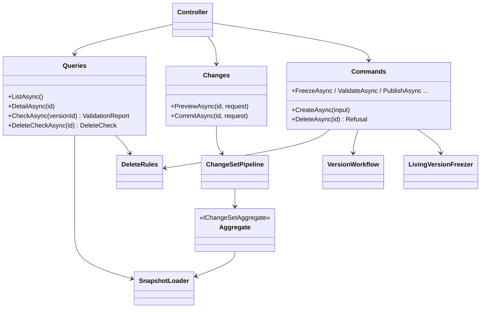

# Feature classes

[Index](README.md) · [High-level architecture](01-architecture.md) · [Request pipeline](02-request-pipeline.md) ·
[Core classes](03-core-classes.md) · [Version lifecycle](04-version-lifecycle.md) · [Key actions](06-key-actions.md)

Every module follows the same shape. A controller folder in `WebApi/<Feature>/` routes the contract's paths and calls three
kinds of Application service: **queries** (read models built from snapshots), a **change-set service** over
`ChangeSetPipeline` for edits, and **commands** for lifecycle actions on stored state. The module's
`*FeatureServiceCollectionExtensions` (in `WebApi/Configuration`) registers its route resources, services, aggregate,
snapshot rules, publication rule, copier and handlers. Contract schemas live in the module's file under
`api/openapi/contract/`, and their C# records in `Application/<Feature>/Models`.

## Tenant, session and system tenants

- **Controllers:** `SessionController` (`GET /api/me`), `TenantsController` (`GET /api/tenants`), `VocabulariesController`
  (`GET /api/vocabularies`), `TenantCatalogController` (`catalog`, `dimensions/{id}/published-members`),
  `OverviewController` (`overview`), `SystemTenantsController` (`/api/system/tenants`: list, get, create, update,
  enable or disable, verify).
- **Services:** `AccessibleTenantsService`; `TenantCatalogReader` builds the `TenantCatalog` every picker and cross-module
  link resolves against (one row per identity of every module, with live dimension versions, the dataset versions the
  active release pins, and the owning report of each report dimension and report bridge); `PublishedMembersReader`;
  `TenantInfoReader` (`qe_database_info`); `OverviewService`; `SystemTenantService` over `qe_tenant_directory` with
  `TenantConnectionVerification` and `IConnectionStringMasker`.
- Registered by `AddTenantFeature`.

## Source objects

- **Controller:** `SourceObjectsController` (`source-objects`, `source-objects/{kind}/{name}/columns`).
- **Services:** `SourceObjectDirectory` lists the tables and views datasets can read, with columns typed as fields, the
  managed-table registry (`qe_managed_source_object`) and live statistics; the engine's own objects are excluded.
  `ISourceObjectCatalog` reads `information_schema`, including `ListDistinctValuesAsync`, which report diagnostics use for
  direct sources (through `DatasetFieldValues`).

## Datasets, bindings and measures

- **Controllers:** `DatasetsController` (`datasets`: list, create, detail, delete, delete check, create draft at
  `datasets/{id}/versions`); `DatasetVersionsController` (`dataset-versions/{id}`: content, delete, delete check,
  `changes/preview`, `changes`, `check`, `validate`, `publish`, `reopen`, `retire`, and
  `fields/{id}/materialization` with `POST`, `DELETE` and `refresh`).
- **Aggregate:** `DatasetAggregate` over `DatasetSnapshot`; root is the dataset version. Operations: `updateDataset`,
  `saveSettings`, `renameSourceTable`, `saveField`, `deleteField`, `addFieldsFromColumns`, `saveGrain`, `deleteGrain`,
  `saveBinding`, `deleteBinding`, `saveMeasure`, `deleteMeasure`. Bindings (`Bindings/DatasetBindingEdits`, time bindings
  included) and measures (`Measures/DatasetMeasureEdits`, components, time policies, derived `qe_measure_dependency`) are
  part of the dataset version aggregate; their folders hold their edits and rules. Only a draft's content changes; only a
  change to the dataset identity row is engine-visible.
- **Services:** `DatasetQueries`, `DatasetChanges` (commits, then materializes JSON path fields whose input asked for it),
  `DatasetCommands` (create over an existing object or a new managed table, delete, drafts, the strict transitions),
  `DatasetSchemaChanges` (managed-table DDL as write-plan schema statements), `DatasetTableDrops` (a dataset delete's drops
  of the managed tables only it reads, with their views and registry rows), `DatasetMaterializations` (one asynchronous
  materialized view per source object holding its JSON path fields' columns), `DatasetVersionCloner`,
  `DatasetFieldValues` (the bounded distinct values of a field, for report diagnostics), `DatasetDeleteRules`.
- **Rules:** 26 snapshot rules, all `Publication` stage (field, grain, binding, measure, formula and time-policy rules),
  bridged to the workflow by `DatasetVersionRules`; one retirement rule, `ReleasePinsRetiredVersionRule`.
- **Infrastructure:** `IManagedTables` (`StarRocksManagedTables`), `IMaterializedViews` (`StarRocksMaterializedViews`).

## Dimensions

- **Controllers:** `DimensionsController` (`dimensions`: list, create, detail, delete, delete check, `changes/preview`,
  `changes`; `dimension-profiles` and `dimension-profiles/{profileKey}/define`; `dimension-roles/{id}/delete-check`);
  `DimensionVersionsController` (`dimension-versions/{id}`: content, delete, delete check, `check`, `freeze`, and
  `members/{id}/delete-check`, `levels/{id}/delete-check`).
- **Aggregate:** `DimensionAggregate` over `DimensionSnapshot`: the dimension, its roles and its live version's levels,
  members and range bands. Operations: `updateDimension`, `updateVersion`, `saveMember`, `deleteMember`, `moveMember`,
  `importMembers`, `clearMembers`, `saveLevel`, `deleteLevel`, `reorderLevels`, `saveBands`, `saveRole`, `deleteRole`.
  The plan rewrites `qe_dimension_closure` whenever members change.
- **Services:** `DimensionQueries` (report dimensions answer null, so 404), `DimensionChanges` (refuses report dimensions),
  `DimensionCommands` (create a user dimension with live version 1, define a system dimension from a profile, delete,
  delete a frozen version, freeze), `DimensionSnapshotLoader`, `DimensionUsageReader`, `DimensionConsumers`,
  `DimensionDrafts`, `DimensionVersionCloner`, `DimensionVersionCopier`, `DimensionVersionRemover`, `ClosureBuilder`,
  `DimensionDeleteRules`. `ReportDimensions` is the public hook through which the reports module creates and removes report
  dimensions.
- **Rules:** key uniqueness, parents and levels in the version, hierarchy acyclic, consumers resolve and profile-required
  keys are `Gate`; band, property and range data type rules are `Publication`. `DimensionVersionRules` bridges them to the
  workflow.

## Mapping sets

- **Controllers:** `MappingSetsController` (`mapping-sets`: list, create, detail, delete, delete check, `changes/preview`,
  `changes`); `MappingVersionsController` (`mapping-versions/{id}`: content, delete, delete check, `check`, `freeze`).
- **Aggregate:** `MappingSetAggregate` over `MappingSetSnapshot`: the set and its live version's entries. Operations:
  `updateMappingSet`, `saveEntry`, `deleteEntry`, `replaceEntries`.
- **Services:** `MappingQueries`, `MappingSetChanges`, `MappingCommands` (create with an empty live version 1, delete,
  delete a frozen version, freeze), `MappingSetSnapshotLoader`, `MappingDrafts`, `MappingVersionCopier`,
  `MappingVersionRemover`, `MappingDeleteRules`.
- **Rules:** all `Commit` stage (`DimensionVersionPublishedRule`, `SourceKeyUniqueRule`, `EntryMemberInVersionRule`,
  `EntryMemberAssignableRule`): the preview flags offending entries and the commit is refused while any remain.

## Bridges

- **Controllers:** `BridgesController` (`bridges`: list, create, detail, delete, delete check, `changes/preview`,
  `changes`); `BridgeVersionsController` (`bridge-versions/{id}`: content, delete, delete check, `check`, `freeze`).
- **Aggregate:** `BridgeAggregate` over `BridgeSnapshot`: an analytical bridge and its live version's mappings. Operations:
  `updateBridge`, `updateBridgeVersion`, `saveBridgeMapping`, `deleteBridgeMapping`, `replaceBridgeMappings`.
- **Services:** `BridgeQueries`, `BridgeChanges` and `BridgeCommands` (both refuse report bridges), `BridgeStore` (stores
  and removes whole bridges, publishing version 1 through the workflow), `BridgeSnapshotLoader`, `BridgeOwnerReader` (which
  report source owns a bridge), `BridgeDrafts`, `BridgeVersionCopier`, `BridgeDeleteRules`.
- **`ReportBridges`:** the public service through which only the reports module writes report bridges: `CreateAsync` (live
  version 1, empty or copying another report bridge's rules; its publish advances the revision), `RenameAsync`,
  `ReplaceRowAsync`, `RemoveRowsAsync` and `DeleteAsync`. Its writes are immediate; the report commit places them in its
  write plan.
- **Rules:** all `Commit` stage (endpoint versions published, members in endpoint versions, pair uniqueness, cardinality,
  allocation rules, descendants only for report bridges).

## Releases

- **Controllers:** `ReleasesController` (`releases`: list, create, `diff`, detail, delete, `changes/preview`, `changes`,
  `check`, `validate`, `publish`, `reopen`, `retire`, `activate`); `ReleaseProjectionsController` (`manifest-datasets`,
  `identities`, `report-reads`).
- **Aggregate:** `ReleaseAggregate` over `ReleaseSnapshot`: a draft release's manifest, with one operation,
  `saveManifest`. Never engine-visible.
- **Services:** `ReleaseQueries`, `ReleaseChanges` (refuses a release that is not a draft; the preview adds the rules'
  report and the difference from the active release), `ReleaseCommands` (create, delete a draft, validate, publish,
  reopen, retire, activate), `ReleaseRules` over the `IReleaseRule`s, `ReleaseReportChecks` (enabled reports against a
  release), `ReleaseNotActiveRule`, the manifest and report readers.
- **Rules:** `ReleaseGateRule` runs the `Gate`-stage release rules in the change set; `ReleaseVersionRules` is the
  `semantic_release` publication rule.

## Assumption sets

- **Controller:** `AssumptionSetsController` (`assumption-sets`: list, capture, `capture-preview`, `compare`, detail,
  relabel with `PUT`, delete).
- **Services:** `AssumptionSetQueries`, `AssumptionSetCommands` (capture, relabel, delete), `AssumptionPins` (the pin
  tables; pin the active set, unpin a deleted identity), `ActiveSetPinner` (the publish handler of each living kind),
  `PinIdentityReader`. Assumption sets have no change set.

## Calculation models

- **Controller:** `CalculationModelsController` (`calculation-models`: list, create, detail, delete, delete check,
  `formula-check`, `changes/preview`, `changes`).
- **Aggregate:** `ModelChanges` over `ModelSnapshot`: the model, variables, calculated measures, parameters and
  attributions. Operations: `updateModel`, `saveVariable`, `deleteVariable`, `saveMeasure`, `deleteMeasure`,
  `saveParameter`, `deleteParameter`, `setAttribution`, `clearAttribution`. Engine-visible when an enabled report reads the
  model and its rows changed.
- **Services:** `ModelQueries`, `ModelCommands` (create a disabled empty model, delete a model no report reads),
  `ModelSnapshotLoader`, `MetricAttributionService`, `ModelParameterService`, `ModelFormulaChecker` (parses one formula with
  the engine's `ExpressionParser` and checks the rules a formula answers for alone), `ModelDeleteRules`.
- **Rules:** `ModelGateRule` (`Gate`) refuses a change that introduces a model-rule or report-rule violation; a violation the
  stored model already has does not block, so a broken model can be repaired step by step. `ModelFindingsRule`
  (`Publication`) reports the rest.

## Reports

- **Controller:** `ReportsController` (`reports`: list, create, detail, delete, `diagnostics`,
  `sources/{sourceKey}/unmapped`, `changes/preview`, `changes`, `PUT enabled`).
- **Aggregate:** `ReportAggregate` over `ReportSnapshot`: the report row, its rows (the report dimension's members, member
  options and overlay lines), sources with their variables, left-out items and report bridges' rules, profiles,
  calculation dimensions, scenarios, variable scopes, columns, styles and row parameters. Operations: `updateSettings`,
  `saveRow`, `moveRow`, `deleteRow`, `saveSource`, `deleteSource`, `setSourceVariables`, `setRowRules`, `setLeftOut`,
  `saveProfile`, `deleteProfile`, `saveCalculationDimension`, `deleteCalculationDimension`, `setScenarios`,
  `setVariableScopes`, `setColumns`, `saveStyle`, `deleteStyle`. Engine-visible when the report is enabled and its content
  changed.
- **Services:** `ReportQueries`, `ReportChanges` (the preview adds the pending report's diagnostics), `ReportCommands`
  (create a disabled report with its report dimension, optionally copying another report through `ReportCopy`; enable,
  which runs every report rule, or disable), `ReportRemover` (deletes the report with its content, source bridges and report
  dimension), `ReportSourceWrites` (plans source rows and report bridges through `ReportBridges`), `ReportDiagnosticsBuilder`
  (readiness steps, source coverage and profile resolution; a direct source's items are its field's values in the active
  release's dataset version, read through `DatasetFieldValues`), `ReportSnapshotLoader`, `ReportGraphReader`,
  `OwnedVersions`, `ReleaseDatasets`.
- **Rules:** twelve `IReportRule`s run by `ReportRules`; `ReportGateRule` (`Gate`) refuses a change that leaves an enabled
  report breaking any of them, and `ReportFindingsRule` (`Publication`) lists a disabled report's violations as findings.
