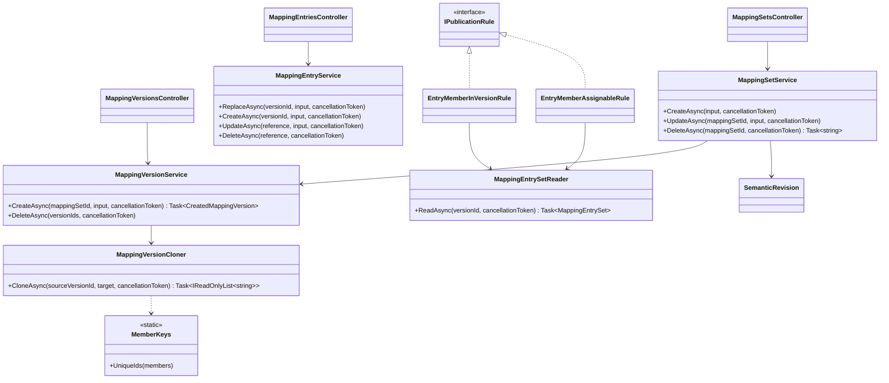
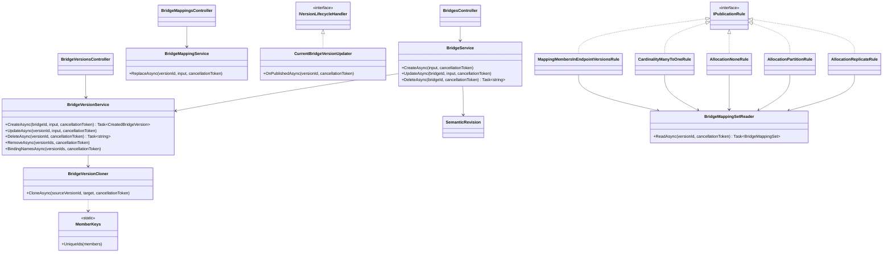
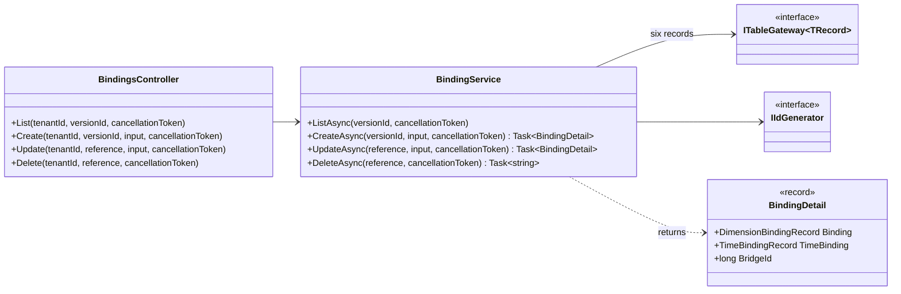
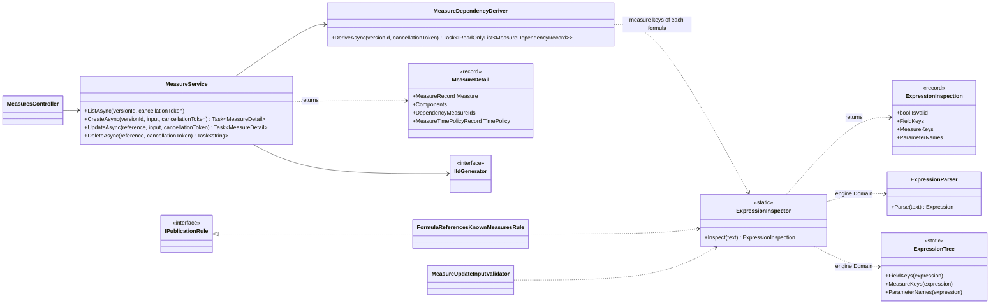
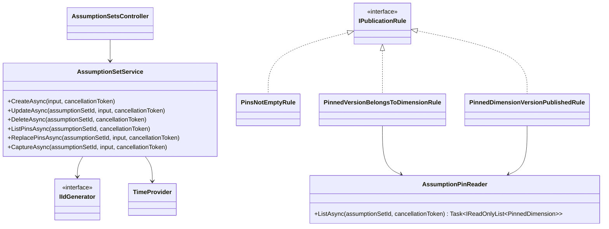
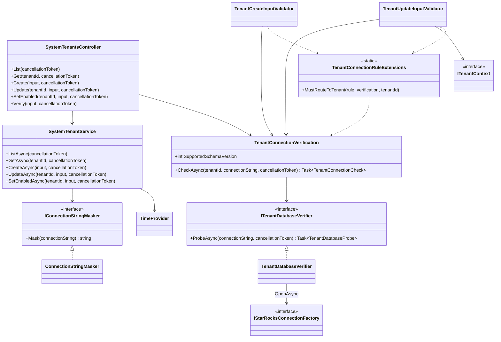

# Feature classes

[Diagram index](README.md) · [Architecture](01-architecture.md) · [Request pipeline](02-request-pipeline.md) · [Core classes](03-core-classes.md) · [Version lifecycle](04-version-lifecycle.md) · [Key actions](06-key-actions.md)

One drawing per feature area. Each shows the controllers, services, cloners, derivers, readers and executors of the area, the interfaces at its seams, and the rules that depend on them. Table gateways are left out of the drawings to keep them readable; the table under each drawing lists the records each class reads or writes through `ITableGateway<TRecord>`. Publication rules are listed in registration order, which is the order the workflow runs them; a rule's code and class name are given as `code` (`Class`). Endpoint detail is in the [OpenAPI document](../../openapi/admin-api.json).

**Sources:** [ITableGateway.cs](../../src/Quantalytix.QueryEngine.Admin.Application/Metadata/ITableGateway.cs), [VersionWorkflow.cs](../../src/Quantalytix.QueryEngine.Admin.Application/Versioning/VersionWorkflow.cs), [feature registrations](../../src/Quantalytix.QueryEngine.Admin.Api/Configuration), [Program.cs](../../src/Quantalytix.QueryEngine.Admin.Api/Program.cs).

## Datasets, source objects and schema changes

The drawing shows the dataset slice: identities, versions and their content, fields and grains, and the two Infrastructure seams that reach the physical tenant database. It matters because creating, cloning, materializing and deleting each fan out over several tables in a fixed order.

- **Routes:** `api/tenants/{tenantId}/datasets` (`DatasetsController`, including `{datasetId:long}/versions`), `api/tenants/{tenantId}/dataset-versions` (`DatasetVersionsController`), `api/tenants/{tenantId}/dataset-versions/{versionId:long}/fields` (`FieldsController`, including `from-columns`, `{fieldId:long}/materialize` and `{fieldId:long}/materialized-column`), `api/tenants/{tenantId}/dataset-versions/{versionId:long}/grains` (`GrainsController`), `api/tenants/{tenantId}/source-objects` (`SourceObjectsController`).
- **Publication rules** (`dataset_version`, the first ten of the kind): `source_object_exists` (`SourceObjectExistsRule`), `version_supports_a_mode` (`VersionSupportsAModeRule`), `default_time_binding_in_version` (`DefaultTimeBindingInVersionRule`), `field_key_unique` (`FieldKeyUniqueRule`), `field_columns_exist` (`FieldColumnsExistRule`), `expression_field_references` (`ExpressionFieldReferencesRule`), `expression_field_acyclic` (`ExpressionFieldAcyclicRule`), `grain_key_unique` (`GrainKeyUniqueRule`), `grain_fields_in_version` (`GrainFieldsInVersionRule`), `series_grain_excludes_time_field` (`SeriesGrainExcludesTimeFieldRule`).
- **Retirement rules and lifecycle handlers:** none.
- **Registration:** `AddDatasetsFeature` in [DatasetsFeatureServiceCollectionExtensions.cs](../../src/Quantalytix.QueryEngine.Admin.Api/Configuration/DatasetsFeatureServiceCollectionExtensions.cs), which also maps `ISourceObjectCatalog` to `SourceObjectCatalog` and `ISchemaChangeExecutor` to `SchemaChangeExecutor`.

`DatasetVersionContentStore` owns the order of the nine content tables: parents first when it inserts, children first when it deletes. A clone remaps every ID inside the version through one `IdRemap`, while references to other aggregates (dimensions and their versions, levels and members, mapping sets, bridge versions) keep their IDs. `SourceObjectService` hides the engine's `qe_` tables and `vw_qe_` views from the possible sources. `ExpressionFieldReferencesRule` and `ExpressionFieldAcyclicRule` parse field expressions with `ExpressionInspector`.

| Class | Records |
| --- | --- |
| `DatasetService` | `DatasetRecord`, `DatasetVersionRecord`, `ReleaseDatasetRecord`, `SemanticReleaseRecord` |
| `DatasetVersionService` | `DatasetVersionRecord`, `ReleaseDatasetRecord`, `SemanticReleaseRecord` |
| `DatasetVersionCloner` | `DatasetVersionRecord` |
| `DatasetVersionContentStore` | `FieldRecord`, `DatasetGrainRecord`, `DatasetGrainFieldRecord`, `DimensionBindingRecord`, `TimeBindingRecord`, `MeasureRecord`, `MeasureComponentRecord`, `MeasureDependencyRecord`, `MeasureTimePolicyRecord` |
| `FieldService` | `FieldRecord` |
| `FieldUsage` | `DatasetGrainRecord`, `DatasetGrainFieldRecord`, `DimensionBindingRecord`, `TimeBindingRecord`, `MeasureRecord`, `MeasureComponentRecord` |
| `FieldsFromColumnsService`, `MaterializedColumnService` | `FieldRecord`, `DatasetVersionRecord` |
| `GrainService` | `DatasetGrainRecord`, `DatasetGrainFieldRecord`, `MeasureTimePolicyRecord`, `MeasureRecord` |

**Sources:** [Datasets controllers](../../src/Quantalytix.QueryEngine.Admin.Api/Datasets), [SourceObjectsController.cs](../../src/Quantalytix.QueryEngine.Admin.Api/SourceObjects/SourceObjectsController.cs), [DatasetService.cs](../../src/Quantalytix.QueryEngine.Admin.Application/Datasets/DatasetService.cs), [DatasetVersionService.cs](../../src/Quantalytix.QueryEngine.Admin.Application/Datasets/DatasetVersionService.cs), [DatasetVersionCloner.cs](../../src/Quantalytix.QueryEngine.Admin.Application/Datasets/DatasetVersionCloner.cs), [DatasetVersionContentStore.cs](../../src/Quantalytix.QueryEngine.Admin.Application/Datasets/DatasetVersionContentStore.cs), [FieldService.cs](../../src/Quantalytix.QueryEngine.Admin.Application/Datasets/FieldService.cs), [FieldUsage.cs](../../src/Quantalytix.QueryEngine.Admin.Application/Datasets/FieldUsage.cs), [FieldsFromColumnsService.cs](../../src/Quantalytix.QueryEngine.Admin.Application/Datasets/FieldsFromColumnsService.cs), [MaterializedColumnService.cs](../../src/Quantalytix.QueryEngine.Admin.Application/Datasets/MaterializedColumnService.cs), [MaterializedColumnDdl.cs](../../src/Quantalytix.QueryEngine.Admin.Application/Datasets/MaterializedColumnDdl.cs), [GrainService.cs](../../src/Quantalytix.QueryEngine.Admin.Application/Datasets/GrainService.cs), [SourceObjectService.cs](../../src/Quantalytix.QueryEngine.Admin.Application/SourceObjects/SourceObjectService.cs), [ISourceObjectCatalog.cs](../../src/Quantalytix.QueryEngine.Admin.Application/SourceObjects/ISourceObjectCatalog.cs), [ISchemaChangeExecutor.cs](../../src/Quantalytix.QueryEngine.Admin.Application/SourceObjects/ISchemaChangeExecutor.cs), [SourceObjectCatalog.cs](../../src/Quantalytix.QueryEngine.Admin.Infrastructure.StarRocks/SourceObjects/SourceObjectCatalog.cs), [SchemaChangeExecutor.cs](../../src/Quantalytix.QueryEngine.Admin.Infrastructure.StarRocks/SchemaChanges/SchemaChangeExecutor.cs), [dataset rules](../../src/Quantalytix.QueryEngine.Admin.Application/Datasets), [DatasetsFeatureServiceCollectionExtensions.cs](../../src/Quantalytix.QueryEngine.Admin.Api/Configuration/DatasetsFeatureServiceCollectionExtensions.cs).

## Dimensions

The drawing shows the dimension slice: identities, effective-dated versions, levels, the member tree, range bands, and the two lifecycle handlers. It matters because a dimension version is the most connected object: mapping versions, bridge versions, bindings and assumption sets all pin it.

```mermaid
classDiagram
    direction TB
    class DimensionsController
    class DimensionVersionsController
    class DimensionLevelsController
    class DimensionMembersController
    class RangeBandsController
    class DimensionService {
        +CreateAsync(input, cancellationToken)
        +UpdateAsync(dimensionId, input, cancellationToken)
        +DeleteAsync(dimensionId, cancellationToken) Task~string~
    }
    class DimensionVersionService {
        +CreateAsync(dimensionId, input, cancellationToken)
        +UpdateAsync(dimensionVersionId, input, cancellationToken)
        +DeleteAsync(dimensionVersionId, cancellationToken) Task~string~
    }
    class DimensionVersionCloner {
        +CloneAsync(sourceVersionId, target, cancellationToken)
    }
    class DimensionVersionRemover {
        +RemoveAsync(versionIds, cancellationToken)
    }
    class DimensionDeleteChecks {
        +DimensionAsync(dimension, versions, cancellationToken) Task~string~
        +VersionAsync(version, cancellationToken) Task~string~
        +LevelAsync(level, cancellationToken) Task~string~
        +MemberAsync(member, cancellationToken) Task~string~
    }
    class DimensionLevelService
    class DimensionMemberService {
        +ReorderAsync(dimensionVersionId, input, cancellationToken)
    }
    class RangeBandService {
        +ReplaceAsync(reference, input, cancellationToken)
    }
    class RangeBandSetReader {
        +ReadAsync(versionId, cancellationToken) Task~RangeBandSet~
    }
    class ClosureBuilder {
        +OnValidatingAsync(versionId, cancellationToken)
    }
    class PredecessorValidityCloser {
        +OnPublishedAsync(versionId, cancellationToken)
    }
    class DimensionValidity {
        <<static>>
        +Overlap(first, second) bool
        +IsOpenPredecessor(published, later) bool
    }
    class IVersionLifecycleHandler {
        <<interface>>
    }
    class IPublicationRule {
        <<interface>>
    }
    DimensionsController --> DimensionService
    DimensionVersionsController --> DimensionVersionService
    DimensionLevelsController --> DimensionLevelService
    DimensionMembersController --> DimensionMemberService
    RangeBandsController --> RangeBandService
    DimensionService --> DimensionVersionService
    DimensionService --> DimensionVersionRemover
    DimensionService --> DimensionDeleteChecks
    DimensionService --> SemanticRevision
    DimensionVersionService --> DimensionVersionCloner
    DimensionVersionService --> DimensionVersionRemover
    DimensionVersionService --> DimensionDeleteChecks
    DimensionLevelService --> DimensionDeleteChecks
    DimensionMemberService --> DimensionDeleteChecks
    DimensionVersionCloner ..> IdRemap : one per clone
    IVersionLifecycleHandler <|.. ClosureBuilder
    IVersionLifecycleHandler <|.. PredecessorValidityCloser
    PredecessorValidityCloser ..> DimensionValidity
    IPublicationRule <|.. ValidityOverlapRule
    ValidityOverlapRule ..> DimensionValidity
    IPublicationRule <|.. BandBoundaryFamilyRule
    IPublicationRule <|.. BandBoundsOrderedRule
    IPublicationRule <|.. BandsNonOverlappingRule
    IPublicationRule <|.. BandMemberInVersionRule
    BandBoundaryFamilyRule --> RangeBandSetReader
    BandBoundsOrderedRule --> RangeBandSetReader
    BandsNonOverlappingRule --> RangeBandSetReader
    BandMemberInVersionRule --> RangeBandSetReader
```

- **Routes:** `api/tenants/{tenantId}/dimensions` (`DimensionsController`); under `api/tenants/{tenantId}`, `dimensions/{dimensionId:long}/versions` and `dimension-versions/{dimensionVersionId:long}` (`DimensionVersionsController`); `api/tenants/{tenantId}/dimension-versions/{dimensionVersionId:long}/levels` (`DimensionLevelsController`), `.../members` (`DimensionMembersController`, including `order`) and `.../range-bands` (`RangeBandsController`).
- **Publication rules** (`dimension_version`): `valid_from_required` (`ValidFromRequiredRule`), `validity_overlap` (`ValidityOverlapRule`), `range_data_type_matches_kind` (`RangeDataTypeMatchesKindRule`), `level_key_unique` (`LevelKeyUniqueRule`), `member_key_unique` (`MemberKeyUniqueRule`), `member_parent_in_version` (`MemberParentInVersionRule`), `member_level_in_version` (`MemberLevelInVersionRule`), `hierarchy_acyclic` (`HierarchyAcyclicRule`), `band_boundary_family` (`BandBoundaryFamilyRule`), `band_bounds_ordered` (`BandBoundsOrderedRule`), `bands_non_overlapping` (`BandsNonOverlappingRule`), `band_member_in_version` (`BandMemberInVersionRule`).
- **Retirement rules:** none. **Lifecycle handlers:** `ClosureBuilder` (`OnValidatingAsync`), then `PredecessorValidityCloser` (`OnPublishedAsync`).
- **Registration:** `AddDimensionsFeature` in [DimensionsFeatureServiceCollectionExtensions.cs](../../src/Quantalytix.QueryEngine.Admin.Api/Configuration/DimensionsFeatureServiceCollectionExtensions.cs).

`DimensionVersionService` stores the new draft first and then lets `DimensionVersionCloner` copy the source's levels, members with their parents and levels, range bands, and a draft of every non-retired mapping version of the dimension's mapping sets pinned to the source, with its entries; closure rows are not copied, because validation rebuilds them. `DimensionVersionRemover` deletes children first: the entries of draft mapping versions pinned to the versions, those mapping versions, range bands, closure rows, members, levels, then the versions. `DimensionDeleteChecks` names what blocks deleting a dimension, a version, a level or a member before anything is deleted.

| Class | Records |
| --- | --- |
| `DimensionService` | `DimensionRecord`, `DimensionVersionRecord` |
| `DimensionVersionService` | `DimensionVersionRecord` |
| `DimensionVersionCloner` | `DimensionLevelRecord`, `DimensionMemberRecord`, `RangeBandRecord`, `MappingSetRecord`, `MappingVersionRecord`, `DimensionMappingRecord` |
| `DimensionVersionRemover` | `DimensionVersionRecord`, `DimensionLevelRecord`, `DimensionMemberRecord`, `DimensionClosureRecord`, `RangeBandRecord`, `MappingVersionRecord`, `DimensionMappingRecord` |
| `DimensionDeleteChecks` | `DimensionMemberRecord`, `RangeBandRecord`, `MappingSetRecord`, `MappingVersionRecord`, `DimensionMappingRecord`, `BridgeRecord`, `BridgeVersionRecord`, `BridgeMappingRecord`, `DimensionBindingRecord`, `AssumptionSetDimensionRecord`, `AssumptionSetRecord` |
| `DimensionLevelService` | `DimensionLevelRecord` |
| `DimensionMemberService` | `DimensionMemberRecord` |
| `RangeBandService` | `RangeBandRecord` |
| `RangeBandSetReader` | `DimensionVersionRecord`, `DimensionRecord`, `RangeBandRecord`, `DimensionMemberRecord` |
| `ClosureBuilder` | `DimensionMemberRecord`, `DimensionClosureRecord` |
| `PredecessorValidityCloser` | `DimensionVersionRecord` |

**Sources:** [Dimensions controllers](../../src/Quantalytix.QueryEngine.Admin.Api/Dimensions), [DimensionService.cs](../../src/Quantalytix.QueryEngine.Admin.Application/Dimensions/DimensionService.cs), [DimensionVersionService.cs](../../src/Quantalytix.QueryEngine.Admin.Application/Dimensions/DimensionVersionService.cs), [DimensionVersionCloner.cs](../../src/Quantalytix.QueryEngine.Admin.Application/Dimensions/DimensionVersionCloner.cs), [DimensionVersionRemover.cs](../../src/Quantalytix.QueryEngine.Admin.Application/Dimensions/DimensionVersionRemover.cs), [DimensionDeleteChecks.cs](../../src/Quantalytix.QueryEngine.Admin.Application/Dimensions/DimensionDeleteChecks.cs), [DimensionLevelService.cs](../../src/Quantalytix.QueryEngine.Admin.Application/Dimensions/DimensionLevelService.cs), [DimensionMemberService.cs](../../src/Quantalytix.QueryEngine.Admin.Application/Dimensions/DimensionMemberService.cs), [RangeBandService.cs](../../src/Quantalytix.QueryEngine.Admin.Application/Dimensions/RangeBandService.cs), [RangeBandSetReader.cs](../../src/Quantalytix.QueryEngine.Admin.Application/Dimensions/RangeBandSetReader.cs), [ClosureBuilder.cs](../../src/Quantalytix.QueryEngine.Admin.Application/Dimensions/ClosureBuilder.cs), [PredecessorValidityCloser.cs](../../src/Quantalytix.QueryEngine.Admin.Application/Dimensions/PredecessorValidityCloser.cs), [DimensionValidity.cs](../../src/Quantalytix.QueryEngine.Admin.Application/Dimensions/DimensionValidity.cs), [dimension rules](../../src/Quantalytix.QueryEngine.Admin.Application/Dimensions), [DimensionsFeatureServiceCollectionExtensions.cs](../../src/Quantalytix.QueryEngine.Admin.Api/Configuration/DimensionsFeatureServiceCollectionExtensions.cs).

## Mappings

The drawing shows the mapping slice: mapping sets, their versions pinned to dimension versions, and the source-key entries. It matters because a mapping version only means something for the dimension version it pins, so cloning moves entries by member key.

- **Routes:** `api/tenants/{tenantId}/mapping-sets` (`MappingSetsController`); under `api/tenants/{tenantId}`, `mapping-sets/{mappingSetId:long}/versions` and `mapping-versions/{versionId:long}` (`MappingVersionsController`); `api/tenants/{tenantId}/mapping-versions/{versionId:long}/entries` (`MappingEntriesController`).
- **Publication rules** (`mapping_version`): `dimension_version_belongs_to_set_dimension` (`DimensionVersionBelongsToSetDimensionRule`), `dimension_version_published` (`DimensionVersionPublishedRule`), `one_mapping_version_per_dimension_version` (`OneMappingVersionPerDimensionVersionRule`), `source_key_unique` (`SourceKeyUniqueRule`), `entry_member_in_version` (`EntryMemberInVersionRule`), `entry_member_assignable` (`EntryMemberAssignableRule`).
- **Retirement rules and lifecycle handlers:** none.
- **Registration:** the first half of `AddMappingsAndBridgesFeature` in [MappingsAndBridgesFeatureServiceCollectionExtensions.cs](../../src/Quantalytix.QueryEngine.Admin.Api/Configuration/MappingsAndBridgesFeatureServiceCollectionExtensions.cs).

A mapping set is created without versions, because each version pins a dimension version. A clone moves every entry to the member with the same key in the draft's pinned dimension version, through `MemberKeys.UniqueIds`, and returns the source keys it dropped in `CreatedMappingVersion`. The dimension slice writes mapping versions too: `DimensionVersionCloner` copies those pinned to a cloned dimension version, and `DimensionVersionRemover` deletes the draft ones pinned to a deleted dimension version.

| Class | Records |
| --- | --- |
| `MappingSetService` | `MappingSetRecord`, `MappingVersionRecord`, `DimensionBindingRecord` |
| `MappingVersionService` | `MappingVersionRecord`, `DimensionMappingRecord` |
| `MappingVersionCloner` | `DimensionMappingRecord`, `DimensionMemberRecord` |
| `MappingEntryService` | `DimensionMappingRecord` |
| `MappingEntrySetReader` | `MappingVersionRecord`, `DimensionMappingRecord`, `DimensionMemberRecord` |

**Sources:** [Mappings controllers](../../src/Quantalytix.QueryEngine.Admin.Api/Mappings), [MappingSetService.cs](../../src/Quantalytix.QueryEngine.Admin.Application/Mappings/MappingSetService.cs), [MappingVersionService.cs](../../src/Quantalytix.QueryEngine.Admin.Application/Mappings/MappingVersionService.cs), [MappingVersionCloner.cs](../../src/Quantalytix.QueryEngine.Admin.Application/Mappings/MappingVersionCloner.cs), [MappingEntryService.cs](../../src/Quantalytix.QueryEngine.Admin.Application/Mappings/MappingEntryService.cs), [MappingEntrySetReader.cs](../../src/Quantalytix.QueryEngine.Admin.Application/Mappings/MappingEntrySetReader.cs), [MemberKeys.cs](../../src/Quantalytix.QueryEngine.Admin.Application/Mappings/MemberKeys.cs), [mapping rules](../../src/Quantalytix.QueryEngine.Admin.Application/Mappings), [DimensionVersionCloner.cs](../../src/Quantalytix.QueryEngine.Admin.Application/Dimensions/DimensionVersionCloner.cs), [DimensionVersionRemover.cs](../../src/Quantalytix.QueryEngine.Admin.Application/Dimensions/DimensionVersionRemover.cs), [MappingsAndBridgesFeatureServiceCollectionExtensions.cs](../../src/Quantalytix.QueryEngine.Admin.Api/Configuration/MappingsAndBridgesFeatureServiceCollectionExtensions.cs).

## Bridges

The drawing shows the bridge slice: bridges between two dimensions, their versions pinned to an endpoint version on each side, and the member-to-member mappings. It matters because five of the seven bridge rules read the same mapping set, through `BridgeMappingSetReader`.

- **Routes:** `api/tenants/{tenantId}/bridges` (`BridgesController`); under `api/tenants/{tenantId}`, `bridges/{bridgeId:long}/versions` and `bridge-versions/{versionId:long}` (`BridgeVersionsController`); `api/tenants/{tenantId}/bridge-versions/{versionId:long}/mappings` (`BridgeMappingsController`).
- **Publication rules** (`bridge_version`): `endpoint_versions_match_bridge` (`EndpointVersionsMatchBridgeRule`), `endpoint_versions_published` (`EndpointVersionsPublishedRule`), `mapping_members_in_endpoint_versions` (`MappingMembersInEndpointVersionsRule`), `cardinality_many_to_one` (`CardinalityManyToOneRule`), `allocation_none` (`AllocationNoneRule`), `allocation_partition` (`AllocationPartitionRule`), `allocation_replicate` (`AllocationReplicateRule`).
- **Retirement rules:** none. **Lifecycle handlers:** `CurrentBridgeVersionUpdater` (`OnPublishedAsync`).
- **Registration:** the second half of `AddMappingsAndBridgesFeature` in [MappingsAndBridgesFeatureServiceCollectionExtensions.cs](../../src/Quantalytix.QueryEngine.Admin.Api/Configuration/MappingsAndBridgesFeatureServiceCollectionExtensions.cs).

A bridge is created without versions, because each version pins its two endpoint dimension versions. A clone keeps each mapping's factor and weight and moves it to the members with the same source and target keys in the new endpoint versions, returning the mappings it dropped in `CreatedBridgeVersion`. Deleting a draft bridge version clears `qe_bridge.current_bridge_version_id` when it names that version.

| Class | Records |
| --- | --- |
| `BridgeService` | `BridgeRecord`, `BridgeVersionRecord` |
| `BridgeVersionService` | `BridgeRecord`, `BridgeVersionRecord`, `BridgeMappingRecord`, `DimensionBindingRecord` |
| `BridgeVersionCloner` | `BridgeMappingRecord`, `DimensionMemberRecord` |
| `BridgeMappingService` | `BridgeMappingRecord` |
| `BridgeMappingSetReader` | `BridgeVersionRecord`, `BridgeMappingRecord`, `DimensionMemberRecord` |
| `CurrentBridgeVersionUpdater` | `BridgeVersionRecord`, `BridgeRecord` |

**Sources:** [Bridges controllers](../../src/Quantalytix.QueryEngine.Admin.Api/Bridges), [BridgeService.cs](../../src/Quantalytix.QueryEngine.Admin.Application/Bridges/BridgeService.cs), [BridgeVersionService.cs](../../src/Quantalytix.QueryEngine.Admin.Application/Bridges/BridgeVersionService.cs), [BridgeVersionCloner.cs](../../src/Quantalytix.QueryEngine.Admin.Application/Bridges/BridgeVersionCloner.cs), [BridgeMappingService.cs](../../src/Quantalytix.QueryEngine.Admin.Application/Bridges/BridgeMappingService.cs), [BridgeMappingSetReader.cs](../../src/Quantalytix.QueryEngine.Admin.Application/Bridges/BridgeMappingSetReader.cs), [CurrentBridgeVersionUpdater.cs](../../src/Quantalytix.QueryEngine.Admin.Application/Bridges/CurrentBridgeVersionUpdater.cs), [bridge rules](../../src/Quantalytix.QueryEngine.Admin.Application/Bridges), [MappingsAndBridgesFeatureServiceCollectionExtensions.cs](../../src/Quantalytix.QueryEngine.Admin.Api/Configuration/MappingsAndBridgesFeatureServiceCollectionExtensions.cs).

## Bindings

The drawing shows the binding slice, which routes a dataset version's fields to canonical dimensions, with the time extension of time bindings. It is small in classes but carries nine of the dataset version's publication rules.

- **Routes:** `api/tenants/{tenantId}/dataset-versions/{versionId:long}/bindings` (`BindingsController`).
- **Publication rules** (`dataset_version`, after the Datasets rules): `binding_fields_in_version` (`BindingFieldsInVersionRule`), `binding_source_field_groupable` (`BindingSourceFieldGroupableRule`), `one_binding_per_field` (`OneBindingPerFieldRule`), `pinned_version_belongs_to_dimension` (`BindingPinnedVersionRule`), `mapped_binding_mapping_set_dimension` (`MappedBindingMappingSetDimensionRule`), `range_binding_dimension_kind` (`RangeBindingDimensionKindRule`), `time_binding_dimension_kind` (`TimeBindingDimensionKindRule`), `bridge_binding_route` (`BridgeBindingRouteRule`), `grouping_references_in_version` (`GroupingReferencesInVersionRule`).
- **Retirement rules and lifecycle handlers:** none.
- **Registration:** `AddBindingsAndMeasuresFeature` in [BindingsAndMeasuresFeatureServiceCollectionExtensions.cs](../../src/Quantalytix.QueryEngine.Admin.Api/Configuration/BindingsAndMeasuresFeatureServiceCollectionExtensions.cs).

`BindingService` writes the binding row before its time extension and deletes the extension first; a binding whose kind stops being `time` loses its extension. A delete is blocked while the binding is required, is the source binding of a bridge binding, is the required time binding of a measure's time policy, or is the version's default time binding. The bindings' rules are plain `IPublicationRule` classes over gateways, so the drawing leaves them out.

| Class | Records |
| --- | --- |
| `BindingService` | `DimensionBindingRecord`, `TimeBindingRecord`, `BridgeVersionRecord`, `DatasetVersionRecord`, `MeasureTimePolicyRecord`, `MeasureRecord` |

**Sources:** [BindingsController.cs](../../src/Quantalytix.QueryEngine.Admin.Api/Bindings/BindingsController.cs), [BindingService.cs](../../src/Quantalytix.QueryEngine.Admin.Application/Bindings/BindingService.cs), [BindingDetail.cs](../../src/Quantalytix.QueryEngine.Admin.Application/Bindings/Models/BindingDetail.cs), [binding rules](../../src/Quantalytix.QueryEngine.Admin.Application/Bindings), [BindingsAndMeasuresFeatureServiceCollectionExtensions.cs](../../src/Quantalytix.QueryEngine.Admin.Api/Configuration/BindingsAndMeasuresFeatureServiceCollectionExtensions.cs).

## Measures

The drawing shows the measure slice and how formula dependencies are derived rather than edited. It matters because the engine finds the measures a formula needs from `qe_measure_dependency`, and the API keeps those rows in step with the formulas by parsing them with the engine's own parser.

- **Routes:** `api/tenants/{tenantId}/dataset-versions/{versionId:long}/measures` (`MeasuresController`).
- **Publication rules** (`dataset_version`, after the Bindings rules): `measure_key_unique` (`MeasureKeyUniqueRule`), `component_fields_in_version` (`ComponentFieldsInVersionRule`), `component_roles_match_kind` (`ComponentRolesMatchKindRule`), `formula_references_known_measures` (`FormulaReferencesKnownMeasuresRule`), `formula_acyclic` (`FormulaAcyclicRule`), `time_policy_series_grain` (`TimePolicySeriesGrainRule`), `time_policy_time_binding_in_version` (`TimePolicyTimeBindingInVersionRule`).
- **Retirement rules and lifecycle handlers:** none.
- **Registration:** `AddBindingsAndMeasuresFeature` in [BindingsAndMeasuresFeatureServiceCollectionExtensions.cs](../../src/Quantalytix.QueryEngine.Admin.Api/Configuration/BindingsAndMeasuresFeatureServiceCollectionExtensions.cs), which also registers `MeasureDependencyDeriver`.

Every save derives the dependency rows of every formula of the version again, because a formula may name a measure created after it. A key that names no measure produces no row; `formula_references_known_measures` reports it at validation. A measure that another formula depends on cannot be deleted.

| Class | Records |
| --- | --- |
| `MeasureService` | `MeasureRecord`, `MeasureComponentRecord`, `MeasureDependencyRecord`, `MeasureTimePolicyRecord` |
| `MeasureDependencyDeriver` | `MeasureRecord`, `MeasureDependencyRecord` |

**Sources:** [MeasuresController.cs](../../src/Quantalytix.QueryEngine.Admin.Api/Measures/MeasuresController.cs), [MeasureService.cs](../../src/Quantalytix.QueryEngine.Admin.Application/Measures/MeasureService.cs), [MeasureDependencyDeriver.cs](../../src/Quantalytix.QueryEngine.Admin.Application/Measures/MeasureDependencyDeriver.cs), [MeasureDetail.cs](../../src/Quantalytix.QueryEngine.Admin.Application/Measures/Models/MeasureDetail.cs), [ExpressionInspector.cs](../../src/Quantalytix.QueryEngine.Admin.Application/Expressions/ExpressionInspector.cs), [ExpressionInspection.cs](../../src/Quantalytix.QueryEngine.Admin.Application/Expressions/Models/ExpressionInspection.cs), [MeasureUpdateInputValidator.cs](../../src/Quantalytix.QueryEngine.Admin.Application/Measures/MeasureUpdateInputValidator.cs), [measure rules](../../src/Quantalytix.QueryEngine.Admin.Application/Measures), [BindingsAndMeasuresFeatureServiceCollectionExtensions.cs](../../src/Quantalytix.QueryEngine.Admin.Api/Configuration/BindingsAndMeasuresFeatureServiceCollectionExtensions.cs); in the query engine checkout: [ExpressionParser.cs](../../../../Quantalytix.QueryEngine/src/Quantalytix.QueryEngine.Domain/Expressions/ExpressionParser.cs), [ExpressionTree.cs](../../../../Quantalytix.QueryEngine/src/Quantalytix.QueryEngine.Domain/Expressions/ExpressionTree.cs).

## Releases and overview

The drawing shows semantic releases, their manifests of pinned dataset versions, activation, and the tenant overview. It matters because activation is the only way a dataset version reaches queries.

```mermaid
classDiagram
    direction TB
    class ReleasesController
    class OverviewController
    class ReleaseService {
        +ListAsync(cancellationToken)
        +CreateAsync(input, cancellationToken)
        +DeleteAsync(releaseId, cancellationToken)
        +ListDatasetsAsync(releaseId, cancellationToken)
        +ReplaceDatasetsAsync(releaseId, input, cancellationToken)
    }
    class ReleaseActivator {
        +ActivateAsync(releaseId, cancellationToken) Task~ReleaseActivationResult~
    }
    class ReleaseActivationResult {
        <<record>>
        +bool Activated
        +SemanticReleaseRecord Release
        +DatabaseInfoRecord DatabaseInfo
    }
    class ReleaseManifestReader {
        +ListDatasetsAsync(releaseId, cancellationToken)
        +ListBindingsAsync(releaseId, cancellationToken)
    }
    class OverviewService {
        +GetAsync(cancellationToken) Task~TenantOverview~
    }
    class IIdGenerator {
        <<interface>>
    }
    class IPublicationRule {
        <<interface>>
    }
    class IRetirementRule {
        <<interface>>
    }
    ReleasesController --> ReleaseService
    ReleasesController --> ReleaseActivator
    OverviewController --> OverviewService
    ReleaseService --> IIdGenerator
    ReleaseService --> TimeProvider
    ReleaseActivator --> SemanticRevision
    ReleaseActivator --> TimeProvider
    ReleaseActivator ..> ReleaseActivationResult : returns
    IRetirementRule <|.. ReleaseNotActiveRule
    IPublicationRule <|.. PinnedVersionBelongsToDatasetRule
    IPublicationRule <|.. PinnedDatasetVersionPublishedRule
    IPublicationRule <|.. BoundDimensionsResolvableRule
    IPublicationRule <|.. MappedBindingsResolvableRule
    IPublicationRule <|.. BridgeBindingsResolvableRule
    PinnedVersionBelongsToDatasetRule --> ReleaseManifestReader
    PinnedDatasetVersionPublishedRule --> ReleaseManifestReader
    BoundDimensionsResolvableRule --> ReleaseManifestReader
    MappedBindingsResolvableRule --> ReleaseManifestReader
    BridgeBindingsResolvableRule --> ReleaseManifestReader
```

- **Routes:** `api/tenants/{tenantId}/releases` (`ReleasesController`, including `{releaseId:long}/datasets` and `{releaseId:long}/activate`), `api/tenants/{tenantId}/overview` (`OverviewController`).
- **Publication rules** (`semantic_release`): `manifest_not_empty` (`ManifestNotEmptyRule`), `pinned_version_belongs_to_dataset` (`PinnedVersionBelongsToDatasetRule`), `pinned_version_published` (`PinnedDatasetVersionPublishedRule`), `bound_dimensions_resolvable` (`BoundDimensionsResolvableRule`), `mapped_bindings_resolvable` (`MappedBindingsResolvableRule`), `bridge_bindings_resolvable` (`BridgeBindingsResolvableRule`).
- **Retirement rules:** `release_not_active` (`ReleaseNotActiveRule`). **Lifecycle handlers:** none.
- **Registration:** `AddReleasesAndSystemFeature` in [ReleasesAndSystemFeatureServiceCollectionExtensions.cs](../../src/Quantalytix.QueryEngine.Admin.Api/Configuration/ReleasesAndSystemFeatureServiceCollectionExtensions.cs).

A release is created as a draft, optionally with a copy of another release's manifest. Validating, publishing and retiring go through the version status endpoint with kind `semantic_release`; activation has its own endpoint, refuses a release that is not published, and advances the semantic revision. `OverviewService` only reads: the tenant's identity, schema version, revision and active release, counts, and drafts in progress.

| Class | Records |
| --- | --- |
| `ReleaseService` | `SemanticReleaseRecord`, `ReleaseDatasetRecord`, `DatabaseInfoRecord` |
| `ReleaseActivator` | `SemanticReleaseRecord`, `DatabaseInfoRecord` |
| `ReleaseManifestReader` | `ReleaseDatasetRecord`, `DatasetRecord`, `DimensionBindingRecord` |
| `ReleaseNotActiveRule` | `DatabaseInfoRecord`, `SemanticReleaseRecord` |
| `OverviewService` | `DatabaseInfoRecord`, `SemanticReleaseRecord`, `ReleaseDatasetRecord`, `DatasetRecord`, `DatasetVersionRecord`, `MeasureRecord`, `DimensionRecord`, `DimensionVersionRecord`, `MappingSetRecord`, `MappingVersionRecord`, `BridgeRecord`, `BridgeVersionRecord`, `AssumptionSetRecord` |

**Sources:** [ReleasesController.cs](../../src/Quantalytix.QueryEngine.Admin.Api/Releases/ReleasesController.cs), [OverviewController.cs](../../src/Quantalytix.QueryEngine.Admin.Api/Overview/OverviewController.cs), [ReleaseService.cs](../../src/Quantalytix.QueryEngine.Admin.Application/Releases/ReleaseService.cs), [ReleaseActivator.cs](../../src/Quantalytix.QueryEngine.Admin.Application/Releases/ReleaseActivator.cs), [ReleaseActivationResult.cs](../../src/Quantalytix.QueryEngine.Admin.Application/Releases/Models/ReleaseActivationResult.cs), [ReleaseManifestReader.cs](../../src/Quantalytix.QueryEngine.Admin.Application/Releases/ReleaseManifestReader.cs), [ReleaseNotActiveRule.cs](../../src/Quantalytix.QueryEngine.Admin.Application/Releases/ReleaseNotActiveRule.cs), [release rules](../../src/Quantalytix.QueryEngine.Admin.Application/Releases), [OverviewService.cs](../../src/Quantalytix.QueryEngine.Admin.Application/Overview/OverviewService.cs), [ReleasesAndSystemFeatureServiceCollectionExtensions.cs](../../src/Quantalytix.QueryEngine.Admin.Api/Configuration/ReleasesAndSystemFeatureServiceCollectionExtensions.cs).

## Assumption sets

The drawing shows assumption sets, snapshots that pin one exact dimension version per dimension. It matters because they are the one versioned kind without a validated state: their publication rules run on draft to published.

- **Routes:** `api/tenants/{tenantId}/assumption-sets` (`AssumptionSetsController`, including `{assumptionSetId:long}/dimensions` and `{assumptionSetId:long}/capture`).
- **Publication rules** (`assumption_set`): `pins_not_empty` (`PinsNotEmptyRule`), `pinned_version_belongs_to_dimension` (`PinnedVersionBelongsToDimensionRule`), `pinned_version_published` (`PinnedDimensionVersionPublishedRule`).
- **Retirement rules and lifecycle handlers:** none.
- **Registration:** `AddReleasesAndSystemFeature` in [ReleasesAndSystemFeatureServiceCollectionExtensions.cs](../../src/Quantalytix.QueryEngine.Admin.Api/Configuration/ReleasesAndSystemFeatureServiceCollectionExtensions.cs).

Pins are edited as a complete list or captured: `CaptureAsync` pins, for each named dimension, its published version effective at the set's `effective_at`. Publishing and retiring go through the version status endpoint with kind `assumption_set`, and both advance the semantic revision.

| Class | Records |
| --- | --- |
| `AssumptionSetService` | `AssumptionSetRecord`, `AssumptionSetDimensionRecord`, `DimensionVersionRecord` |
| `AssumptionPinReader` | `AssumptionSetDimensionRecord`, `DimensionRecord` |

**Sources:** [AssumptionSetsController.cs](../../src/Quantalytix.QueryEngine.Admin.Api/AssumptionSets/AssumptionSetsController.cs), [AssumptionSetService.cs](../../src/Quantalytix.QueryEngine.Admin.Application/AssumptionSets/AssumptionSetService.cs), [AssumptionPinReader.cs](../../src/Quantalytix.QueryEngine.Admin.Application/AssumptionSets/AssumptionPinReader.cs), [PinsNotEmptyRule.cs](../../src/Quantalytix.QueryEngine.Admin.Application/AssumptionSets/PinsNotEmptyRule.cs), [PinnedVersionBelongsToDimensionRule.cs](../../src/Quantalytix.QueryEngine.Admin.Application/AssumptionSets/PinnedVersionBelongsToDimensionRule.cs), [PinnedDimensionVersionPublishedRule.cs](../../src/Quantalytix.QueryEngine.Admin.Application/AssumptionSets/PinnedDimensionVersionPublishedRule.cs), [ReleasesAndSystemFeatureServiceCollectionExtensions.cs](../../src/Quantalytix.QueryEngine.Admin.Api/Configuration/ReleasesAndSystemFeatureServiceCollectionExtensions.cs), [VersionWorkflow.cs](../../src/Quantalytix.QueryEngine.Admin.Application/Versioning/VersionWorkflow.cs).

## System tenants and tenant verification

The drawing shows how SystemAdmins edit the control plane's tenant directory and how a candidate connection string is verified. It matters because a tenant's connection string decides which database every one of its requests writes to.

- **Routes:** `api/system/tenants` (`SystemTenantsController`, `SystemAdmin` policy, including `{tenantId}`, `{tenantId}/enabled` and `verify`).
- **Publication rules, retirement rules and lifecycle handlers:** none; tenant directory rows are not versioned.
- **Registration:** `AddReleasesAndSystemFeature` in [ReleasesAndSystemFeatureServiceCollectionExtensions.cs](../../src/Quantalytix.QueryEngine.Admin.Api/Configuration/ReleasesAndSystemFeatureServiceCollectionExtensions.cs), which also maps `ITenantDatabaseVerifier` to `TenantDatabaseVerifier` and `IConnectionStringMasker` to `ConnectionStringMasker`.

A connection string is external input, so it is verified whenever one is supplied: `POST verify` reports the outcome as a `TenantConnectionCheck`, while create and update run the same check through `MustRouteToTenant` as a validation error on `connectionString`. The check passes when the string opens and its database's `qe_database_info` names the tenant and has metadata schema version 4. Connection strings are write-only: every response masks the password through MySqlConnector's own parser. Tenants are never deleted.

| Class | Records |
| --- | --- |
| `SystemTenantService` | `TenantDirectoryRecord` |
| `TenantCreateInputValidator` | `TenantDirectoryRecord`, to check that the tenant ID is unused |

**Sources:** [SystemTenantsController.cs](../../src/Quantalytix.QueryEngine.Admin.Api/SystemTenants/SystemTenantsController.cs), [SystemTenantService.cs](../../src/Quantalytix.QueryEngine.Admin.Application/SystemTenants/SystemTenantService.cs), [TenantConnectionVerification.cs](../../src/Quantalytix.QueryEngine.Admin.Application/SystemTenants/TenantConnectionVerification.cs), [ITenantDatabaseVerifier.cs](../../src/Quantalytix.QueryEngine.Admin.Application/SystemTenants/ITenantDatabaseVerifier.cs), [IConnectionStringMasker.cs](../../src/Quantalytix.QueryEngine.Admin.Application/SystemTenants/IConnectionStringMasker.cs), [TenantConnectionRuleExtensions.cs](../../src/Quantalytix.QueryEngine.Admin.Application/SystemTenants/TenantConnectionRuleExtensions.cs), [TenantCreateInputValidator.cs](../../src/Quantalytix.QueryEngine.Admin.Application/SystemTenants/TenantCreateInputValidator.cs), [TenantUpdateInputValidator.cs](../../src/Quantalytix.QueryEngine.Admin.Application/SystemTenants/TenantUpdateInputValidator.cs), [TenantDatabaseVerifier.cs](../../src/Quantalytix.QueryEngine.Admin.Infrastructure.StarRocks/TenantVerification/TenantDatabaseVerifier.cs), [ConnectionStringMasker.cs](../../src/Quantalytix.QueryEngine.Admin.Infrastructure.StarRocks/TenantVerification/ConnectionStringMasker.cs), [ReleasesAndSystemFeatureServiceCollectionExtensions.cs](../../src/Quantalytix.QueryEngine.Admin.Api/Configuration/ReleasesAndSystemFeatureServiceCollectionExtensions.cs).
