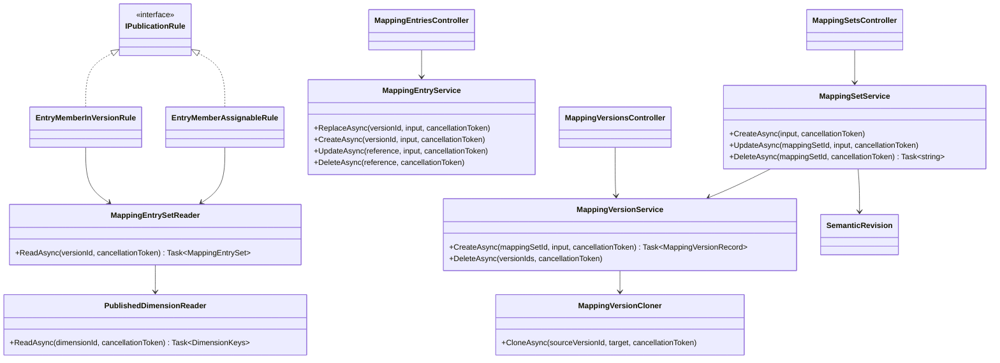
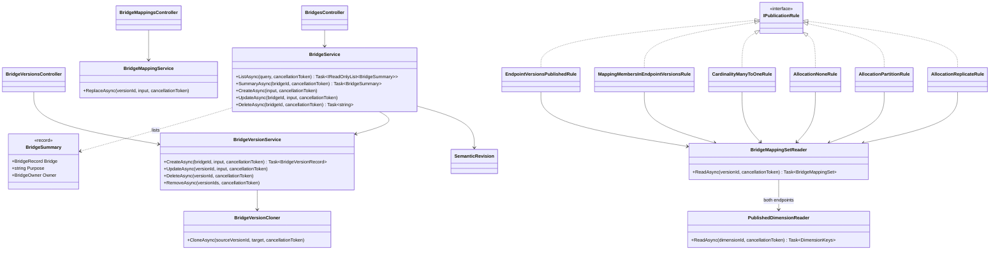
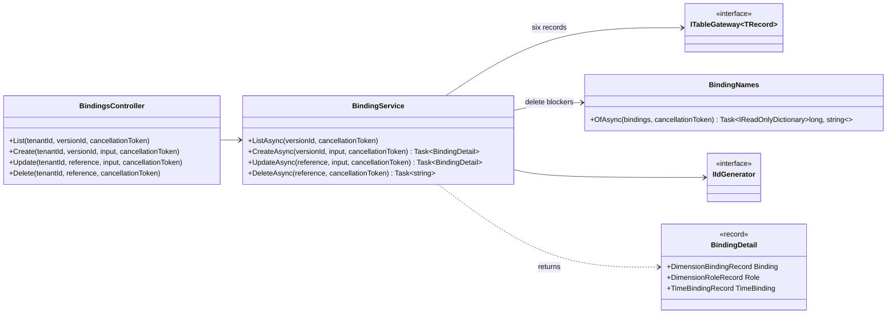
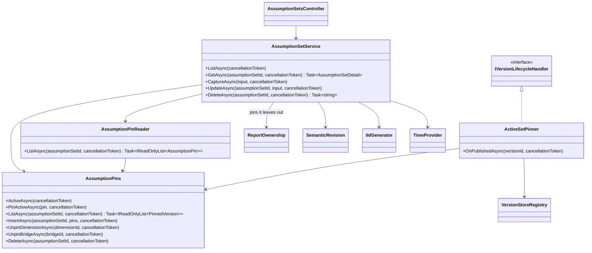

# Feature classes

[Diagram index](README.md) · [Architecture](01-architecture.md) · [Request pipeline](02-request-pipeline.md) · [Core classes](03-core-classes.md) · [Version lifecycle](04-version-lifecycle.md) · [Key actions](06-key-actions.md)

One drawing per feature area. Each shows the controllers, services, cloners, derivers, readers and executors of the area, the interfaces at its seams, and the rules that depend on them. Table gateways are left out of the drawings to keep them readable; the table under each drawing lists the records each class reads or writes through `ITableGateway<TRecord>`. Publication rules are listed in registration order, which is the order the workflow runs them; a rule's code and class name are given as `code` (`Class`). Endpoint detail is in the [OpenAPI document](../../openapi/admin-api.json).

**Sources:** [ITableGateway.cs](../../src/Quantalytix.QueryEngine.Admin.Application/Metadata/ITableGateway.cs), [VersionWorkflow.cs](../../src/Quantalytix.QueryEngine.Admin.Application/Versioning/VersionWorkflow.cs), [feature registrations](../../src/Quantalytix.QueryEngine.Admin.Api/Configuration), [Program.cs](../../src/Quantalytix.QueryEngine.Admin.Api/Program.cs).

## Datasets, source objects and schema changes

The drawing shows the dataset slice: identities, versions and their content, fields and grains, and the two Infrastructure seams that reach the physical tenant database. It matters because creating, cloning, materializing and deleting each fan out over several tables in a fixed order.

```mermaid
classDiagram
    direction TB
    class DatasetsController
    class DatasetVersionsController
    class FieldsController
    class GrainsController
    class SourceObjectsController
    class DatasetService {
        +CreateAsync(input, cancellationToken) Task~DatasetRecord~
        +UpdateAsync(datasetId, input, cancellationToken)
        +DeleteAsync(datasetId, cancellationToken) Task~string~
    }
    class DatasetVersionService {
        +CreateAsync(datasetId, input, cancellationToken)
        +UpdateAsync(versionId, input, cancellationToken)
        +DeleteDraftAsync(versionId, cancellationToken) Task~string~
        +DeleteAsync(versionIds, cancellationToken)
    }
    class DatasetVersionCloner {
        +CloneAsync(sourceVersionId, datasetId, versionNumber, cancellationToken)
    }
    class DatasetVersionContentStore {
        +LoadAsync(versionIds, cancellationToken) Task~DatasetVersionContent~
        +InsertAsync(content, cancellationToken)
        +DeleteAsync(versionIds, cancellationToken)
    }
    class FieldService {
        +CreateAsync(versionId, input, cancellationToken)
        +UpdateAsync(reference, input, cancellationToken)
        +DeleteAsync(reference, cancellationToken) Task~string~
    }
    class FieldUsage {
        +ListAsync(fieldId, cancellationToken)
    }
    class FieldsFromColumnsService {
        +CreateAsync(versionId, input, cancellationToken)
    }
    class MaterializedColumnService {
        +MaterializeAsync(reference, input, cancellationToken) Task~string~
        +SetAsync(reference, input, cancellationToken) Task~string~
    }
    class MaterializedColumnDdl {
        <<static>>
        +AddColumn(tableName, columnName, field) string
    }
    class GrainService {
        +CreateAsync(versionId, input, cancellationToken)
        +UpdateAsync(reference, input, cancellationToken)
        +DeleteAsync(reference, cancellationToken) Task~string~
    }
    class SourceObjectService {
        +ListAsync(cancellationToken)
        +ExistsAsync(kind, name, cancellationToken) Task~bool~
        +ListColumnsAsync(objectName, cancellationToken)
    }
    class ISourceObjectCatalog {
        <<interface>>
        +ListObjectsAsync(cancellationToken)
        +ListColumnsAsync(objectName, cancellationToken)
    }
    class SourceObjectCatalog
    class ISchemaChangeExecutor {
        <<interface>>
        +ApplyAsync(tableName, statement, cancellationToken) Task
    }
    class SchemaChangeExecutor
    class IStarRocksConnectionFactory {
        <<interface>>
    }
    class IPublicationRule {
        <<interface>>
    }
    DatasetsController --> DatasetService
    DatasetsController --> DatasetVersionService
    DatasetVersionsController --> DatasetVersionService
    FieldsController --> FieldService
    FieldsController --> FieldsFromColumnsService
    FieldsController --> MaterializedColumnService
    GrainsController --> GrainService
    SourceObjectsController --> SourceObjectService
    DatasetService --> DatasetVersionService
    DatasetService --> SemanticRevision
    DatasetVersionService --> DatasetVersionCloner
    DatasetVersionService --> DatasetVersionContentStore
    DatasetVersionCloner --> DatasetVersionContentStore
    DatasetVersionCloner ..> IdRemap : one per clone
    FieldService --> FieldUsage
    FieldsFromColumnsService --> SourceObjectService
    MaterializedColumnService --> SourceObjectService
    MaterializedColumnService --> ISchemaChangeExecutor
    MaterializedColumnService ..> MaterializedColumnDdl
    SourceObjectService --> ISourceObjectCatalog
    ISourceObjectCatalog <|.. SourceObjectCatalog
    ISchemaChangeExecutor <|.. SchemaChangeExecutor
    SourceObjectCatalog --> IStarRocksConnectionFactory
    SchemaChangeExecutor --> IStarRocksConnectionFactory
    IPublicationRule <|.. SourceObjectExistsRule
    IPublicationRule <|.. FieldColumnsExistRule
    SourceObjectExistsRule --> SourceObjectService
    FieldColumnsExistRule --> SourceObjectService
```

- **Routes:** `api/tenants/{tenantId}/datasets` (`DatasetsController`, including `{datasetId:long}/versions`), `api/tenants/{tenantId}/dataset-versions` (`DatasetVersionsController`), `api/tenants/{tenantId}/dataset-versions/{versionId:long}/fields` (`FieldsController`, including `from-columns`, `{fieldId:long}/materialize` and `{fieldId:long}/materialized-column`), `api/tenants/{tenantId}/dataset-versions/{versionId:long}/grains` (`GrainsController`), `api/tenants/{tenantId}/source-objects` (`SourceObjectsController`).
- **Publication rules** (`dataset_version`, the first ten of the kind): `source_object_exists` (`SourceObjectExistsRule`), `version_supports_a_mode` (`VersionSupportsAModeRule`), `default_time_binding_in_version` (`DefaultTimeBindingInVersionRule`), `field_key_unique` (`FieldKeyUniqueRule`), `field_columns_exist` (`FieldColumnsExistRule`), `expression_field_references` (`ExpressionFieldReferencesRule`), `expression_field_acyclic` (`ExpressionFieldAcyclicRule`), `grain_key_unique` (`GrainKeyUniqueRule`), `grain_fields_in_version` (`GrainFieldsInVersionRule`), `series_grain_excludes_time_field` (`SeriesGrainExcludesTimeFieldRule`).
- **Retirement rules and lifecycle handlers:** none.
- **Registration:** `AddDatasetsFeature` in [DatasetsFeatureServiceCollectionExtensions.cs](../../src/Quantalytix.QueryEngine.Admin.Api/Configuration/DatasetsFeatureServiceCollectionExtensions.cs), which also maps `ISourceObjectCatalog` to `SourceObjectCatalog` and `ISchemaChangeExecutor` to `SchemaChangeExecutor`.

`DatasetVersionContentStore` owns the order of the nine content tables: parents first when it inserts, children first when it deletes. A clone remaps every ID inside the version through one `IdRemap`, while references to other aggregates (dimensions, mapping sets and bridges) keep their IDs and level and member keys stay as they are. `SourceObjectService` hides the engine's `qe_` tables and `vw_qe_` views from the possible sources. `ExpressionFieldReferencesRule` and `ExpressionFieldAcyclicRule` parse field expressions with `ExpressionInspector`.

| Class | Records |
| --- | --- |
| `DatasetService` | `DatasetRecord`, `DatasetVersionRecord`, `ReleaseDatasetRecord`, `SemanticReleaseRecord` |
| `DatasetVersionService` | `DatasetVersionRecord`, `ReleaseDatasetRecord`, `SemanticReleaseRecord` |
| `DatasetVersionCloner` | `DatasetVersionRecord` |
| `DatasetVersionContentStore` | `FieldRecord`, `DatasetGrainRecord`, `DatasetGrainFieldRecord`, `DimensionBindingRecord`, `TimeBindingRecord`, `MeasureRecord`, `MeasureComponentRecord`, `MeasureDependencyRecord`, `MeasureTimePolicyRecord` |
| `FieldService` | `FieldRecord` |
| `FieldUsage` | `DatasetGrainRecord`, `DatasetGrainFieldRecord`, `DimensionBindingRecord`, `TimeBindingRecord`, `MeasureRecord`, `MeasureComponentRecord` |
| `FieldsFromColumnsService`, `MaterializedColumnService` | `FieldRecord`, `DatasetVersionRecord` |
| `GrainService` | `DatasetGrainRecord`, `DatasetGrainFieldRecord`, `MeasureTimePolicyRecord`, `MeasureRecord` |

**Sources:** [Datasets controllers](../../src/Quantalytix.QueryEngine.Admin.Api/Datasets), [SourceObjectsController.cs](../../src/Quantalytix.QueryEngine.Admin.Api/SourceObjects/SourceObjectsController.cs), [DatasetService.cs](../../src/Quantalytix.QueryEngine.Admin.Application/Datasets/DatasetService.cs), [DatasetVersionService.cs](../../src/Quantalytix.QueryEngine.Admin.Application/Datasets/DatasetVersionService.cs), [DatasetVersionCloner.cs](../../src/Quantalytix.QueryEngine.Admin.Application/Datasets/DatasetVersionCloner.cs), [DatasetVersionContentStore.cs](../../src/Quantalytix.QueryEngine.Admin.Application/Datasets/DatasetVersionContentStore.cs), [FieldService.cs](../../src/Quantalytix.QueryEngine.Admin.Application/Datasets/FieldService.cs), [FieldUsage.cs](../../src/Quantalytix.QueryEngine.Admin.Application/Datasets/FieldUsage.cs), [FieldsFromColumnsService.cs](../../src/Quantalytix.QueryEngine.Admin.Application/Datasets/FieldsFromColumnsService.cs), [MaterializedColumnService.cs](../../src/Quantalytix.QueryEngine.Admin.Application/Datasets/MaterializedColumnService.cs), [MaterializedColumnDdl.cs](../../src/Quantalytix.QueryEngine.Admin.Application/Datasets/MaterializedColumnDdl.cs), [GrainService.cs](../../src/Quantalytix.QueryEngine.Admin.Application/Datasets/GrainService.cs), [SourceObjectService.cs](../../src/Quantalytix.QueryEngine.Admin.Application/SourceObjects/SourceObjectService.cs), [ISourceObjectCatalog.cs](../../src/Quantalytix.QueryEngine.Admin.Application/SourceObjects/ISourceObjectCatalog.cs), [ISchemaChangeExecutor.cs](../../src/Quantalytix.QueryEngine.Admin.Application/SourceObjects/ISchemaChangeExecutor.cs), [SourceObjectCatalog.cs](../../src/Quantalytix.QueryEngine.Admin.Infrastructure.StarRocks/SourceObjects/SourceObjectCatalog.cs), [SchemaChangeExecutor.cs](../../src/Quantalytix.QueryEngine.Admin.Infrastructure.StarRocks/SchemaChanges/SchemaChangeExecutor.cs), [dataset rules](../../src/Quantalytix.QueryEngine.Admin.Application/Datasets), [DatasetsFeatureServiceCollectionExtensions.cs](../../src/Quantalytix.QueryEngine.Admin.Api/Configuration/DatasetsFeatureServiceCollectionExtensions.cs).

## Dimensions

The drawing shows the dimension slice: identities, roles, versions, levels, the member tree, range bands, the closure builder, and the readers other slices use to resolve keys. It matters because a dimension's published version is the one the active assumption set pins: bindings, mapping entries, bridge mappings and reports name its levels and members by key, and resolve those keys in it. A role is a named use of a dimension, its template, such as `servicingBranch` of `branch`: bindings, calculation dimensions and bridge sources name roles, and requests name a binding by its role's key.

```mermaid
classDiagram
    direction TB
    class DimensionsController
    class DimensionRolesController
    class DimensionVersionsController
    class DimensionLevelsController
    class DimensionMembersController
    class RangeBandsController
    class DimensionService {
        +CreateAsync(input, cancellationToken)
        +UpdateAsync(dimensionId, input, cancellationToken)
        +DeleteAsync(dimensionId, cancellationToken) Task~string~
    }
    class DimensionRoleService {
        +CreateAsync(dimensionId, input, cancellationToken)
        +UpdateAsync(roleId, input, cancellationToken)
        +DeleteAsync(roleId, cancellationToken) Task~string~
    }
    class DimensionVersionService {
        +CreateAsync(dimensionId, input, cancellationToken)
        +UpdateAsync(dimensionVersionId, input, cancellationToken)
        +DeleteAsync(dimensionVersionId, cancellationToken)
    }
    class DimensionVersionCloner {
        +CloneAsync(sourceVersionId, target, cancellationToken)
    }
    class DimensionVersionRemover {
        +RemoveAsync(versionIds, cancellationToken)
    }
    class DimensionDeleteChecks {
        +DimensionAsync(dimension, versions, cancellationToken) Task~string~
        +RoleAsync(role, cancellationToken) Task~string~
        +LevelAsync(level, cancellationToken) Task~string~
        +MemberAsync(member, cancellationToken) Task~string~
    }
    class DimensionConsumers {
        +ListAsync(dimensionId, cancellationToken) Task~IReadOnlyList~KeyReference~~
    }
    class PublishedDimensionReader {
        +ReadAsync(dimensionId, cancellationToken) Task~DimensionKeys~
        +KeysAsync(version, cancellationToken) Task~DimensionKeys~
    }
    class DimensionLevelService
    class DimensionMemberService {
        +ReorderAsync(dimensionVersionId, input, cancellationToken)
    }
    class RangeBandService {
        +ReplaceAsync(reference, input, cancellationToken)
    }
    class RangeBandSetReader {
        +ReadAsync(versionId, cancellationToken) Task~RangeBandSet~
    }
    class ClosureBuilder {
        +OnValidatingAsync(versionId, cancellationToken)
        +RebuildAsync(versionId, cancellationToken)
    }
    class IVersionLifecycleHandler {
        <<interface>>
    }
    class IPublicationRule {
        <<interface>>
    }
    DimensionsController --> DimensionService
    DimensionRolesController --> DimensionRoleService
    DimensionVersionsController --> DimensionVersionService
    DimensionLevelsController --> DimensionLevelService
    DimensionMembersController --> DimensionMemberService
    RangeBandsController --> RangeBandService
    DimensionService --> DimensionVersionService
    DimensionService --> DimensionRoleService : first role
    DimensionService --> DimensionVersionRemover
    DimensionService --> DimensionDeleteChecks
    DimensionService --> SemanticRevision
    DimensionRoleService --> DimensionDeleteChecks
    DimensionRoleService --> SemanticRevision
    DimensionVersionService --> DimensionVersionCloner
    DimensionVersionService --> DimensionVersionRemover
    DimensionLevelService --> DimensionDeleteChecks
    DimensionMemberService --> DimensionDeleteChecks
    DimensionMemberService --> ClosureBuilder
    DimensionDeleteChecks --> DimensionConsumers : published versions only
    DimensionVersionCloner ..> IdRemap : one per clone
    IVersionLifecycleHandler <|.. ClosureBuilder
    IPublicationRule <|.. DimensionConsumersResolveRule
    DimensionConsumersResolveRule --> DimensionConsumers
    DimensionConsumersResolveRule --> PublishedDimensionReader
    IPublicationRule <|.. BandBoundaryFamilyRule
    IPublicationRule <|.. BandBoundsOrderedRule
    IPublicationRule <|.. BandsNonOverlappingRule
    IPublicationRule <|.. BandMemberInVersionRule
    BandBoundaryFamilyRule --> RangeBandSetReader
    BandBoundsOrderedRule --> RangeBandSetReader
    BandsNonOverlappingRule --> RangeBandSetReader
    BandMemberInVersionRule --> RangeBandSetReader
```

- **Routes:** `api/tenants/{tenantId}/dimensions` (`DimensionsController`); `api/tenants/{tenantId}/dimensions/{dimensionId:long}/roles` (`DimensionRolesController`, including `{roleId:long}`); under `api/tenants/{tenantId}`, `dimensions/{dimensionId:long}/versions` and `dimension-versions/{dimensionVersionId:long}` (`DimensionVersionsController`); `api/tenants/{tenantId}/dimension-versions/{dimensionVersionId:long}/levels` (`DimensionLevelsController`), `.../members` (`DimensionMembersController`, including `order`) and `.../range-bands` (`RangeBandsController`). Content writes take a draft or the published version (`[RequireEditable]`); deleting a version takes a draft (`[RequireDraft]`).
- **Publication rules** (`dimension_version`): `range_data_type_matches_kind` (`RangeDataTypeMatchesKindRule`), `level_key_unique` (`LevelKeyUniqueRule`), `member_key_unique` (`MemberKeyUniqueRule`), `member_parent_in_version` (`MemberParentInVersionRule`), `member_level_in_version` (`MemberLevelInVersionRule`), `hierarchy_acyclic` (`HierarchyAcyclicRule`), `band_boundary_family` (`BandBoundaryFamilyRule`), `band_bounds_ordered` (`BandBoundsOrderedRule`), `bands_non_overlapping` (`BandsNonOverlappingRule`), `band_member_in_version` (`BandMemberInVersionRule`), `dimension_consumers_resolve` (`DimensionConsumersResolveRule`).
- **Retirement rules:** none. **Lifecycle handlers:** `ClosureBuilder` (`OnValidatingAsync`); `PredecessorRetirer` and `ActiveSetPinner` serve every living kind.
- **Registration:** `AddDimensionsFeature` in [DimensionsFeatureServiceCollectionExtensions.cs](../../src/Quantalytix.QueryEngine.Admin.Api/Configuration/DimensionsFeatureServiceCollectionExtensions.cs).

`DimensionVersionService` stores the new draft first and then lets `DimensionVersionCloner` copy the source's levels, members with their parents and levels, and range bands; closure rows are not copied, because validation rebuilds them. Mapping sets and bridges name members by key, so they follow the draft once it is published. `DimensionMemberService` rebuilds the closure after every member write, so a live edit of the published version keeps the closure the engine reads current. `DimensionVersionRemover` deletes children first: range bands, closure rows, members, levels, then the versions; nothing else references a draft, so a draft version's delete has no blockers.

A dimension has a purpose, the `dimension_purpose` vocabulary. An `analytical` dimension is one datasets bind through its roles; every dimension `POST dimensions` creates is analytical, and the Dimensions pages list only these. A `report` dimension holds one report's rows: `ReportService` creates it through `DimensionService.CreateReportDimensionAsync`, as a hierarchical dimension without roles whose v1 is a single root `total` or a `DimensionVersionCloner` copy of another dimension's published version, publishes v1 at once and deletes it with the report. Nothing binds a report dimension, so `NewDimensionRoleInputValidator` refuses a role on one, `NewMappingSetInputValidator` refuses a mapping set into one, and every bridge into it belongs to one of its report's sources (see [Report editor](#report-editor)). Only the report editor changes a report dimension: `[RequireAnalytical]` on the dimension, version, level, member and range-band writes, and on status changes, answers 409 "Owned by a report" for one. The `dimensions` lookup takes an optional `purpose`.

Roles are not versioned. `DimensionService` creates a new dimension's first role with it, from `NewDimensionInput.DefaultRole`, which every kind but `time` requires and `time` forbids, because a time binding names its dimension. A role's key is unique in the tenant and fixed; its display name and description are editable, and a change advances the semantic revision, because the engine's catalog shows both. `DimensionDeleteChecks.RoleAsync` refuses to delete a role a binding, calculation dimension or report source names, and deleting a dimension deletes its roles once nothing names them.

`DimensionConsumers` lists the keys live objects name in a dimension: the unknown member keys of the bindings of published dataset versions, the member keys of the entries of published mapping versions, the source or target member keys of the mappings of published bridge versions, and the grouping level and ancestor keys of the enabled calculation dimensions of enabled reports on its roles. A report's own rows name keys of its report dimension, which only its editor changes and keeps resolved. `dimension_consumers_resolve` requires a version being published to hold every one of them, because it becomes the version they resolve in, and `DimensionDeleteChecks` refuses to delete a level or member of the published version that one of them names; drafts resolve nothing, so they never block. `PublishedDimensionReader` gives the binding, mapping, bridge and report rules the keys of a dimension's published version.

| Class | Records |
| --- | --- |
| `DimensionService` | `DimensionRecord`, `DimensionVersionRecord`, `DimensionRoleRecord` |
| `DimensionRoleService` | `DimensionRoleRecord` |
| `DimensionVersionService` | `DimensionVersionRecord` |
| `DimensionVersionCloner` | `DimensionLevelRecord`, `DimensionMemberRecord`, `RangeBandRecord` |
| `DimensionVersionRemover` | `DimensionVersionRecord`, `DimensionLevelRecord`, `DimensionMemberRecord`, `DimensionClosureRecord`, `RangeBandRecord` |
| `DimensionDeleteChecks` | `DimensionVersionRecord`, `DimensionMemberRecord`, `RangeBandRecord`, `DimensionRoleRecord`, `MappingSetRecord`, `BridgeRecord`, `DimensionBindingRecord`, `DatasetRecord`, `DatasetVersionRecord`, `ReportRecord`, `CalculationDimensionRecord`, `ReportSourceRecord` |
| `DimensionConsumers` | `DatasetRecord`, `DatasetVersionRecord`, `DimensionBindingRecord`, `DimensionRoleRecord`, `MappingSetRecord`, `MappingVersionRecord`, `DimensionMappingRecord`, `BridgeRecord`, `BridgeVersionRecord`, `BridgeMappingRecord`, `ReportRecord`, `CalculationDimensionRecord` |
| `PublishedDimensionReader` | `DimensionVersionRecord`, `DimensionLevelRecord`, `DimensionMemberRecord` |
| `DimensionLevelService` | `DimensionLevelRecord` |
| `DimensionMemberService` | `DimensionMemberRecord` |
| `RangeBandService` | `RangeBandRecord` |
| `RangeBandSetReader` | `DimensionVersionRecord`, `DimensionRecord`, `RangeBandRecord`, `DimensionMemberRecord` |
| `ClosureBuilder` | `DimensionMemberRecord`, `DimensionClosureRecord` |

**Sources:** [Dimensions controllers](../../src/Quantalytix.QueryEngine.Admin.Api/Dimensions), [DimensionService.cs](../../src/Quantalytix.QueryEngine.Admin.Application/Dimensions/DimensionService.cs), [DimensionRoleService.cs](../../src/Quantalytix.QueryEngine.Admin.Application/Dimensions/DimensionRoleService.cs), [NewDimensionInputValidator.cs](../../src/Quantalytix.QueryEngine.Admin.Application/Dimensions/NewDimensionInputValidator.cs), [DimensionVersionService.cs](../../src/Quantalytix.QueryEngine.Admin.Application/Dimensions/DimensionVersionService.cs), [DimensionVersionCloner.cs](../../src/Quantalytix.QueryEngine.Admin.Application/Dimensions/DimensionVersionCloner.cs), [DimensionVersionRemover.cs](../../src/Quantalytix.QueryEngine.Admin.Application/Dimensions/DimensionVersionRemover.cs), [DimensionDeleteChecks.cs](../../src/Quantalytix.QueryEngine.Admin.Application/Dimensions/DimensionDeleteChecks.cs), [DimensionConsumers.cs](../../src/Quantalytix.QueryEngine.Admin.Application/Dimensions/DimensionConsumers.cs), [DimensionConsumersResolveRule.cs](../../src/Quantalytix.QueryEngine.Admin.Application/Dimensions/DimensionConsumersResolveRule.cs), [PublishedDimensionReader.cs](../../src/Quantalytix.QueryEngine.Admin.Application/Dimensions/PublishedDimensionReader.cs), [DimensionLevelService.cs](../../src/Quantalytix.QueryEngine.Admin.Application/Dimensions/DimensionLevelService.cs), [DimensionMemberService.cs](../../src/Quantalytix.QueryEngine.Admin.Application/Dimensions/DimensionMemberService.cs), [RangeBandService.cs](../../src/Quantalytix.QueryEngine.Admin.Application/Dimensions/RangeBandService.cs), [RangeBandSetReader.cs](../../src/Quantalytix.QueryEngine.Admin.Application/Dimensions/RangeBandSetReader.cs), [ClosureBuilder.cs](../../src/Quantalytix.QueryEngine.Admin.Application/Dimensions/ClosureBuilder.cs), [dimension rules](../../src/Quantalytix.QueryEngine.Admin.Application/Dimensions), [DimensionsFeatureServiceCollectionExtensions.cs](../../src/Quantalytix.QueryEngine.Admin.Api/Configuration/DimensionsFeatureServiceCollectionExtensions.cs), [DimensionConsumersTests.cs](../../tests/Quantalytix.QueryEngine.Admin.Tests/Dimensions/DimensionConsumersTests.cs), [DimensionRoleTests.cs](../../tests/Quantalytix.QueryEngine.Admin.Tests/Dimensions/DimensionRoleTests.cs).

## Mappings

The drawing shows the mapping slice: mapping sets, their versions, and the source-key entries. It matters because an entry names its member by key, which queries resolve in the version of the set's dimension their assumption set pins, so a mapping version carries over to a new dimension version without being copied.

- **Routes:** `api/tenants/{tenantId}/mapping-sets` (`MappingSetsController`); under `api/tenants/{tenantId}`, `mapping-sets/{mappingSetId:long}/versions` and `mapping-versions/{versionId:long}` (`MappingVersionsController`); `api/tenants/{tenantId}/mapping-versions/{versionId:long}/entries` (`MappingEntriesController`). Entry writes take a draft or the published version.
- **Publication rules** (`mapping_version`): `dimension_version_published` (`DimensionVersionPublishedRule`), `source_key_unique` (`SourceKeyUniqueRule`), `entry_member_in_version` (`EntryMemberInVersionRule`), `entry_member_assignable` (`EntryMemberAssignableRule`).
- **Retirement rules:** none. **Lifecycle handlers:** `PredecessorRetirer` and `ActiveSetPinner`, as for every living kind.
- **Registration:** the first half of `AddMappingsAndBridgesFeature` in [MappingsAndBridgesFeatureServiceCollectionExtensions.cs](../../src/Quantalytix.QueryEngine.Admin.Api/Configuration/MappingsAndBridgesFeatureServiceCollectionExtensions.cs).

A mapping set is created without versions, because its entries belong to versions. `NewMappingSetInputValidator` refuses a report dimension: a report's sources reach its rows by bridge or by field, never through a mapping set. A clone copies the source's entries as they are under new entry IDs. `MappingEntrySetReader` reads a version's entries with the keys of the published version of the set's dimension; while the dimension has none, `dimension_version_published` reports it once and the member rules stay silent.

| Class | Records |
| --- | --- |
| `MappingSetService` | `MappingSetRecord`, `MappingVersionRecord`, `DimensionBindingRecord` |
| `MappingVersionService` | `MappingVersionRecord`, `DimensionMappingRecord` |
| `MappingVersionCloner` | `DimensionMappingRecord` |
| `MappingEntryService` | `DimensionMappingRecord` |
| `MappingEntrySetReader` | `MappingVersionRecord`, `MappingSetRecord`, `DimensionMappingRecord`, through `PublishedDimensionReader` the dimension's version, levels and members |

**Sources:** [Mappings controllers](../../src/Quantalytix.QueryEngine.Admin.Api/Mappings), [MappingSetService.cs](../../src/Quantalytix.QueryEngine.Admin.Application/Mappings/MappingSetService.cs), [MappingVersionService.cs](../../src/Quantalytix.QueryEngine.Admin.Application/Mappings/MappingVersionService.cs), [MappingVersionCloner.cs](../../src/Quantalytix.QueryEngine.Admin.Application/Mappings/MappingVersionCloner.cs), [MappingEntryService.cs](../../src/Quantalytix.QueryEngine.Admin.Application/Mappings/MappingEntryService.cs), [MappingEntrySetReader.cs](../../src/Quantalytix.QueryEngine.Admin.Application/Mappings/MappingEntrySetReader.cs), [mapping rules](../../src/Quantalytix.QueryEngine.Admin.Application/Mappings), [PublishedDimensionReader.cs](../../src/Quantalytix.QueryEngine.Admin.Application/Dimensions/PublishedDimensionReader.cs), [MappingsAndBridgesFeatureServiceCollectionExtensions.cs](../../src/Quantalytix.QueryEngine.Admin.Api/Configuration/MappingsAndBridgesFeatureServiceCollectionExtensions.cs), [MappingEntryRuleTests.cs](../../tests/Quantalytix.QueryEngine.Admin.Tests/Mappings/MappingEntryRuleTests.cs).

## Bridges

The drawing shows the bridge slice: bridges between two dimensions, their versions, and the member-to-member mappings. It matters because all six bridge rules read the same mapping set, through `BridgeMappingSetReader`, and its member keys resolve in the published versions of the bridge's two dimensions.

- **Routes:** `api/tenants/{tenantId}/bridges` (`BridgesController`, whose list takes an optional `purpose`); under `api/tenants/{tenantId}`, `bridges/{bridgeId:long}/versions` and `bridge-versions/{versionId:long}` (`BridgeVersionsController`); `api/tenants/{tenantId}/bridge-versions/{versionId:long}/mappings` (`BridgeMappingsController`). Version and mapping writes take a draft or the published version, and every write refuses a report's bridge (`[RequireAnalytical]`).
- **Publication rules** (`bridge_version`): `endpoint_versions_published` (`EndpointVersionsPublishedRule`), `mapping_members_in_endpoint_versions` (`MappingMembersInEndpointVersionsRule`), `cardinality_many_to_one` (`CardinalityManyToOneRule`), `allocation_none` (`AllocationNoneRule`), `allocation_partition` (`AllocationPartitionRule`), `allocation_replicate` (`AllocationReplicateRule`).
- **Retirement rules:** none. **Lifecycle handlers:** `PredecessorRetirer` and `ActiveSetPinner`, as for every living kind.
- **Registration:** the second half of `AddMappingsAndBridgesFeature` in [MappingsAndBridgesFeatureServiceCollectionExtensions.cs](../../src/Quantalytix.QueryEngine.Admin.Api/Configuration/MappingsAndBridgesFeatureServiceCollectionExtensions.cs).

A bridge is created without versions, because its mappings belong to versions. A version holds its cardinality, allocation mode and mappings; a clone copies the mappings with their factors, weights and source selections under new mapping IDs. An analytical bridge maps each source member alone: `BridgeMappingsInputValidator` refuses the `descendants` selection, which only a report source's bridge takes. Bindings name the bridge itself, so deleting a draft version has no blockers, and deleting the bridge is blocked by the bindings that use it.

`POST bridges` connects analytical dimensions only: `NewBridgeInputValidator` refuses a `report` source or target. A bridge into a report dimension belongs to the report source that created it, which alone edits and deletes it (see [Report editor](#report-editor)); every generic bridge, version, mapping and status write answers 409 "Owned by a report" for one. `GET bridges` lists each bridge as a `BridgeSummary`: its purpose, the `dimension_purpose` of its target, so `analytical` or `report`, and for a report bridge its `BridgeOwner`, the report and source that own it. `?purpose=analytical` lists the analytical bridges alone. The `bridges` lookup lists every bridge; the binding editor narrows it to bridges into the role's template, which a report dimension never is.

| Class | Records |
| --- | --- |
| `BridgeService` | `BridgeRecord`, `BridgeVersionRecord`, `DimensionBindingRecord`, `DimensionRecord`, `ReportRecord`, `ReportSourceRecord` |
| `BridgeVersionService` | `BridgeVersionRecord`, `BridgeMappingRecord` |
| `BridgeVersionCloner` | `BridgeMappingRecord` |
| `BridgeMappingService` | `BridgeMappingRecord` |
| `BridgeMappingSetReader` | `BridgeVersionRecord`, `BridgeRecord`, `BridgeMappingRecord`, through `PublishedDimensionReader` the endpoints' versions, levels and members |

**Sources:** [Bridges controllers](../../src/Quantalytix.QueryEngine.Admin.Api/Bridges), [BridgeService.cs](../../src/Quantalytix.QueryEngine.Admin.Application/Bridges/BridgeService.cs), [BridgeSummary.cs](../../src/Quantalytix.QueryEngine.Admin.Application/Bridges/Models/BridgeSummary.cs), [BridgePurposeTests.cs](../../tests/Quantalytix.QueryEngine.Admin.Tests/Bridges/BridgePurposeTests.cs), [BridgeVersionService.cs](../../src/Quantalytix.QueryEngine.Admin.Application/Bridges/BridgeVersionService.cs), [BridgeVersionCloner.cs](../../src/Quantalytix.QueryEngine.Admin.Application/Bridges/BridgeVersionCloner.cs), [BridgeMappingService.cs](../../src/Quantalytix.QueryEngine.Admin.Application/Bridges/BridgeMappingService.cs), [BridgeMappingSetReader.cs](../../src/Quantalytix.QueryEngine.Admin.Application/Bridges/BridgeMappingSetReader.cs), [bridge rules](../../src/Quantalytix.QueryEngine.Admin.Application/Bridges), [MappingsAndBridgesFeatureServiceCollectionExtensions.cs](../../src/Quantalytix.QueryEngine.Admin.Api/Configuration/MappingsAndBridgesFeatureServiceCollectionExtensions.cs), [BridgeMappingRuleTests.cs](../../tests/Quantalytix.QueryEngine.Admin.Tests/Bridges/BridgeMappingRuleTests.cs).

## Bindings

The drawing shows the binding slice, which binds a dataset version's fields to roles of canonical dimensions, with the time extension of time bindings, which name their time dimension instead. It is small in classes but carries eight of the dataset version's publication rules. A binding names its role, mapping set or bridge by identity and its unknown member by key, so it resolves in whichever versions an assumption set pins. A version binds each role at most once, and one field may feed several roles. Bindings have no name of their own: `BindingNames` names them the way requests do, a role binding by its role's key and a time binding by its field's key, for every message, delete blocker and lookup that lists them.

- **Routes:** `api/tenants/{tenantId}/dataset-versions/{versionId:long}/bindings` (`BindingsController`).
- **Publication rules** (`dataset_version`, after the Datasets rules): `binding_fields_in_version` (`BindingFieldsInVersionRule`), `binding_source_field_groupable` (`BindingSourceFieldGroupableRule`), `bound_roles_distinct` (`BoundRolesDistinctRule`), which allows one binding per role and no field keyed like a bound role but the one its binding reads, `mapped_binding_mapping_set_dimension` (`MappedBindingMappingSetDimensionRule`), `range_binding_dimension_kind` (`RangeBindingDimensionKindRule`), `time_binding_dimension_kind` (`TimeBindingDimensionKindRule`), `bridge_binding_route` (`BridgeBindingRouteRule`), `unknown_members_in_version` (`UnknownMembersInVersionRule`), which resolves the binding's unknown member in the published version of its dimension through `PublishedDimensionReader`.
- **Retirement rules and lifecycle handlers:** none.
- **Registration:** `AddBindingsAndMeasuresFeature` in [BindingsAndMeasuresFeatureServiceCollectionExtensions.cs](../../src/Quantalytix.QueryEngine.Admin.Api/Configuration/BindingsAndMeasuresFeatureServiceCollectionExtensions.cs).

`BindingInputValidator` requires an existing role for every kind but `time`, and the time dimension for `time`. `BindingService` copies the role's template into the binding's `dimension_id`, which never changes because a role's template is fixed, so every rule that compares dimensions reads it from the binding. It writes the binding row before its time extension and deletes the extension first; a binding whose kind stops being `time` loses its extension. A delete is blocked while the binding is required, is the source binding of a bridge binding, is the required time binding of a measure's time policy, or is the version's default time binding. The bindings' rules are plain `IPublicationRule` classes over gateways, so the drawing leaves them out.

| Class | Records |
| --- | --- |
| `BindingService` | `DimensionBindingRecord`, `TimeBindingRecord`, `DimensionRoleRecord`, `DatasetVersionRecord`, `MeasureTimePolicyRecord`, `MeasureRecord` |
| `BindingNames` | `DimensionRoleRecord`, `FieldRecord` |

**Sources:** [BindingsController.cs](../../src/Quantalytix.QueryEngine.Admin.Api/Bindings/BindingsController.cs), [BindingService.cs](../../src/Quantalytix.QueryEngine.Admin.Application/Bindings/BindingService.cs), [BindingNames.cs](../../src/Quantalytix.QueryEngine.Admin.Application/Bindings/BindingNames.cs), [BindingInputValidator.cs](../../src/Quantalytix.QueryEngine.Admin.Application/Bindings/BindingInputValidator.cs), [BindingDetail.cs](../../src/Quantalytix.QueryEngine.Admin.Application/Bindings/Models/BindingDetail.cs), [binding rules](../../src/Quantalytix.QueryEngine.Admin.Application/Bindings), [BindingsAndMeasuresFeatureServiceCollectionExtensions.cs](../../src/Quantalytix.QueryEngine.Admin.Api/Configuration/BindingsAndMeasuresFeatureServiceCollectionExtensions.cs).

## Measures

The drawing shows the measure slice and how formula dependencies are derived rather than edited. It matters because the engine finds the measures a formula needs from `qe_measure_dependency`, and the API keeps those rows in step with the formulas by parsing them with the engine's own parser.

- **Routes:** `api/tenants/{tenantId}/dataset-versions/{versionId:long}/measures` (`MeasuresController`).
- **Publication rules** (`dataset_version`, after the Bindings rules): `measure_key_unique` (`MeasureKeyUniqueRule`), `component_fields_in_version` (`ComponentFieldsInVersionRule`), `component_roles_match_kind` (`ComponentRolesMatchKindRule`), `formula_references_known_measures` (`FormulaReferencesKnownMeasuresRule`), `formula_acyclic` (`FormulaAcyclicRule`), `time_policy_series_grain` (`TimePolicySeriesGrainRule`), `time_policy_time_binding_in_version` (`TimePolicyTimeBindingInVersionRule`), then `interval_estimates_for_finer_periods` (`IntervalEstimatesForFinerPeriodsRule`, a binding rule that reads the measures' time policies).
- **Retirement rules and lifecycle handlers:** none.
- **Registration:** `AddBindingsAndMeasuresFeature` in [BindingsAndMeasuresFeatureServiceCollectionExtensions.cs](../../src/Quantalytix.QueryEngine.Admin.Api/Configuration/BindingsAndMeasuresFeatureServiceCollectionExtensions.cs), which also registers `MeasureDependencyDeriver`.

Every save derives the dependency rows of every formula of the version again, because a formula may name a measure created after it. A key that names no measure produces no row; `formula_references_known_measures` reports it at validation. A measure that another formula depends on cannot be deleted. Dataset expressions, field expressions, measure formulas and row filters, are expression language 1.0, so `MustBeValidExpression` refuses `POWER`, which only model formulas on formula language 1.1 or later call, and `YEARFRAC`, which only model formulas on formula language 1.2 call, because it reads the period a report evaluates them for.

A time binding of interval rows that allows a periodicity finer than its native one, such as a monthly plan read by day, can only serve estimates: `interval_estimates_for_finer_periods` requires every enabled measure that aggregates on it, the binding its time policy requires or else the version's default time binding, to have a time policy with `partial_interval_behavior` `uniform_estimate`, so the engine spreads each interval over the periods it overlaps.

| Class | Records |
| --- | --- |
| `MeasureService` | `MeasureRecord`, `MeasureComponentRecord`, `MeasureDependencyRecord`, `MeasureTimePolicyRecord` |
| `MeasureDependencyDeriver` | `MeasureRecord`, `MeasureDependencyRecord` |

**Sources:** [MeasuresController.cs](../../src/Quantalytix.QueryEngine.Admin.Api/Measures/MeasuresController.cs), [MeasureService.cs](../../src/Quantalytix.QueryEngine.Admin.Application/Measures/MeasureService.cs), [MeasureDependencyDeriver.cs](../../src/Quantalytix.QueryEngine.Admin.Application/Measures/MeasureDependencyDeriver.cs), [MeasureDetail.cs](../../src/Quantalytix.QueryEngine.Admin.Application/Measures/Models/MeasureDetail.cs), [ExpressionInspector.cs](../../src/Quantalytix.QueryEngine.Admin.Application/Expressions/ExpressionInspector.cs), [ExpressionInspection.cs](../../src/Quantalytix.QueryEngine.Admin.Application/Expressions/Models/ExpressionInspection.cs), [MeasureUpdateInputValidator.cs](../../src/Quantalytix.QueryEngine.Admin.Application/Measures/MeasureUpdateInputValidator.cs), [measure rules](../../src/Quantalytix.QueryEngine.Admin.Application/Measures), [IntervalEstimatesForFinerPeriodsRule.cs](../../src/Quantalytix.QueryEngine.Admin.Application/Bindings/IntervalEstimatesForFinerPeriodsRule.cs), [BindingsAndMeasuresFeatureServiceCollectionExtensions.cs](../../src/Quantalytix.QueryEngine.Admin.Api/Configuration/BindingsAndMeasuresFeatureServiceCollectionExtensions.cs); in the query engine checkout: [ExpressionParser.cs](../../../../Quantalytix.QueryEngine/src/Quantalytix.QueryEngine.Domain/Expressions/ExpressionParser.cs), [ExpressionTree.cs](../../../../Quantalytix.QueryEngine/src/Quantalytix.QueryEngine.Domain/Expressions/ExpressionTree.cs).

## Releases and overview

The drawing shows semantic releases, their manifests of pinned dataset versions, activation, and the tenant overview. It matters because activation is the only way a dataset version reaches queries, and the release rules are where every enabled report's keys are checked against the dataset versions they will resolve in.

```mermaid
classDiagram
    direction TB
    class ReleasesController
    class OverviewController
    class ReleaseService {
        +ListAsync(cancellationToken)
        +CreateAsync(input, cancellationToken)
        +DeleteAsync(releaseId, cancellationToken)
        +ListDatasetsAsync(releaseId, cancellationToken)
        +ReplaceDatasetsAsync(releaseId, input, cancellationToken)
    }
    class ReleaseActivator {
        +ActivateAsync(releaseId, cancellationToken) Task~ReleaseActivationResult~
    }
    class ReleaseActivationResult {
        <<record>>
        +bool Activated
        +SemanticReleaseRecord Release
        +DatabaseInfoRecord DatabaseInfo
    }
    class ReleaseManifestReader {
        +ListDatasetsAsync(releaseId, cancellationToken)
        +ListBindingsAsync(releaseId, cancellationToken)
    }
    class ReportConsumerRule {
        +EvaluateAsync(versionId, cancellationToken)
    }
    class ReportGraphReader {
        +EnabledAsync(cancellationToken) Task~IReadOnlyList~ReportGraph~~
        +ScopeAsync(graphs, releaseId, cancellationToken) Task~ReportScope~
    }
    class OverviewService {
        +GetAsync(cancellationToken) Task~TenantOverview~
    }
    class IIdGenerator {
        <<interface>>
    }
    class IPublicationRule {
        <<interface>>
    }
    class IRetirementRule {
        <<interface>>
    }
    ReleasesController --> ReleaseService
    ReleasesController --> ReleaseActivator
    OverviewController --> OverviewService
    ReleaseService --> IIdGenerator
    ReleaseService --> TimeProvider
    ReleaseActivator --> SemanticRevision
    ReleaseActivator --> TimeProvider
    ReleaseActivator ..> ReleaseActivationResult : returns
    IRetirementRule <|.. ReleaseNotActiveRule
    IPublicationRule <|.. PinnedVersionBelongsToDatasetRule
    IPublicationRule <|.. PinnedDatasetVersionPublishedRule
    IPublicationRule <|.. BoundDimensionsResolvableRule
    IPublicationRule <|.. MappedBindingsResolvableRule
    IPublicationRule <|.. BridgeBindingsResolvableRule
    PinnedVersionBelongsToDatasetRule --> ReleaseManifestReader
    PinnedDatasetVersionPublishedRule --> ReleaseManifestReader
    BoundDimensionsResolvableRule --> ReleaseManifestReader
    MappedBindingsResolvableRule --> ReleaseManifestReader
    BridgeBindingsResolvableRule --> ReleaseManifestReader
    IPublicationRule <|.. ReportConsumerRule
    ReportConsumerRule --> ReportSourcesResolveRule : over every enabled report
    ReportConsumerRule --> ReportFactorsApplyRule : over every enabled report
    ReportConsumerRule --> ReportGraphReader : the release's scope
    ReleaseManifestReader --> BindingNames : binding names
```

- **Routes:** `api/tenants/{tenantId}/releases` (`ReleasesController`, including `{releaseId:long}/datasets` and `{releaseId:long}/activate`), `api/tenants/{tenantId}/overview` (`OverviewController`).
- **Publication rules** (`semantic_release`): `manifest_not_empty` (`ManifestNotEmptyRule`), `pinned_version_belongs_to_dataset` (`PinnedVersionBelongsToDatasetRule`), `pinned_version_published` (`PinnedDatasetVersionPublishedRule`), `bound_dimensions_resolvable` (`BoundDimensionsResolvableRule`), `mapped_bindings_resolvable` (`MappedBindingsResolvableRule`), `bridge_bindings_resolvable` (`BridgeBindingsResolvableRule`), then the report rules the Calculation models and Reports slice registers for this kind: `report_sources_resolve` (`ReportSourcesResolveRule`) and `report_factors_apply` (`ReportFactorsApplyRule`), each through `ReportConsumerRule`.
- **Retirement rules:** `release_not_active` (`ReleaseNotActiveRule`). **Lifecycle handlers:** none.
- **Registration:** `AddReleasesAndSystemFeature` in [ReleasesAndSystemFeatureServiceCollectionExtensions.cs](../../src/Quantalytix.QueryEngine.Admin.Api/Configuration/ReleasesAndSystemFeatureServiceCollectionExtensions.cs).

A release is created as a draft, optionally with a copy of another release's manifest; it pins dataset versions only. The binding rules require the dimension, mapping set and bridge each binding of a pinned dataset version names to have a published version, which the active assumption set pins. Reports are not pinned: a report runs against whichever release is active, so the release checks every enabled report against its own dataset versions, through `ReportGraphReader` (see [Calculation models and reports](#calculation-models-and-reports)). Validating, publishing and retiring go through the version status endpoint with kind `semantic_release`; activation has its own endpoint, refuses a release that is not published, and advances the semantic revision. `OverviewService` only reads: the tenant's identity, schema version, revision and active release, counts, and drafts in progress; calculation models and reports have no drafts, so it counts them alone.

| Class | Records |
| --- | --- |
| `ReleaseService` | `SemanticReleaseRecord`, `ReleaseDatasetRecord`, `DatabaseInfoRecord` |
| `ReleaseActivator` | `SemanticReleaseRecord`, `DatabaseInfoRecord` |
| `ReleaseManifestReader` | `ReleaseDatasetRecord`, `DatasetRecord`, `DimensionBindingRecord` |
| `ReleaseNotActiveRule` | `DatabaseInfoRecord`, `SemanticReleaseRecord` |
| `OverviewService` | `DatabaseInfoRecord`, `SemanticReleaseRecord`, `ReleaseDatasetRecord`, `DatasetRecord`, `DatasetVersionRecord`, `MeasureRecord`, `DimensionRecord`, `DimensionVersionRecord`, `MappingSetRecord`, `MappingVersionRecord`, `BridgeRecord`, `BridgeVersionRecord`, `AssumptionSetRecord`, `CalculationModelRecord`, `ReportRecord` |

**Sources:** [ReleasesController.cs](../../src/Quantalytix.QueryEngine.Admin.Api/Releases/ReleasesController.cs), [OverviewController.cs](../../src/Quantalytix.QueryEngine.Admin.Api/Overview/OverviewController.cs), [ReleaseService.cs](../../src/Quantalytix.QueryEngine.Admin.Application/Releases/ReleaseService.cs), [ReleaseActivator.cs](../../src/Quantalytix.QueryEngine.Admin.Application/Releases/ReleaseActivator.cs), [ReleaseActivationResult.cs](../../src/Quantalytix.QueryEngine.Admin.Application/Releases/Models/ReleaseActivationResult.cs), [ReleaseManifestReader.cs](../../src/Quantalytix.QueryEngine.Admin.Application/Releases/ReleaseManifestReader.cs), [ReleaseNotActiveRule.cs](../../src/Quantalytix.QueryEngine.Admin.Application/Releases/ReleaseNotActiveRule.cs), [release rules](../../src/Quantalytix.QueryEngine.Admin.Application/Releases), [ReportGraphReader.cs](../../src/Quantalytix.QueryEngine.Admin.Application/Reports/ReportGraphReader.cs), [OverviewService.cs](../../src/Quantalytix.QueryEngine.Admin.Application/Overview/OverviewService.cs), [ReleasesAndSystemFeatureServiceCollectionExtensions.cs](../../src/Quantalytix.QueryEngine.Admin.Api/Configuration/ReleasesAndSystemFeatureServiceCollectionExtensions.cs).

## Assumption sets

The drawing shows assumption sets, which pin one version of each identity of the three living kinds. It matters because they decide which versions a request reads: the one active set holds the default versions and every publish repoints it, while historical sets are captured copies that let a request backtest against the versions of their time.

- **Routes:** `api/tenants/{tenantId}/assumption-sets` (`AssumptionSetsController`): `GET` lists the sets, `POST` captures a historical set (201), and `{assumptionSetId:long}` reads a set with its pins, relabels it (`PUT`) or deletes it (`DELETE`, 409 for the active set).
- **Publication and retirement rules:** none; assumption sets are not a versioned kind. **Lifecycle handlers:** `ActiveSetPinner`, one per living kind.
- **Registration:** `AddReleasesAndSystemFeature` in [ReleasesAndSystemFeatureServiceCollectionExtensions.cs](../../src/Quantalytix.QueryEngine.Admin.Api/Configuration/ReleasesAndSystemFeatureServiceCollectionExtensions.cs).

The tenant database holds the active set, with status `active` and key `active`, from the moment it is created; tenant verification refuses a database without exactly one, and the API never creates or deletes it. `ActiveSetPinner` upserts the active set's pin of the identity whose version was just published, so the active set always pins every published version. `CaptureAsync` copies the active set's pins into a new set with status `historical`, a key of its own, `captured_at` and the active release as `release_id`, whose dataset versions the engine reads for the set. Reports always run on the active set, so it leaves out the pins of report dimensions and of the bridges into them, which `ReportOwnership.OwnedIdsAsync` lists; deleting a report or a source unpins its dimension or bridge from every set (`UnpinDimensionAsync`, `UnpinBridgeAsync`). The copy keeps pinning those versions after later publishes retire them, and retired versions never change, so a historical set reproduces the content of its time. Capturing and deleting advance the semantic revision, because the engine caches the set keys requests can name by revision; relabelling does not. `AssumptionPinReader` labels each pin with its identity key, version number and status for the web SPA.

| Class | Records |
| --- | --- |
| `AssumptionSetService` | `AssumptionSetRecord`, `DatabaseInfoRecord`; through `ReportOwnership`, `DimensionRecord`, `BridgeRecord` |
| `AssumptionPins` | `AssumptionSetRecord`, `AssumptionSetDimensionRecord`, `AssumptionSetMappingRecord`, `AssumptionSetBridgeRecord` |
| `AssumptionPinReader` | `DimensionRecord`, `DimensionVersionRecord`, `MappingSetRecord`, `MappingVersionRecord`, `BridgeRecord`, `BridgeVersionRecord` |

**Sources:** [AssumptionSetsController.cs](../../src/Quantalytix.QueryEngine.Admin.Api/AssumptionSets/AssumptionSetsController.cs), [AssumptionSetService.cs](../../src/Quantalytix.QueryEngine.Admin.Application/AssumptionSets/AssumptionSetService.cs), [AssumptionPins.cs](../../src/Quantalytix.QueryEngine.Admin.Application/AssumptionSets/AssumptionPins.cs), [AssumptionPinReader.cs](../../src/Quantalytix.QueryEngine.Admin.Application/AssumptionSets/AssumptionPinReader.cs), [ActiveSetPinner.cs](../../src/Quantalytix.QueryEngine.Admin.Application/AssumptionSets/ActiveSetPinner.cs), [ReleasesAndSystemFeatureServiceCollectionExtensions.cs](../../src/Quantalytix.QueryEngine.Admin.Api/Configuration/ReleasesAndSystemFeatureServiceCollectionExtensions.cs), [AssumptionSetTests.cs](../../tests/Quantalytix.QueryEngine.Admin.Tests/AssumptionSets/AssumptionSetTests.cs).

## System tenants and tenant verification

The drawing shows how SystemAdmins edit the control plane's tenant directory and how a candidate connection string is verified. It matters because a tenant's connection string decides which database every one of its requests writes to.

- **Routes:** `api/system/tenants` (`SystemTenantsController`, `SystemAdmin` policy, including `{tenantId}`, `{tenantId}/enabled` and `verify`).
- **Publication rules, retirement rules and lifecycle handlers:** none; tenant directory rows are not versioned.
- **Registration:** `AddReleasesAndSystemFeature` in [ReleasesAndSystemFeatureServiceCollectionExtensions.cs](../../src/Quantalytix.QueryEngine.Admin.Api/Configuration/ReleasesAndSystemFeatureServiceCollectionExtensions.cs), which also maps `ITenantDatabaseVerifier` to `TenantDatabaseVerifier` and `IConnectionStringMasker` to `ConnectionStringMasker`.

A connection string is external input, so it is verified whenever one is supplied: `POST verify` reports the outcome as a `TenantConnectionCheck`, while create and update run the same check through `MustRouteToTenant` as a validation error on `connectionString`. The check passes when the string opens, its database's `qe_database_info` names the tenant and has metadata schema version 14, and `qe_assumption_set` holds exactly one active set, which every publish repoints. Connection strings are write-only: every response masks the password through MySqlConnector's own parser. Tenants are never deleted.

| Class | Records |
| --- | --- |
| `SystemTenantService` | `TenantDirectoryRecord` |
| `TenantCreateInputValidator` | `TenantDirectoryRecord`, to check that the tenant ID is unused |

**Sources:** [SystemTenantsController.cs](../../src/Quantalytix.QueryEngine.Admin.Api/SystemTenants/SystemTenantsController.cs), [SystemTenantService.cs](../../src/Quantalytix.QueryEngine.Admin.Application/SystemTenants/SystemTenantService.cs), [TenantConnectionVerification.cs](../../src/Quantalytix.QueryEngine.Admin.Application/SystemTenants/TenantConnectionVerification.cs), [ITenantDatabaseVerifier.cs](../../src/Quantalytix.QueryEngine.Admin.Application/SystemTenants/ITenantDatabaseVerifier.cs), [IConnectionStringMasker.cs](../../src/Quantalytix.QueryEngine.Admin.Application/SystemTenants/IConnectionStringMasker.cs), [TenantConnectionRuleExtensions.cs](../../src/Quantalytix.QueryEngine.Admin.Application/SystemTenants/TenantConnectionRuleExtensions.cs), [TenantCreateInputValidator.cs](../../src/Quantalytix.QueryEngine.Admin.Application/SystemTenants/TenantCreateInputValidator.cs), [TenantUpdateInputValidator.cs](../../src/Quantalytix.QueryEngine.Admin.Application/SystemTenants/TenantUpdateInputValidator.cs), [TenantDatabaseVerifier.cs](../../src/Quantalytix.QueryEngine.Admin.Infrastructure.StarRocks/TenantVerification/TenantDatabaseVerifier.cs), [ConnectionStringMasker.cs](../../src/Quantalytix.QueryEngine.Admin.Infrastructure.StarRocks/TenantVerification/ConnectionStringMasker.cs), [ReleasesAndSystemFeatureServiceCollectionExtensions.cs](../../src/Quantalytix.QueryEngine.Admin.Api/Configuration/ReleasesAndSystemFeatureServiceCollectionExtensions.cs).

## Calculation models and reports

The drawing shows the calculation-model slice and the report slice. A calculation model holds the reusable metrics, variables, with their display format and unit, and calculated measures, with the currency, calendar and formula language they are read in, the attributions that split a metric's change across its drivers, the attribution method that splits it, and the parameters its formulas read. Neither models nor reports are versioned: a report names its model and its report dimension by identity, both fixed at creation, and holds everything that ties the model's metrics to data and rows: sources and the variables they supply, source profiles, calculation dimensions, each a role with a default grouping, variable scopes, columns, overlay rows and member options, the parameter values its rows set and the styles they show, with its settings. It matters because an enabled report and its model are live: the engine reads every write at once, so the report rules check each write to the report, and the model gate each write to the model's metrics and parameters, before it is made, and the report is checked again when a release is validated.

```mermaid
classDiagram
    direction TB
    class CalculationModelsController
    class VariablesController
    class CalculatedMeasuresController
    class MetricAttributionsController
    class ModelParametersController
    class ReportsController
    class SourceProfilesController
    class CalculationDimensionsController
    class ReportVariableScopesController
    class ReportColumnsController
    class ReportStylesController
    class IOwnedContent~TItem, TInput~ {
        <<interface>>
        +ListAsync(ownerId, cancellationToken)
        +BelongsAsync(ownerId, itemId, cancellationToken) Task~bool~
        +Compose(ownerId, itemId, input) TItem
        +InsertAsync(item, cancellationToken)
        +UpdateAsync(item, cancellationToken)
        +DeleteAsync(itemId, cancellationToken) Task~string~
    }
    class IModelContent~TItem, TInput~ {
        <<interface>>
        +Put(model, item) ModelGraph
        +Without(model, itemId) ModelGraph
    }
    class IReportContent~TItem, TInput~ {
        <<interface>>
        +Put(report, item) ReportGraph
        +Without(report, itemId) ReportGraph
    }
    class OwnedRows~TRecord, TInput~ {
        <<abstract>>
    }
    class ModelRows~TRecord, TInput~ {
        <<abstract>>
    }
    class OwnedItemReferenceValidator~TReference, TItem, TInput~
    class CalculationModelService {
        +CreateAsync(input, cancellationToken)
        +ComposeAsync(modelId, input, cancellationToken) Task~CalculationModelRecord~
        +UpdateAsync(model, cancellationToken)
        +DeleteAsync(modelId, cancellationToken) Task~string~
    }
    class MetricAttributionService {
        +ListAsync(modelId, cancellationToken) Task~IReadOnlyList~MetricAttribution~~
        +Compose(metricKey, input)$ MetricAttribution
        +Put(model, attribution)$ ModelGraph
        +Without(model, metricKey)$ ModelGraph
        +ReplaceAsync(modelId, attribution, cancellationToken)
        +DeleteAsync(modelId, metricKey, cancellationToken)
    }
    class ModelParameterService {
        +ListAsync(modelId, cancellationToken) Task~IReadOnlyList~ModelParameter~~
        +Compose(parameterKey, input)$ ModelParameter
        +Put(model, parameter)$ ModelGraph
        +Without(model, parameterKey)$ ModelGraph
        +ReplaceAsync(modelId, parameter, cancellationToken)
        +DeleteAsync(modelId, parameterKey, cancellationToken)
    }
    class ParameterValues {
        <<static>>
        +Problem(parameter, number, text) string
    }
    class ModelChanges {
        +ApplyAsync(modelId, change, write, cancellationToken) Task~IReadOnlyList~RuleViolation~~
    }
    class FormulaReferencesResolveRule {
        <<static>>
        +Evaluate(model) IEnumerable~RuleViolation~
        +Unresolved(metricKeys, expressionText) IEnumerable~string~
    }
    class FormulasAcyclicRule {
        <<static>>
        +Evaluate(model) IEnumerable~RuleViolation~
    }
    class FormulasFitLanguageRule {
        <<static>>
        +Evaluate(model) IEnumerable~RuleViolation~
    }
    class FormulaParametersResolveRule {
        <<static>>
        +Evaluate(model) IEnumerable~RuleViolation~
    }
    class AttributionInputs {
        <<static>>
        +Of(expressionText) IReadOnlyList~string~
        +DefaultDriverCount(inputs) int
    }
    class AttributionReferencesResolveRule {
        <<static>>
        +Evaluate(model) IEnumerable~RuleViolation~
    }
    class AttributionDriversRule {
        <<static>>
        +Evaluate(model) IEnumerable~RuleViolation~
    }
    class AttributionWeightVariableRule {
        <<static>>
        +Evaluate(model) IEnumerable~RuleViolation~
    }
    class ReportUses {
        +OfModelAsync(modelId, cancellationToken) Task~IReadOnlyList~ReportRecord~~
        +ModelReadersAsync(modelId, cancellationToken)
    }
    class ModelKeys
    class FormulaGraph
    class ReportService {
        +CreateAsync(input, cancellationToken)
        +UpdateAsync(reportId, input, cancellationToken)
        +UpdateSettingsAsync(reportId, input, cancellationToken) Task~IReadOnlyList~RuleViolation~~
        +DeleteAsync(reportId, cancellationToken)
    }
    class ReportStatusService {
        +SetAsync(reportId, input, cancellationToken) Task~IReadOnlyList~RuleViolation~~
        +CheckAsync(reportId, cancellationToken) Task~IReadOnlyList~RuleViolation~~
    }
    class ReportChanges {
        +ApplyAsync(reportId, change, write, cancellationToken) Task~IReadOnlyList~RuleViolation~~
    }
    class ReportRules {
        +EvaluateAsync(reports, cancellationToken) Task~IReadOnlyList~RuleViolation~~
    }
    class IReportRule {
        <<interface>>
        +Evaluate(report, scope) IEnumerable~RuleViolation~
    }
    class ReportConsumerRule {
        +EvaluateAsync(releaseId, cancellationToken)
    }
    class ReportGraphReader {
        +ReadAsync(report, cancellationToken) Task~ReportGraph~
        +EnabledAsync(cancellationToken) Task~IReadOnlyList~ReportGraph~~
        +ScopeAsync(graphs, releaseId, cancellationToken) Task~ReportScope~
    }
    class ReleaseDatasets {
        +ReadAsync(releaseId, datasetIds, cancellationToken)
        +ActiveAsync(datasetId, cancellationToken)
    }
    class OwnedVersions {
        +StructureAsync(report, cancellationToken) Task~DimensionVersionRecord~
        +BridgesAsync(sources, cancellationToken)
    }
    class ModelMetricsReader {
        +ReadForReportAsync(reportId, cancellationToken) Task~ModelMetrics~
    }
    class ReportContentRemover {
        +RemoveSourcesAsync(removed, cancellationToken)
        +RemoveProfilesAsync(profileIds, cancellationToken)
        +RemoveContentAsync(reportId, cancellationToken)
    }
    class ReportVariableScopeService {
        +ReplaceAsync(reportId, input, cancellationToken)
    }
    class ReportColumnService {
        +ReplaceAsync(reportId, input, cancellationToken)
    }
    class ReportStyleService {
        +ListAsync(reportId, cancellationToken) Task~IReadOnlyList~ReportStyleRecord~~
        +Compose(reportId, styleKey, input)$ ReportStyleRecord
        +Put(report, style)$ ReportGraph
        +Without(report, styleKey)$ ReportGraph
        +ReplaceAsync(style, cancellationToken)
        +DeleteAsync(reportId, styleKey, cancellationToken) Task~string~
    }
    class IPublicationRule {
        <<interface>>
    }
    CalculationModelsController --> CalculationModelService
    CalculationModelsController --> ModelChanges
    VariablesController --> IModelContent
    CalculatedMeasuresController --> IModelContent
    VariablesController --> ModelChanges
    CalculatedMeasuresController --> ModelChanges
    MetricAttributionsController --> MetricAttributionService
    MetricAttributionsController --> ModelChanges
    ModelParametersController --> ModelParameterService
    ModelParametersController --> ModelChanges
    SourceProfilesController --> IReportContent
    CalculationDimensionsController --> IReportContent
    SourceProfilesController --> ReportChanges
    CalculationDimensionsController --> ReportChanges
    IOwnedContent <|-- IModelContent
    IOwnedContent <|-- IReportContent
    IOwnedContent <|.. OwnedRows
    OwnedRows <|-- ModelRows
    IModelContent <|.. ModelRows
    ModelRows <|-- VariableService
    ModelRows <|-- CalculatedMeasureService
    OwnedRows <|-- CalculationDimensionService
    IReportContent <|.. CalculationDimensionService
    IReportContent <|.. SourceProfileService
    OwnedItemReferenceValidator --> IOwnedContent : BelongsAsync
    CalculationModelService --> ReportUses
    ModelChanges --> MetricAttributionService : the model's attributions
    ModelChanges --> ModelParameterService : the model's parameters
    ModelChanges ..> FormulaReferencesResolveRule
    ModelChanges ..> FormulasAcyclicRule
    ModelChanges ..> FormulasFitLanguageRule
    ModelChanges ..> FormulaParametersResolveRule
    ModelChanges ..> AttributionReferencesResolveRule
    ModelChanges ..> AttributionDriversRule
    ModelChanges ..> AttributionWeightVariableRule
    AttributionReferencesResolveRule ..> FormulaReferencesResolveRule : Unresolved
    AttributionDriversRule ..> AttributionInputs
    ModelChanges --> ReportUses : every report of the model
    ModelChanges --> ReportGraphReader
    ModelChanges ..> ReportRowParametersResolveRule : every report
    ModelChanges ..> ReportMetricsResolveRule : the enabled reports
    ModelChanges ..> ProfilesCompleteRule : the enabled reports
    ReportRowParametersResolveRule ..> ParameterValues
    ProfilesCompleteRule ..> FormulaGraph
    SourceProfileService --> ReportContentRemover
    ReportsController --> ReportService
    ReportsController --> ReportStatusService
    ReportVariableScopesController --> ReportVariableScopeService
    ReportColumnsController --> ReportColumnService
    ReportStylesController --> ReportStyleService
    ReportStylesController --> ReportChanges
    ReportService --> ReportChanges
    ReportService --> ReportContentRemover
    ReportService --> VersionWorkflow : publishes the report dimension
    ReportVariableScopeService --> ReportChanges
    ReportColumnService --> ReportChanges
    ReportChanges --> ReportGraphReader
    ReportChanges --> ReportRules
    ReportStatusService --> ReportRules
    ReportRules --> IReportRule : every registered rule
    ReportRules --> ReportGraphReader : scope
    ReportGraphReader --> OwnedVersions
    ReportGraphReader --> ReleaseDatasets
    ReportGraphReader --> PublishedDimensionReader
    ReportGraphReader --> ModelParameterService : the model's parameters
    IPublicationRule <|.. ReportConsumerRule
    ReportConsumerRule --> IReportRule : one rule, over every enabled report
    ReportConsumerRule --> ReportGraphReader
    IReportRule <|.. ReportItemsResolveRule
    IReportRule <|.. CalculationGroupingResolveRule
    IReportRule <|.. ScenarioDimensionRule
    IReportRule <|.. DefaultProfileEnabledRule
    IReportRule <|.. ReportDefaultsResolveRule
    IReportRule <|.. ColumnKeysDistinctRule
    IReportRule <|.. ReportMetricsResolveRule
    IReportRule <|.. ProfilesCompleteRule
    IReportRule <|.. ReportSourcesResolveRule
    IReportRule <|.. ReportFactorsApplyRule
    IReportRule <|.. ReportRowParametersResolveRule
    IReportRule <|.. ReportStylesResolveRule
```

- **Routes:** `api/tenants/{tenantId}/calculation-models` (`CalculationModelsController`), with `{modelId:long}`; under `api/tenants/{tenantId}/calculation-models/{modelId:long}`, `variables` (`VariablesController`) and `calculated-measures` (`CalculatedMeasuresController`), each with `{itemId:long}` for an edit or delete, and `attributions` (`MetricAttributionsController`) and `parameters` (`ModelParametersController`), each listed whole, with `{metricKey}` or `{parameterKey}` for a `PUT` that writes one whole or a `DELETE`. The metric, attribution and parameter writes and `PUT calculation-models/{modelId:long}` are `[AdvancesModelRevision]`. `api/tenants/{tenantId}/reports` (`ReportsController`), with `{reportId:long}`, `settings`, `status` and `validation`; under `api/tenants/{tenantId}/reports/{reportId:long}`, `profiles` (`SourceProfilesController`) and `calculation-dimensions` (`CalculationDimensionsController`), each with `{itemId:long}` for an edit or delete, `variable-scopes` (`ReportVariableScopesController`) and `columns` (`ReportColumnsController`), each replaced whole by a `PUT`, and `styles` (`ReportStylesController`), listed whole, with `{styleKey}` for a `PUT` that writes one whole or a `DELETE`. Every report write is `[AdvancesReportRevision]`; the rows and sources are the [report editor](#report-editor)'s.
- **Publication rules** (`semantic_release`): `report_sources_resolve` and `report_factors_apply` through `ReportConsumerRule`, over every enabled report, against the release's dataset versions.
- **Model rules** (run by `ModelChanges` on every write to a model, its metrics, their attributions or its parameters; see [The model gate](04-version-lifecycle.md#the-model-gate)): `formula_references_resolve` (`FormulaReferencesResolveRule`), `formulas_acyclic` (`FormulasAcyclicRule`), `formulas_fit_language` (`FormulasFitLanguageRule`), `formula_parameters_resolve` (`FormulaParametersResolveRule`), `attribution_references_resolve` (`AttributionReferencesResolveRule`), `attribution_drivers` (`AttributionDriversRule`) and `attribution_weight_variable` (`AttributionWeightVariableRule`) on the model, then `report_row_parameters_resolve` over every report of the model, enabled or not, and `report_metrics_resolve` and `profiles_complete` over every enabled one.
- **Report rules** (`IReportRule`, run by `ReportRules` on enabling a report, on every write to an enabled report and on `POST validation`): `report_items_resolve` (`ReportItemsResolveRule`), `calculation_grouping_resolve` (`CalculationGroupingResolveRule`), `scenario_dimension` (`ScenarioDimensionRule`), `default_profile_enabled` (`DefaultProfileEnabledRule`), `report_defaults_resolve` (`ReportDefaultsResolveRule`), `column_keys_distinct` (`ColumnKeysDistinctRule`), `report_metrics_resolve` (`ReportMetricsResolveRule`), `profiles_complete` (`ProfilesCompleteRule`), `report_sources_resolve` (`ReportSourcesResolveRule`), `report_factors_apply` (`ReportFactorsApplyRule`), `report_row_parameters_resolve` (`ReportRowParametersResolveRule`) and `report_styles_resolve` (`ReportStylesResolveRule`).
- **Retirement rules and lifecycle handlers:** none; neither models nor reports are a versioned kind.
- **Registration:** `AddCalculationModelsAndReportsFeature` in [CalculationModelsAndReportsFeatureServiceCollectionExtensions.cs](../../src/Quantalytix.QueryEngine.Admin.Api/Configuration/CalculationModelsAndReportsFeatureServiceCollectionExtensions.cs), which registers each model content service as its `IModelContent<TItem, TInput>` and each report content service as its `IReportContent<TItem, TInput>`, both also as `IOwnedContent<TItem, TInput>` and each with the closed `OwnedItemReferenceValidator` that checks its `{itemId}` routes, `ModelChanges`, `MetricAttributionService`, `ModelParameterService`, `ReportStyleService`, every report rule once, and the two release rules as `ReportConsumerRule`s.

Models are created without metrics on the `gregorian` calendar, in the currency, formula language (`formula_language_version`: `1.0`; `1.1`, which adds `POWER`; or `1.2`, which adds declared parameters, string literals compared with text and `YEARFRAC`) and attribution method (`attribution_method`: `shapley` or `sequential`) the input names; editing a model goes through the model gate, so a model whose formulas call `POWER` stays on 1.1 or later, and one whose formulas use what 1.2 adds stays on 1.2. Reports are created disabled. `NewReportInputValidator` checks that the report key is free as a dimension key, that the model exists, and that the optional `startFromDimensionId`, whose published version the new dimension copies, is a categorical or hierarchical dimension whose published version has one root, because a report's rows are one tree. `ReportService.CreateAsync` creates the report dimension, publishes its v1 through `VersionWorkflow.PublishAsync` and stores the report with default settings, monthly periods in UTC. Deleting a report deletes everything it owns, through `ReportContentRemover`, then the report and its dimension, unpinned first; nothing outside the report names what it owns, so nothing blocks it. Deleting a model is blocked while any report reads it, through `ReportUses.ModelReadersAsync`, and otherwise deletes its variables, calculated measures, attributions and parameters with it.

An attribution says how a metric's change between two values, such as a month and the month before or actuals and a budget, splits into the effects of its drivers, which the engine evaluates under the model's attribution method. It belongs to one variable or calculated measure, by key: an expression the drivers are switched in, which defaults to the calculated measure's formula and which a variable must bring, an optional weight variable for the member contributions of a ratio, and drivers, each a set of the expression's inputs, metric keys and `@periodDays` or `@yearDays`, that switch together. `AttributionInputs` lists an expression's inputs: its metric keys, and both days inputs when it reads either or calls `YEARFRAC`, which reads the period; a declared parameter is never an input, because a row's value is the same on both sides of a comparison. A metric without drivers has the default ones: one per metric it reads, and one `days` driver for the days. `MetricAttributionsController` writes an attribution whole, drivers included, and `MetricAttributionInputValidator` checks its shape: a model formula, driver keys other than `residual`, which names the unexplained part, and inputs listed once. Whether it resolves in the model and splits its expression is the model gate's concern, because later edits to the metrics change both.

A parameter is a value a model declares for its formulas to read as `@key`, typed `number` or `text` (`parameter_value_type`); a text parameter may be limited to allowed values, and a parameter's default is the value of every report row that no row above sets. `ModelParametersController` writes a parameter whole under its key, and `ModelParameterReferenceValidator` and `ModelParameterInputValidator` check its key, which is neither `periodDays` nor `yearDays`, and its fields: a number parameter has a number default and nothing else, and a text parameter a text default of at most 256 bytes, among its allowed values, which are distinct and non-empty, when it has them. `MustBeModelFormula` does not refuse a formula's parameter names, because a parameter can be declared after a formula reads it. Whether every name resolves and is read where its type belongs, and whether every report's row values still fit, are the model gate's concern: `formula_parameters_resolve` admits text only compared with text by `=`, `<>` or `IN`, or as the argument of `YEARFRAC`, which takes a `day_count_convention` value in quotes or a text parameter whose allowed values are all conventions, and `report_row_parameters_resolve` runs over every report of the model through `ReportUses`, so deleting, retyping or narrowing a parameter that a formula or a row reads is refused. The day count of the seed's margin model is such a parameter, `dayCount`, which its formulas pass to `YEARFRAC`.

A model holds only metrics: variables and calculated measures share one key namespace, which `ModelKeys` checks, because a formula names either as `[m.KEY]`, and they reference each other by key. Report content names metrics by key too: source variables, scopes and profile picks name variables, columns variables or calculated measures, and formula rows calculated measures. The input checks resolve those keys in the report's model through `ModelMetricsReader`, so one model serves several reports, each with its own data. `IOwnedContent<TItem, TInput>` serves both owners: `ContentKeys` reads the owner from the route, a model's `modelId` or a report's `reportId`, and `Compose` builds the row a write would store, so `IModelContent.Put` and `Without` can show the model gate the model, and `IReportContent.Put` and `Without` the report rules the report, as the write would leave it before `InsertAsync`, `UpdateAsync` or `DeleteAsync` runs. Variable scopes and columns are replaced whole, columns as an ordered list. A variable scope names a member of the report dimension and a selection, `exact` or `descendants`: rows inside the member's branch read their own value, rows above it read the member's value, and other rows read nothing; a variable without a scope reads every row its sources reach.

A calculation dimension is a role plus a default grouping of its template's members, which a report request can replace for its own run, and which `GroupingInputValidator<T>` checks and `calculation_grouping_resolve` resolves in the template's published version; a source reaches it through its dataset's enabled binding of the role, and the engine lets a column break out or filter by it only when every source the column reads reaches it. `ReportSettingsInputValidator` checks the default settings, whose `periodicity`, `timeZone` and `layout` (the `report_layout` vocabulary: `statement`, whose lines keep their order, or `list`, whose table a request filters, orders and pages as a whole) affect execution, and the default filter, which compares calculation dimensions and may compare `parameter` operands that every request then supplies, though not `periodDays` or `yearDays`, which calculated measures read, nor, as `report_defaults_resolve` checks, a parameter the report's model declares, whose values the report's rows set and which the engine therefore refuses from a request.

A scenario dimension, a calculation dimension with `IsScenario`, holds plan versions, such as budgets and forecasts, which a run never adds together: a run names one version as its scenario instead, so `CalculationDimensionInputValidator` keeps it neither groupable nor filterable, and `scenario_dimension` allows a report one enabled scenario dimension. A source variable's `MissingBehavior` overrides the variable's own for that source alone, so a budget source can read null where it has no rows.

A style says how a report shows a row: a font family, size from 6 to 72 points and `font_weight`, italics, `#RRGGBB` text and background colors, a `border_style` above and below, and an indent from 0 to 10 levels; a property left null keeps the client's own. A row names its style by key, and a row that names none shows the default style of its `row_role` (`header`, `subtotal`, `total`, `detail` or `formula`), if the report has one. `ReportStylesController` writes a style whole under its key through `ReportChanges`, and `ReportStyleInputValidator` checks its fields; `report_styles_resolve` refuses, for an enabled report, a row that names a style the report lacks and a role with two default styles. Styles are presentation only, so no formula reads them. A style a row shows is not deleted: `ReportStyleService.DeleteAsync` names the rows, and for an enabled report the report rules refuse the delete first.

Every report rule is a pure `Evaluate(ReportGraph, ReportScope)`. `ReportGraphReader` reads a `ReportGraph`, a report's content with its model's metrics and parameters, its report dimension's members, its bridge sources' rules, its rows' parameter values and its styles, and `ReportRules` adds the `ReportScope` it is checked in: the active release's versions of the sources' datasets, through `ReleaseDatasets`, and the published versions of the calculation dimensions' templates. `ReportChanges.ApplyAsync` checks a write to an enabled report on the graph the write would leave (see [The report gate](04-version-lifecycle.md#the-report-gate)), and `ModelChanges.ApplyAsync` a write to a model's metrics or parameters on the model the write would leave and on each report over it, given those metrics and parameters (see [The model gate](04-version-lifecycle.md#the-model-gate)). `ReportConsumerRule` checks the other side: a semantic release through every enabled report, which `ReportGraphReader.EnabledAsync` reads, against its own dataset versions, so a release whose dataset version stops applying bridge factors to a measure a factored source reads is refused. A variable or calculated measure that a formula of its model or an enabled report reads is kept by the model gate, whose violations name what reads it. A profile is blocked while it is its report's default. Roles are blocked while a binding, calculation dimension or report source names them.

| Class | Records |
| --- | --- |
| `CalculationModelService` | `CalculationModelRecord`, `VariableRecord`, `CalculatedMeasureRecord`, `MetricAttributionRecord`, `MetricAttributionDriverRecord`, `ModelParameterRecord`; through `ReportUses`, `ReportRecord` |
| `ModelChanges` | `CalculationModelRecord`, `VariableRecord`, `CalculatedMeasureRecord`; through `MetricAttributionService` and `ModelParameterService`, the model's attributions and parameters; through `ReportUses` and `ReportGraphReader`, every report of the model |
| `MetricAttributionService` | `MetricAttributionRecord`, `MetricAttributionDriverRecord` |
| `ModelParameterService` | `ModelParameterRecord` |
| `ModelKeys` | `VariableRecord`, `CalculatedMeasureRecord` |
| `VariableService`, `CalculatedMeasureService`, `CalculationDimensionService` | Their own record each |
| `ReportUses` | `ReportRecord` |
| `ReportService`, `ReportStatusService`, `ReportChanges` | `ReportRecord` |
| `ReportContentRemover` | `ReportSourceRecord`, `ReportSourceVariableRecord`, `SourceProfileRecord`, `SourceProfileVariableRecord`, `CalculationDimensionRecord`, `ReportVariableScopeRecord`, `ReportColumnRecord`, `ReportLineRecord`, `ReportMemberOptionRecord`, `ReportRowParameterRecord`, `ReportStyleRecord`; through `BridgeService` and `AssumptionPins`, a bridge source's bridge and its pins |
| `ReportVariableScopeService`, `ReportColumnService` | Their own record each |
| `ReportStyleService` | `ReportStyleRecord`; `ReportMemberOptionRecord` and `ReportLineRecord`, the rows that show a style |
| `SourceProfileService` | `SourceProfileRecord`, `SourceProfileVariableRecord`, `ReportRecord` |
| `ModelMetricsReader` | `ReportRecord`, `VariableRecord`, `CalculatedMeasureRecord` |
| `ReportGraphReader` | `ReportRecord`, `DimensionMemberRecord`, `ReportColumnRecord`, `ReportLineRecord`, `ReportMemberOptionRecord`, `ReportStyleRecord`, `ReportRowParameterRecord`, `ReportVariableScopeRecord`, `SourceProfileRecord`, `SourceProfileVariableRecord`, `ReportSourceRecord`, `ReportSourceVariableRecord`, `BridgeMappingRecord`, `CalculationDimensionRecord`, `VariableRecord`, `CalculatedMeasureRecord`, `DatasetRecord`, `DimensionRoleRecord`; through `ModelParameterService`, the model's parameters |
| `ReleaseDatasets` | `DatabaseInfoRecord`, `ReleaseDatasetRecord`, `DatasetRecord`, `FieldRecord`, `DimensionBindingRecord`, `TimeBindingRecord`, `MeasureRecord` |
| `OwnedVersions` | `DimensionVersionRecord`, `BridgeVersionRecord` |

**Sources:** [CalculationModels controllers](../../src/Quantalytix.QueryEngine.Admin.Api/CalculationModels), [Reports controllers](../../src/Quantalytix.QueryEngine.Admin.Api/Reports), [IOwnedContent.cs](../../src/Quantalytix.QueryEngine.Admin.Application/Content/IOwnedContent.cs), [OwnedRows.cs](../../src/Quantalytix.QueryEngine.Admin.Application/Content/OwnedRows.cs), [OwnedItemReferenceValidator.cs](../../src/Quantalytix.QueryEngine.Admin.Application/Content/OwnedItemReferenceValidator.cs), [ContentKeys.cs](../../src/Quantalytix.QueryEngine.Admin.Application/Content/ContentKeys.cs), [ModelRows.cs](../../src/Quantalytix.QueryEngine.Admin.Application/CalculationModels/ModelRows.cs), [IModelContent.cs](../../src/Quantalytix.QueryEngine.Admin.Application/CalculationModels/IModelContent.cs), [ModelChanges.cs](../../src/Quantalytix.QueryEngine.Admin.Application/CalculationModels/ModelChanges.cs), [IReportContent.cs](../../src/Quantalytix.QueryEngine.Admin.Application/Reports/IReportContent.cs), [ReportUses.cs](../../src/Quantalytix.QueryEngine.Admin.Application/CalculationModels/ReportUses.cs), [model services and rules](../../src/Quantalytix.QueryEngine.Admin.Application/CalculationModels), [ReportService.cs](../../src/Quantalytix.QueryEngine.Admin.Application/Reports/ReportService.cs), [ReportStatusService.cs](../../src/Quantalytix.QueryEngine.Admin.Application/Reports/ReportStatusService.cs), [ReportChanges.cs](../../src/Quantalytix.QueryEngine.Admin.Application/Reports/ReportChanges.cs), [ReportRules.cs](../../src/Quantalytix.QueryEngine.Admin.Application/Reports/ReportRules.cs), [ReportConsumerRule.cs](../../src/Quantalytix.QueryEngine.Admin.Application/Reports/ReportConsumerRule.cs), [ReportGraphReader.cs](../../src/Quantalytix.QueryEngine.Admin.Application/Reports/ReportGraphReader.cs), [report services and rules](../../src/Quantalytix.QueryEngine.Admin.Application/Reports), [CalculationModelsAndReportsFeatureServiceCollectionExtensions.cs](../../src/Quantalytix.QueryEngine.Admin.Api/Configuration/CalculationModelsAndReportsFeatureServiceCollectionExtensions.cs), [CalculationModels tests](../../tests/Quantalytix.QueryEngine.Admin.Tests/CalculationModels), [Reports tests](../../tests/Quantalytix.QueryEngine.Admin.Tests/Reports).

## Report editor

The drawing shows the report editor slice, which builds a report's rows and the sources that reach them. A row is a member of the report's dimension or an overlay row; a source reads one dataset and reaches the rows by one mapping method, chosen once: `bridge`, through a bridge of its own from a role the dataset binds, or `direct`, by a field whose values are row keys. It matters because the editor writes three kinds of object as one report, the report dimension's one version, each bridge source's bridge and the report's own rows, and every one of those writes is live once the report is enabled.

```mermaid
classDiagram
    direction TB
    class ReportEditorController
    class ReportSourcesController
    class ReportEditorReader {
        +ReadAsync(reportId, cancellationToken) Task~EditorView~
    }
    class ReportRowService {
        +ReplaceAsync(reportId, input, cancellationToken) Task~IReadOnlyList~RuleViolation~~
    }
    class ReportSourceService {
        +CreateAsync(reportId, input, cancellationToken) Task~IReadOnlyList~RuleViolation~~
        +UpdateAsync(reportId, sourceId, input, cancellationToken) Task~IReadOnlyList~RuleViolation~~
        +DeleteAsync(reportId, sourceId, cancellationToken) Task~IReadOnlyList~RuleViolation~~
    }
    class ReportSourceVariableService {
        +ReplaceAsync(reportId, sourceId, input, cancellationToken) Task~IReadOnlyList~RuleViolation~~
    }
    class SourceItemService {
        +ReplaceAsync(reportId, sourceId, input, cancellationToken) Task~IReadOnlyList~RuleViolation~~
    }
    class SourceCoverageReader {
        +UnmappedAsync(sourceId, cancellationToken) Task~IReadOnlyList~string~~
    }
    class ReportRowTree {
        <<static>>
        +Problems(rows) IEnumerable~string~
    }
    class ReportRowsInputValidator
    class NewReportSourceInputValidator
    class ReportSourceInputValidator
    class SourceVariablesInputValidator
    class SourceItemsInputValidator
    class ReportSourceKeys {
        <<static>>
        +Bridge(reportKey, sourceKey) string
    }
    class BridgeEntries {
        <<static>>
    }
    ReportEditorController --> ReportEditorReader
    ReportEditorController --> ReportRowService
    ReportSourcesController --> ReportSourceService
    ReportSourcesController --> ReportSourceVariableService
    ReportSourcesController --> SourceItemService
    ReportSourcesController --> SourceCoverageReader
    ReportSourcesController --> ReportEditorReader : answers the view
    ReportRowService --> ReportChanges
    ReportRowService --> OwnedVersions
    ReportRowService --> BridgeMappingService : drops entries of removed rows
    ReportRowService ..> BridgeEntries
    ReportSourceService --> ReportChanges
    ReportSourceService --> BridgeService
    ReportSourceService --> BridgeVersionService
    ReportSourceService --> BridgeMappingService
    ReportSourceService --> VersionWorkflow : publishes a new bridge's version
    ReportSourceService --> ReportContentRemover
    ReportSourceService ..> ReportSourceKeys
    ReportSourceVariableService --> ReportChanges
    SourceItemService --> ReportChanges
    SourceItemService --> BridgeMappingService
    SourceItemService --> OwnedVersions
    SourceItemService ..> BridgeEntries
    SourceCoverageReader --> PublishedDimensionReader
    ReportEditorReader --> OwnedVersions
    ReportEditorReader --> PublishedDimensionReader
    ReportEditorReader --> ModelParameterService : the model's parameters
    ReportEditorReader ..> SourceCoverageReader : unmapped counts
    ReportRowsInputValidator ..> ReportRowTree
    ReportRowsInputValidator ..> FormulaRowReferences
    ReportRowsInputValidator --> ModelParameterService : the values' parameters
    ReportRowsInputValidator ..> ParameterValues
```

- **Routes:** under `api/tenants/{tenantId}/reports/{reportId:long}` (`ReportEditorController`): `GET editor` reads the `EditorView`, and `PUT rows` replaces the row tree. Under `api/tenants/{tenantId}/reports/{reportId:long}/sources` (`ReportSourcesController`): `POST` creates a source, `PUT {sourceId:long}` edits it, `DELETE {sourceId:long}` deletes it, `PUT {sourceId:long}/variables` replaces its variables, `PUT {sourceId:long}/items` replaces the rules that add into one row, whose key the body carries, and `GET {sourceId:long}/unmapped` lists its unmapped items. Every write answers the `EditorView` afterwards, is `[AdvancesReportRevision]` and goes through `ReportChanges`.
- **Publication rules:** none of its own; the [report rules](#calculation-models-and-reports) gate its writes. **Lifecycle handlers:** none of its own; publishing a new bridge's version runs the bridge kind's.
- **Registration:** `AddCalculationModelsAndReportsFeature` in [CalculationModelsAndReportsFeatureServiceCollectionExtensions.cs](../../src/Quantalytix.QueryEngine.Admin.Api/Configuration/CalculationModelsAndReportsFeatureServiceCollectionExtensions.cs).

A row has one of the `report_row_kind` values. A `data` row is an assignable member of the report dimension: it takes source items, and the rows under it add to its total. A `group` row is a member that takes no items and totals the rows under it, or only heads them when it shows no values. A `section` row is an overlay header, and a `formula` row is an overlay row that places one calculated measure in one column. `PUT rows` takes the whole tree. `ReportRowTree` refuses a shape the report dimension or the engine can't hold: a repeated key, other than one top-level member row (the report's total), a missing parent, a member row under an overlay row, a row under a formula row, or a cycle. `ReportRowsInputValidator` keeps a stored member row a member row and an overlay row an overlay row, and keeps a row with items a data row. Each row may name a style and set its own values of the model's parameters, a map from parameter key to a JSON number or string; the validator refuses, at `rows[i].styleKey` or `rows[i].parameters.{key}`, a style the report lacks and a value of a parameter the model lacks, of the other type, outside the parameter's allowed values or too large for its column, for every report, because the model gate checks every report's values. `ReportRowService` composes the members, overlay rows with their styles, member options for the hidden rows, headers and styled member rows, the rows' parameter values, each a number or text by its parameter's type, and the variable scopes that still name a row, checks them through `ReportChanges`, then writes them in bulk, the parameter values in place of the report's, and rebuilds the dimension's closure once. A row the tree leaves out goes with what names it: the bridge entries that map items to it, its variable scopes, its member option and its parameter values. `EditorView` carries each row's style key and own values, and the model's parameters with their defaults, from which the web app shows the value a row inherits.

A source names its dataset, mapping method, time field and, by method, a role or a field; all but its label and time field are fixed once it is created. `NewReportSourceInputValidator` checks them against the active release, which reports run against: a dataset the release pins, a time field with a time binding, and for a bridge source a role the dataset binds into members, which only analytical dimensions have. `ReportSourceService` gives a bridge source a bridge of its own, keyed `{reportKey}_{sourceKey}` by `ReportSourceKeys` and labelled like the source, from the role's dimension into the report dimension, `many_to_many` with `replicate` allocation, and publishes its one version at once, so its rules are live edits like the rest of the report. A new bridge source can start as a copy of another bridge source's entries over the same dimension; the copy is never linked. Deleting a source deletes its variables, the profile picks that name it and its bridge, unpinned first.

`PUT variables` replaces what a source supplies: each variable of the model a measure of the source's dataset, with an optional filter over its fields and an optional `missingBehavior` that replaces the variable's own for this source alone, such as `null` for a budget source with no rows for some lines. A variable the source no longer supplies leaves the profiles that picked the source for it, every profile without a source for one of the source's variables picks the source, and a report without profiles gets profile `default`, which becomes its default, so a report can be enabled as soon as its sources supply what its columns read. `PUT items` replaces the rules of one bridge source that add into one data row. A rule takes an item, an assignable member of the published version of the role's dimension, or, with the `descendants` selection, a folder: a member with every member under it, including the members added under it later. Each rule has a factor, such as -1 to take back out an item that a folder rule brings into the row, or 0.5 to take half of it. The bridge replicates, so the source's other rows keep their rules: an item may add into several rows, and its values count once for each rule, times the rule's factor. `SourceItemsInputValidator` checks every key, that a rule taking an item alone names an assignable member, and that the list names each item once. The write goes through `ReportChanges`: the graph carries every bridge source's rules as `ReportSourceItem`s, so `report_factors_apply` refuses a factor other than 1 in a source that supplies a variable from a measure that ignores bridge factors. `SourceCoverageReader` lists the items no rule reaches, by itself or through a folder above it: their dataset rows reach no member of the report dimension, so the report leaves them out without a trace, and the editor shows them. The editor view carries each rule's selection and factor, from which the web app also lists the items whose factors do not add up to 1.

| Class | Records |
| --- | --- |
| `ReportEditorReader` | `ReportRecord`, `DimensionMemberRecord`, `ReportMemberOptionRecord`, `ReportLineRecord`, `ReportRowParameterRecord`, `ReportColumnRecord`, `ReportSourceRecord`, `ReportSourceVariableRecord`, `BridgeMappingRecord`, `DatasetRecord`, `DimensionRoleRecord`; through `ModelParameterService`, `ModelParameterRecord` |
| `ReportRowService` | `ReportRecord`, `DimensionMemberRecord`, `ReportMemberOptionRecord`, `ReportLineRecord`, `ReportRowParameterRecord`, `ReportColumnRecord`, `ReportVariableScopeRecord`, `ReportSourceRecord`; through `BridgeMappingService`, `BridgeMappingRecord` |
| `ReportSourceService` | `ReportRecord`, `ReportSourceRecord`, `DimensionRoleRecord`; through the bridge services, `BridgeRecord`, `BridgeVersionRecord`, `BridgeMappingRecord` |
| `ReportSourceVariableService` | `ReportRecord`, `ReportSourceVariableRecord`, `SourceProfileRecord`, `SourceProfileVariableRecord` |
| `SourceItemService` | `ReportSourceRecord`; through `BridgeMappingService`, `BridgeMappingRecord`; through `ReportChanges`, the report's `ReportGraph` |
| `SourceCoverageReader` | `ReportSourceRecord`, `DimensionRoleRecord`, `BridgeMappingRecord`; through `PublishedDimensionReader`, the role's dimension's published members |

**Sources:** [ReportEditorController.cs](../../src/Quantalytix.QueryEngine.Admin.Api/Reports/ReportEditorController.cs), [ReportSourcesController.cs](../../src/Quantalytix.QueryEngine.Admin.Api/Reports/ReportSourcesController.cs), [ReportEditor](../../src/Quantalytix.QueryEngine.Admin.Application/ReportEditor), [ReportRowKinds.cs](../../src/Quantalytix.QueryEngine.Admin.Application/Vocabulary/ReportRowKinds.cs), [ReportMappingMethods.cs](../../src/Quantalytix.QueryEngine.Admin.Application/Vocabulary/ReportMappingMethods.cs), [ReportEditor tests](../../tests/Quantalytix.QueryEngine.Admin.Tests/ReportEditor).
