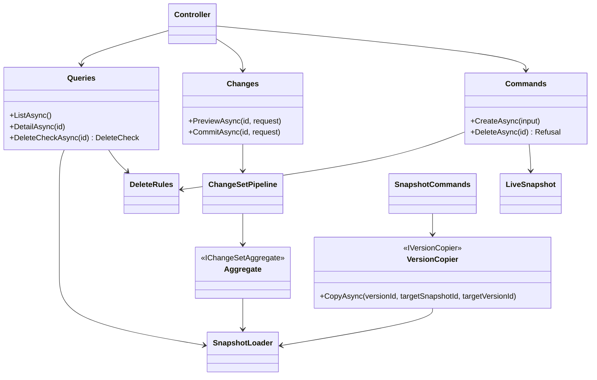

# Feature classes

[Index](README.md) · [High-level architecture](01-architecture.md) · [Request pipeline](02-request-pipeline.md) ·
[Core classes](03-core-classes.md) · [Snapshot lifecycle](04-version-lifecycle.md) · [Key actions](06-key-actions.md)

Every module follows the same shape. A controller folder in `WebApi/<Feature>/` routes the contract's paths and calls three
kinds of Application service: **queries** (read models built from snapshots), a **change-set service** over
`ChangeSetPipeline` for edits, and **commands** for actions on stored state. The module's
`*FeatureServiceCollectionExtensions` (in `WebApi/Configuration`) registers its route resources, services, aggregate,
snapshot rules, and its kind's `IVersionCopier`, `IVersionRemover` and `IVersionRules`. Contract schemas live in the module's file under
`api/openapi/contract/`, and their C# records in `Application/<Feature>/Models`.

## Tenant, session and system tenants

- **Controllers:** `SessionController` (`GET /api/me`), `TenantsController` (`GET /api/tenants`), `VocabulariesController`
  (`GET /api/vocabularies`), `TenantCatalogController` (`catalog`, `dimensions/{id}/published-members`),
  `OverviewController` (`overview`), `SystemTenantsController` (`/api/system/tenants`: list, get, create, update,
  enable or disable, verify).
- **Services:** `AccessibleTenantsService`; `TenantCatalogReader` builds the `TenantCatalog` every picker and cross-module
  link resolves against (one row per identity of every module, with its live version, and the owning report of each report dimension and report bridge); `PublishedMembersReader`;
  `TenantInfoReader` (`qe_database_info`); `OverviewService`; `SystemTenantService` over `qe_tenant_directory` with
  `TenantConnectionVerification` and `IConnectionStringMasker`.
- Registered by `AddTenantFeature`.

## Source objects

- **Controller:** `SourceObjectsController` (`source-objects`, `source-objects/{kind}/{name}/columns`).
- **Services:** `SourceObjectDirectory` lists the tables and views datasets can read, with columns typed as fields, the
  managed-table registry (`qe_managed_source_object`) and live statistics; the engine's own objects are excluded.
  `ISourceObjectCatalog` reads `information_schema`, including `ListDistinctValuesAsync`, which report diagnostics use for
  direct sources (through `DatasetFieldValues`).

## Datasets, bindings and measures

- **Controllers:** `DatasetsController` (`datasets`: list, create, detail, delete, delete check); `DatasetVersionsController`
  (`dataset-versions/{id}`: content of a live or frozen version,
  `changes/preview`, `changes`, and `fields/{id}/materialization` with `POST`, `DELETE` and `refresh`).
- **Aggregate:** `DatasetAggregate` over `DatasetSnapshot`; root is the dataset's live version. Operations: `updateDataset`,
  `saveSettings`, `renameSourceTable`, `saveField`, `deleteField`, `addFieldsFromColumns`, `saveGrain`, `deleteGrain`,
  `saveBinding`, `deleteBinding`, `saveMeasure`, `deleteMeasure`. Bindings (`Bindings/DatasetBindingEdits`, time bindings
  included) and measures (`Measures/DatasetMeasureEdits`, components, time policies, derived `qe_measure_dependency`) are
  part of the dataset version aggregate; their folders hold their edits and rules. Every commit edits the live version and
  advances the semantic revision; a change set aimed at a frozen version is refused with 409 "Version is frozen".
- **Services:** `DatasetQueries`, `DatasetChanges` (commits, advances the semantic revision, then materializes JSON path fields
  whose input asked for it), `DatasetCommands` (create the dataset with its live version over an existing object or a new
  managed table, delete),
  `DatasetSchemaChanges` (managed-table DDL as write-plan schema statements), `DatasetTableDrops` (a dataset delete's drops
  of the managed tables only it reads, with their views and registry rows), `DatasetMaterializations` (one asynchronous
  materialized view per source object holding its JSON path fields' columns), `DatasetVersionCopier`,
  `DatasetVersionRemover`, `DatasetVersionRules`, `DatasetFieldValues` (the bounded distinct values of a field, for report diagnostics), `DatasetDeleteRules`.
- **Rules:** the field, grain, binding, measure, formula and time-policy rules, and the rules that check a dataset against the
  rest of live: the binding identity rules `BoundDimensionsResolvableRule`, `MappedBindingsResolvableRule` and
  `BridgeBindingsResolvableRule` (base `BindingIdentityRule`), and `DatasetReportsResolveRule`, which runs
  `report_sources_resolve` and `report_factors_apply` for the enabled reports that read the dataset. All are `Commit` stage;
  `DatasetVersionRules` runs them on a stored version for restore.
- **Infrastructure:** `IManagedTables` (`StarRocksManagedTables`), `IMaterializedViews` (`StarRocksMaterializedViews`).

## Dimensions

- **Controllers:** `DimensionsController` (`dimensions`: list, create, detail, delete, delete check, `changes/preview`,
  `changes`; `dimension-profiles` and `dimension-profiles/{profileKey}/define`; `dimension-roles/{id}/delete-check`);
  `DimensionVersionsController` (`dimension-versions/{id}`: content of a live or frozen version, and `members/{id}/delete-check`,
  `levels/{id}/delete-check`).
- **Aggregate:** `DimensionAggregate` over `DimensionSnapshot`: the dimension, its roles and its live version's levels,
  members and range bands. Operations: `updateDimension`, `updateVersion`, `saveMember`, `deleteMember`, `moveMember`,
  `importMembers`, `clearMembers`, `saveLevel`, `deleteLevel`, `reorderLevels`, `saveBands`, `saveRole`, `deleteRole`.
  The plan rewrites `qe_dimension_closure` whenever members change.
- **Services:** `DimensionQueries` (report dimensions answer null, so 404), `DimensionChanges` (refuses report dimensions),
  `DimensionCommands` (create a user dimension with its live version, define a system dimension from a profile, delete),
  `DimensionSnapshotLoader`, `DimensionUsageReader`, `DimensionConsumers`, `DimensionVersionCopier` (over `DimensionVersionCloner`, which
  copies levels, members, bands and closure through one `IdRemap`), `DimensionVersionRemover`, `DimensionVersionRules`, `ClosureBuilder`,
  `DimensionDeleteRules`. `ReportDimensions` is the public hook through which the reports module creates and removes report
  dimensions.
- **Rules:** key uniqueness, parents and levels in the version, hierarchy acyclic, consumers resolve and profile-required
  keys are `Gate`; band, property and range data type rules are `Commit`. `DimensionVersionRules` runs them on a stored
  version for restore.

## Mapping sets

- **Controllers:** `MappingSetsController` (`mapping-sets`: list, create, detail, delete, delete check, `changes/preview`,
  `changes`); `MappingVersionsController` (`mapping-versions/{id}`: content of a live or frozen version).
- **Aggregate:** `MappingSetAggregate` over `MappingSetSnapshot`: the set and its live version's entries. Operations:
  `updateMappingSet`, `saveEntry`, `deleteEntry`, `replaceEntries`.
- **Services:** `MappingQueries`, `MappingSetChanges`, `MappingCommands` (create with an empty live version, delete),
  `MappingSetSnapshotLoader`, `MappingVersionCopier`,
  `MappingVersionRemover`, `MappingVersionRules`, `MappingDeleteRules`.
- **Rules:** all `Commit` stage (`DimensionVersionInSnapshotRule`, code `dimension_version_in_snapshot`, `SourceKeyUniqueRule`, `EntryMemberInVersionRule`,
  `EntryMemberAssignableRule`): the preview flags offending entries and the commit is refused while any remain.

## Bridges

- **Controllers:** `BridgesController` (`bridges`: list, create, detail, delete, delete check, `changes/preview`,
  `changes`); `BridgeVersionsController` (`bridge-versions/{id}`: content of a live or frozen version).
- **Aggregate:** `BridgeAggregate` over `BridgeSnapshot`: an analytical bridge and its live version's mappings. Operations:
  `updateBridge`, `updateBridgeVersion`, `saveBridgeMapping`, `deleteBridgeMapping`, `replaceBridgeMappings`.
- **Services:** `BridgeQueries`, `BridgeChanges` and `BridgeCommands` (both refuse report bridges), `BridgeStore` (stores
  and removes whole bridges with their live version), `BridgeSnapshotLoader`, `BridgeOwnerReader` (which report source owns a
  bridge), `BridgeVersionCopier`, `BridgeVersionRemover`, `BridgeVersionRules`, `BridgeDeleteRules`.
- **`ReportBridges`:** the public service through which only the reports module writes report bridges: `CreateAsync` (a live
  version, empty or copying another report bridge's rules), `RenameAsync`,
  `ReplaceRowAsync`, `RemoveRowsAsync` and `DeleteAsync`. Its writes are immediate; the report commit places them in its
  write plan.
- **Rules:** all `Commit` stage (`EndpointVersionsInSnapshotRule`, code `endpoint_versions_in_snapshot`, members in endpoint versions, pair uniqueness, cardinality,
  allocation rules, descendants only for report bridges).

## Snapshots

- **Controller:** `SnapshotsController` (`snapshots`: `GET` list, `POST` capture; `snapshots/capture-preview`;
  `snapshots/compare?from=&to=`; `snapshots/{snapshotId}`: `GET` detail, `PUT` relabel, `DELETE`;
  `snapshots/{snapshotId}/restore`).
- **Services:** `SnapshotIndex` (which version every snapshot holds of every identity), `SnapshotQueries` (`SnapshotList`,
  `SnapshotDetail`, `SnapshotComparison` with `differs` on each common pair, and the capture preview's `SnapshotCounts`),
  `SnapshotCommands` (`CaptureAsync`, `RestoreAsync`, `RelabelAsync`, `DeleteAsync` over every kind's `IVersionCopier`,
  `IVersionRemover` and `IVersionRules`), with `LiveSnapshot` and `SnapshotHolders` registered by `AddAdminApplication`.
  Snapshots have no change set. Registered by `AddSnapshotsFeature`.

## Calculation models

- **Controllers:** `CalculationModelsController` (`calculation-models`: list, create, detail, delete, delete check,
  `formula-check`, `changes/preview`, `changes`); `CalculationModelVersionsController` (`calculation-model-versions/{id}`: a live
  or frozen model version).
- **Aggregate:** `ModelChanges` over `ModelSnapshot`: the model and its live version's variables, calculated measures, parameters and
  attributions. Operations: `updateModel`, `saveVariable`, `deleteVariable`, `saveMeasure`, `deleteMeasure`,
  `saveParameter`, `deleteParameter`, `setAttribution`, `clearAttribution`. Every commit advances the semantic revision.
- **Services:** `ModelQueries`, `ModelCommands` (create a disabled empty model with its live version, delete a model no live report
  reads and no frozen snapshot holds), `ModelSnapshotLoader`, `CalculationModelVersionCopier`, `CalculationModelVersionRemover`,
  `CalculationModelVersionRules`, `MetricAttributionService`, `ModelParameterService`, `ModelFormulaChecker` (parses one formula with
  the engine's `ExpressionParser` and checks the rules a formula answers for alone), `ModelDeleteRules`.
- **Rules:** `ModelGateRule` (`Gate`) refuses a change that introduces a model-rule or report-rule violation; a violation the
  stored model already has does not refuse a preview, so the editor can show it next to the edit that repairs it.
  `ModelFindingsRule` (`Commit`) refuses the commit until none remains, for a disabled model too.

## Reports

- **Controllers:** `ReportsController` (`reports`: list, create, detail, delete, `diagnostics`,
  `sources/{sourceKey}/unmapped`, `changes/preview`, `changes`, `PUT enabled`); `ReportVersionsController`
  (`report-versions/{id}`: a live or frozen report version's whole document).
- **Aggregate:** `ReportAggregate` over `ReportSnapshot`: the report and its live `qe_report_version`, its rows (the report dimension's members, member
  options and overlay lines), sources with their variables, left-out items and report bridges' rules, profiles,
  calculation dimensions, scenarios, variable scopes, columns, styles and row parameters. Operations: `updateSettings`,
  `saveRow`, `moveRow`, `deleteRow`, `saveSource`, `deleteSource`, `setSourceVariables`, `setRowRules`, `setLeftOut`,
  `saveProfile`, `deleteProfile`, `saveCalculationDimension`, `deleteCalculationDimension`, `setScenarios`,
  `setVariableScopes`, `setColumns`, `saveStyle`, `deleteStyle`. Every commit advances the semantic revision.
- **Services:** `ReportQueries`, `ReportChanges` (the preview adds the pending report's diagnostics), `ReportCommands`
  (create a disabled report with its live version and its report dimension, optionally copying another report through `ReportCopy`; enable,
  which runs every report rule, or disable), `ReportRemover` (deletes the report with its content, source bridges and report
  dimension), `ReportSourceWrites` (plans source rows and report bridges through `ReportBridges`), `ReportDiagnosticsBuilder`
  (readiness steps, source coverage and profile resolution; a direct source's items are its field's values in the live
  dataset version, read through `DatasetFieldValues`), `ReportSnapshotLoader`, `ReportGraphReader`, `ReportVersionCopier`
  (remaps line, column, source and profile ids through `IdRemap`), `ReportVersionRemover`, `ReportVersionRules`,
  `OwnedVersions` (the report dimension's and source bridges' versions in one snapshot), `SnapshotDatasets` (the dataset
  versions a snapshot holds, which a report version's sources resolve in).
- **Rules:** twelve `IReportRule`s run by `ReportRules`; `ReportGateRule` (`Gate`) refuses a change that leaves an enabled
  report breaking any of them, and `ReportFindingsRule` (`Commit`) lists a disabled report's as findings that refuse its commit, so a disabled report with
  findings cannot be saved.
