# Key actions

[Diagram index](README.md) · [Architecture](01-architecture.md) · [Request pipeline](02-request-pipeline.md) · [Core classes](03-core-classes.md) · [Version lifecycle](04-version-lifecycle.md) · [Feature classes](05-feature-classes.md)

Each drawing traces one write from its controller to the table gateways, in the order the statements run. StarRocks runs no `UPDATE` or `DELETE` inside a transaction, so every gateway call is its own statement and nothing rolls back; services therefore write parents before children and delete children before parents. A participant named after a record, such as "DatasetRecord gateway", is the `ITableGateway<TRecord>` of that record, implemented by `StarRocksTableGateway`. Authentication, authorization and binding run first on every request, as [Request pipeline](02-request-pipeline.md) shows; the drawings mention validation and the draft check only where they matter.

**Sources:** [ITableGateway.cs](../../src/Quantalytix.QueryEngine.Admin.Application/Metadata/ITableGateway.cs), [StarRocksTableGateway.cs](../../src/Quantalytix.QueryEngine.Admin.Infrastructure.StarRocks/Tables/StarRocksTableGateway.cs), [DatasetVersionContentStore.cs](../../src/Quantalytix.QueryEngine.Admin.Application/Datasets/DatasetVersionContentStore.cs).

## Creating a dataset and its draft v1

The drawing shows `POST /api/tenants/{tenantId}/datasets`. The dataset row is written before its first version, so the version never points at a missing dataset.

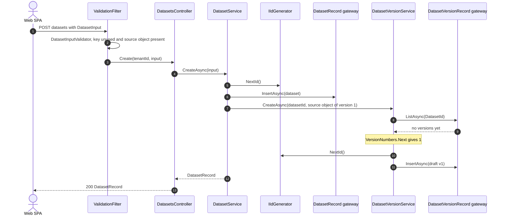

Version 1 is a draft over the source object the input names, supports aggregate and detail queries, and uses expression language 1.0. It has no fields, grains, bindings or measures until they are added.

**Sources:** [DatasetsController.cs](../../src/Quantalytix.QueryEngine.Admin.Api/Datasets/DatasetsController.cs), [DatasetService.cs](../../src/Quantalytix.QueryEngine.Admin.Application/Datasets/DatasetService.cs), [DatasetVersionService.cs](../../src/Quantalytix.QueryEngine.Admin.Application/Datasets/DatasetVersionService.cs), [DatasetInputValidator.cs](../../src/Quantalytix.QueryEngine.Admin.Application/Datasets/DatasetInputValidator.cs), [VersionNumbers.cs](../../src/Quantalytix.QueryEngine.Admin.Application/Versioning/VersionNumbers.cs), [IdGenerator.cs](../../src/Quantalytix.QueryEngine.Admin.Infrastructure.StarRocks/Identifiers/IdGenerator.cs).

## Cloning a dataset version

The drawing shows `POST .../datasets/{datasetId}/versions` with `cloneFromVersionId`. One `IdRemap` gives every ID inside the version one new ID, so references between the copies point at the copies, and the content is written parent table first.

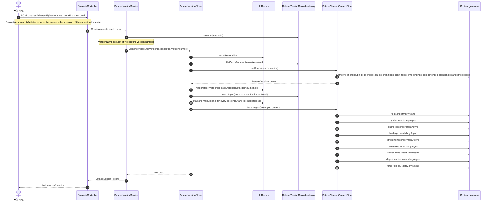

The clone keeps the source's settings and source object. Because one `IdRemap` serves the whole clone, the new `DefaultTimeBindingId` and every binding's, component's and time policy's references land on the copied rows; references to other aggregates (dimensions, their versions, levels and members, mapping sets, bridge versions) keep their IDs. `InsertManyAsync` writes nothing for an empty list.

**Sources:** [DatasetsController.cs](../../src/Quantalytix.QueryEngine.Admin.Api/Datasets/DatasetsController.cs), [DatasetVersionService.cs](../../src/Quantalytix.QueryEngine.Admin.Application/Datasets/DatasetVersionService.cs), [DatasetVersionCloner.cs](../../src/Quantalytix.QueryEngine.Admin.Application/Datasets/DatasetVersionCloner.cs), [DatasetVersionContentStore.cs](../../src/Quantalytix.QueryEngine.Admin.Application/Datasets/DatasetVersionContentStore.cs), [DatasetVersionContent.cs](../../src/Quantalytix.QueryEngine.Admin.Application/Datasets/Models/DatasetVersionContent.cs), [IdRemap.cs](../../src/Quantalytix.QueryEngine.Admin.Application/Versioning/IdRemap.cs), [DatasetVersionInputValidator.cs](../../src/Quantalytix.QueryEngine.Admin.Application/Datasets/DatasetVersionInputValidator.cs), [DatasetVersionClonerTests.cs](../../tests/Quantalytix.QueryEngine.Admin.Tests/Datasets/DatasetVersionClonerTests.cs).

## Materializing a json_path field

The drawing shows `POST .../dataset-versions/{versionId}/fields/{fieldId}/materialize`, the one write that changes a source table. StarRocks applies the column change as an asynchronous job, so the executor waits for it before the field points at the new column.

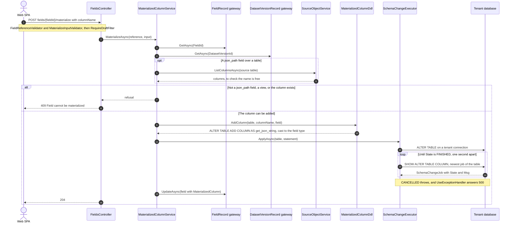

The generated column holds what the engine would compute for the field: `get_json_string` of the JSON column at the field's path, cast to the field's type unless it is a string. Every version that reads the table shares the column, but only this draft field points at it, so published versions are unaffected.

**Sources:** [FieldsController.cs](../../src/Quantalytix.QueryEngine.Admin.Api/Datasets/FieldsController.cs), [MaterializedColumnService.cs](../../src/Quantalytix.QueryEngine.Admin.Application/Datasets/MaterializedColumnService.cs), [MaterializedColumnDdl.cs](../../src/Quantalytix.QueryEngine.Admin.Application/Datasets/MaterializedColumnDdl.cs), [SourceObjectService.cs](../../src/Quantalytix.QueryEngine.Admin.Application/SourceObjects/SourceObjectService.cs), [SchemaChangeExecutor.cs](../../src/Quantalytix.QueryEngine.Admin.Infrastructure.StarRocks/SchemaChanges/SchemaChangeExecutor.cs), [SchemaChangeJob.cs](../../src/Quantalytix.QueryEngine.Admin.Infrastructure.StarRocks/SchemaChanges/Models/SchemaChangeJob.cs), [MaterializeInputValidator.cs](../../src/Quantalytix.QueryEngine.Admin.Application/Datasets/MaterializeInputValidator.cs), [MaterializedColumnDdlTests.cs](../../tests/Quantalytix.QueryEngine.Admin.Tests/Datasets/MaterializedColumnDdlTests.cs).

## Bulk-replacing mapping entries

The drawing shows `PUT .../mapping-versions/{versionId}/entries`, which replaces a version's complete entry list. The whole list is validated before the old rows are deleted; on the published version the write is live, so it advances the semantic revision.

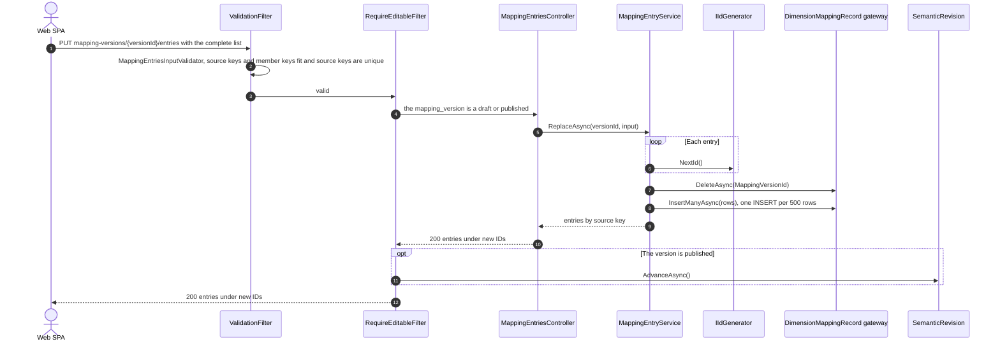

`BridgeMappingService.ReplaceAsync` replaces a bridge version's mappings the same way, `DeleteAsync` by `BridgeVersionId` then `InsertManyAsync` under new mapping IDs. Whether the member keys name members of the published version of the set's dimension is checked by the `entry_member_in_version` and `entry_member_assignable` rules, when a draft is validated or when an author runs the Validate check of the published version.

**Sources:** [MappingEntriesController.cs](../../src/Quantalytix.QueryEngine.Admin.Api/Mappings/MappingEntriesController.cs), [MappingEntryService.cs](../../src/Quantalytix.QueryEngine.Admin.Application/Mappings/MappingEntryService.cs), [MappingEntriesInputValidator.cs](../../src/Quantalytix.QueryEngine.Admin.Application/Mappings/MappingEntriesInputValidator.cs), [RequireEditableFilter.cs](../../src/Quantalytix.QueryEngine.Admin.Api/Versioning/RequireEditableFilter.cs), [BridgeMappingService.cs](../../src/Quantalytix.QueryEngine.Admin.Application/Bridges/BridgeMappingService.cs), [StarRocksTableGateway.cs](../../src/Quantalytix.QueryEngine.Admin.Infrastructure.StarRocks/Tables/StarRocksTableGateway.cs).

## Saving a measure

The drawing shows `POST` and `PUT .../dataset-versions/{versionId}/measures`. The measure row comes first, then its components and time policy, and last the dependency rows of every formula of the version, derived from the formulas' text.

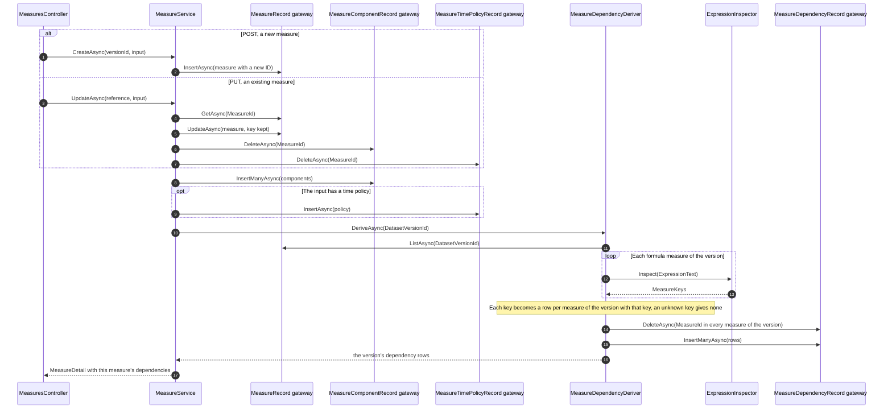

Every formula is derived again on every save, because a formula may name a measure created after it. `ExpressionInspector` parses with the engine's `ExpressionParser`, so the rows match what the engine will need; `formula_references_known_measures` and `formula_acyclic` check the result when the version is validated.

**Sources:** [MeasuresController.cs](../../src/Quantalytix.QueryEngine.Admin.Api/Measures/MeasuresController.cs), [MeasureService.cs](../../src/Quantalytix.QueryEngine.Admin.Application/Measures/MeasureService.cs), [MeasureDependencyDeriver.cs](../../src/Quantalytix.QueryEngine.Admin.Application/Measures/MeasureDependencyDeriver.cs), [ExpressionInspector.cs](../../src/Quantalytix.QueryEngine.Admin.Application/Expressions/ExpressionInspector.cs), [MeasureDetail.cs](../../src/Quantalytix.QueryEngine.Admin.Application/Measures/Models/MeasureDetail.cs), [MeasureDependencyDeriverTests.cs](../../tests/Quantalytix.QueryEngine.Admin.Tests/Measures/MeasureDependencyDeriverTests.cs).

## Validating and publishing a dimension version

The drawing shows two requests to the status endpoint for one `dimension_version`: validated, then published. Validation rebuilds the closure before the rules run, and the rules check that the version keeps every key live objects name; publishing retires the version it replaces, repoints the active assumption set and advances the semantic revision.

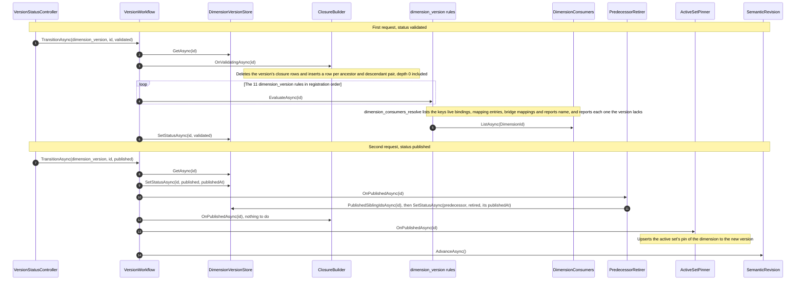

Bindings, mapping entries, bridge mappings, report rows, member options and variable scopes name members by key, so none of them changes: from the revision advance on, the engine resolves their keys in the new version. Historical assumption sets keep pinning the retired predecessor, which never changes again.

**Sources:** [VersionWorkflow.cs](../../src/Quantalytix.QueryEngine.Admin.Application/Versioning/VersionWorkflow.cs), [DimensionVersionStore.cs](../../src/Quantalytix.QueryEngine.Admin.Application/Versioning/DimensionVersionStore.cs), [ClosureBuilder.cs](../../src/Quantalytix.QueryEngine.Admin.Application/Dimensions/ClosureBuilder.cs), [DimensionConsumersResolveRule.cs](../../src/Quantalytix.QueryEngine.Admin.Application/Dimensions/DimensionConsumersResolveRule.cs), [DimensionConsumers.cs](../../src/Quantalytix.QueryEngine.Admin.Application/Dimensions/DimensionConsumers.cs), [PredecessorRetirer.cs](../../src/Quantalytix.QueryEngine.Admin.Application/Versioning/PredecessorRetirer.cs), [ActiveSetPinner.cs](../../src/Quantalytix.QueryEngine.Admin.Application/AssumptionSets/ActiveSetPinner.cs), [SemanticRevision.cs](../../src/Quantalytix.QueryEngine.Admin.Application/Versioning/SemanticRevision.cs), [DimensionsFeatureServiceCollectionExtensions.cs](../../src/Quantalytix.QueryEngine.Admin.Api/Configuration/DimensionsFeatureServiceCollectionExtensions.cs), [ClosureBuilderTests.cs](../../tests/Quantalytix.QueryEngine.Admin.Tests/Dimensions/ClosureBuilderTests.cs), [DimensionConsumersTests.cs](../../tests/Quantalytix.QueryEngine.Admin.Tests/Dimensions/DimensionConsumersTests.cs), [VersionWorkflowTests.cs](../../tests/Quantalytix.QueryEngine.Admin.Tests/Versioning/VersionWorkflowTests.cs).

## Publishing a bridge version

The drawing shows a `bridge_version` validated and then published. All six of its rules read the version's mappings through `BridgeMappingSetReader`, which resolves their member keys in the published versions of the bridge's two dimensions; publishing retires the bridge's previous version, repoints the active assumption set and advances the semantic revision.

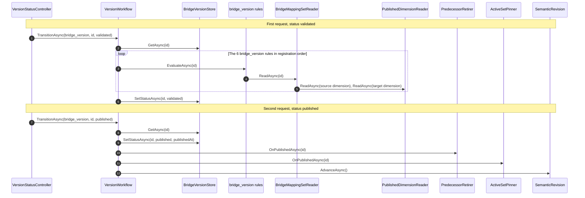

Bridge bindings name the bridge itself, so they need no change to follow the new version: the engine reads the version their assumption set pins.

**Sources:** [VersionWorkflow.cs](../../src/Quantalytix.QueryEngine.Admin.Application/Versioning/VersionWorkflow.cs), [BridgeVersionStore.cs](../../src/Quantalytix.QueryEngine.Admin.Application/Versioning/BridgeVersionStore.cs), [BridgeMappingSetReader.cs](../../src/Quantalytix.QueryEngine.Admin.Application/Bridges/BridgeMappingSetReader.cs), [PublishedDimensionReader.cs](../../src/Quantalytix.QueryEngine.Admin.Application/Dimensions/PublishedDimensionReader.cs), [PredecessorRetirer.cs](../../src/Quantalytix.QueryEngine.Admin.Application/Versioning/PredecessorRetirer.cs), [ActiveSetPinner.cs](../../src/Quantalytix.QueryEngine.Admin.Application/AssumptionSets/ActiveSetPinner.cs), [MappingsAndBridgesFeatureServiceCollectionExtensions.cs](../../src/Quantalytix.QueryEngine.Admin.Api/Configuration/MappingsAndBridgesFeatureServiceCollectionExtensions.cs), [bridge rules](../../src/Quantalytix.QueryEngine.Admin.Application/Bridges), [BridgeMappingRuleTests.cs](../../tests/Quantalytix.QueryEngine.Admin.Tests/Bridges/BridgeMappingRuleTests.cs).

## Activating a release

The drawing shows `POST .../releases/{releaseId}/activate`, the only way a dataset version reaches queries. The pointer is written before the revision advances, so the engine never caches the previous release under the new revision.

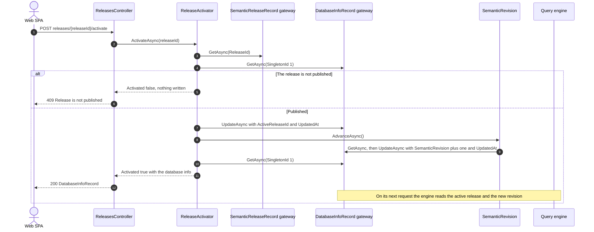

The release's status is checked before anything is written, so a refused activation leaves `qe_database_info` as it was. Publishing a release does not activate it, and the active release cannot be retired.

**Sources:** [ReleasesController.cs](../../src/Quantalytix.QueryEngine.Admin.Api/Releases/ReleasesController.cs), [ReleaseActivator.cs](../../src/Quantalytix.QueryEngine.Admin.Application/Releases/ReleaseActivator.cs), [ReleaseActivationResult.cs](../../src/Quantalytix.QueryEngine.Admin.Application/Releases/Models/ReleaseActivationResult.cs), [SemanticRevision.cs](../../src/Quantalytix.QueryEngine.Admin.Application/Versioning/SemanticRevision.cs), [DatabaseInfoRecord.cs](../../src/Quantalytix.QueryEngine.Admin.Application/Metadata/Models/DatabaseInfoRecord.cs), [ReleaseNotActiveRule.cs](../../src/Quantalytix.QueryEngine.Admin.Application/Releases/ReleaseNotActiveRule.cs), [ReleaseActivationTests.cs](../../tests/Quantalytix.QueryEngine.Admin.Tests/Releases/ReleaseActivationTests.cs); in the query engine checkout: [MetadataQueries.cs](../../../../Quantalytix.QueryEngine/src/Quantalytix.QueryEngine.Metadata.StarRocks/Readers/MetadataQueries.cs).

## Capturing an assumption set

The drawing shows `POST .../assumption-sets`, which captures a historical set: a copy of the active set's pins under a key of its own, with the active release. A request that names the key reads the versions the active set pinned at that moment over that release's dataset versions, so an author can backtest against them later.

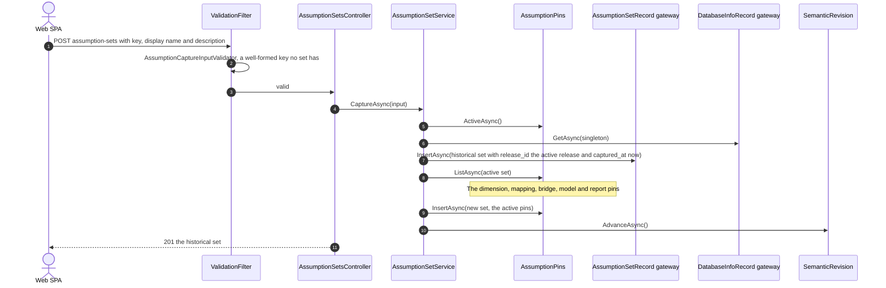

Publishing repoints only the active set, so the captured set keeps its versions, which publishing retires and freezes. Activating another release leaves the captured set on its release, which the engine keeps reading after the release is retired. Deleting a historical set removes it with its pins and advances the revision too; the active set cannot be deleted.

**Sources:** [AssumptionSetsController.cs](../../src/Quantalytix.QueryEngine.Admin.Api/AssumptionSets/AssumptionSetsController.cs), [AssumptionSetService.cs](../../src/Quantalytix.QueryEngine.Admin.Application/AssumptionSets/AssumptionSetService.cs), [AssumptionPins.cs](../../src/Quantalytix.QueryEngine.Admin.Application/AssumptionSets/AssumptionPins.cs), [AssumptionCaptureInputValidator.cs](../../src/Quantalytix.QueryEngine.Admin.Application/AssumptionSets/AssumptionCaptureInputValidator.cs), [AssumptionSetTests.cs](../../tests/Quantalytix.QueryEngine.Admin.Tests/AssumptionSets/AssumptionSetTests.cs).

## Verifying and creating a system tenant

The drawing shows a SystemAdmin testing a connection string with `POST api/system/tenants/verify`, then registering the tenant with `POST api/system/tenants`. The same check runs both times: as the answer of `verify`, and as a validation error on `connectionString` when a create would store a string that does not route to the tenant.

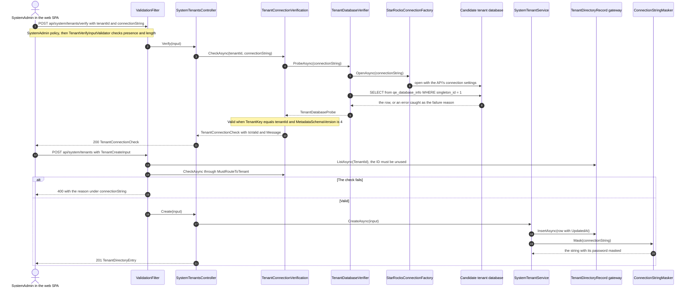

`TenantDirectoryRecord` lives in `query_control`, so its gateway opens the control plane rather than a tenant database. Every response masks the password, so a stored connection string never leaves the server; a later update with no connection string keeps the stored one.

**Sources:** [SystemTenantsController.cs](../../src/Quantalytix.QueryEngine.Admin.Api/SystemTenants/SystemTenantsController.cs), [TenantConnectionVerification.cs](../../src/Quantalytix.QueryEngine.Admin.Application/SystemTenants/TenantConnectionVerification.cs), [TenantDatabaseVerifier.cs](../../src/Quantalytix.QueryEngine.Admin.Infrastructure.StarRocks/TenantVerification/TenantDatabaseVerifier.cs), [StarRocksConnectionFactory.cs](../../src/Quantalytix.QueryEngine.Admin.Infrastructure.StarRocks/Connections/StarRocksConnectionFactory.cs), [TenantVerifyInputValidator.cs](../../src/Quantalytix.QueryEngine.Admin.Application/SystemTenants/TenantVerifyInputValidator.cs), [TenantCreateInputValidator.cs](../../src/Quantalytix.QueryEngine.Admin.Application/SystemTenants/TenantCreateInputValidator.cs), [TenantConnectionRuleExtensions.cs](../../src/Quantalytix.QueryEngine.Admin.Application/SystemTenants/TenantConnectionRuleExtensions.cs), [SystemTenantService.cs](../../src/Quantalytix.QueryEngine.Admin.Application/SystemTenants/SystemTenantService.cs), [ConnectionStringMasker.cs](../../src/Quantalytix.QueryEngine.Admin.Infrastructure.StarRocks/TenantVerification/ConnectionStringMasker.cs), [TableCatalog.cs](../../src/Quantalytix.QueryEngine.Admin.Infrastructure.StarRocks/Tables/TableCatalog.cs).

## A blocked delete answered with 409

The drawing shows `DELETE .../datasets/{datasetId}`. The service collects every reason the delete is blocked before it deletes anything; only when nothing blocks it does it delete, children first.

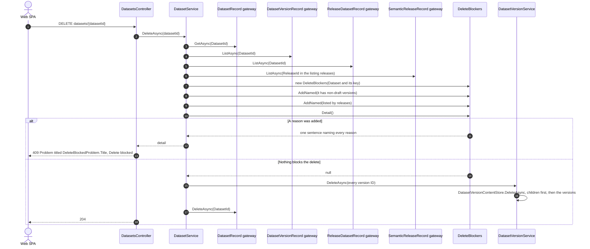

`DeleteBlockers` lists at most ten names per reason and counts the rest. The same pattern guards the other 19 deletes that answer "Delete blocked", with the checks of each slice, such as `FieldUsage` for fields, `DimensionDeleteChecks` for dimensions, levels and members, and `ReportUses` for models and the model content live reports name. Deleting a draft version of a living kind has no blockers, because other objects name the identity or keys of its published version, never a draft.

**Sources:** [DatasetsController.cs](../../src/Quantalytix.QueryEngine.Admin.Api/Datasets/DatasetsController.cs), [DatasetService.cs](../../src/Quantalytix.QueryEngine.Admin.Application/Datasets/DatasetService.cs), [DeleteBlockers.cs](../../src/Quantalytix.QueryEngine.Admin.Application/Metadata/DeleteBlockers.cs), [DeleteBlockedProblem.cs](../../src/Quantalytix.QueryEngine.Admin.Api/Errors/DeleteBlockedProblem.cs), [DatasetVersionService.cs](../../src/Quantalytix.QueryEngine.Admin.Application/Datasets/DatasetVersionService.cs), [DatasetVersionContentStore.cs](../../src/Quantalytix.QueryEngine.Admin.Application/Datasets/DatasetVersionContentStore.cs), [FieldUsage.cs](../../src/Quantalytix.QueryEngine.Admin.Application/Datasets/FieldUsage.cs), [DimensionDeleteChecks.cs](../../src/Quantalytix.QueryEngine.Admin.Application/Dimensions/DimensionDeleteChecks.cs), [ReportUses.cs](../../src/Quantalytix.QueryEngine.Admin.Application/CalculationModels/ReportUses.cs).
