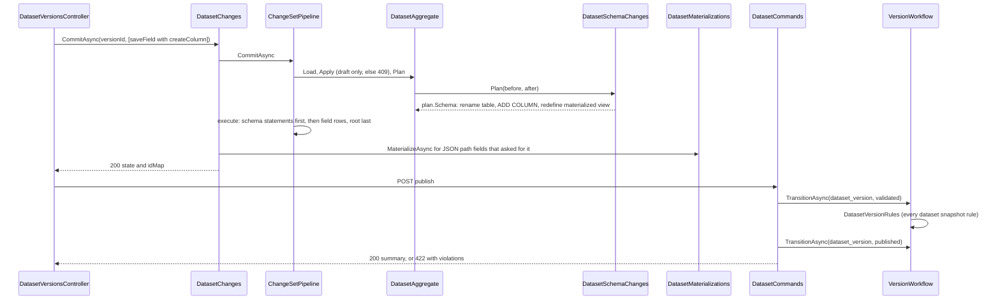
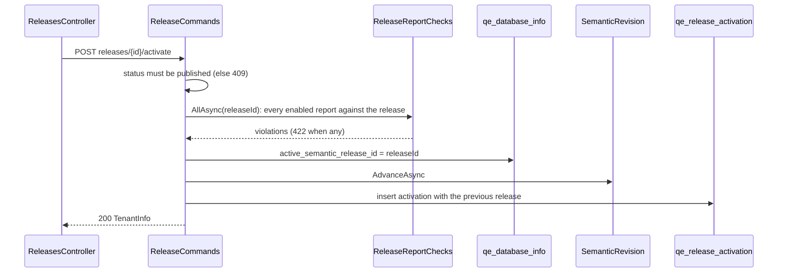
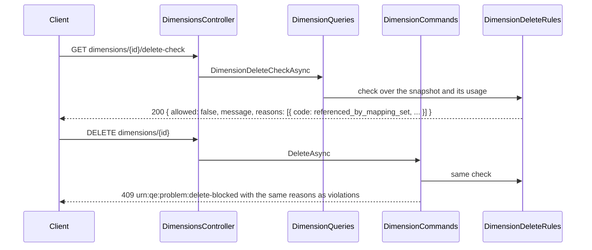

# Key actions

[Index](README.md) · [High-level architecture](01-architecture.md) · [Request pipeline](02-request-pipeline.md) ·
[Core classes](03-core-classes.md) · [Version lifecycle](04-version-lifecycle.md) · [Feature classes](05-feature-classes.md)

Each sequence starts after authentication, the route existence check and input validation
([Request pipeline](02-request-pipeline.md)). Paths are relative to `/api/tenants/{tenantId}`.

## Dimension commit

The user adds a member and moves another in the dimension editor, then saves. Each edit already went through
`POST dimensions/{id}/changes/preview`; Save posts the same operations to `changes`.

```mermaid
sequenceDiagram
    participant Ctl as DimensionsController
    participant Svc as DimensionChanges
    participant P as ChangeSetPipeline
    participant Agg as DimensionAggregate
    participant Rules as Snapshot rules
    participant Plan as WritePlan
    participant Rev as SemanticRevision
    Ctl->>Svc: CommitAsync(dimensionId, operations)
    Svc->>Svc: refuse a report dimension (409)
    Svc->>P: CommitAsync
    P->>Agg: LoadAsync (dimension, roles, live version, levels, members, bands, surroundings)
    loop each operation
        P->>P: validators (400 under operations[n])
        P->>Agg: Apply (saveMember resolves tmp ids, moveMember)
    end
    P->>Rules: Gate rules (keys unique, parents in version, acyclic, consumers resolve)
    P->>Rules: Commit rules (none for dimensions)
    P->>Agg: Plan(before, after)
    Agg->>Plan: Sync members; delete and insert qe_dimension_closure
    P->>Plan: Ordered() then execute
    P->>Agg: IsEngineVisible: live content changed
    P->>Rev: AdvanceAsync
    P->>Agg: LoadAsync, ReadAsync with stored ids
    P-->>Ctl: state and idMap { "tmp:...": "123..." }
```

The commit replays the operations onto the dimension as stored now. A refusal at any step returns its problem and nothing
is written. Because the version is live, the change reaches the next query once the revision advances.

## Dataset commit and publish

A draft version gets a new field that creates a column on its managed table, then the user publishes the version.



Schema statements run before every row write because DDL cannot be rolled back; `DatasetSchemaChanges` derives them from
the difference between the stored and changed physical catalog, so a replay after a partial commit plans none. Content
changes of a draft are not engine-visible, and publishing a dataset version does not advance the revision: the version
reaches queries only when a release that pins it is activated.

## Release activation



The pointer is written before the revision advances, so the engine never caches the previous release under the new
revision; the log row is written last, so a stop never logs an activation that did not happen.

## Report commit with report bridges

The user adds a bridge source to a report, maps source items to rows, and saves.

```mermaid
sequenceDiagram
    participant Ctl as ReportsController
    participant P as ChangeSetPipeline
    participant Agg as ReportAggregate
    participant Src as ReportSourceWrites
    participant Br as ReportBridges
    participant Plan as WritePlan
    Ctl->>P: CommitAsync(reportId, [saveSource, setRowRules, ...])
    P->>Agg: Load, Apply
    P->>P: ReportGateRule (an enabled report must pass every report rule)
    P->>Agg: Plan(before, after)
    Agg->>Plan: Sync content rows (members, lines, columns, profiles, ...)
    Agg->>Src: Plan(before, after, depth)
    Src->>Plan: Call(Insert): Br.CreateAsync, then insert the source row with its bridge id
    Src->>Plan: Call(Insert): Br.ReplaceRowAsync per row whose rules changed
    Agg->>Plan: closure of the report dimension when members changed; report row last
    P->>Plan: execute in order
    P->>P: advance the revision when the report is enabled
    P-->>Ctl: 200 ReportDocument
```

Report bridges are written only through the bridges module's public `ReportBridges` service. `WritePlan.Call` places each
call where a row write of its kind and depth would run: a new source's bridge is created before its row, a renamed source
renames its bridge, a deleted source's row is deleted before its bridge (`ReportBridges.DeleteAsync`, which removes pins,
version and rules), and rules into a row are replaced after the sources that own them. A commit that stops midway leaves at
most a bridge no source owns, which the engine never reads. The preview of the same operations also returns the report's
diagnostics; for a direct source, `ReportDiagnosticsBuilder` reads the field's distinct values through `DatasetFieldValues`
and `ISourceObjectCatalog.ListDistinctValuesAsync` to report the values that name no data row.

## Freeze of a living version

```mermaid
sequenceDiagram
    participant Ctl as MappingVersionsController
    participant Cmd as MappingCommands
    participant Fz as LivingVersionFreezer
    participant Wf as VersionWorkflow
    participant Cp as MappingVersionCopier
    participant H as Handlers
    Ctl->>Cmd: POST mapping-versions/{n}/freeze { note }
    Cmd->>Fz: FreezeAsync(mapping_version, n, note)
    Fz->>Fz: n must be published (else 409)
    Fz->>Wf: CheckAsync: MappingVersionRules (422 when any violation)
    Fz->>Cp: CopyAsync(n) -> draft n+1
    Fz->>Wf: PublishAsync(n+1): draft -> validated -> published
    Wf->>H: PredecessorRetirer retires n; ActiveSetPinner pins n+1
    Wf->>Wf: SemanticRevision.AdvanceAsync
    Fz->>Fz: SetFreezeNoteAsync(n, note)
    Cmd-->>Ctl: 200 FreezeResult { report, live }
```

Dimension and bridge freezes are the same with their own copier and rules; for a dimension, `ClosureBuilder` rebuilds the
copy's closure when it is validated. After the freeze, version n is read-only and the identity's change set edits n+1.

## Delete check and blocked delete



When the check allows the delete, `DimensionCommands.DeleteAsync` removes the active set's pin, the versions with their
content, the roles and the dimension row, and the controller answers 204. A historical assumption set's pin is a blocker
(`referenced_by_assumption_set`). Deletes inside a change set (a member, level or role) run the same rules through
`context.Blocked` and answer the same 409.

A dataset delete runs the same way through `DatasetDeleteRules`, and builds a `WritePlan`: `DatasetTableDrops` adds, as schema
statements, the drop of each managed table that only the dataset's versions read, after its materialized view, and the delete
of its `qe_managed_source_object` row; the version content, versions and dataset row follow children-first.
