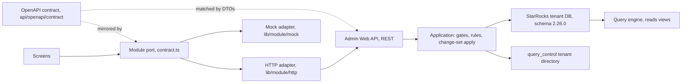

# 00 Architecture

## Layers

| Layer | Owns | Never does |
|---|---|---|
| Screens (`web2/src/components`) | Rendering, local UI state, URL state | Calls `fetch`, imports a DTO, decides whether input is valid |
| Module port (`web2/src/lib/<module>/contract.ts`) | The frontend contract: read models, inputs, results, the port interface, mirroring the OpenAPI contract | Knows about HTTP or the mock |
| Adapters (`lib/<module>/http`, `lib/<module>/mock`) | Translating the port to a transport | Holds business rules the server does not also hold |
| Admin Web API (controllers) | Routing, authentication, tenant access, binding, problem responses | Business rules |
| Application | Feature services, input validators, publication rules, gates, change-set application | SQL |
| Infrastructure (StarRocks) | Table gateways, introspection, DDL for managed objects, tenant routing | Rules |

## The contract-first rule (Agreed)

1. **The hand-authored OpenAPI contract is the source of truth (design-first).** It lives in
   [`api/openapi/contract/`](../../api/openapi/contract/README.md): a root `admin-api.yaml`, the shared kernel
   `common.yaml` (from [01](01-api-conventions.md)) and one file per module. Its read models and inputs are shaped to
   what the screens need, not to the tables. A read model may join several tables (a dimension list item carries its
   roles, version summaries and profile); the Application composes it.
2. The TypeScript port in `contract.ts` mirrors the contract's schemas by name and is what screens see. A screen depends
   only on its module's port and on the shared kernel ([02](02-frontend-contract-layer.md)).
3. **C# request and response DTOs are written by hand to match the contract;** no server code is generated. A DTO
   whose name, property names, types or nullability differ from its contract schema is a defect: fix the DTO, or change
   the contract first.
4. `api/openapi/admin-api.json` stays generated from the C# build, as the record of what the server implements.
   `ContractConformanceTests` (`api/tests`) loads the bundled contract and `admin-api.json` and fails on any difference
   in paths, methods, status codes, schema property names, types or nullability. Operations not yet implemented are
   listed in its allow-list, which only shrinks and is empty when the refactor ends.
5. `web2/src/lib/api/schema.d.ts` is generated from the bundled contract and imported only inside the HTTP adapters,
   which map generated types to port types.
6. Each adapter must pass the same port-level test suite, so the mock and HTTP adapters cannot drift (parity rule).

The removed `web` client re-exported generated schema types into screens. `web2` must not; its prototype already
isolates screens behind ports, and the blueprint keeps that boundary.

## Where validation lives (Agreed, OI-05)

- **The server is authoritative.** Every input check, publication rule, gate and cascade runs in the Application. The
  engine trusts the metadata it reads and re-checks none of it (engine README "Checks before any source runs";
  schema doc §18), so a rule the API skips is a rule nobody enforces.
- **The client renders server results.** Field errors, rule violations, delete blockers, readiness and coverage come
  back from the API in the shapes [01](01-api-conventions.md) defines. A screen may disable a control from a read
  model flag (for example `isVersionEditable`) but does not compute validity.
- **Client-side helpers stay presentational.** Parsing a pasted table into rows, highlighting a formula, or grouping a
  list is presentation; deciding that a row is invalid is not. `web2` currently runs real rules in the browser:
  `lib/mappings/rules.ts`, `lib/model/rules.ts` and the report's `coverage.ts`, `profiles.ts` and `scenarios.ts`. Those
  move behind check endpoints and read-model diagnostics; formulas are checked by `formula-check` (OI-43).
- **Validate once, at the boundary.** Input validators run when a request enters the Application; publication rules
  run when a version is validated or an aggregate is committed. Deeper layers assume valid input.

## Aggregates

The API is organized around the aggregates a user edits and saves as one unit. Each has one change set
([01, change-set protocol](01-api-conventions.md#change-set-protocol-agreed-oi-01)).

| Aggregate | Root | Edited content | Lifecycle |
|---|---|---|---|
| Dataset version | `qe_dataset_version` | settings, fields, grains, bindings (+ time binding), measures (+ components, time policy) | strict: draft, validated, published, retired |
| Dimension | `qe_dimension` + its live version | identity flags, roles, the live version's levels, members, range bands | living, live-and-frozen: one live version edited in place, frozen snapshots (OI-14) |
| Mapping set | `qe_mapping_set` + its live version | identity, entries | living, live-and-frozen (OI-14) |
| Bridge | `qe_bridge` + its live version | identity, cardinality, allocation, mappings (analytical bridges only) | living, live-and-frozen (OI-14) |
| Release | `qe_semantic_release` | manifest | strict |
| Assumption set | `qe_assumption_set` | label and description (historical only) | captured, never edited |
| Calculation model | `qe_calculation_model` | settings, variables, calculated measures, parameters, attributions | not versioned; every write gated |
| Report | `qe_report` | settings, rows, sources, profiles, calculation dimensions, scenarios, scopes, columns, styles, plus its report dimension and report bridges | not versioned; enabled reports gated |

## The engine boundary (Agreed)

- The engine reads metadata only through `vw_qe_*` views and caches snapshots by tenant, release,
  `semantic_revision`, assumption set and dataset. Every committed change the engine can see must advance
  `qe_database_info.semantic_revision` exactly once per commit ([01](01-api-conventions.md#semantic-revision-agreed)).
- The engine lists and runs **enabled** reports only, on the active assumption set. Report preview and run from the
  admin are out of scope for this refactor (OI-53).
- The engine has no formula-validation endpoint. The Admin API references `Quantalytix.QueryEngine.Domain` for
  `ExpressionParser` and must type-check formulas itself (OI-43).
- The engine is reached over SignalR (`/hubs/query`). The Admin API does not call it.

## Out of scope

- The engine's request contracts (query 1.4, report 2.1) and report preview or run (OI-53).
- Identity provider integration beyond the claims the API reads.
- Physical fact data.
