# 12 Dimensions

## Purpose and sources

The dimension manager authors reusable member sets: a dimension's roles, and its versions' levels, members and range
bands. It also lists usage and defines system dimensions from profiles. Report-owned dimensions are not listed here;
they are reached only from their report (OI-22).

Sources: [`web/src/lib/dimensions/contract.ts`](../../web/src/lib/dimensions/contract.ts) and its mock
(`mock/adapter.ts`, `mock/rules.ts`); [dimensions concept](../concepts/dimensions.md);
[dimension manager brief](../requirements/dimension-manager-prototype.md); current `DimensionsController`,
`DimensionRolesController`, `DimensionVersionsController`, `DimensionLevelsController`, `DimensionMembersController`,
`RangeBandsController`; schema `dimension/`.

## Domain rules

| # | Rule | Source |
|---|---|---|
| M1 | Kinds `categorical`, `hierarchical`, `range`, `time`; key, kind, origin and purpose are fixed. Only `displayName`, `isEnabled`, `isRemovable` change. | Concept §6.5 |
| M2 | `createDimension` creates origin `user`, purpose `analytical` dimensions; report dimensions come from `createReport`; system dimensions come from `defineSystemDimension` (a profile) or from provisioning. | Concept §6.2; OI-16 |
| M3 | A dimension has one version per snapshot. The live version is edited in place and every commit runs every gate and commit rule; edits reach queries through `semantic_revision`. A frozen snapshot's version is read-only ([14](14-snapshots.md)). | OI-14; plan |
| M4 | Member and level keys unique per version; parent and level in the same version; acyclic parents; closure matches parents and is rebuilt on every member write. | Concept §2.2, §6.3 |
| M5 | A range version has a range data type (`decimal`, `date`, `datetime`); bands typed, ordered, non-overlapping; only the first open below and only the last open above; replaced as a whole set. | Concept §2.1, §6.5 |
| M6 | Role keys are tenant-unique and fixed. Every non-time analytical dimension has at least one role; time has none; report dimensions have none. | Concept §2.1 |
| M7 | Adding a role while a report names the dimension's only role as a scenario is refused; a profile may also declare `singleRole`, which refuses a second role unconditionally. | Schema README 2.24.0; OI-20 |
| M8 | Report dimensions are refused by every write of this module (409 "Owned by a report") and are not listed by it. | Concept §1 "Hidden dimensions"; OI-22 |
| M9 | Delete: a dimension only when removable, no frozen snapshot holds a version of it, nothing referencing it or its roles; a member when it has no children, no band and no live reference; a level when no member uses it and no calculation dimension groups at it. | Concept §3.4, §6.6 |
| M10 | Every key another object names must exist in the live version after a commit (`dimension_consumers_resolve`). | Concept §6.4 |
| M11 | A profile's edit policy governs its dimension: `locked` refuses every edit (the owner changes it through provisioning, OI-24); `extend` refuses deleting or re-keying a required member or role; `open` allows everything except delete. | Dim brief §6.1, §7; OI-16 |

## The version model (Agreed, OI-14)

Every versioned kind shares one model ([14](14-snapshots.md)): a version per snapshot, one of them **live** and edited in
place, the rest in **frozen** snapshots, and no drafts, validation or publishing.

```mermaid
stateDiagram-v2
  [*] --> live: create (the live version)
  live --> live: commit edits (gate and commit rules; advances semantic_revision)
  live --> frozen: capture copies it into a new frozen snapshot
  frozen --> live: restore copies it over the live version
  frozen --> [*]: delete the snapshot
```



- Every commit runs every rule of the kind on the result and refuses with 422 when one fails, so the live version is always
  valid. The preview reports the commit rules' findings in `violations`.
- A frozen version accepts no edits: the change set is posted on the dimension and always edits its live version, so a frozen
  version has no edit route. It is read through the same version content route as the live one.
- Capture copies every live version of every kind, with new ids for levels, members and bands; the live ids never change.
- Restore replaces the live version's content with a copy of the frozen version, keeping the live version's id.

## Frontend contract

`dimensions/contract.ts` is adopted with these deltas:

| Item | Change | Issue |
|---|---|---|
| `ProblemDetails`, `ApiResult`, `Violation`, `DeleteCheck` | Kernel types (the `ProblemDetails` alias is removed); `DimensionViolation` narrows the target area to `DimensionTab`; `Violation.tab`/`itemId` become `target.area`/`itemId`; codes become the API's snake_case rule codes | OI-11 |
| `DimensionProfile`, `Dimension.profileKey`, `EditPolicy`, `listAvailableProfiles`, `defineSystemDimension` | Kept. Profiles come from a code registry; `profileKey` is stored in `qe_dimension.dimension_profile_key` (SG-03); seeded system dimensions are backfilled. `DimensionProfile` gains `singleRole?: boolean` | OI-16, OI-20 |
| `DimensionPropertyField`, `DimensionMember.properties` | `DimensionPropertyField[]` in the profile; the server validates `properties` for system dimensions only; user dimensions keep free key/value | OI-18 |
| `DimensionVersion.createdAt`, `snapshotId` | Stored (`created_at`, `snapshot_id`) | OI-12 |
| Version status, `retiredAt`, `supersededBy`, `freezeNote`, Freeze action | Removed: a version's snapshot says whether it is live | |
| `DimensionUsageReference` kind `'report'` (template usage) | Removed | OI-19 |
| `listHiddenDimensions`, the Hidden tab, `useViewer().isSystemAdmin` gate | Removed | OI-09, OI-22 |
| `RangeDataType` | Add `datetime` (schema allows it) | |
| `DimensionKind`, `DimensionPurpose`, `DefinitionOrigin` (was `DimensionOrigin`), `Periodicity` | Shared kernel types, also read by tenant, mappings, datasets and reports | |
| `Origin` list filter `listDimensions(origin)` | Kept, typed with the kernel `DefinitionOrigin` | |
| `listAllDimensions` | Moves to `TenantApi.getCatalog`; kept deprecated until `lib/mappings/directory.ts` switches in P5 | OI-13 |

### Port (Agreed)

```ts
export interface DimensionsApi extends ChangeSetPort {
  // reads
  listDimensions(origin: DefinitionOrigin): Promise<DimensionListItem[]>      // analytical only
  listAvailableProfiles(): Promise<AvailableDimensionProfile[]>
  getDimension(id: Id): Promise<ApiResult<DimensionDetail>>
  getVersion(versionId: Id): Promise<ApiResult<DimensionVersionContent>>      // live or frozen
  checkDelete(target: DimensionDeleteTarget): Promise<DeleteCheck>             // one HTTP delete-check per target kind

  // edits (staged per dimension: identity, roles, and the live version's content)
  updateDimension(id: Id, patch: DimensionPatch): Promise<ApiResult<Dimension>>
  updateVersion(versionId: Id, patch: DimensionVersionPatch): Promise<ApiResult<DimensionVersion>>
  saveMember(versionId: Id, input: DimensionMemberInput): Promise<ApiResult<DimensionMember>>
  deleteMember(versionId: Id, memberId: Id): Promise<ApiResult<null>>
  moveMember(versionId: Id, memberId: Id, to: DimensionMemberPosition): Promise<ApiResult<DimensionMemberPosition>>
  importMembers(versionId: Id, rows: DimensionMemberImportRow[], mode?: DimensionMemberImportMode): Promise<ApiResult<DimensionMemberImportResult>>
  clearMembers(versionId: Id): Promise<ApiResult<{ removed: number }>>
  saveLevel(versionId: Id, input: DimensionLevelInput): Promise<ApiResult<DimensionLevel>>
  deleteLevel(versionId: Id, levelId: Id): Promise<ApiResult<null>>
  reorderLevels(versionId: Id, orderedIds: Id[]): Promise<ApiResult<DimensionLevel[]>>
  saveBands(versionId: Id, bands: RangeBand[]): Promise<ApiResult<RangeBand[]>>
  saveRole(dimensionId: Id, input: DimensionRoleInput): Promise<ApiResult<DimensionRole>>
  deleteRole(roleId: Id): Promise<ApiResult<null>>

  // commands
  createDimension(input: CreateDimensionInput): Promise<ApiResult<DimensionCreated>>
  defineSystemDimension(profileKey: string): Promise<ApiResult<DimensionCreated>>
  deleteDimension(id: Id): Promise<ApiResult<null>>
}
```

Read models stay as in `web`: `DimensionListItem` (dimension + profile + roles + version summaries + live
member count), `DimensionDetail` (+ usage), `DimensionVersionContent` (version + levels + members + bands).

`DimensionDetail.usage` is computed by the server from bindings, mapping sets, bridges, calculation dimensions, report
scenarios, report sources and frozen snapshots, with the member keys each names (drives member delete blockers and
`dimension_consumers_resolve`).

## HTTP API

Prefix `/api/tenants/{t}`. Open to any tenant user (OI-09).

| Method | Route | Request | Response | Errors | Port |
|---|---|---|---|---|---|
| GET | `dimensions?origin=user\|system` | | `DimensionListItem[]` (analytical only) | | `listDimensions` |
| GET | `dimension-profiles?available=true` | | `AvailableDimensionProfile[]` | | `listAvailableProfiles` (`listAvailableDimensionProfiles`) |
| POST | `dimensions` | `CreateDimensionInput` | `201 DimensionCreated` (the live version) | 400, 409 key taken | `createDimension` |
| POST | `dimension-profiles/{profileKey}/define` | | `201 DimensionCreated` | 409 defined already | `defineSystemDimension` |
| GET | `dimensions/{id}` | | `DimensionDetail` | 404 (also for report-owned) | `getDimension` |
| GET | `dimensions/{id}/delete-check` | | `DeleteCheck` | 404 | `checkDelete({type:'dimension'})` (`checkDimensionDelete`) |
| DELETE | `dimensions/{id}` | | `204` | 409 blocked, report-owned, system | `deleteDimension` |
| GET | `dimension-versions/{id}` | | `DimensionVersionContent` | 404 | `getVersion` |
| POST | `dimensions/{id}/changes/preview` | `ChangeSetRequest<DimensionOperation>` | `ChangeSetPreview<DimensionEditState>` | 400, 409, 422 | edits |
| POST | `dimensions/{id}/changes` | `ChangeSetRequest<DimensionOperation>` | `ChangeSetCommit<DimensionEditState>` | 400, 409 owned by report / locked, 422 | `commitChanges` |
| GET | `dimension-versions/{id}/members/{memberId}/delete-check` | | `DeleteCheck` | | `checkDelete({type:'member'})` (`checkDimensionMemberDelete`) |
| GET | `dimension-versions/{id}/levels/{levelId}/delete-check` | | `DeleteCheck` | | `checkDelete({type:'level'})` (`checkDimensionLevelDelete`) |
| GET | `dimension-roles/{roleId}/delete-check` | | `DeleteCheck` | | `checkDelete({type:'role'})` (`checkDimensionRoleDelete`) |

`DimensionEditState` = `{ dimension: DimensionDetail; content: DimensionVersionContent }`, so the preview returns everything the
editor shows.

The port's one `checkDelete(target)` maps to one delete-check operation per target kind, so each target has its own
route and 404. Reasons use the shared `DeleteBlockerCode` list ([01](01-api-conventions.md#delete-checks-agreed-oi-07)):
`not_removable`, `system_dimension`, `has_children`, `required_by_profile`, `assigned_by_bands`,
`named_by_consumers`, `referenced_by_member`, `referenced_by_snapshot` and `referenced_by_<usage kind>`.

Component names are prefixed with `Dimension` (`DimensionMember`, `DimensionLevel`, `DimensionRole`,
`DimensionMemberInput`, `DimensionMemberPosition`, `DimensionVersionContent`, `AvailableDimensionProfile`) because
contract component names are global across modules.

The change set targets the dimension, not the version: identity, roles and the live version's content are saved
together (as `DimensionEditScope` does today).

## Change-set operations

```ts
type DimensionOperation =
  | { op: 'updateDimension'; patch: DimensionPatch }
  | { op: 'updateVersion'; versionId: Id; patch: DimensionVersionPatch }   // clears band bounds
  | { op: 'saveMember'; versionId: Id; input: DimensionMemberInput }
  | { op: 'deleteMember'; versionId: Id; memberId: Id }
  | { op: 'moveMember'; versionId: Id; memberId: Id; to: DimensionMemberPosition }
  | { op: 'importMembers'; versionId: Id; rows: DimensionMemberImportRow[]; mode: DimensionMemberImportMode }
  | { op: 'clearMembers'; versionId: Id }
  | { op: 'saveLevel'; versionId: Id; input: DimensionLevelInput }
  | { op: 'deleteLevel'; versionId: Id; levelId: Id }
  | { op: 'reorderLevels'; versionId: Id; orderedIds: Id[] }
  | { op: 'saveBands'; versionId: Id; bands: RangeBand[] }
  | { op: 'saveRole'; input: DimensionRoleInput }
  | { op: 'deleteRole'; roleId: Id }
```

Import parsing (CSV/TSV to `DimensionMemberImportRow[]`) stays in the browser (OI-21). Edit policy (M11) is enforced per operation.

## Rule codes

From the current API: `range_data_type_matches_kind`, `level_key_unique`, `member_key_unique`,
`member_parent_in_version`, `member_level_in_version`, `hierarchy_acyclic`, `band_boundary_family`,
`band_bounds_ordered`, `bands_non_overlapping`, `band_member_in_version`, `dimension_consumers_resolve`. New:
`profile_required_keys_present`, `profile_properties_valid` (OI-18), `band_open_bounds_at_ends`. Key, parent, level,
hierarchy, consumer and profile-required-key rules are gates; band, property and range data type rules are commit rules.

Mapping from `web` codes: `duplicateMemberKey` → `member_key_unique`, `duplicateLevelKey` → `level_key_unique`,
`cycle` → `hierarchy_acyclic`, `rangeType` → `range_data_type_matches_kind`, `bandOverlap` →
`bands_non_overlapping`, `bandOrder` → `band_bounds_ordered`, `bandMember` → `band_member_in_version`,
`bandOpenBound` → `band_open_bounds_at_ends`, `requiredMember`/`requiredRole` → `profile_required_keys_present`,
`namedKeyMissing` → `dimension_consumers_resolve`.

## Schema mapping

| Contract | Table / column |
|---|---|
| `Dimension` | `qe_dimension` (`definition_origin` → `origin`, `dimension_purpose` → `purpose`) |
| `Dimension.profileKey` | `qe_dimension.dimension_profile_key` (new, [SG-03](91-schema-gaps.md#sg-03-dimension-profile-key)) |
| `Dimension.ownerReport` | `qe_report.report_dimension_id` reverse lookup |
| `DimensionRole` | `qe_dimension_role` |
| `DimensionVersion` | `qe_dimension_version` (`snapshot_id`, `created_at`) |
| `DimensionLevel` | `qe_dimension_level` (`is_leaf_level` → `isLeaf`) |
| `DimensionMember` | `qe_dimension_member` (`parent_dimension_member_id` → `parentId`, `properties` JSON) |
| closure | `qe_dimension_closure`, server-maintained |
| `RangeBand` | `qe_range_band` (typed bound columns per `range_data_type`) |
| usage | bindings, mapping sets, bridges, calculation dimensions, report scenarios, report sources, frozen snapshots |

## Deltas from the current API

| Change | Item |
|---|---|
| Keep | Delete blockers and their phrasing; report-owned refusal; closure rebuild |
| Change | Per-entity role, level, member, band and order writes become change-set operations on the dimension |
| Change | `POST dimensions` creates the live version and returns `{ dimensionId, versionId }` |
| Remove | `POST dimensions/{id}/versions`, `PUT versions/dimension_version/{id}/status`, `POST versions/dimension_version/{id}/validation`, version delete: every commit validates the live version, and snapshots replace freezing |
| New | `delete-check` per target, usage in the detail read model, profiles, define, `moveMember`, `importMembers`, `clearMembers` |
| Remove | `GET .../roles`, `.../levels`, `.../members`, `.../range-bands` lists (the version content read model carries them); report dimensions from every list of this module |

## Decisions applied

[OI-09](90-open-issues.md#oi-09), [OI-11](90-open-issues.md#oi-11), [OI-12](90-open-issues.md#oi-12),
[OI-13](90-open-issues.md#oi-13), [OI-14](90-open-issues.md#oi-14),
[OI-16](90-open-issues.md#oi-16), [OI-18](90-open-issues.md#oi-18),
[OI-19](90-open-issues.md#oi-19), [OI-20](90-open-issues.md#oi-20), [OI-21](90-open-issues.md#oi-21),
[OI-22](90-open-issues.md#oi-22), [OI-24](90-open-issues.md#oi-24).
