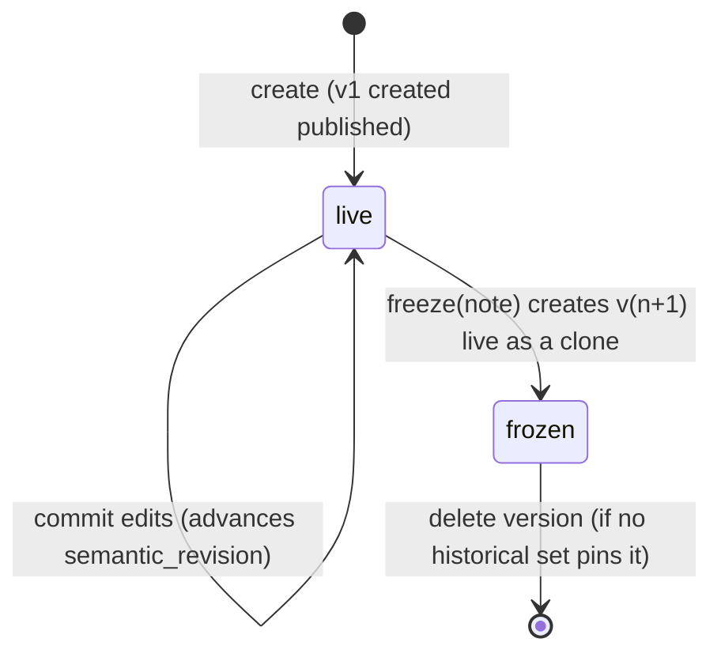

# 12 Dimensions

## Purpose and sources

The dimension manager authors reusable member sets: a dimension's roles, and its versions' levels, members and range
bands. It also lists usage and defines system dimensions from profiles. Report-owned dimensions are not listed here;
they are reached only from their report (OI-22).

Sources: [`web2/src/lib/dimensions/contract.ts`](../../web2/src/lib/dimensions/contract.ts) and its mock
(`mock/adapter.ts`, `mock/rules.ts`); [dimensions concept](../concepts/dimensions.md);
[dimension manager brief](../requirements/dimension-manager-prototype.md); current `DimensionsController`,
`DimensionRolesController`, `DimensionVersionsController`, `DimensionLevelsController`, `DimensionMembersController`,
`RangeBandsController`; schema `dimension/`.

## Domain rules

| # | Rule | Source |
|---|---|---|
| M1 | Kinds `categorical`, `hierarchical`, `range`, `time`; key, kind, origin and purpose are fixed. Only `displayName`, `isEnabled`, `isRemovable` change. | Concept §6.5 |
| M2 | `createDimension` creates origin `user`, purpose `analytical` dimensions; report dimensions come from `createReport`; system dimensions come from `defineSystemDimension` (a profile) or from provisioning. | Concept §6.2; OI-16 |
| M3 | Versions are **live-and-frozen**: exactly one live version (stored `published`), edited in place; edits reach queries through `semantic_revision`; freezing makes the live version a read-only snapshot (stored `retired`) and continues in a new live clone; a live version is never retired by hand. | OI-14, OI-17 |
| M4 | Member and level keys unique per version; parent and level in the same version; acyclic parents; closure matches parents and is rebuilt on every member write. | Concept §2.2, §6.3 |
| M5 | A range version has a range data type (`decimal`, `date`, `datetime`); bands typed, ordered, non-overlapping; only the first open below and only the last open above; replaced as a whole set. | Concept §2.1, §6.5 |
| M6 | Role keys are tenant-unique and fixed. Every non-time analytical dimension has at least one role; time has none; report dimensions have none. | Concept §2.1 |
| M7 | Adding a role while a report names the dimension's only role as a scenario is refused; a profile may also declare `singleRole`, which refuses a second role unconditionally. | Schema README 2.24.0; OI-20 |
| M8 | Report dimensions are refused by every write of this module (409 "Owned by a report") and are not listed by it. | Concept §1 "Hidden dimensions"; OI-22 |
| M9 | Delete: a dimension only when removable, no frozen version pinned by a historical set, nothing referencing it or its roles; a member when it has no children, no band and no live reference; a level when no member uses it and no calculation dimension groups at it. | Concept §3.4, §6.6 |
| M10 | Every key another object names must exist in the live version after a commit (`dimension_consumers_resolve`). | Concept §6.4 |
| M11 | A profile's edit policy governs its dimension: `locked` refuses every edit and freeze (the owner changes it through provisioning, OI-24); `extend` refuses deleting or re-keying a required member or role; `open` allows everything except delete. | Dim brief §6.1, §7; OI-16 |

## The version model (Agreed, OI-14)

Dimensions, mapping sets and bridges share one model: one **live** version edited in place, plus **frozen** snapshots,
and no drafts. It runs on the living lifecycle the schema already has (`published` = live, `retired` = frozen).



`freeze(versionId, note)` is one command:

1. Run every rule of the kind on the live version. On violations, return `{ report, live: null }` (422 over HTTP) and
   change nothing.
2. Insert version n+1 as a clone (for dimensions: levels, members with new ids, bands, range data type; for mapping
   sets: entries; for bridges: settings and mappings) with status `published`.
3. Set version n to `retired`, stamp `retired_at`, record the note (`freeze_note`, OI-15).
4. Repoint the active assumption set to n+1; historical sets keep n.
5. Advance `semantic_revision`.

`check` runs the rules on any version without changing anything. A frozen version accepts no edits. Deleting a frozen
version is allowed when no historical assumption set pins it; the live version cannot be deleted. Drafts, validation
and publishing remain only for dataset versions and releases (OI-17, OI-30).

## Frontend contract

`dimensions/contract.ts` is adopted with these deltas:

| Item | Change | Issue |
|---|---|---|
| `ProblemDetails`, `ApiResult`, `Violation`, `ValidationReport`, `DeleteCheck` | Kernel types; `Violation.tab`/`itemId` become `target.area`/`itemId`; codes become the API's snake_case rule codes | OI-11 |
| `DimensionProfile`, `Dimension.profileKey`, `EditPolicy`, `listAvailableProfiles`, `defineSystemDimension` | Kept. Profiles come from a code registry; `profileKey` is stored in `qe_dimension.dimension_profile_key` (SG-03); seeded system dimensions are backfilled. `DimensionProfile` gains `singleRole?: boolean` | OI-16, OI-20 |
| `PropertyField`, `Member.properties` | `PropertyField[]` in the profile; the server validates `properties` for system dimensions only; user dimensions keep free key/value | OI-18 |
| `DimensionVersion.createdAt`, `retiredAt`; `VersionSummary.retiredAt` | Stored (`created_at`, `retired_at`, SG-04) | OI-12 |
| `supersededBy` | Derived: the next version number | OI-12 |
| `freezeNote` | Stored (`freeze_note`, SG-05) | OI-15 |
| `UsageReference` kind `'report'` (template usage) | Removed | OI-19 |
| `listHiddenDimensions`, the Hidden tab, `useViewer().isSystemAdmin` gate | Removed | OI-09, OI-22 |
| `RangeDataType` | Add `datetime` (schema allows it) | |
| `Origin` list filter `listDimensions(origin)` | Kept | |
| `listAllDimensions` | Moves to `TenantApi.getCatalog` | OI-13 |

### Port (Agreed)

```ts
export interface DimensionsApi extends ChangeSetPort {
  // reads
  listDimensions(origin: Origin): Promise<DimensionListItem[]>      // analytical only
  listAvailableProfiles(): Promise<AvailableProfile[]>
  getDimension(id: Id): Promise<ApiResult<DimensionDetail>>
  getVersion(versionId: Id): Promise<ApiResult<VersionContent>>
  checkVersion(versionId: Id): Promise<ApiResult<ValidationReport>>
  checkDelete(target: DeleteTarget): Promise<DeleteCheck>

  // edits (staged per dimension: identity, roles, and the live version's content)
  updateDimension(id: Id, patch: Partial<Pick<Dimension, 'displayName' | 'isEnabled' | 'isRemovable'>>): Promise<ApiResult<Dimension>>
  updateVersion(versionId: Id, patch: { rangeDataType: RangeDataType | null }): Promise<ApiResult<DimensionVersion>>
  saveMember(versionId: Id, input: MemberInput): Promise<ApiResult<Member>>
  deleteMember(versionId: Id, memberId: Id): Promise<ApiResult<null>>
  moveMember(versionId: Id, memberId: Id, to: MovePosition): Promise<ApiResult<MovePosition>>
  importMembers(versionId: Id, rows: ImportRow[], mode?: ImportMode): Promise<ApiResult<ImportResult>>
  clearMembers(versionId: Id): Promise<ApiResult<{ removed: number }>>
  saveLevel(versionId: Id, input: LevelInput): Promise<ApiResult<Level>>
  deleteLevel(versionId: Id, levelId: Id): Promise<ApiResult<null>>
  reorderLevels(versionId: Id, orderedIds: Id[]): Promise<ApiResult<Level[]>>
  saveBands(versionId: Id, bands: RangeBand[]): Promise<ApiResult<RangeBand[]>>
  saveRole(dimensionId: Id, input: RoleInput): Promise<ApiResult<Role>>
  deleteRole(roleId: Id): Promise<ApiResult<null>>

  // commands
  createDimension(input: CreateDimensionInput): Promise<ApiResult<{ dimensionId: Id; versionId: Id }>>
  defineSystemDimension(profileKey: string): Promise<ApiResult<{ dimensionId: Id; versionId: Id }>>
  deleteDimension(id: Id): Promise<ApiResult<null>>
  freezeVersion(versionId: Id, note: string | null): Promise<ApiResult<FreezeResult>>
  deleteVersion(versionId: Id): Promise<ApiResult<null>>
}
```

Read models stay as in `web2`: `DimensionListItem` (dimension + profile + roles + version summaries + published
member count), `DimensionDetail` (+ usage), `VersionContent` (version + levels + members + bands).

`DimensionDetail.usage` is computed by the server from bindings, mapping sets, bridges, calculation dimensions, report
scenarios, report sources and assumption set pins, with the member keys each names (drives member delete blockers and
`dimension_consumers_resolve`).

## HTTP API

Prefix `/api/tenants/{t}`. Open to any tenant user (OI-09).

| Method | Route | Request | Response | Errors | Port |
|---|---|---|---|---|---|
| GET | `dimensions?origin=user\|system` | | `DimensionListItem[]` (analytical only) | | `listDimensions` |
| GET | `dimension-profiles?available=true` | | `AvailableProfile[]` | | `listAvailableProfiles` |
| POST | `dimensions` | `CreateDimensionInput` | `201 { dimensionId, versionId }` (v1 live) | 400, 409 key taken | `createDimension` |
| POST | `dimension-profiles/{profileKey}/define` | | `201 { dimensionId, versionId }` | 409 defined already | `defineSystemDimension` |
| GET | `dimensions/{id}` | | `DimensionDetail` | 404 (also for report-owned) | `getDimension` |
| GET | `dimensions/{id}/delete-check` | | `DeleteCheck` | 404 | `checkDelete({type:'dimension'})` |
| DELETE | `dimensions/{id}` | | `204` | 409 blocked, report-owned, system | `deleteDimension` |
| GET | `dimension-versions/{id}` | | `VersionContent` | 404 | `getVersion` |
| POST | `dimensions/{id}/changes/preview` | `ChangeSetRequest<DimensionOperation>` | `ChangeSetPreview<DimensionEditState>` | 400, 409, 422 | edits |
| POST | `dimensions/{id}/changes` | `ChangeSetRequest<DimensionOperation>` | `ChangeSetCommit<DimensionEditState>` | 400, 409 owned by report / locked / frozen, 422 | `commitChanges` |
| POST | `dimension-versions/{id}/check` | | `ValidationReport` | | `checkVersion` |
| POST | `dimension-versions/{id}/freeze` | `{ note: string \| null }` | `FreezeResult` | 409 not live / locked, 422 (as data in the port) | `freezeVersion` |
| GET | `dimension-versions/{id}/delete-check` | | `DeleteCheck` | | `checkDelete({type:'version'})` |
| DELETE | `dimension-versions/{id}` | | `204` | 409 live / pinned | `deleteVersion` |
| GET | `dimension-versions/{id}/members/{memberId}/delete-check` | | `DeleteCheck` | | `checkDelete({type:'member'})` |
| GET | `dimension-versions/{id}/levels/{levelId}/delete-check` | | `DeleteCheck` | | `checkDelete({type:'level'})` |
| GET | `dimension-roles/{roleId}/delete-check` | | `DeleteCheck` | | `checkDelete({type:'role'})` |

`DimensionEditState` = `{ dimension: DimensionDetail; content: VersionContent }`, so the preview returns everything the
editor shows.

The change set targets the dimension, not the version: identity, roles and the live version's content are saved
together (as `DimensionEditScope` does today).

## Change-set operations

```ts
type DimensionOperation =
  | { op: 'updateDimension'; patch: { displayName?: string; isEnabled?: boolean; isRemovable?: boolean } }
  | { op: 'updateVersion'; versionId: Id; patch: { rangeDataType: RangeDataType | null } }   // clears band bounds
  | { op: 'saveMember'; versionId: Id; input: MemberInput }
  | { op: 'deleteMember'; versionId: Id; memberId: Id }
  | { op: 'moveMember'; versionId: Id; memberId: Id; to: MovePosition }
  | { op: 'importMembers'; versionId: Id; rows: ImportRow[]; mode: ImportMode }
  | { op: 'clearMembers'; versionId: Id }
  | { op: 'saveLevel'; versionId: Id; input: LevelInput }
  | { op: 'deleteLevel'; versionId: Id; levelId: Id }
  | { op: 'reorderLevels'; versionId: Id; orderedIds: Id[] }
  | { op: 'saveBands'; versionId: Id; bands: RangeBand[] }
  | { op: 'saveRole'; input: RoleInput }
  | { op: 'deleteRole'; roleId: Id }
```

Import parsing (CSV/TSV to `ImportRow[]`) stays in the browser (OI-21). Edit policy (M11) is enforced per operation.

## Rule codes

From the current API: `range_data_type_matches_kind`, `level_key_unique`, `member_key_unique`,
`member_parent_in_version`, `member_level_in_version`, `hierarchy_acyclic`, `band_boundary_family`,
`band_bounds_ordered`, `bands_non_overlapping`, `band_member_in_version`, `dimension_consumers_resolve`. New:
`profile_required_keys_present`, `profile_properties_valid` (OI-18), `band_open_bounds_at_ends`.

Mapping from `web2` codes: `duplicateMemberKey` → `member_key_unique`, `duplicateLevelKey` → `level_key_unique`,
`cycle` → `hierarchy_acyclic`, `rangeType` → `range_data_type_matches_kind`, `bandOverlap` →
`bands_non_overlapping`, `bandOrder` → `band_bounds_ordered`, `bandMember` → `band_member_in_version`,
`bandOpenBound` → `band_open_bounds_at_ends`, `requiredMember`/`requiredRole` → `profile_required_keys_present`,
`namedKeyMissing` → `dimension_consumers_resolve`.

## Schema mapping

| Contract | Table / column |
|---|---|
| `Dimension` | `qe_dimension` (`definition_origin` → `origin`, `dimension_purpose` → `purpose`) |
| `Dimension.profileKey` | `qe_dimension.dimension_profile_key` (new, [SG-03](91-schema-gaps.md#sg-03-dimension-profile-key)) |
| `Dimension.ownerReport` | `qe_report.report_dimension_id` reverse lookup |
| `Role` | `qe_dimension_role` |
| `DimensionVersion` | `qe_dimension_version`; `createdAt`, `retiredAt`, `freezeNote` new ([SG-04](91-schema-gaps.md#sg-04-version-timestamps), [SG-05](91-schema-gaps.md#sg-05-freeze-note)) |
| `Level` | `qe_dimension_level` (`is_leaf_level` → `isLeaf`) |
| `Member` | `qe_dimension_member` (`parent_dimension_member_id` → `parentId`, `properties` JSON) |
| closure | `qe_dimension_closure`, server-maintained |
| `RangeBand` | `qe_range_band` (typed bound columns per `range_data_type`) |
| usage | bindings, mapping sets, bridges, calculation dimensions, report scenarios, report sources, assumption set pins |

## Deltas from the current API

| Change | Item |
|---|---|
| Keep | Delete blockers and their phrasing; report-owned refusal; closure rebuild |
| Change | Per-entity role, level, member, band and order writes become change-set operations on the dimension |
| Change | `POST dimensions` creates v1 live (published) and returns `{ dimensionId, versionId }` |
| Change | `POST dimensions/{id}/versions` and `PUT versions/dimension_version/{id}/status` replaced by `freeze` |
| Change | `POST versions/dimension_version/{id}/validation` becomes `check` |
| New | `delete-check` per target, usage in the detail read model, profiles, define, `moveMember`, `importMembers`, `clearMembers` |
| Remove | `GET .../roles`, `.../levels`, `.../members`, `.../range-bands` lists (the version content read model carries them); report dimensions from every list of this module |

## Decisions applied

[OI-09](90-open-issues.md#oi-09), [OI-11](90-open-issues.md#oi-11), [OI-12](90-open-issues.md#oi-12),
[OI-13](90-open-issues.md#oi-13), [OI-14](90-open-issues.md#oi-14), [OI-15](90-open-issues.md#oi-15),
[OI-16](90-open-issues.md#oi-16), [OI-17](90-open-issues.md#oi-17), [OI-18](90-open-issues.md#oi-18),
[OI-19](90-open-issues.md#oi-19), [OI-20](90-open-issues.md#oi-20), [OI-21](90-open-issues.md#oi-21),
[OI-22](90-open-issues.md#oi-22), [OI-24](90-open-issues.md#oi-24).
