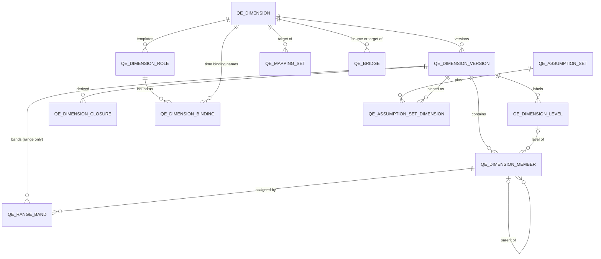
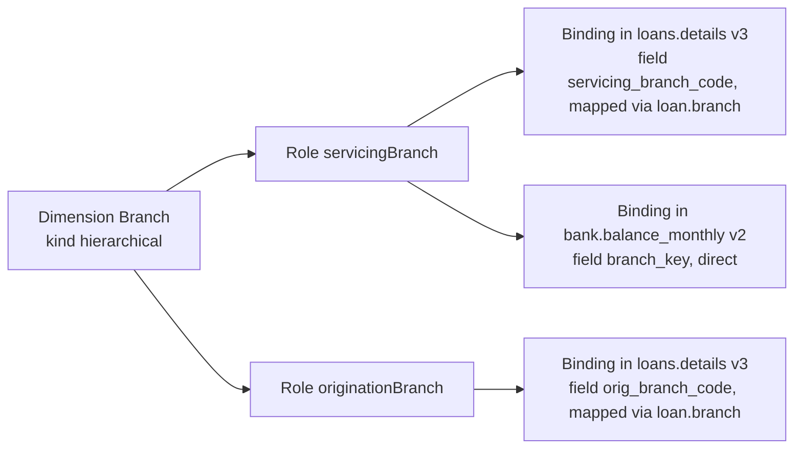
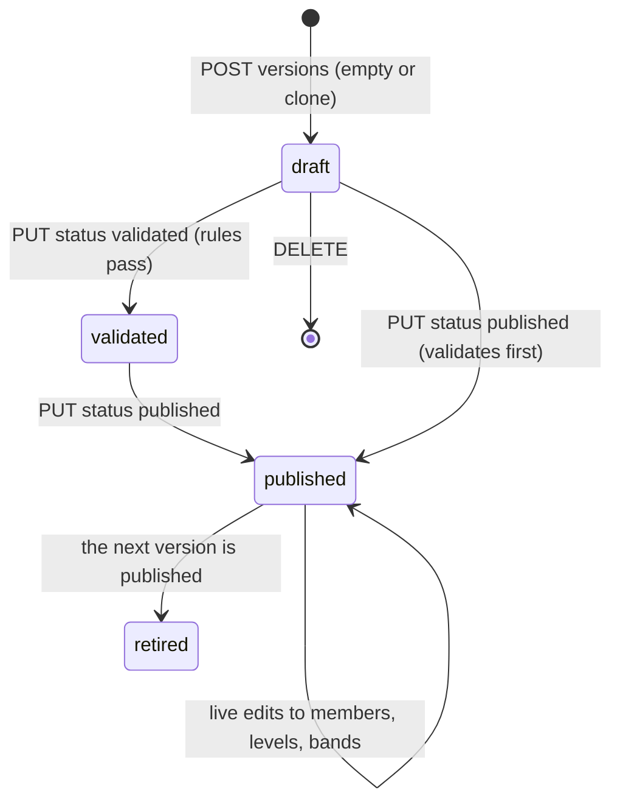
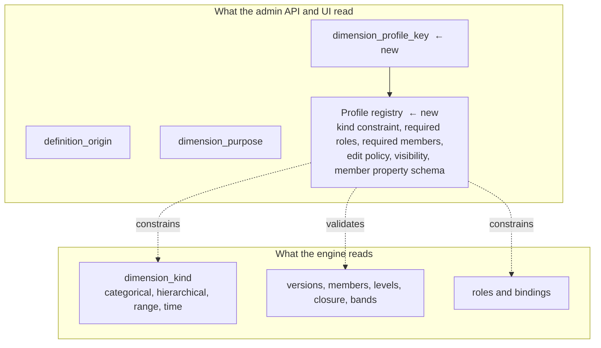

# Dimensions

A dimension is anything a query can group or filter by. This document describes how the Quantalytix query engine models
dimensions: the vocabulary the product uses and how it maps onto the schema, the tables and their invariants, how
dimensions relate to datasets, mapping sets, bridges, assumption sets and reports, how the engine resolves them when it
runs a query or a report, and what the admin API enforces when a dimension is created, edited, published or deleted.
The last sections cover system-defined dimensions and member metadata, where the current implementation stops short of
the product's requirements, and what the dimension manager should expose.

Sources of truth, in order: `database/srdb_ebm/schema/01_tables/dimension/`, `docs/schema/Query_Engine_Database_Schema.md`
§8–§12 and §18 of the seed kit, the admin API's `Application/Dimensions` feature, and the engine's
`CanonicalDimensionJoin`. Schema design revision 2.26.0, metadata schema version 17.

## 1. Product vocabulary and how the system models it

The product describes five dimension types from the data's point of view. The system does not store a dimension type
with those five values. It separates three questions that the five types bundle together:

1. **What is the canonical set of members?** This is `qe_dimension.dimension_kind`: `categorical`, `hierarchical`,
   `range` or `time`. A dimension row exists only when there is a canonical member set worth reusing.
2. **How does a dataset's field reach those members?** This is `qe_dimension_binding.binding_kind`: `direct`,
   `mapped`, `range`, `bridge` or `time`. The same dimension can be reached by different datasets in different ways.
3. **Where does the raw value come from?** This is `qe_field.field_source_kind`: `column`, `json_path` or
   `expression`. A field is groupable on its own, without any dimension row, when `is_groupable` is true.

The five product types map onto those three axes as follows.

| Product type | Canonical dimension? | `dimension_kind` | `binding_kind` | Field source | Notes |
|---|---|---|---|---|---|
| Discrete, grouped by key | Yes | `categorical` or `hierarchical` | `direct` when the field already holds member keys; `mapped` when a source code system has to be translated; `bridge` when another binding's members are remapped | any | Structure (flat list, balanced hierarchy, jagged hierarchy) is a property of the member tree, not of the kind |
| Range, bucketed by a measure | Yes | `range` | `range` | any numeric, date or datetime field | Bands live on the dimension version, so the same bands serve every dataset that binds the role |
| Literal, direct field mapping | No | — | — | `column` or `json_path` | A groupable field. Grouped under its `field_key`; no members, no hierarchy, no mapping |
| Date | Yes | `time` | `time` | `date`, `datetime` or `timestamp` field | Has no roles and no materialized members; periods are derived arithmetically from the field |
| Calculated | No | — | — | `expression` | A groupable field whose value is a validated row expression over other fields |

Two consequences matter for the manager.

- **Literal and calculated are not merged, but neither is a dimension.** They are kept apart by
  `field_source_kind` (`column`/`json_path` versus `expression`), and both are managed in the dataset manager's Fields
  tab, not in the dimension manager. They share one grouping path in the engine: `GROUP BY` the resolved field value.
  The schema document calls these "direct grouping" and "calculated grouping" and says explicitly that they are
  capabilities of a field rather than dimension entities, so that a dataset can expose hundreds of groupable fields
  without creating members for each (§7, "Direct grouping and calculated grouping").
- **A calculated classification can be promoted to a discrete dimension** without changing the expression: bind the
  expression field to a role with a `direct` or `mapped` binding. The field's own key keeps grouping by the raw
  expression value, and the role's key groups by the canonical member. The two IDs must differ unless the binding reads
  that very field, so each request ID has one meaning.

`categorical` and `hierarchical` are declarative. The engine resolves both through the same member-key join and the
same closure table, and a categorical dimension may hold parent links. The distinction tells pickers and reports what
to expect: a report's template dimension must be one of the two, and the UI can hide hierarchy controls for a
categorical dimension. A jagged hierarchy needs no special kind; members may sit at any depth, and each binding's
`ragged_behavior` says what happens when a query groups at a level or depth that a member lacks.

### Terms

| Term | Meaning |
|---|---|
| Dimension | The identity row (`qe_dimension`): key, kind, origin, removability, purpose. Never versioned. |
| Dimension version | A member set with its levels, closure and range bands (`qe_dimension_version`). Draft, validated, published or retired. At most one is published. |
| Role | A named use of a dimension (`qe_dimension_role`), such as `servicingBranch` and `originationBranch` of `Branch`. The role's key is the ID a request groups and filters by. Not versioned. |
| Binding | A dataset version's declaration that one of its fields classifies rows into a role's members (`qe_dimension_binding`). Belongs to the dataset, not the dimension. |
| Member | A node of a version's member tree (`qe_dimension_member`), named across versions by `member_key`. |
| Level | An optional business label for a tier of the hierarchy (`qe_dimension_level`). Structural depth comes from parentage, not from levels. |
| Closure | The derived ancestor/descendant table (`qe_dimension_closure`) the engine joins to group at a level, depth or ancestor, or to roll up. |
| Mapping set | A source code system that translates raw values into member keys of one dimension (`qe_mapping_set`). |
| Bridge | A remapping from the members of one dimension to the members of another, with factors and allocation (`qe_bridge`). |
| Assumption set | The set of version pins a query reads through. The active set pins every published version; a historical set is a captured snapshot. |

### Hidden dimensions

Not every dimension is shown in the dimension manager. A hidden dimension is a `qe_dimension` row that the Dimensions
list, the query catalog and the pickers that choose an analytical dimension leave out, because something else owns it
and is the only place it changes. Today there is one kind.

- **Report dimensions** (`dimension_purpose = 'report'`). A report dimension holds the rows of exactly one report and is
  bound to that report through `qe_report.report_dimension_id`. It is created with the report, keyed and named like it,
  edited only in the report editor and deleted with the report (§5.2). It has no roles, so no dataset binds it and no
  query groups by it. The Dimensions list shows only `analytical` dimensions, and the generic dimension endpoints refuse
  writes to a report dimension with 409 "Owned by a report". The bridges into it belong to its report's sources: the
  report editor edits them, and they appear read-only on their source dimension's Bridges tab. A report dimension still
  appears in two places: the new report sheet's "Start from" picker, so a report can start as a copy of another report's
  rows, and the active assumption set's pins, which open its report's editor.

The proposed dimension profiles add a second kind: a profile with `hidden` visibility for backend-only dimensions
(§7.3).

## 2. Database level

### 2.1 Tables



**`qe_dimension`** — identity. `dimension_key` (unique, fixed, a letter then letters, digits or underscores),
`display_name`, `dimension_kind`, `definition_origin` (`system` or `user`), `is_removable`, `is_enabled`,
`dimension_purpose` (`analytical` or `report`).

**`qe_dimension_role`** — `dimension_role_key` (unique across the whole tenant, fixed), `display_name`, `description`,
`dimension_id` (fixed). Every analytical dimension except a time dimension has at least one role; time dimensions have
none.

**`qe_dimension_version`** — `version_number`, `status`, `range_data_type` (`decimal`, `date` or `datetime` for a range
dimension, null otherwise), `published_at`.

**`qe_dimension_level`** — `level_key` (unique in the version), `display_name`, `ordinal`, `periodicity` (time
levels only), `is_leaf_level`.

**`qe_dimension_member`** — `member_key` (unique in the version, stable across versions), `display_name`,
`description`, `parent_dimension_member_id`, `dimension_level_id`, `is_assignable`, `sort_order`, `properties` (JSON).
`dimension_member_id` is globally unique, not version-local, so parent, closure and band references inside a version
are unambiguous; references from outside the dimension use `member_key` because a new version gives its members new
IDs.

**`qe_dimension_closure`** — one row per (ancestor, descendant) pair including depth 0 self rows. Never edited
directly; the admin API rebuilds it after every member write and at validation.

**`qe_range_band`** — ordered bands of a range version: `ordinal`, `dimension_member_id`, one typed bound pair
(`lower_decimal`/`upper_decimal`, `lower_date`/`upper_date` or `lower_datetime`/`upper_datetime`), `lower_inclusive`
(default true), `upper_inclusive` (default false). A null bound is unbounded.

### 2.2 Invariants the database cannot enforce

StarRocks foreign keys are optimizer hints, so the admin API enforces these at validation and publication:

- Member keys and level keys are unique within a version. A member's parent and level belong to the same version.
  Parent links are acyclic.
- Closure rows exactly match the parent graph.
- A range version has a range data type and its bands use only that type's bound columns; bands are ordered,
  non-overlapping, and only the first may lack a lower bound and only the last an upper one. Every other kind has no
  range data type.
- Each dimension has at most one published version. The active assumption set pins exactly the published versions.
- Every member or level key named by a live object (a published binding's unknown member, a published mapping entry, a
  published bridge mapping, an enabled report's calculation dimension grouping) exists in the published version.
- A report dimension has no roles, belongs to exactly one report, and is the target of no mapping set and the source
  of no bridge.

### 2.3 Member `properties`

`qe_dimension_member.properties` is the extension point for member metadata: the only free-form store a member has.
The seed uses it for plan versions (`kind`, `horizonStart`, `horizonEnd`, `asOf`, `status`), and `GetCatalog` returns
it when `includeMemberDetails` is true. Today it is untyped JSON: the admin API checks that it parses, and nothing
declares which keys a given dimension's members should carry. Section 7 proposes how to type it.

## 3. Relationships

### 3.1 Dimension → role → binding → dataset

A dimension is a template. A role names one use of it, and a binding ties one dataset version's field to that role.



Rules that follow:

- A dataset version binds each role at most once, and a bound role's key is the key of no other field in that version.
  A request therefore names `servicingBranch` and gets one deterministic column.
- Every role of one template shares members, levels, versions, mapping sets and bridges, so two roles are conformed by
  construction. A report that pivots several datasets by `branch` lines them up because each reads its own binding of
  the same role.
- Bindings belong to the dataset version and are immutable once that version is published. Dimension content is not:
  a binding names its dimension, mapping set and bridge by identity and its unknown member by key, never by version.

### 3.2 Mapping sets and bridges

A **mapping set** belongs to one dimension and translates raw source codes into member keys. Several datasets that
share a source vocabulary share the mapping set; datasets with different vocabularies use different sets for the same
dimension (the seed maps GL branch `001` to `BR02` through `finance.branch` and loan branch `001` to `BR01` through
`loan.branch`).

A **bridge** leads from one dimension to another and remaps members with a signed `factor` and an
`allocation_weight`. An analytical bridge is used by a `bridge` binding: a dataset that already binds `Account` can
expose an `AccountGroup` role through a bridge without a second mapping. A report source's bridge (section 5.2) has
`many_to_many` cardinality, `replicate` allocation and may use `descendants` rules.

Mapping sets and bridges are versioned like dimensions: one published version each, edited in place, pinned by the
assumption set.

### 3.3 Assumption sets, releases and independence

Dataset versions are pinned by a **release**; dimension, mapping and bridge versions are pinned by an **assumption
set**. The two are independent on purpose:

- Changing a hierarchy, adding members or republishing a mapping never requires a new dataset version or a release.
- A query that names no set reads the active set, which always pins the published versions. Publishing a dimension
  version retires its predecessor and repoints the active set in the same operation.
- A historical set is a snapshot of the active set plus the release that was active then. A query that names it
  classifies rows as they were classified at capture time, over the dataset versions of that release. A historical set
  captured before a dimension existed cannot serve a binding of it (`assumption_set_incomplete`).
- Every edit to a published dimension version, role or dimension identity that the engine can see advances
  `semantic_revision`, which is part of the engine's metadata cache key, so the change is visible on the next request.

### 3.4 What references a dimension

Everything below blocks deleting the dimension, and the admin API names each blocker in its 409 response:

| Reference | Through | Blocks delete of |
|---|---|---|
| Dataset version binding | `qe_dimension_binding.dimension_role_id` / `dimension_id` | dimension, role |
| Mapping set | `qe_mapping_set.dimension_id` | dimension |
| Bridge | `qe_bridge.source_dimension_id` / `target_dimension_id` | dimension |
| Report row structure | `qe_report.report_dimension_id` | dimension |
| Report calculation dimension | `qe_calculation_dimension.dimension_role_id` | dimension, role |
| Report bridge source | `qe_report_source.dimension_role_id` | dimension, role |
| Report scenario | `qe_report_scenario.dimension_role_id` | dimension, role |
| Non-draft version | `qe_dimension_version.status` | dimension |
| `is_removable = false` | `qe_dimension.is_removable` | dimension |

Within a published version, a member cannot be deleted while it has children, is assigned by a range band, or is named
by a live object (binding unknown member, mapping entry, bridge mapping, calculation dimension ancestor grouping); a
level cannot be deleted while members use it or a calculation dimension groups at it.

## 4. How queries use dimensions

### 4.1 Discovery

`GetCatalog` returns, per dataset, the `dimensions` a request may group by. Each entry's `id` is a role key (with the
role's display name and description and the template's `dimensionKey`) or a time binding's field key, and carries the
`version` the assumption set pins: level keys and members with parent and level resolved to keys. `includeMembers`
and `includeMemberDetails` control payload size; the latter adds `description`, `sortOrder`, `isAssignable` and
`properties` per member. Groupable fields appear under `fields`, not `dimensions`. Disabled dimensions and bindings
and unpublished versions never appear.

### 4.2 Resolution of a request dimension ID

```text
dimensions[].id
  -> a role key the dataset version binds?
       yes -> canonical resolution through that binding (members, mapping, bands, bridge, closure)
  -> a field key with an enabled time binding?
       yes -> time axis, periods derived from the field
  -> a field key with is_groupable?
       yes -> GROUP BY the field's value or expression
  -> error
```

### 4.3 Groupings, rollups and ragged members (contract 1.3 and 1.1)

A binding classifies each row into a member; the request decides how members group:

| Grouping | Request | Engine |
|---|---|---|
| `member` (default) | `{ "id": "branch" }` | Groups by the member's own key |
| `level` | `{ "id": "branch", "grouping": { "mode": "level", "level": "region" } }` | Joins the closure to the unique ancestor whose level is `region` |
| `ancestor` | `{ "mode": "ancestor", "ancestor": "NORTH" }` | Joins the closure to that one ancestor; rows outside its subtree are ragged |
| `depth` | `{ "mode": "depth", "depth": 1 }` | Joins the closure at that edge distance |
| rollup | `{ "id": "branch", "rollup": true }` | Joins the closure without a single-ancestor predicate, so each row contributes to itself and every ancestor; each node is computed with the measure's own semantics, never summed from children |

Level and ancestor keys resolve in the pinned version (`grouping_not_found` otherwise). A field grouped by its raw
value accepts no grouping (`grouping_not_supported`). A member that lacks the requested ancestor groups as the
binding's `ragged_behavior` says: under `NULL`, under itself (`self`), or is excluded.

### 4.4 Dimension predicates

`[d.branch] = 'BR01'`, `[d.branch@level:region] = 'NORTH'`, or the structured `{ "type": "dimension", "id": ... }`
operand filters on the canonical member a row resolves to, not on the raw code. The binding must be filterable, and a
bridge that can send a row to several members cannot be filtered on. Each operand resolves on its own grouping,
independent of the output breakout, so a query can break out by branch while filtering by region.

### 4.5 The SQL shape

`CanonicalDimensionJoin` (engine, StarRocks provider) emits, per dimension, a chain of joins bound to the pinned
version IDs:

1. **Find the member.** `direct`: join `qe_dimension_member` on `member_key = CAST(value AS VARCHAR)`. `mapped`: join
   `vw_qe_mapping_entry` on the pinned mapping version and `source_key_value`. `range`: join `qe_range_band` on the
   pinned version with the typed bound comparison, honoring inclusivity and null bounds. `bridge`: resolve the source
   binding's member first, then join `vw_qe_bridge_entry` on the pinned bridge version and both pinned dimension
   versions, taking the target member, factor and allocation weight.
2. **Apply unmapped behavior.** `LEFT JOIN` by default so unmapped rows survive under `NULL`; inner `JOIN` when the
   binding excludes them; `COALESCE(member, unknown_member_id)` when it routes them to the unknown member.
3. **Pick the grouping key.** The member's own key, or a closure subquery selecting the ancestor at the level, depth or
   fixed ancestor, or the full closure for a rollup. Ragged `exclude` adds a condition; ragged `self` coalesces to the
   member's own key.

Values are compared as text so `001` stays distinct from `1`; the engine never coerces. The joins are inner where
possible so StarRocks can push runtime filters into the fact scan.

### 4.6 Results

`"result": { "includeMembers": true }` attaches the pinned version's members for every canonical dimension the query
grouped by, so a client can label and sort rows without a second call. A dimension grouped by raw field value has no
members and is omitted.

## 5. How reports use dimensions

Reports use dimensions in three distinct ways, each with its own table.

### 5.1 Calculation dimensions: cross-dataset pivots

`qe_calculation_dimension` names, per report, a role plus a default grouping. Every source whose dataset binds that
role reaches the dimension through its own binding, so a margin statement built from GL and loan-level datasets pivots
by `branch` even though their raw codes differ. A source whose dataset does not bind the role does not reach the
dimension, and a request may not pivot by it unless every source the selected metrics and profile need binds it; the
engine refuses fan-out rather than invent data. The default grouping lives on the calculation dimension (`branch` by
member, `region` at level `region`, both over the same role), and a request can override it per run.

### 5.2 Report dimensions: the rows of a statement

A report's rows are the members of its own dimension, `dimension_purpose = 'report'`, created with the report, keyed
and named like it, and either copied from a template categorical or hierarchical dimension or started as a single
`total` root. It is a hidden dimension (§1): it has no roles, so no dataset binds it, no query groups by it, the
catalog never lists it and the dimension manager leaves it out. Its
version is created published and edited in place only through the report editor; the generic dimension endpoints
refuse it with 409 "Owned by a report". Sources reach its rows by a `bridge` of their own from a role their dataset
binds (`many_to_many`, `replicate`, with `descendants` rules so a folder rule covers members added later) or `direct`
by a field whose values are row keys.

### 5.3 Scenarios: plan versions and rate shocks

`qe_report_scenario` names roles whose members are alternatives a run reads one at a time. A scenario's dimension has
exactly one role, so the scenario and the dimension are one; a request names a member per scenario by role key
(`"scenarios": { "planVersion": "FC_2024_09", "rateShock": "BASE" }`) and each source that binds the role filters on it.
Plan versions are the assignable leaves under non-assignable folders by kind and horizon, and their `properties`
carry `kind`, `horizonStart`, `horizonEnd`, `asOf` and `status`, which the report catalog surfaces for pickers. This is
the existing precedent for a purpose-specific dimension with structured member metadata.

## 6. Admin API

### 6.1 Endpoints

| Resource | Endpoints |
|---|---|
| Dimension | `GET/POST dimensions`, `GET/PUT/DELETE dimensions/{id}` |
| Roles | `GET/POST dimensions/{id}/roles`, `PUT/DELETE dimensions/{id}/roles/{roleId}` |
| Versions | `GET/POST dimensions/{id}/versions`, `GET/PUT/DELETE dimension-versions/{versionId}` |
| Levels | `GET/POST dimension-versions/{versionId}/levels`, `PUT/DELETE .../levels/{levelId}` |
| Members | `GET/POST dimension-versions/{versionId}/members`, `PUT/DELETE .../members/{memberId}`, `PUT .../members/order` |
| Range bands | `GET/PUT dimension-versions/{versionId}/range-bands` (the whole set replaced at once) |
| Status | `PUT versions/dimension_version/{versionId}/status` with `validated`, `published` or `retired` |
| Mapping sets, bridges, assumption sets | Their own features; see the API architecture pages |

All paths are under `/api/tenants/{tenantId}/`.

### 6.2 Creating a dimension

`POST dimensions` takes the fixed key and kind, display name, `isEnabled`, `isRemovable`, a `rangeDataType` (required
for `range`, null otherwise) and a `defaultRole` (required for every kind but `time`). The service creates the identity
row with `definition_origin = user` and `dimension_purpose = analytical`, draft version 1, and the role. Report
dimensions are created only through `POST reports`.

There is no endpoint that creates a `system` dimension. System dimensions reach a tenant only through the seed kit or a
provisioning script.

### 6.3 Input validation versus publication rules

Two layers check writes, and the web app shows both on the form that caused them rather than validating itself.

**Input validators** run on every save and return 400 `ValidationProblemDetails`: key pattern and length, vocabulary
membership (`dimension_kind`, `range_data_type`, `grouping_mode`), display name and description lengths, JSON that
parses, a parent or level ID that exists, bands whose bounds match the version's range data type.

**Publication rules** run on `PUT .../status` to `validated` or `published` and return 422 listing every violation:

| Code | Rule |
|---|---|
| `member_key_unique` | Member keys unique in the version |
| `level_key_unique` | Level keys unique in the version |
| `member_parent_in_version` | A member's parent belongs to the same version |
| `member_level_in_version` | A member's level belongs to the same version |
| `hierarchy_acyclic` | Parent links never cycle |
| `range_data_type_matches_kind` | Range versions have a range data type; others have none |
| `band_boundary_family` | Bands set only the bounds of the version's range data type |
| `band_bounds_ordered` | Lower below upper when both are set |
| `band_member_in_version` | Every band assigns a member of its own version |
| `bands_non_overlapping` | Bands do not overlap, with inclusivity considered; only the first is open below and only the last open above |
| `dimension_consumers_resolve` | Every level and member key that live objects name exists in the version being published |

`ClosureBuilder` rebuilds the closure before the rules run, so a cloned draft's copied members get closure rows and a
cycle surfaces as `hierarchy_acyclic`.

### 6.4 Lifecycle



- Dimension versions are "living": the published version is edited in place and every edit reaches queries at once,
  through the semantic revision. Publishing version n+1 retires version n and repoints the active assumption set; a
  published version is never retired by hand.
- A new draft is empty or a clone of any version. A clone copies levels, members, parentage and, for range
  dimensions, the range data type and bands.
- `dimension_consumers_resolve` is what makes republishing safe: the new version must keep every key that bindings,
  mapping entries, bridge mappings and enabled reports already name, because the moment it is published they resolve
  in it.

### 6.5 Editing

- **Identity.** `PUT dimensions/{id}` edits `displayName`, `isEnabled` and `isRemovable`. The key, kind, origin and
  purpose are fixed. A `system` dimension keeps its stored `isRemovable` regardless of the input. A changed name or
  availability advances the semantic revision.
- **Roles.** `PUT roles/{roleId}` edits display name and description; the key and dimension are fixed because requests
  and report filters name the key. Adding a role to a dimension whose only role is some report's scenario is refused.
- **Members.** Every create, update, delete and reorder rebuilds the version's closure. `PUT members/order` reorders
  siblings. Deleting from a published version runs the blocker checks in section 3.4.
- **Range bands.** Replaced as a whole set, in ordinal order.
- **Report dimensions.** Every generic write to one is refused with 409; the report editor applies the change under the
  report rules.

### 6.6 Deleting

`DELETE dimensions/{id}` succeeds only when the dimension is removable, every version is a draft and nothing in
section 3.4 references it or its roles. Drafts are hard-deleted with their content, children before parents.

## 7. System-defined and module-required dimensions

### 7.1 What exists

- `definition_origin` (`system` | `user`) says who defined the dimension. The admin API never creates `system`; it only
  protects `is_removable` on one.
- `is_removable` blocks deletion. A user may set it on their own dimension; a system dimension's value is frozen.
- `dimension_purpose` (`analytical` | `report`) keeps report row structures out of analytical pickers. It is the one
  existing mechanism for hiding a dimension from the dimension manager (see "Hidden dimensions" in §1).
- `properties` on members holds structured metadata by convention only (the plan-version precedent in 5.3).

In the seed, `Branch` and `Calendar` are `system` and not removable, and `MarginStatement`, `BalanceSheet` and
`KeyRatios` are the report dimensions of the three seeded reports. Every other dimension is `user`, `analytical` and
removable, including `Product`, so no module dependency is modelled today.

### 7.2 What the requirements add

The product requirements go beyond this in four ways:

1. **Module ownership.** A profitability module needs a `Product` dimension with specific member keys to exist. Nothing
   records which module requires which dimension, which roles it reads, or which member keys it depends on.
2. **Graduated edit restrictions.** Some system dimensions may be renamed and extended but not have required members
   removed; some may not be edited at all; some should never be visible. Today the only lever is `is_removable`.
3. **Visibility.** Backend-only dimensions should not appear in the manager, and module dimensions should appear in
   the module's own area. Only `report` purpose is filtered today.
4. **Typed member metadata.** A `Branch` member carrying a photo, a `Territory` member carrying a geometry, a plan
   version carrying a horizon: each is a schema over `properties` that the manager should render and validate as
   such, instead of a JSON text box.

### 7.3 Proposed model: dimension profiles

Keep `dimension_kind` as the structural axis the engine reads, and add a **profile** as the product axis the admin
API and UI read. The engine stays unchanged, because it never reads origin, purpose or profile.



A **profile** is a named contract the API ships with (and, later, that a module can register):

| Profile attribute | Purpose | Example for `branch` |
|---|---|---|
| `key` | Stored as `qe_dimension.dimension_profile_key`; null means a plain user dimension of its kind | `branch` |
| `kind` | The `dimension_kind` a dimension of this profile must have | `hierarchical` |
| `requiredRoles` | Role keys that must exist and may not be deleted | `branch` |
| `requiredMembers` | Member keys the published version must keep; `dimension_consumers_resolve` extends naturally to them | none for branch; `MORTGAGE`, `AUTO`, `COMMERCIAL`, `DEPOSITS` for `product` |
| `editPolicy` | `open` (anything but delete), `extend` (add members and roles, rename, but keep required keys), `locked` (identity and content read-only) | `open` |
| `visibility` | `manager` (listed in the dimension manager under its profile), `module` (listed only in the owning module's area), `hidden` | `manager` |
| `owner` | The module that depends on it, for the manager's "required by" label | `profitability` |
| `memberPropertySchema` | A JSON schema for `properties`, which the member sheet renders as typed fields and the API validates | `{ photoUrl: uri, address: {...}, geo: { lat, lng } }` |
| `cardinality` | Whether a tenant has at most one dimension of this profile | one |

With this in place the manager's "type" picker becomes exactly the list in the requirements: the four base kinds a user
may create freely (discrete, which the sheet then refines into categorical or hierarchical; range; date; literal and
calculated are routed to the dataset manager), followed by every profile whose visibility is `manager` and whose
cardinality still allows a new instance. A profile with `cardinality: one` that already exists appears as the existing
dimension, not as a creatable type.

What this requires, by layer:

- **Schema.** `qe_dimension.dimension_profile_key VARCHAR(64) NULL`. No other table changes; `properties` already
  exists on members. New metadata schema version.
- **Admin API.** A profile registry (code, not tenant data, at first), a `NewDimensionInput.profileKey` that fixes
  kind and seeds required roles and members, a publication rule `profile_required_keys_present`, an edit filter like
  `RequireAnalytical` that applies the edit policy, `properties` validation against the profile's schema on member
  writes, and `GET dimension-profiles` so the UI never hard-codes the list.
- **Web.** The list page groups or filters by profile and hides `hidden`/`module` profiles; the new-dimension sheet
  takes a type from the registry; the member sheet renders the property schema as fields; required members and roles
  render with a lock.

Until the registry exists, the closest expression of a module dependency with today's schema is: seed the dimension
with `definition_origin = system`, `is_removable = false`, and treat `properties` conventions as documentation. That
protects deletion only; it does not protect the member keys a module reads.

## 8. What the dimension manager should expose

For a plain user dimension, the manager edits the entities above in this shape; the current web app under
`web/src/features/dimensions` implements every area but Usage.

| Area | Content | Read-only when |
|---|---|---|
| Identity header | key, name, kind, enabled, removable, origin and purpose badges; for a profile dimension, the owning module and policy | key, kind, origin, purpose always; name and flags under `locked` |
| Versions | the version list with status, new empty draft, clone, validate, publish, delete draft | — |
| Members | the tree in sort order with key, name, level, assignable, description, properties; create under a parent, reorder, move, delete with blockers shown; for a profile, properties rendered from the schema | version retired; required members locked under `extend` |
| Levels | key, name, ordinal, leaf, periodicity (time only) | version retired |
| Range bands | the ordered band list typed by the version's range data type, inclusivity flags, assigned member; the first and last open-ended | kind is not `range`; version retired |
| Roles | key, name, description; add role (refused for a scenario dimension); delete with blockers | key always; required roles locked |
| Mappings | the mapping sets whose source codes map onto the dimension's members; new mapping set; each opens its own page under the dimension, with versions of its own | — |
| Bridges | into the dimension: its own bridges, created here, each opening its own page under the dimension; from the dimension: the bridges that read its members, analytical ones linking to their target's page and report ones to their report's editor | the bridges from the dimension always |
| Usage | the bindings, calculation dimensions, scenarios and reports that reference the dimension or its roles; which assumption sets pin which version | — |

Deletion of a dimension, role, level or member should show the API's blocker list before the action, since the API
refuses rather than cascades.

## 9. Open questions

1. Should profiles be shipped in code with the API, or be tenant data that a module registers at install time? Code is
   simpler and matches "the user cannot delete it"; data allows per-tenant modules.
2. For `extend` policy dimensions such as `Product`: may a user re-parent a required member, or only add members
   beneath and beside it?
3. Member metadata such as photos: store a URL in `properties`, or should the platform own binary storage? The schema
   only has room for the former.
4. Should the manager let a user create a `hierarchical` dimension directly, or always start `categorical` and let the
   presence of parent links decide? The engine does not care; the choice affects the type picker and the report
   template picker.
5. Is there a need for a time dimension with materialized members (a fiscal 4-4-5 calendar)? The schema allows it but
   no part of the admin API or engine exercises it yet.
