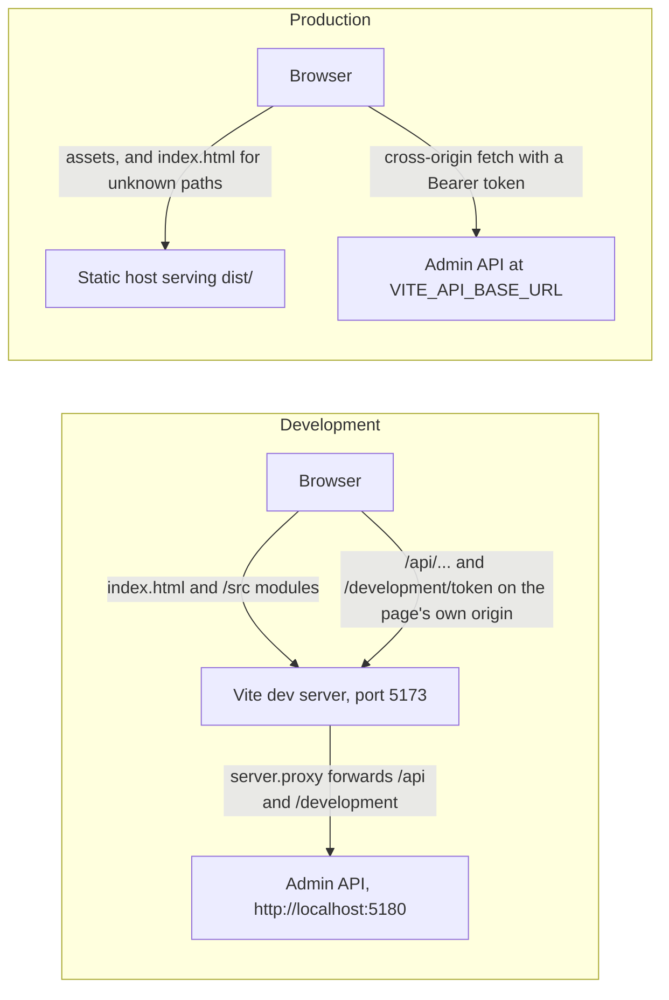
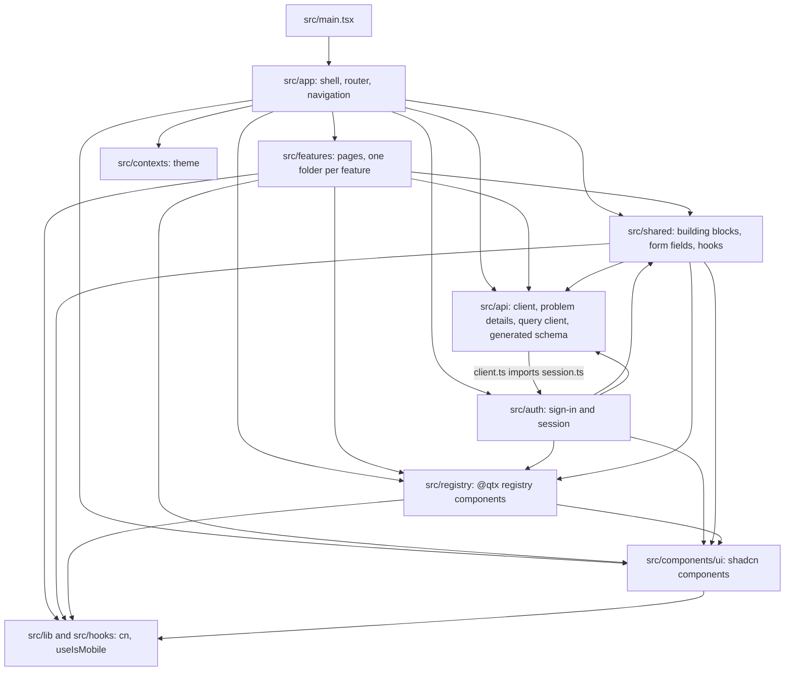
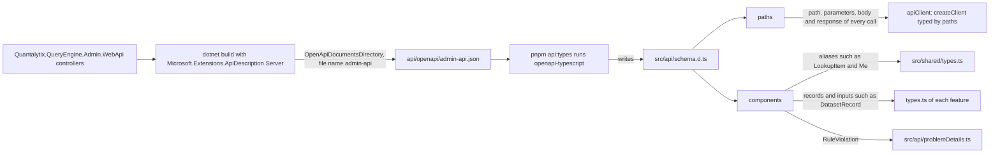

# High-level architecture

[Diagram index](README.md) · [Composition](02-composition.md) · [How it works](03-how-it-works.md) · [Critical flows](04-critical-flows.md)

## Runtime topology

The browser loads the app from one origin and sends every API call to the base URL fixed at build time. In development that base URL is empty, so the calls go to the Vite dev server, which proxies them to the API; in production a static host serves the build and the browser calls the API across origins, which the API must allow.

- `VITE_API_BASE_URL` is the only setting the app reads: `apiClient` uses it as its `baseUrl`, and `authClient` puts it in front of `/development/token`. Vite inlines it at build time. `.env.development` leaves it empty, so both clients call the dev server's own origin, and the dev server forwards `/api` and `/development` to the API's `http` launch profile. The browser then needs neither a CORS entry for its origin nor a route to port 5180.
- A production build calls the API at the configured URL from another origin. The API's default CORS policy allows the origins in `Cors:AllowedOrigins`, with any header and method and no credentials; its Development settings list `http://localhost:5173` and ports 5191 to 5195.
- `authClient` is the development client in every build. The API keeps `POST /development/token` only on a Development host, so a production build needs another `AuthClient` implementation in `src/auth/AuthClient.ts` before anyone can sign in.

| Setting | Development | Production |
| --- | --- | --- |
| App origin | Vite dev server, `http://localhost:5173` (`strictPort`) | The static host serving `dist/` |
| `VITE_API_BASE_URL` | Empty (`.env.development`) | The API's URL, set per environment at build time (`.env.example` documents it) |
| API calls | Same origin, forwarded by `server.proxy` | Cross-origin, allowed by the API's `Cors:AllowedOrigins` |
| Deep links such as `/t/sandbox/datasets/3` | Vite's SPA fallback serves `index.html` | `navigationFallback` in `staticwebapp.config.json` rewrites them to `/index.html`, except `/assets/*` and static file extensions |

**Sources:** [vite.config.ts](../../vite.config.ts), [.env.development](../../.env.development), [.env.example](../../.env.example), [env.d.ts](../../src/env.d.ts), [staticwebapp.config.json](../../public/staticwebapp.config.json), [client.ts](../../src/api/client.ts), [AuthClient.ts](../../src/auth/AuthClient.ts), [README.md](../../README.md), [AdminCorsServiceCollectionExtensions.cs](../../../api/src/Quantalytix.QueryEngine.Admin.WebApi/Configuration/AdminCorsServiceCollectionExtensions.cs), [appsettings.Development.json](../../../api/src/Quantalytix.QueryEngine.Admin.WebApi/appsettings.Development.json), [launchSettings.json](../../../api/src/Quantalytix.QueryEngine.Admin.WebApi/Properties/launchSettings.json), [DevelopmentTokenController.cs](../../../api/src/Quantalytix.QueryEngine.Admin.WebApi/Development/DevelopmentTokenController.cs), [DevelopmentControllerFeatureProvider.cs](../../../api/src/Quantalytix.QueryEngine.Admin.WebApi/Development/DevelopmentControllerFeatureProvider.cs).

## Source layers

The source tree is split by responsibility. The drawing shows which folders of `src` import which; an arrow means "imports from". The arrows are the imports that exist at a3ba75b; no lint rule enforces them.

- No feature imports the shell, the auth folder or another feature, with one exception: `DatasetVersionTabs` in `src/features/datasets` renders `BindingsTab` from `src/features/bindings` and `MeasuresTab` from `src/features/measures`, folders that have no routes of their own. A report names its calculation model by identity, so `ReportColumnSheet` and the editor's tabs read the model's metrics by the report's `calculationModelId`. The model page's metrics and the report page's profiles and calculation dimensions share `OwnedContentTab` and the hooks of `src/shared/ownedContent.ts`, each keyed by its owner, a model or a report; the report editor's source writes change profile picks too, so its hooks refresh that content through the same `invalidateOwnedContent`.
- `src/api/client.ts` reads and clears the token with `readSession` and `clearSession` from `src/auth/session.ts`, while `src/auth` uses `apiClient`, `unwrap` and `ApiProblem`. `session.ts` imports nothing, so the two folders do not form a module cycle.
- `src/shared` imports no feature, no shell code and nothing from `src/auth`. It reaches the API through five hooks, drawn in [shared building blocks](03-how-it-works.md#shared-building-blocks).
- Registry components import shadcn components and `cn`, and each other through the `@registry` alias. oxlint skips `src/components/ui`, `src/registry` and `src/hooks/use-mobile.ts`.

| Folder | Holds |
| --- | --- |
| `src/app` | `router`, `AppShell`, `AppSidebar` with `navigation.ts`, `AppBreadcrumbs`, `TenantRedirect`, `TenantSwitcher`, `ThemeToggle`, `UserMenu`, `NotFoundPage` and `RouteErrorPage` |
| `src/features/<feature>` | `routes.tsx`, the lazy pages, the feature's hooks (`queries.ts`, `api.ts` or `use*.ts`), sheets, dialogs, form-value mappers and `types.ts` |
| `src/auth` | `SessionProvider`, `RequireSession`, `LoginPage`, `useSession` and `useSignedInSession`, `authClient`, and the sessionStorage helpers in `session.ts` |
| `src/api` | `apiClient`, `unwrap`, `ApiProblem`, `toFieldErrors`, `queryClient`, `invalidateTenantQueries` and the generated `schema.d.ts` |
| `src/shared` | List, sheet, dialog and version blocks, pickers and editors, the `form` fields, and hooks such as `useLookup`, `useVocabularies`, `useTenantId` and `useVersionTransition` |
| `src/contexts` | `ThemeProvider` and `useTheme` |
| `src/components/ui` | shadcn components in the `new-york` style |
| `src/registry` | `@qtx` components such as `Combobox`, `DataTable`, `Sheet`, `MultiSelect`, `CodeEditor`, `JsonEditor` and `Loading`, and `pages/ErrorPage` |
| `src/lib`, `src/hooks` | `cn` (clsx and tailwind-merge) and `useIsMobile`, which the shadcn sidebar uses |

**Sources:** [main.tsx](../../src/main.tsx), [router.tsx](../../src/app/router.tsx), [App.tsx](../../src/app/App.tsx), [client.ts](../../src/api/client.ts), [session.ts](../../src/auth/session.ts), [SessionProvider.tsx](../../src/auth/SessionProvider.tsx), [DatasetVersionTabs.tsx](../../src/features/datasets/DatasetVersionTabs.tsx), [utils.ts](../../src/lib/utils.ts), [use-mobile.ts](../../src/hooks/use-mobile.ts), [sidebar.tsx](../../src/components/ui/sidebar.tsx), [.oxlintrc.json](../../.oxlintrc.json), [README.md](../../README.md), and the imports of every file in `src`.

## Generated API types

Request and response types come from the API's OpenAPI document, so a call that does not match the contract fails `tsc -b`. The drawing shows how the document becomes the types that the client and the pages use; arrows mean "produces" or "types".

- A call such as `apiClient.GET('/api/tenants/{tenantId}/datasets', { params: { path: { tenantId } } })` compiles only with a path, parameters and body that the document declares, and `unwrap` returns the declared response type.
- `src/shared/types.ts` also declares unions that the document leaves as plain strings: `VersionKind` (the values of the `version_kind` vocabulary), `VersionStatus` and `LookupKind`.
- `POST /development/token` is not in the document, so `AuthClient.ts` declares its `DevelopmentTokenResponse` by hand and calls the endpoint with plain `fetch`.
- The README asks for `schema.d.ts` to be committed with the API change that produced it.

| Generated type | Used by |
| --- | --- |
| `paths` | `apiClient` in `client.ts`, and through it every `GET`, `POST`, `PUT` and `DELETE` call |
| `components['schemas']` | `src/shared/types.ts` (`LookupItem`, `Vocabulary`, `VocabularyValue`, `RuleViolation`, `VersionStatusResult`, `Me`, `Tenant`), the `types.ts` of every feature except overview, `OverviewPage` (`TenantOverview`) and `problemDetails.ts` (`RuleViolation`) |

**Sources:** [package.json](../../package.json), [client.ts](../../src/api/client.ts), [schema.d.ts](../../src/api/schema.d.ts), [problemDetails.ts](../../src/api/problemDetails.ts), [types.ts](../../src/shared/types.ts), [datasets/types.ts](../../src/features/datasets/types.ts), [OverviewPage.tsx](../../src/features/overview/OverviewPage.tsx), [AuthClient.ts](../../src/auth/AuthClient.ts), [README.md](../../README.md), [Quantalytix.QueryEngine.Admin.WebApi.csproj](../../../api/src/Quantalytix.QueryEngine.Admin.WebApi/Quantalytix.QueryEngine.Admin.WebApi.csproj), [admin-api.json](../../../api/openapi/admin-api.json).

## Configuration

Build, test and tooling settings live in a few files at the root of `web/`. The first table lists them with their values at a3ba75b; the second lists the package scripts.

| Setting | Where | Value |
| --- | --- | --- |
| Alias `@` | `resolve.alias` in `vite.config.ts`; `paths` in `tsconfig.json` and `tsconfig.app.json` | `./src` |
| Alias `@registry` | Same places | `./src/registry`; registry components import each other through it |
| `VITE_API_BASE_URL` | Typed in `src/env.d.ts` | Empty in `.env.development`; `http://localhost:5180` in `.env.example`, which says to set it per environment, for example in `.env.production` or the CI build step. `*.local` files are git-ignored |
| Dev server | `server` in `vite.config.ts` | Port 5173 with `strictPort`; `proxy` sends `/api` and `/development` to `http://localhost:5180` |
| Vitest | `test` in `vite.config.ts` | `include: ['src/**/*.test.ts']`; `env: { TZ: 'Asia/Tokyo' }` |
| TypeScript | `tsconfig.app.json`, `tsconfig.node.json` | `tsc -b` checks `src` (bundler resolution, `noEmit`, `react-jsx`) and `vite.config.ts` |
| Lint | `.oxlintrc.json` | react, typescript and oxc plugins; `react/rules-of-hooks` is an error and `react/only-export-components` a warning; shadcn and registry code is ignored |
| Static host | `public/staticwebapp.config.json` | `navigationFallback` rewrites to `/index.html`, excluding `/assets/*` and static file extensions |
| shadcn | `components.json` | Style `new-york`, `rsc: false`, `tsx: true`, Tailwind CSS in `src/index.css`, base color `neutral`, CSS variables, `lucide` icons, aliases under `@/components`, `@/lib` and `@/hooks`, and the `@qtx` registry at `http://localhost:6006/r/{name}.json` |
| Package manager | `packageManager` in `package.json` | `pnpm@11.10.0` |

| Script | Command | Purpose |
| --- | --- | --- |
| `dev` | `vite` | Dev server on port 5173 |
| `build` | `tsc -b && vite build` | Type-check, then bundle into `dist/` |
| `lint` | `oxlint` | Lint with `.oxlintrc.json` |
| `test` | `vitest run` | Run `src/**/*.test.ts` once, in `Asia/Tokyo` |
| `preview` | `vite preview` | Serve the built `dist/` |
| `api:types` | `openapi-typescript ../api/openapi/admin-api.json -o src/api/schema.d.ts` | Regenerate the API types |
| `registry:serve` | `pnpm dlx serve -l 6006 /home/caliotta/code/qtx-ui-registry/public` | Serve a local checkout of the registry, at an absolute path, for `shadcn add @qtx/<item>` |

**Sources:** [vite.config.ts](../../vite.config.ts), [tsconfig.json](../../tsconfig.json), [tsconfig.app.json](../../tsconfig.app.json), [tsconfig.node.json](../../tsconfig.node.json), [env.d.ts](../../src/env.d.ts), [.env.development](../../.env.development), [.env.example](../../.env.example), [.gitignore](../../.gitignore), [.oxlintrc.json](../../.oxlintrc.json), [staticwebapp.config.json](../../public/staticwebapp.config.json), [components.json](../../components.json), [package.json](../../package.json).
