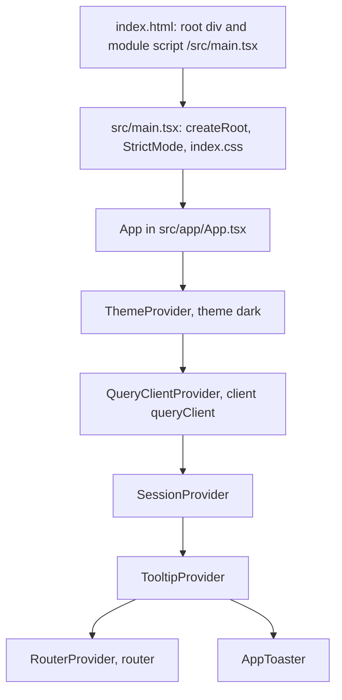
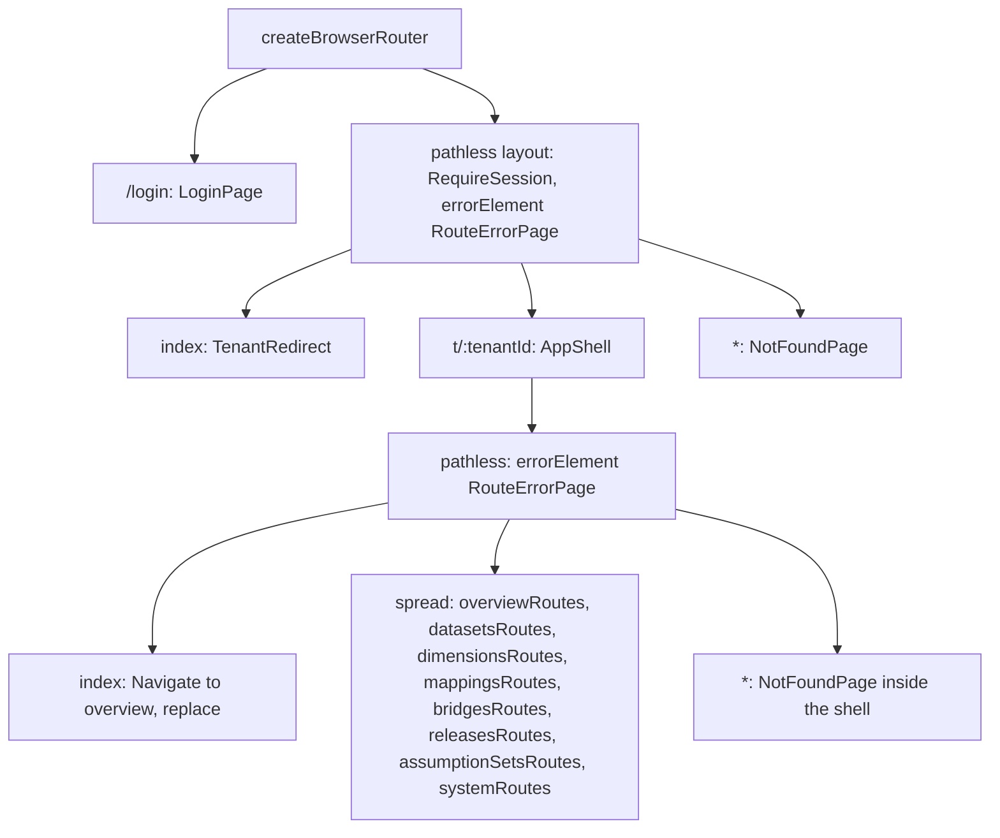
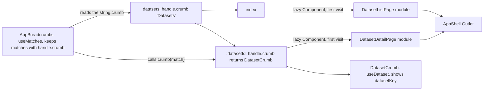
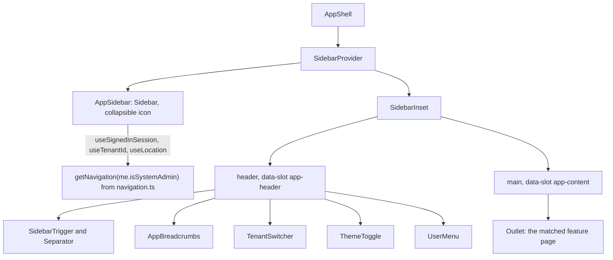
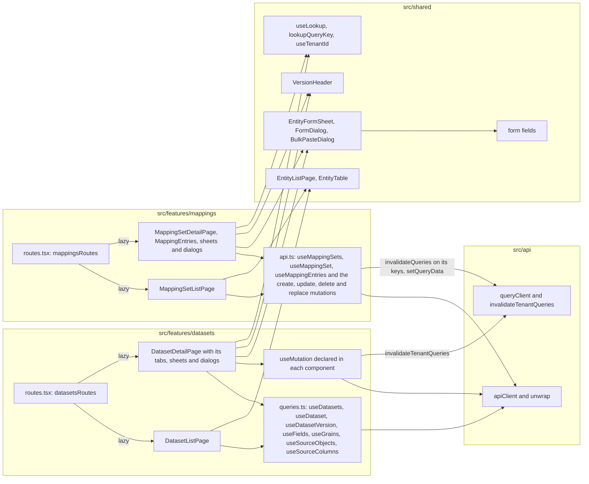
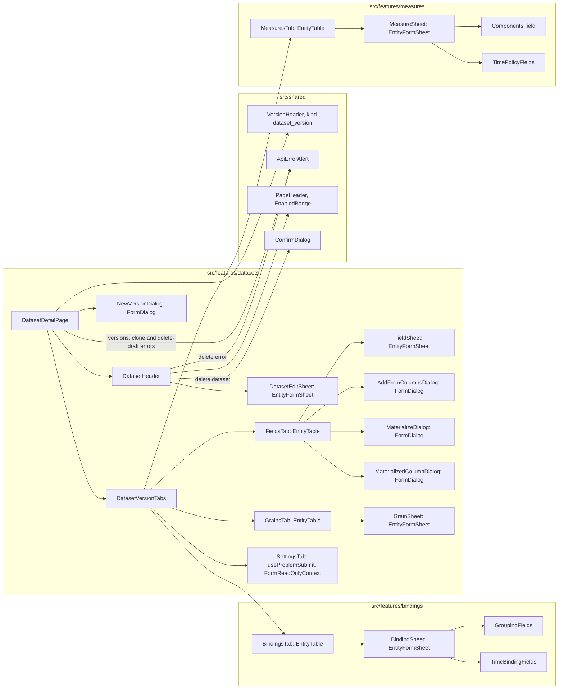

# Composition

[Diagram index](README.md) · [Architecture](01-architecture.md) · [How it works](03-how-it-works.md) · [Critical flows](04-critical-flows.md)

## Provider chain

One component tree hosts every page. The drawing shows the nesting from the HTML entry to the router; an arrow means "renders". Every provider sits above the router, so the theme, the query cache and the session survive every navigation.

- `SessionProvider` sits above the router and uses no router hooks. It restores the token, runs the `['session', 'me']` query and offers `signIn` and `signOut`; `LoginPage` and `RequireSession`, which render inside the router, do the navigating.
- The shadcn `Toaster` reads its theme from next-themes, which the app does not use, so `AppToaster` passes the theme from `useTheme`.

| Provider | Defined in | Provides | Read by |
| --- | --- | --- | --- |
| `ThemeProvider` | `src/contexts/Theme.tsx` | `theme` and `setTheme` through `useTheme`; puts the `dark` or `light` class on the html element | `ThemeToggle`, `AppToaster` |
| `QueryClientProvider` | TanStack Query, with `queryClient` from `src/api/queryClient.ts` | The app-wide query client | Every `useQuery` and `useMutation`; `SessionProvider` through `useQueryClient` |
| `SessionProvider` | `src/auth/SessionProvider.tsx` | `SessionState` (`session`, `isLoading`, `error`, `signIn`, `signOut`) through `SessionContext` | `useSession` in `LoginPage`, `RequireSession` and `UserMenu`; `useSignedInSession` in `AppSidebar`, `TenantSwitcher`, `TenantRedirect` and `UserMenu` |
| `TooltipProvider` | `src/components/ui/tooltip.tsx` | The shared Radix tooltip context | Sidebar tooltips and the registry's `BehaviorSwitch`, `IconTooltip` and `TruncatedText` |
| `RouterProvider` | react-router, with `router` from `src/app/router.tsx` | Matches, params, search parameters and navigation | Every route element |
| `AppToaster` | `src/app/App.tsx` | The sonner `Toaster` with `richColors` | `toast` calls in pages and shared blocks |

**Sources:** [index.html](../../index.html), [main.tsx](../../src/main.tsx), [App.tsx](../../src/app/App.tsx), [Theme.tsx](../../src/contexts/Theme.tsx), [queryClient.ts](../../src/api/queryClient.ts), [SessionProvider.tsx](../../src/auth/SessionProvider.tsx), [useSession.ts](../../src/auth/useSession.ts), [sonner.tsx](../../src/components/ui/sonner.tsx), [tooltip.tsx](../../src/components/ui/tooltip.tsx).

## Route tree

`router.tsx` builds the whole route tree with `createBrowserRouter`. The drawing shows it; an arrow points from a route to its children. Only `/login` is public: the pathless `RequireSession` route guards everything else, and every feature page renders inside `AppShell` under `/t/:tenantId`.

- The pathless child of `AppShell` carries a second `RouteErrorPage`, so an error thrown while a feature page renders shows inside the shell, with the sidebar and header in place. `RouteErrorPage` shows the status of a route error response, or 500 with the error's message.
- `TenantRedirect` sends `/` to the overview of the token's tenant. For a token without a tenant it loads `GET /api/tenants` and opens the first tenant, or shows a 404 page when there is none.
- `/t/:tenantId` has no breadcrumb of its own, so the breadcrumbs start at the feature.

| Feature folder | Paths under `/t/:tenantId` | Lazy pages | `handle.crumb` |
| --- | --- | --- | --- |
| `overview` | `overview` | `OverviewPage` | `'Overview'` |
| `datasets` | `datasets`, `datasets/:datasetId` | `DatasetListPage`, `DatasetDetailPage` | `'Datasets'`, `DatasetCrumb` |
| `dimensions` | `dimensions`, `dimensions/:dimensionId` | `DimensionListPage`, `DimensionDetailPage` | `'Dimensions'`, `DimensionCrumb` |
| `mappings` | `mappings`, `mappings/:mappingSetId` | `MappingSetListPage`, `MappingSetDetailPage` | `'Mappings'`, `MappingSetCrumb` |
| `bridges` | `bridges`, `bridges/:bridgeId` | `BridgeListPage`, `BridgeDetailPage` | `'Bridges'`, `BridgeCrumb` |
| `releases` | `releases`, `releases/:releaseId` | `ReleasesPage`, `ReleaseEditorPage` | `'Releases'`, `ReleaseCrumb` |
| `assumption-sets` | `assumption-sets`, `assumption-sets/:assumptionSetId` | `AssumptionSetsPage`, `AssumptionSetEditorPage` | `'Assumption sets'`, `AssumptionSetCrumb` |
| `system` | `system/tenants` | `TenantsPage` | `'Tenants'` |

**Sources:** [router.tsx](../../src/app/router.tsx), [errorPages.tsx](../../src/app/errorPages.tsx), [RequireSession.tsx](../../src/auth/RequireSession.tsx), [TenantRedirect.tsx](../../src/app/TenantRedirect.tsx), [overview/routes.tsx](../../src/features/overview/routes.tsx), [datasets/routes.tsx](../../src/features/datasets/routes.tsx), [dimensions/routes.tsx](../../src/features/dimensions/routes.tsx), [mappings/routes.tsx](../../src/features/mappings/routes.tsx), [bridges/routes.tsx](../../src/features/bridges/routes.tsx), [releases/routes.tsx](../../src/features/releases/routes.tsx), [assumption-sets/routes.tsx](../../src/features/assumption-sets/routes.tsx), [system/routes.tsx](../../src/features/system/routes.tsx).

## A feature's routes and breadcrumbs

Each feature exports its routes from `routes.tsx`, and the router spreads them under `/t/:tenantId`. The drawing shows the dataset routes; arrows mean "has child", "loads" or "reads". A page loads as its own chunk on its first visit, and the header builds the breadcrumbs from the `handle.crumb` of every matched route.

- `lazy: { Component }` imports the page module when its route first matches. The `routes.tsx` files and the crumb components they import load with the app; the page modules do not.
- `RouteHandle` in `src/shared/routeHandle.ts` types `handle.crumb` as a string or a function of the match that returns a node. `AppBreadcrumbs` renders the last crumb as the current page and the others as links to their match's pathname.
- Dataset, dimension, mapping set and bridge pages keep the selected version in the `?version=` search parameter, read through `selectedVersion`. Release and assumption set editors are versions themselves, so their version picker navigates to `releases/:releaseId` or `assumption-sets/:assumptionSetId` instead; see [the versioning UI](03-how-it-works.md#versioning-ui).

**Sources:** [datasets/routes.tsx](../../src/features/datasets/routes.tsx), [routeHandle.ts](../../src/shared/routeHandle.ts), [AppBreadcrumbs.tsx](../../src/app/AppBreadcrumbs.tsx), [DatasetCrumb.tsx](../../src/features/datasets/DatasetCrumb.tsx), [DatasetDetailPage.tsx](../../src/features/datasets/DatasetDetailPage.tsx), [ReleaseEditorPage.tsx](../../src/features/releases/ReleaseEditorPage.tsx), [AssumptionSetEditorPage.tsx](../../src/features/assumption-sets/AssumptionSetEditorPage.tsx), [versionSelection.ts](../../src/shared/versionSelection.ts).

## App shell

`AppShell` is the layout of every `/t/:tenantId` page. The drawing shows what it renders; an arrow means "renders", and the labelled arrow names what the sidebar reads.

Hiding the System group only changes the navigation: `system/tenants` is registered for every user, and the API answers 403 to callers who are not SystemAdmins.

| Part | What it shows |
| --- | --- |
| `AppSidebar` | A header link to `/t/{tenantId}/overview` and one group per `NavGroup` from `getNavigation`. Each item links to `/t/{tenantId}/{path}` and is active while the pathname starts with that link |
| `navigation.ts` | Semantic model: Overview, Datasets, Dimensions, Mappings, Bridges, Releases, Assumption sets. System (`systemAdminOnly`): Tenants at `system/tenants` |
| `AppBreadcrumbs` | One crumb per matched route that has `handle.crumb` |
| `TenantSwitcher` | A tenant `Combobox` for SystemAdmins; a badge with the route's tenant for everyone else |
| `ThemeToggle` | Switches `setTheme` between `dark` and `light` |
| `UserMenu` | The subject, tenant and SystemAdmin badge from `me`; "Sign out" calls `signOut` |

**Sources:** [AppShell.tsx](../../src/app/AppShell.tsx), [AppSidebar.tsx](../../src/app/AppSidebar.tsx), [navigation.ts](../../src/app/navigation.ts), [AppBreadcrumbs.tsx](../../src/app/AppBreadcrumbs.tsx), [TenantSwitcher.tsx](../../src/app/TenantSwitcher.tsx), [ThemeToggle.tsx](../../src/app/ThemeToggle.tsx), [UserMenu.tsx](../../src/app/UserMenu.tsx), [sidebar.tsx](../../src/components/ui/sidebar.tsx), [system/routes.tsx](../../src/features/system/routes.tsx).

## Anatomy of a feature module

Every feature folder has the same shape: `routes.tsx` lazy-loads the pages, the pages read and write through TanStack Query hooks keyed `[resource, tenantId, ...]`, and they render shared building blocks; every call ends in `apiClient` and `unwrap`. The drawing shows datasets and mappings with their real file names; arrows mean "imports and calls".

- Two write styles exist. Datasets, bindings and measures keep their read hooks in `queries.ts` and declare each write as a `useMutation` in the component that uses it; on success it calls `invalidateTenantQueries`. Dimensions, mappings and bridges keep reads and writes in `api.ts`, releases in `useReleases.ts`, assumption sets in `useAssumptionSets.ts` and the tenant directory in `useSystemTenants.ts`. Those writes invalidate the keys they change and the `lookupQueryKey` prefixes of the lookups they affect, and the bulk replaces put the stored list straight into the cache with `setQueryData`.
- Dataset hooks use `['datasets', tenantId, ...]`, `['dataset-versions', tenantId, versionId]`, `['fields', tenantId, versionId]`, `['grains', tenantId, versionId]`, `['source-objects', tenantId]` and `['source-columns', tenantId, name]`. Mapping hooks use `['mapping-sets', tenantId, ...]` and `['mapping-entries', tenantId, versionId]`.
- A version status change on any page goes through `useVersionTransition`, which calls `invalidateTenantQueries`.

| Folder | Hook module | After a write |
| --- | --- | --- |
| `overview` | `useOverview.ts` (`['overview', tenantId]`) | Read-only |
| `datasets` | `queries.ts`; writes in the components | `invalidateTenantQueries` |
| `bindings` | `queries.ts` (`useBindings`, `useDimensionVersions`, `useGroupingVersion`); writes in the components | `invalidateTenantQueries` |
| `measures` | `queries.ts` (`useMeasures`); writes in the components | `invalidateTenantQueries` |
| `dimensions` | `api.ts` | `refresh` of its query keys and lookup kinds; `setQueryData` after a member reorder and a range-band replace |
| `mappings` | `api.ts` | Its keys and lookups; `setQueryData` after a bulk entry replace |
| `bridges` | `api.ts` | Its keys and lookups; `setQueryData` after a bulk mapping replace |
| `releases` | `useReleases.ts` | `invalidateReleases` (`['releases', tenantId]` and the `releases` lookup) or the release keys; activation calls `invalidateTenantQueries` |
| `assumption-sets` | `useAssumptionSets.ts` | `invalidateAssumptionSets` (`['assumption-sets', tenantId]` and its lookup) or the set keys |
| `system` | `useSystemTenants.ts` | `invalidateTenantDirectory`: `['system-tenants']` and `['tenants']` |

**Sources:** [datasets/routes.tsx](../../src/features/datasets/routes.tsx), [DatasetListPage.tsx](../../src/features/datasets/DatasetListPage.tsx), [DatasetDetailPage.tsx](../../src/features/datasets/DatasetDetailPage.tsx), [FieldSheet.tsx](../../src/features/datasets/FieldSheet.tsx), [datasets/queries.ts](../../src/features/datasets/queries.ts), [mappings/routes.tsx](../../src/features/mappings/routes.tsx), [MappingSetListPage.tsx](../../src/features/mappings/MappingSetListPage.tsx), [MappingSetDetailPage.tsx](../../src/features/mappings/MappingSetDetailPage.tsx), [MappingEntries.tsx](../../src/features/mappings/MappingEntries.tsx), [mappings/api.ts](../../src/features/mappings/api.ts), [bindings/queries.ts](../../src/features/bindings/queries.ts), [measures/queries.ts](../../src/features/measures/queries.ts), [dimensions/api.ts](../../src/features/dimensions/api.ts), [bridges/api.ts](../../src/features/bridges/api.ts), [useReleases.ts](../../src/features/releases/useReleases.ts), [useAssumptionSets.ts](../../src/features/assumption-sets/useAssumptionSets.ts), [useSystemTenants.ts](../../src/features/system/useSystemTenants.ts), [useOverview.ts](../../src/features/overview/useOverview.ts), [useVersionTransition.ts](../../src/shared/useVersionTransition.ts), [useLookup.ts](../../src/shared/useLookup.ts), [queryClient.ts](../../src/api/queryClient.ts).

## Deep example: the dataset page

`DatasetDetailPage` is the largest page: a dataset's identity, its versions, and a five-tab editor of the selected version. The drawing shows its component tree; an arrow means "renders", and the text after a colon names the shared block a component is built on. Bindings and measures live in their own feature folders but render only here.

- The materialize dialogs and `AddFromColumnsDialog` belong to `FieldsTab`, which opens them from its toolbar and row menu on a draft. The Fields, Grains, Bindings and Measures tabs each also render a `ConfirmDialog` for deletes and an `ApiErrorAlert` for a failed delete.
- `DatasetDetailPage` keeps the open tab in its own state and passes it to `DatasetVersionTabs`, so the tab survives a switch of version. `DatasetVersionTabs` passes `isDraft` to every tab; each tab is read-only unless the selected version is a draft (see [read-only rendering](04-critical-flows.md#11-read-only-rendering-of-non-drafts)).

| Component | Reads and writes |
| --- | --- |
| `DatasetDetailPage` | `useDataset`, `useLookup('dataset-versions', datasetId)` and `selectedVersion` over `?version=`; clone (`POST .../datasets/{datasetId}/versions` with `cloneFromVersionId`) and delete draft (`DELETE .../dataset-versions/{versionId}`) |
| `DatasetHeader`, `DatasetEditSheet` | `DELETE .../datasets/{datasetId}`, then back to the list; `PUT .../datasets/{datasetId}` with `TextField` and `SwitchField` |
| `NewVersionDialog` | `POST .../datasets/{datasetId}/versions` with `VocabularyField` and `SourceObjectField` |
| `DatasetVersionTabs` | `useDatasetVersion(versionId)` |
| `FieldsTab`, `FieldSheet` | `useFields`; delete, `POST` or `PUT` a field with `TextField`, `VocabularyField`, `SourceColumnField`, `ExpressionField`, `NumberField` and `SwitchField` |
| `AddFromColumnsDialog` | `useSourceColumns`; `POST .../fields/from-columns` with `ColumnsField` |
| `MaterializeDialog`, `MaterializedColumnDialog` | `POST .../fields/{fieldId}/materialize`, with a pending message while StarRocks applies the schema change; `PUT .../fields/{fieldId}/materialized-column` with `SourceColumnField` |
| `GrainsTab`, `GrainSheet` | `useGrains` and the `fields` lookup; delete, `POST` or `PUT` a grain with `GrainFieldsField` (registry `Sortable`) |
| `BindingsTab`, `BindingSheet` | `useBindings`; delete, `POST` or `PUT` a binding. `GroupingFields` lists levels and members of the version `useGroupingVersion` resolves; `TimeBindingFields` shows for time bindings |
| `MeasuresTab`, `MeasureSheet` | `useMeasures`; delete, `POST` or `PUT` a measure with `ComponentsField` (one field per component role) and `TimePolicyFields` |
| `SettingsTab` | `PUT .../dataset-versions/{versionId}` from its own form, with `SourceObjectField`, `EntityField` (`time-bindings`), `JsonField` and the other shared fields |

**Sources:** [DatasetDetailPage.tsx](../../src/features/datasets/DatasetDetailPage.tsx), [DatasetHeader.tsx](../../src/features/datasets/DatasetHeader.tsx), [DatasetEditSheet.tsx](../../src/features/datasets/DatasetEditSheet.tsx), [NewVersionDialog.tsx](../../src/features/datasets/NewVersionDialog.tsx), [DatasetVersionTabs.tsx](../../src/features/datasets/DatasetVersionTabs.tsx), [FieldsTab.tsx](../../src/features/datasets/FieldsTab.tsx), [FieldSheet.tsx](../../src/features/datasets/FieldSheet.tsx), [AddFromColumnsDialog.tsx](../../src/features/datasets/AddFromColumnsDialog.tsx), [MaterializeDialog.tsx](../../src/features/datasets/MaterializeDialog.tsx), [MaterializedColumnDialog.tsx](../../src/features/datasets/MaterializedColumnDialog.tsx), [GrainsTab.tsx](../../src/features/datasets/GrainsTab.tsx), [GrainSheet.tsx](../../src/features/datasets/GrainSheet.tsx), [GrainFieldsField.tsx](../../src/features/datasets/GrainFieldsField.tsx), [SettingsTab.tsx](../../src/features/datasets/SettingsTab.tsx), [SourceObjectField.tsx](../../src/features/datasets/SourceObjectField.tsx), [SourceColumnField.tsx](../../src/features/datasets/SourceColumnField.tsx), [datasets/queries.ts](../../src/features/datasets/queries.ts), [BindingsTab.tsx](../../src/features/bindings/BindingsTab.tsx), [BindingSheet.tsx](../../src/features/bindings/BindingSheet.tsx), [GroupingFields.tsx](../../src/features/bindings/GroupingFields.tsx), [TimeBindingFields.tsx](../../src/features/bindings/TimeBindingFields.tsx), [bindings/queries.ts](../../src/features/bindings/queries.ts), [MeasuresTab.tsx](../../src/features/measures/MeasuresTab.tsx), [MeasureSheet.tsx](../../src/features/measures/MeasureSheet.tsx), [ComponentsField.tsx](../../src/features/measures/ComponentsField.tsx), [TimePolicyFields.tsx](../../src/features/measures/TimePolicyFields.tsx).
