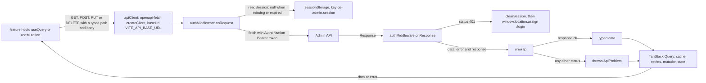
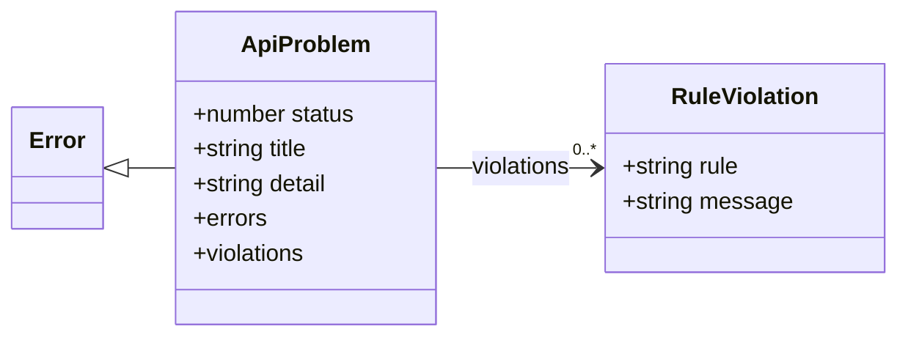
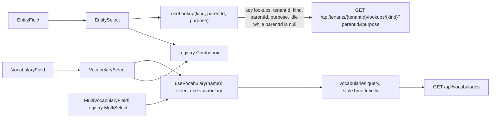
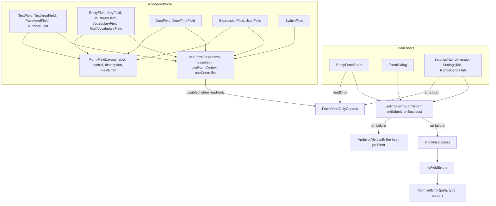
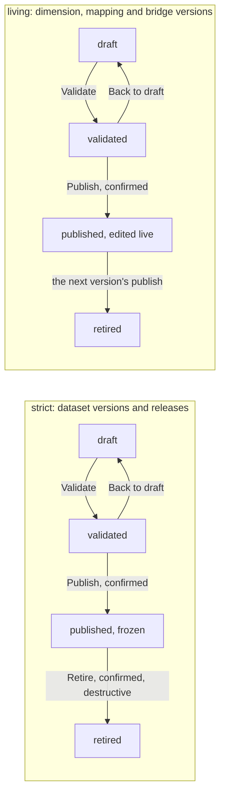
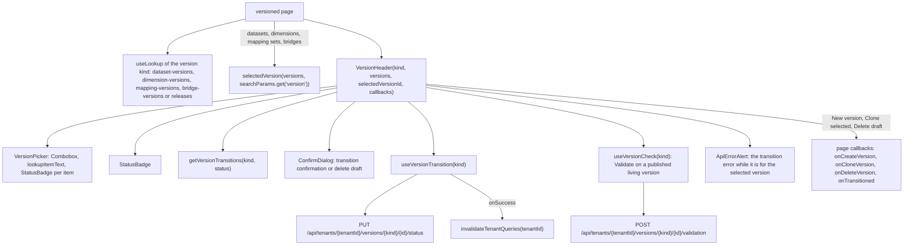
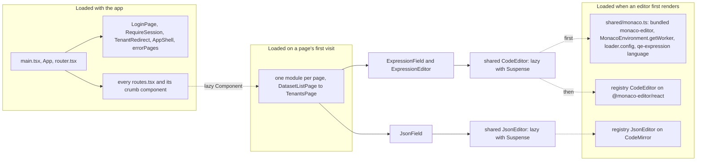
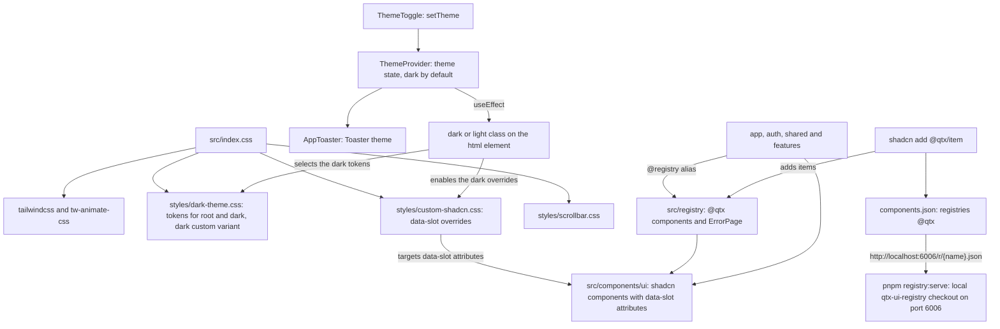
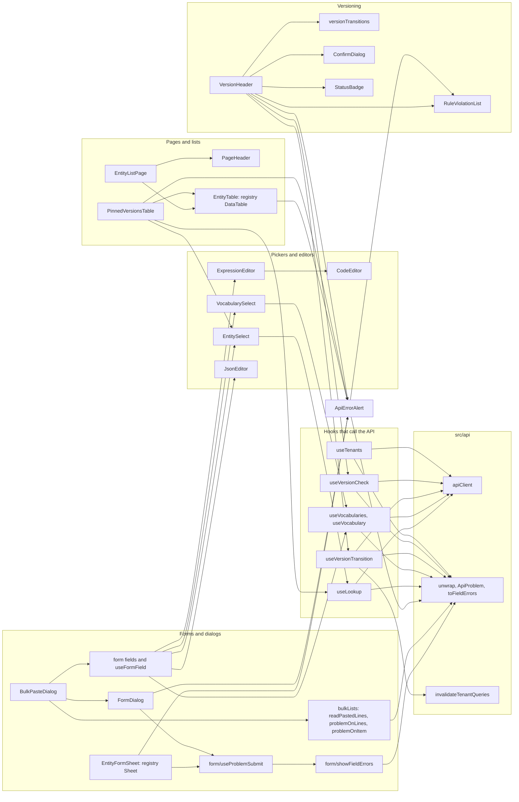

# How it works

[Diagram index](README.md) · [Architecture](01-architecture.md) · [Composition](02-composition.md) · [Critical flows](04-critical-flows.md)

## Data layer

Every server call goes through one typed client and comes back as typed data or as one error type. The drawing shows a call's path from a hook to the API and back; arrows mean "calls" and "returns". What the API does with the request is drawn in [the API's request pipeline](../../../api/docs/architecture/02-request-pipeline.md).

- `authMiddleware` reads the token on every request, so a sign-in or sign-out applies to the next call. A 401 from any `apiClient` call ends the tab's session with a full page load of `/login`; the plain `fetch` that requests a token does not pass through it.
- `unwrap` returns the data of a success and throws an `ApiProblem` for any other status, built from the ProblemDetails body, or from the status text when the body is empty.
- `queryClient` never retries an `ApiProblem`, because the API would answer the same way; other errors, such as a network failure, are retried up to twice. Queries do not refetch when the window regains focus.

| `queryClient` default | Value |
| --- | --- |
| `queries.retry` | `(failureCount, error) => !(error instanceof ApiProblem) && failureCount < 2` |
| `queries.refetchOnWindowFocus` | `false` |
| Everything else | TanStack Query's defaults, such as `staleTime` 0 |

**Sources:** [client.ts](../../src/api/client.ts), [session.ts](../../src/auth/session.ts), [problemDetails.ts](../../src/api/problemDetails.ts), [queryClient.ts](../../src/api/queryClient.ts), [AuthClient.ts](../../src/auth/AuthClient.ts).

## Problem details

Every non-success response becomes an `ApiProblem` that carries the fields of the API's ProblemDetails body. The drawing shows the type; the table shows where each field comes from and where the app shows it.

`toFieldErrors` turns the API's validation keys into react-hook-form paths, `components[0].fieldId` into `components.0.fieldId`, and joins several messages for one path. `problemOnLines` and `problemOnItem` in `bulkLists.ts` rebuild an `ApiProblem` with re-keyed `errors` for bulk paste and for a sheet that edits one item of a list. `problemDetails.test.ts` pins these conversions.

| Field | Filled from | Shown by |
| --- | --- | --- |
| `status` | The response status | `RequireSession`, for a failed `GET /api/me` |
| `title` | The body's `title`, or the status text when the body is empty; `Request failed (status)` when neither has one | The heading of `ApiErrorAlert` |
| `detail` | `detail`, which is also the error's `message` (the title when there is no detail) | `ApiErrorAlert` |
| `errors` | A 400 `ValidationProblemDetails`, keyed by camelCase JSON path | `showFieldErrors` on the form fields, and the list in `ApiErrorAlert` |
| `violations` | A 422 from a version transition: the failed rules, each with `rule` and `message` | The list in `ApiErrorAlert`, each message followed by its rule |

**Sources:** [problemDetails.ts](../../src/api/problemDetails.ts), [problemDetails.test.ts](../../src/api/problemDetails.test.ts), [ApiErrorAlert.tsx](../../src/shared/ApiErrorAlert.tsx), [showFieldErrors.ts](../../src/shared/form/showFieldErrors.ts), [bulkLists.ts](../../src/shared/bulkLists.ts), [RequireSession.tsx](../../src/auth/RequireSession.tsx), [types.ts](../../src/shared/types.ts).

## Query keys and invalidation

Query keys decide what TanStack Query caches and what a write refreshes. Tenant-scoped keys start with the resource and the tenant ID, so `invalidateTenantQueries` can refresh everything of one tenant; control-plane keys have no tenant segment. The table lists the keys and what refreshes them.

| Keys | Hooks | Refreshed by |
| --- | --- | --- |
| `['session', 'me']` | `meQuery` in `SessionProvider`, `staleTime: Infinity` | `fetchQuery` with `staleTime: 0` at sign-in; `queryClient.clear()` at sign-out |
| `['vocabularies']` | `useVocabularies`, `staleTime: Infinity` | Nothing: vocabularies change only with an API deployment |
| `['tenants']` | `useTenants` | `invalidateTenantDirectory` after a tenant directory write |
| `['system-tenants']` | `useTenantDirectory` | `invalidateTenantDirectory` |
| `['lookups', tenantId, kind, parentId]` | `useLookup` | The `lookupQueryKey(tenantId, kind)` prefix after a write that changes that kind; `invalidateTenantQueries` |
| `['overview', tenantId]` | `useOverview` | `invalidateTenantQueries` |
| `['datasets', tenantId, ...]`, `['dataset-versions', ...]`, `['fields', ...]`, `['grains', ...]`, `['source-objects', tenantId]`, `['source-columns', tenantId, name]`, `['bindings', ...]`, `['measures', ...]` | `queries.ts` of datasets, bindings and measures | `invalidateTenantQueries` |
| `['dimensions', tenantId, ...]`, `['dimension-roles', ...]`, `['dimension-versions', ...]`, `['dimension-levels', ...]`, `['dimension-members', ...]`, `['range-bands', ...]` | `dimensions/api.ts` | `refresh` of the changed keys and lookup kinds; `setQueryData` after a member reorder or a band replace |
| `['mapping-sets', tenantId, ...]`, `['mapping-entries', tenantId, versionId]` | `mappings/api.ts` | The changed keys and lookups; `setQueryData` after a bulk entry replace |
| `['bridges', tenantId, ...]`, `['bridge-versions', ...]`, `['bridge-mappings', ...]` | `bridges/api.ts`; the list key holds the `purpose` filter | The changed keys and lookups; `setQueryData` after a bulk mapping replace; a report source write refreshes `['bridges', tenantId]` |
| `['calculation-models', tenantId, ...]`, with a model's `attributions` and `parameters` under its ID | `calculation-models/api.ts` | The changed keys and lookups; a parameter write also refreshes every `['report-editor', tenantId]` view, which lists the model's parameters |
| `['reports', tenantId, ...]`, `['report-columns', ...]`, `['report-scenarios', ...]`, `['report-variable-scopes', ...]`, `['report-styles', ...]`; `['dimension-members', ...]` of the report dimension's version | `reports/api.ts` | The changed keys and lookups; `setQueryData` after a column, scenario or variable scope replace; a column replace refreshes the editor view, whose formula rows name columns; enabling or disabling a report refreshes it and the list |
| `['report-editor', tenantId, reportId]`, `['report-unmapped', tenantId, reportId, sourceId]` | `reports/editorApi.ts`, with the keys shared with `api.ts` in `reports/queryKeys.ts` | Each editor write answers the editor view, which `setQueryData` caches, and refreshes the unmapped items; a row write also refreshes the variable scopes and the `members` lookups; a source write also refreshes the report's content, the report, whose default profile a first variable sets, and the bridges and `bridges` lookups |
| `['owned-content', tenantId, scope, ownerId, kind]`, where the scope is `calculation-models` or `reports` | `shared/ownedContent.ts` | A content write refreshes `['owned-content', tenantId, scope, ownerId]` and the scope's content lookups |
| `['releases', tenantId, ...]` | `useReleases.ts` | `invalidateReleases` or the release keys; `invalidateTenantQueries` after an activation |
| `['assumption-sets', tenantId, ...]` | `useAssumptionSets.ts` | `['assumption-sets', tenantId]` after a capture, relabel or delete; `invalidateTenantQueries` after a publish |

`invalidateTenantQueries(tenantId)` marks stale every query whose key has the tenant ID as its second element, and active queries refetch at once. It runs after every version status change, every dataset, binding and measure write, a dataset clone and a release activation. It never reaches the four control-plane keys. A tenant switch changes every tenant-scoped key, so the new tenant's data is fetched while the old tenant's stays cached.

**Sources:** [queryClient.ts](../../src/api/queryClient.ts), [SessionProvider.tsx](../../src/auth/SessionProvider.tsx), [useVocabularies.ts](../../src/shared/useVocabularies.ts), [useTenants.ts](../../src/shared/useTenants.ts), [useSystemTenants.ts](../../src/features/system/useSystemTenants.ts), [useLookup.ts](../../src/shared/useLookup.ts), [useOverview.ts](../../src/features/overview/useOverview.ts), [datasets/queries.ts](../../src/features/datasets/queries.ts), [bindings/queries.ts](../../src/features/bindings/queries.ts), [measures/queries.ts](../../src/features/measures/queries.ts), [dimensions/api.ts](../../src/features/dimensions/api.ts), [mappings/api.ts](../../src/features/mappings/api.ts), [bridges/api.ts](../../src/features/bridges/api.ts), [calculation-models/api.ts](../../src/features/calculation-models/api.ts), [reports/api.ts](../../src/features/reports/api.ts), [useReleases.ts](../../src/features/releases/useReleases.ts), [useAssumptionSets.ts](../../src/features/assumption-sets/useAssumptionSets.ts), [useVersionTransition.ts](../../src/shared/useVersionTransition.ts).

## Pickers

Pickers load their options from the API: lookups for entities, vocabularies for controlled values. The drawing shows both sources; arrows mean "renders" or "calls".

- `EntitySelect` labels each item with `lookupItemText` (its key and label, each once) and stores the item's ID. A value the options do not list shows its raw ID with "(not in list)". `filter` narrows the options; `PinnedVersionsTable`, for example, offers only published versions.
- `purpose` narrows the `dimensions` kind to `analytical` or `report` dimensions. `DimensionListPage` and the endpoint pickers of `NewBridgeSheet` ask for analytical ones, because datasets bind them and bridges connect them; `NewReportSheet` offers any categorical or hierarchical dimension of either purpose to start the report's own dimension from.
- A `null` parent keeps the lookup idle and the select disabled with "Choose the parent first". `GrainFieldsField`, `ComponentsField` and `PinnedVersionsTable` use `EntitySelect` directly, and tables call `useLookup` to show keys for IDs.
- Vocabularies load once, and every picker selects its vocabulary from that one query. Each option shows the value's description in a tooltip.
- Because the option lists come from the API, no form holds a list of IDs or vocabulary values. The code does name some vocabulary values where a form shows inputs per kind (such as `json_path`, `decimal` or `time`) or picks a default (such as `table`, `row` or `starrocks`).

| `LookupKind` | `parentId` |
| --- | --- |
| `datasets`, `dimensions`, `bridges`, `releases`, `assumption-sets`, `calculation-models`, `reports` | None (`dimensions` takes an optional `purpose`; a model's `classifier` is its currency) |
| `dimension-roles` | Optional dimension (each role's `parentId` is its template, its `classifier` the template's kind, and its label reads like "Servicing branch · Branch") |
| `dataset-versions` | Dataset |
| `fields`, `grains`, `bindings`, `time-bindings`, `measures` | Dataset version (a field's `classifier` is its data type) |
| `dimension-versions` | Dimension |
| `levels`, `members` | Dimension version (a member's own `parentId` is its parent member) |
| `mapping-sets` | Optional dimension |
| `mapping-versions` | Mapping set |
| `bridge-versions` | Bridge |
| `variables`, `calculated-measures` | Calculation model |
| `report-sources`, `source-profiles`, `calculation-dimensions`, `report-columns` | Report (a source's `classifier` is its mapping method) |
| `bound-roles` | Dataset version (the roles it binds into members with an enabled binding; each role's `parentId` is its template) |
| `bridges` | Optional source dimension (each bridge's `parentId` is its target dimension) |

**Sources:** [useLookup.ts](../../src/shared/useLookup.ts), [useVocabularies.ts](../../src/shared/useVocabularies.ts), [EntitySelect.tsx](../../src/shared/EntitySelect.tsx), [VocabularySelect.tsx](../../src/shared/VocabularySelect.tsx), [EntityField.tsx](../../src/shared/form/EntityField.tsx), [VocabularyField.tsx](../../src/shared/form/VocabularyField.tsx), [MultiVocabularyField.tsx](../../src/shared/form/MultiVocabularyField.tsx), [lookupItemText.ts](../../src/shared/lookupItemText.ts), [types.ts](../../src/shared/types.ts), [PinnedVersionsTable.tsx](../../src/shared/PinnedVersionsTable.tsx), [GrainFieldsField.tsx](../../src/features/datasets/GrainFieldsField.tsx), [ComponentsField.tsx](../../src/features/measures/ComponentsField.tsx), [NewDatasetSheet.tsx](../../src/features/datasets/NewDatasetSheet.tsx), [GrainSheet.tsx](../../src/features/datasets/GrainSheet.tsx), [TenantsPage.tsx](../../src/features/system/TenantsPage.tsx).

## Forms

Forms are react-hook-form forms built from the shared fields, and they declare no validation rules: the API owns every rule. The drawing shows how a field binds to its form and how a failed submit puts the API's answer back on the fields; arrows mean "uses".

- `useProblemSubmit` clears every error before a submit, because react-hook-form keeps an error on a path that no field registers, such as a list-level key, and refuses later submits while it is there. It then runs `handleSubmit`, awaits `onSubmit` (usually a mutation's `mutateAsync`) and calls `onSuccess`, which closes the sheet or dialog. On failure it calls `showFieldErrors` and keeps the error as `problem` for `ApiErrorAlert`; the form stays open.
- `EntityFormSheet` and `FormDialog` mount the form body only while open, so each opening starts without a stale problem, and `useSheetForm` resets a form to its entity before it opens the sheet. A read-only `EntityFormSheet` disables its `fieldset`, sets `FormReadOnlyContext`, which `useFormField` turns into `isDisabled` so the Monaco and CodeMirror editors render read-only as well, and shows "Close" without a submit button.
- The form-value modules (`fieldForm.ts`, `bindingForm.ts`, `measureForm.ts`, `bridgeVersionForm.ts`) build the request bodies and leave out the values of inputs that the sheet no longer shows, which the API would otherwise reject; their tests say why.

| Field | Control | Value |
| --- | --- | --- |
| `TextField`, `TextAreaField` | shadcn `Input`, `Textarea` | String |
| `PasswordField` | `Input` of type password | String, for secrets the API never returns |
| `NumberField` | Registry `NumericInput` | Number or null |
| `SwitchField` | Registry `BehaviorSwitch` | Boolean |
| `DateField` | Registry `DatePicker` | `yyyy-MM-dd` or null |
| `DateTimeField` | `datetime-local` input edited in UTC, labelled "(UTC)" | ISO 8601 UTC string or null |
| `VocabularyField`, `MultiVocabularyField` | `VocabularySelect`; registry `MultiSelect` | A value or null; a list of values |
| `EntityField` | `EntitySelect` | Item ID or null |
| `KeyField` | Registry `Combobox` over the given lookup items, such as a dataset's latest fields (`useLatestVersionItems`) or the members of a dimension's published version (`usePublishedDimensionItems`) | Item key or null, for references by key |
| `MultiKeyField` | Registry `MultiSelect` over the given lookup items, such as the metrics an attribution driver switches | A list of item keys |
| `ExpressionField` | `ExpressionEditor` (Monaco) with `[f.` and `[m.` completion | Expression text |
| `JsonField` | Shared `JsonEditor` (CodeMirror) | Raw JSON text |

**Sources:** [EntityFormSheet.tsx](../../src/shared/EntityFormSheet.tsx), [FormDialog.tsx](../../src/shared/FormDialog.tsx), [useProblemSubmit.ts](../../src/shared/form/useProblemSubmit.ts), [showFieldErrors.ts](../../src/shared/form/showFieldErrors.ts), [useFormField.ts](../../src/shared/form/useFormField.ts), [FormFieldLayout.tsx](../../src/shared/form/FormFieldLayout.tsx), [FormReadOnlyContext.ts](../../src/shared/form/FormReadOnlyContext.ts), [index.ts](../../src/shared/form/index.ts), [TextField.tsx](../../src/shared/form/TextField.tsx), [TextAreaField.tsx](../../src/shared/form/TextAreaField.tsx), [PasswordField.tsx](../../src/shared/form/PasswordField.tsx), [NumberField.tsx](../../src/shared/form/NumberField.tsx), [SwitchField.tsx](../../src/shared/form/SwitchField.tsx), [DateField.tsx](../../src/shared/form/DateField.tsx), [DateTimeField.tsx](../../src/shared/form/DateTimeField.tsx), [VocabularyField.tsx](../../src/shared/form/VocabularyField.tsx), [MultiVocabularyField.tsx](../../src/shared/form/MultiVocabularyField.tsx), [EntityField.tsx](../../src/shared/form/EntityField.tsx), [ExpressionField.tsx](../../src/shared/form/ExpressionField.tsx), [JsonField.tsx](../../src/shared/form/JsonField.tsx), [KeyField.tsx](../../src/shared/form/KeyField.tsx), [useLatestVersionItems.ts](../../src/shared/useLatestVersionItems.ts), [useSheetForm.ts](../../src/shared/useSheetForm.ts), [SettingsTab.tsx](../../src/features/datasets/SettingsTab.tsx), [dimensions/SettingsTab.tsx](../../src/features/dimensions/SettingsTab.tsx), [RangeBandsTab.tsx](../../src/features/dimensions/RangeBandsTab.tsx), [fieldForm.ts](../../src/features/datasets/fieldForm.ts), [fieldForm.test.ts](../../src/features/datasets/fieldForm.test.ts).

## Version lifecycle

Five kinds of resource are versioned, under one of two lifecycles, and `VersionHeader` offers the status changes that the kind's lifecycle allows from the selected version's status. Strict kinds, dataset versions and releases, freeze when published, may have several published versions, and are retired by hand. Living kinds, dimension, mapping and bridge versions, have one published version per identity: requests read it by default, it stays editable, and publishing the next version retires it and repoints the active assumption set. Calculation models and reports are not versioned: the model page edits a model's metrics, and from each metric's row its attribution in `AttributionSheet`, in place, and the API refuses an edit that would break a formula, an attribution or an enabled report over the model; the report editor writes a report in place, and a switch in its header enables it; see [flow 12](04-critical-flows.md#12-building-a-report). The drawing shows the changes `getVersionTransitions` offers; the API decides whether each one succeeds, as drawn in [the API's version lifecycle](../../../api/docs/architecture/04-version-lifecycle.md).

- Publish and Retire ask for confirmation first, with texts from `versionTransitions.ts`; a living kind's Publish says that the published version is retired and the active assumption set repointed. A page can replace the text for a target status through `confirmDescriptions`; the release editor does so for Retire on the active release, which the API refuses to retire.
- `isEditable(kind, status)` decides whether a version takes content writes: every draft, and the published version of a living kind. A published living version offers "Validate" instead of a transition, because its live edits pass no status change.
- "Delete draft" shows on a draft when the page passes `onDeleteVersion`, after its own confirmation.
- A refused change, a 409 or a 422 with `violations`, shows under the header; see [flow 7](04-critical-flows.md#7-a-version-transition-answered-with-422).

| `VersionKind` | Page | Lifecycle |
| --- | --- | --- |
| `dataset_version` | `DatasetDetailPage` | Strict |
| `semantic_release` | `ReleaseEditorPage` | Strict |
| `dimension_version` | `DimensionDetailPage` | Living |
| `mapping_version` | `MappingSetDetailPage` | Living |
| `bridge_version` | `BridgeDetailPage` | Living |

**Sources:** [versionTransitions.ts](../../src/shared/versionTransitions.ts), [VersionHeader.tsx](../../src/shared/VersionHeader.tsx), [types.ts](../../src/shared/types.ts), [ReleaseEditorPage.tsx](../../src/features/releases/ReleaseEditorPage.tsx).

## Versioning UI

One component wires the version picker, the status badge and the lifecycle actions for every versioned page. The drawing shows how a page feeds `VersionHeader` and what the header calls; arrows mean "renders" or "calls".

- `selectedVersion` returns the version that `?version=` names, or else the latest, since lookups list versions by version number. A missing or stale parameter, such as a deleted draft's ID, falls back to the latest. The dataset page pushes a history entry when it selects a version; the dimension, mapping set and bridge pages replace the current one.
- `VersionHeader` shows the transition error only while `transition.variables.id` is the selected version, so a 422 list stays with the version it was for: it hides when another version is selected and shows again when that one is selected, until the next transition.
- After a successful change `VersionHeader` shows a toast and calls `onTransitioned`; `useVersionTransition` has already invalidated every query of the tenant.
- A published living version offers "Validate", which runs the publication rules without changing the version: a pass shows a toast, and violations show in a destructive alert under the header, kept with the version they were for like a transition error.
- A report bridge's page passes no "New version", "Clone selected" or "Delete draft" callbacks and shows its one version read-only, with a link to the report editor, which alone changes it; the API refuses the generic writes to it with 409 "Owned by a report".
- A version that cannot change renders read-only, but `VersionHeader` keeps offering its transitions, "Clone selected" and "New version"; see [flow 11](04-critical-flows.md#11-editable-and-read-only-versions).
- Roles are not versioned. The dimension page's Roles tab, the first tab unless the dimension is a time dimension, which has no roles, shows the same roles whichever version is selected; `RoleSheet` always edits, and a role's key is fixed once created. `NewDimensionSheet` creates a dimension's first role with it, its key and name following the dimension's until changed.

| Page | Selection | New version | Clone selected | Delete draft |
| --- | --- | --- | --- | --- |
| `DatasetDetailPage` | `?version=` | `NewVersionDialog` | `POST .../datasets/{datasetId}/versions` with `cloneFromVersionId`, from the page | `DELETE .../dataset-versions/{versionId}` |
| `DimensionDetailPage` | `?version=` | `NewVersionSheet` | `NewVersionSheet` with the source | `useDeleteDimensionVersion` |
| `MappingSetDetailPage` | `?version=` | `NewMappingVersionDialog` | `NewMappingVersionDialog` with the source | `useDeleteMappingVersion` |
| `BridgeDetailPage` | `?version=` | `NewBridgeVersionDialog` | `NewBridgeVersionDialog` with the source's values | `useDeleteBridgeVersion` |
| `ReleaseEditorPage` | Route `releases/:semanticReleaseId` | None | `NewReleaseSheet` with `copyFromSemanticReleaseId` | `useDeleteRelease` |

**Sources:** [VersionHeader.tsx](../../src/shared/VersionHeader.tsx), [useVersionTransition.ts](../../src/shared/useVersionTransition.ts), [versionSelection.ts](../../src/shared/versionSelection.ts), [versionSelection.test.ts](../../src/shared/versionSelection.test.ts), [versionTransitions.ts](../../src/shared/versionTransitions.ts), [StatusBadge.tsx](../../src/shared/StatusBadge.tsx), [ConfirmDialog.tsx](../../src/shared/ConfirmDialog.tsx), [lookupItemText.ts](../../src/shared/lookupItemText.ts), [DatasetDetailPage.tsx](../../src/features/datasets/DatasetDetailPage.tsx), [DimensionDetailPage.tsx](../../src/features/dimensions/DimensionDetailPage.tsx), [MappingSetDetailPage.tsx](../../src/features/mappings/MappingSetDetailPage.tsx), [BridgeDetailPage.tsx](../../src/features/bridges/BridgeDetailPage.tsx), [ReportDetailPage.tsx](../../src/features/reports/ReportDetailPage.tsx), [ReleaseEditorPage.tsx](../../src/features/releases/ReleaseEditorPage.tsx), [useVersionCheck.ts](../../src/shared/useVersionCheck.ts).

## Conventions: UTC, lazy pages and editors

Three conventions hold across the app: times show and edit in UTC, every page loads on demand, and the code editors load only when a form first shows one. The drawing shows what loads with the app and what loads later; a dotted arrow is a dynamic import.

- `formatDateTime` shows an API timestamp as `yyyy-MM-dd HH:mm UTC`, or an em dash when there is none. `DateTimeField` edits through a `datetime-local` input whose text is the UTC wall-clock time (`toDateTimeInput`, `fromDateTimeInput`) and adds "(UTC)" to its label. `DateField` keeps plain `yyyy-MM-dd` dates.
- Vitest runs with `TZ` set to `Asia/Tokyo`, nine hours east of UTC, so a time shown or edited in local time fails `utcTime.test.ts` on every machine.
- `shared/monaco.ts` runs before any Monaco editor mounts. It points `@monaco-editor/react` at the bundled `monaco-editor` instead of a CDN and gives every worker label the bundled editor worker, so only the base worker exists (no TypeScript, JSON, CSS or HTML language service). It registers the `qe-expression` language with the Monarch tokens of `expressionLanguage.ts`.
- `ExpressionEditor` completes field keys after `[f.` and measure keys after `[m.` through `getExpressionCompletions`, and answers only for its own model, because completion providers are global per language.

**Sources:** [utcTime.ts](../../src/shared/utcTime.ts), [utcTime.test.ts](../../src/shared/utcTime.test.ts), [DateTimeField.tsx](../../src/shared/form/DateTimeField.tsx), [DateField.tsx](../../src/shared/form/DateField.tsx), [vite.config.ts](../../vite.config.ts), [router.tsx](../../src/app/router.tsx), [datasets/routes.tsx](../../src/features/datasets/routes.tsx), [CodeEditor.tsx](../../src/shared/CodeEditor.tsx), [monaco.ts](../../src/shared/monaco.ts), [expressionLanguage.ts](../../src/shared/expressionLanguage.ts), [ExpressionEditor.tsx](../../src/shared/ExpressionEditor.tsx), [expressionCompletion.ts](../../src/shared/expressionCompletion.ts), [ExpressionField.tsx](../../src/shared/form/ExpressionField.tsx), [JsonEditor.tsx](../../src/shared/JsonEditor.tsx), [JsonField.tsx](../../src/shared/form/JsonField.tsx).

## Theming and the registry

Styling comes from Tailwind v4 with the registry's theme tokens, shadcn components, and the in-house `@qtx` registry components built on them. The drawing shows how the theme reaches the components and how registry items get into the app; arrows mean "imports", "applies" or "fetches".

- `ThemeProvider` keeps the theme in React state, starting from `theme="dark"`, and swaps the `dark` and `light` classes on the html element; it mirrors the registry's own `ThemeProvider`. `src/styles` holds the registry's stylesheets: `dark-theme.css` declares the tokens for `:root` and `.dark` and the `dark` custom variant, and `custom-shadcn.css` restyles shadcn parts by their `data-slot` attribute, mostly in dark mode.
- App code marks its own parts with `data-slot` names too, such as `app-header`, `entity-table`, `version-header` and `api-error-alert`.
- Registry items come from the `@qtx` registry that `components.json` names; `pnpm registry:serve` serves a local checkout of it for the shadcn CLI. Registry components import shadcn components, `cn` and each other through `@registry`.

| Registry component | Used by |
| --- | --- |
| `Loading` | Pages, tabs, `EntityTable`, `FormDialog`, `LoginPage`, `RequireSession`, `TenantRedirect`, and the editor fallbacks |
| `Combobox` | `EntitySelect`, `VocabularySelect`, `KeyField`, `VersionHeader`, `TenantSwitcher`, `SourceObjectField`, `SourceColumnField`, `ComponentsField` |
| `DataTable`, `Sheet` | `EntityTable`; `EntityFormSheet` |
| `MultiSelect` | `MultiVocabularyField`, `MultiKeyField`, `ColumnsField` |
| `CodeEditor`, `JsonEditor` | The shared `CodeEditor` and `JsonEditor` wrappers |
| `NumericInput`, `DatePicker`, `BehaviorSwitch` | `NumberField`, `DateField`, `SwitchField`, and the enable switch of `ReportDetailPage` |
| `Sortable`, `Nestable` | `GrainFieldsField`, `RangeBandsTab` and `ReportColumnsTab`; `MembersTab`, `MemberTreeRow`, `RowTree` and `RowItem` |
| `TreeView` | `ItemPickerSheet`, which picks a data row's rules, folders and items, in a multiple-selection tree of a bridge source's item dimension members |
| `TruncatedText`, `IconTooltip` | `VersionHeader`, `FieldsTab`, `TenantsPage`; `VocabularySelect` |
| `pages/ErrorPage` | `RequireSession`, `TenantRedirect`, `NotFoundPage`, `RouteErrorPage` |

**Sources:** [Theme.tsx](../../src/contexts/Theme.tsx), [App.tsx](../../src/app/App.tsx), [ThemeToggle.tsx](../../src/app/ThemeToggle.tsx), [index.css](../../src/index.css), [dark-theme.css](../../src/styles/dark-theme.css), [custom-shadcn.css](../../src/styles/custom-shadcn.css), [scrollbar.css](../../src/styles/scrollbar.css), [components.json](../../components.json), [package.json](../../package.json), [README.md](../../README.md), [AppShell.tsx](../../src/app/AppShell.tsx), [Combobox.tsx](../../src/registry/components/Combobox/Combobox.tsx), and the imports of `@registry` across `src`.

## Shared building blocks

`src/shared` is a small library that every feature composes. The drawing shows which shared pieces use which and the five hooks that reach the API; arrows mean "imports".

Only the five hooks call `apiClient`; the other shared pieces reach the API through props, such as the `onSubmit` of a form host or the `replace` of `BulkPasteDialog`, which the features pass in. `useTenants` serves `TenantSwitcher` and `TenantRedirect` in `src/app`.

| Helper | Purpose | Used by |
| --- | --- | --- |
| `useTenantId` | The `:tenantId` route parameter | Every tenant-scoped hook |
| `useSheetForm` | A sheet's form and open state; `open(values)` resets the form, then opens the sheet | Release, assumption set and tenant pages |
| `EnabledBadge`, `StatusBadge` | An availability flag; a version status, or an assumption set's `active` or `historical` | Lists, headers, `VersionHeader` |
| `ClearSelectionButton` | Clears an optional select | `EntitySelect`, `VocabularySelect`, `SourceColumnField` |
| `lookupItemText` | A lookup item's key and label, each once | `EntitySelect`, `VersionHeader` |
| `utcTime.ts` | UTC display and `datetime-local` conversion | Lists, cards, `DateTimeField` |
| `text.ts` | `emptyToNull` for optional text, and `count`, a count with its singular or plural noun | Form-value modules and `SettingsTab`; `BulkPasteDialog`, `RowItem`, `RowSources` and `ItemPickerSheet` |
| `routeHandle.ts`, `types.ts` | `RouteHandle`; schema aliases and unions | Routes and `AppBreadcrumbs`; everywhere |
| `PlaceholderPage` | A stand-in page for an unbuilt feature | Nothing at a3ba75b |

**Sources:** [EntityListPage.tsx](../../src/shared/EntityListPage.tsx), [PageHeader.tsx](../../src/shared/PageHeader.tsx), [EntityTable.tsx](../../src/shared/EntityTable.tsx), [PinnedVersionsTable.tsx](../../src/shared/PinnedVersionsTable.tsx), [EntityFormSheet.tsx](../../src/shared/EntityFormSheet.tsx), [FormDialog.tsx](../../src/shared/FormDialog.tsx), [BulkPasteDialog.tsx](../../src/shared/BulkPasteDialog.tsx), [bulkLists.ts](../../src/shared/bulkLists.ts), [useProblemSubmit.ts](../../src/shared/form/useProblemSubmit.ts), [showFieldErrors.ts](../../src/shared/form/showFieldErrors.ts), [VersionHeader.tsx](../../src/shared/VersionHeader.tsx), [versionTransitions.ts](../../src/shared/versionTransitions.ts), [ConfirmDialog.tsx](../../src/shared/ConfirmDialog.tsx), [StatusBadge.tsx](../../src/shared/StatusBadge.tsx), [EntitySelect.tsx](../../src/shared/EntitySelect.tsx), [VocabularySelect.tsx](../../src/shared/VocabularySelect.tsx), [ExpressionEditor.tsx](../../src/shared/ExpressionEditor.tsx), [CodeEditor.tsx](../../src/shared/CodeEditor.tsx), [JsonEditor.tsx](../../src/shared/JsonEditor.tsx), [useLookup.ts](../../src/shared/useLookup.ts), [useVocabularies.ts](../../src/shared/useVocabularies.ts), [useVersionTransition.ts](../../src/shared/useVersionTransition.ts), [useVersionCheck.ts](../../src/shared/useVersionCheck.ts), [useTenants.ts](../../src/shared/useTenants.ts), [RuleViolationList.tsx](../../src/shared/RuleViolationList.tsx), [ApiErrorAlert.tsx](../../src/shared/ApiErrorAlert.tsx), [useTenantId.ts](../../src/shared/useTenantId.ts), [useSheetForm.ts](../../src/shared/useSheetForm.ts), [EnabledBadge.tsx](../../src/shared/EnabledBadge.tsx), [ClearSelectionButton.tsx](../../src/shared/ClearSelectionButton.tsx), [lookupItemText.ts](../../src/shared/lookupItemText.ts), [utcTime.ts](../../src/shared/utcTime.ts), [text.ts](../../src/shared/text.ts), [routeHandle.ts](../../src/shared/routeHandle.ts), [types.ts](../../src/shared/types.ts), [PlaceholderPage.tsx](../../src/shared/PlaceholderPage.tsx), [queryClient.ts](../../src/api/queryClient.ts), [problemDetails.ts](../../src/api/problemDetails.ts).
