# Critical flows

[Diagram index](README.md) · [Architecture](01-architecture.md) · [Composition](02-composition.md) · [How it works](03-how-it-works.md)

Each flow is traced through the code at a3ba75b. Sequences summarize async calls: they leave out re-renders and most TanStack Query callbacks, and where `apiClient` adds nothing to the story the call is drawn straight to the API.

## 1. Sign-in

Signing in turns a development token into a session: the token is stored for the tab, the identity is loaded with it, and the user lands on a tenant's overview. The drawing follows a submit of the login form.

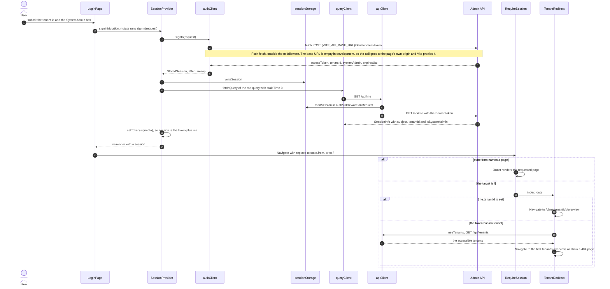

- `unwrap` throws an `ApiProblem` when the token request fails; `signIn` rejects, and `LoginPage` shows the error in an `ApiErrorAlert` under the form.
- `state.from` is set when `RequireSession` sent the user to `/login`, so a deep link opens again after sign-in.
- The form starts with tenant `development` and the SystemAdmin box ticked. The token endpoint exists only on a Development API host.

**Sources:** [LoginPage.tsx](../../src/auth/LoginPage.tsx), [SessionProvider.tsx](../../src/auth/SessionProvider.tsx), [AuthClient.ts](../../src/auth/AuthClient.ts), [session.ts](../../src/auth/session.ts), [client.ts](../../src/api/client.ts), [problemDetails.ts](../../src/api/problemDetails.ts), [RequireSession.tsx](../../src/auth/RequireSession.tsx), [TenantRedirect.tsx](../../src/app/TenantRedirect.tsx), [useTenants.ts](../../src/shared/useTenants.ts), [vite.config.ts](../../vite.config.ts), [DevelopmentTokenController.cs](../../../api/src/Quantalytix.QueryEngine.Admin.Api/Development/DevelopmentTokenController.cs), [SessionController.cs](../../../api/src/Quantalytix.QueryEngine.Admin.Api/Session/SessionController.cs).

## 2. Restoring the session on reload

A reload keeps the user signed in for as long as the tab's token is valid. The drawing shows how `SessionProvider` restores the token and how `RequireSession` renders each state of the identity query.

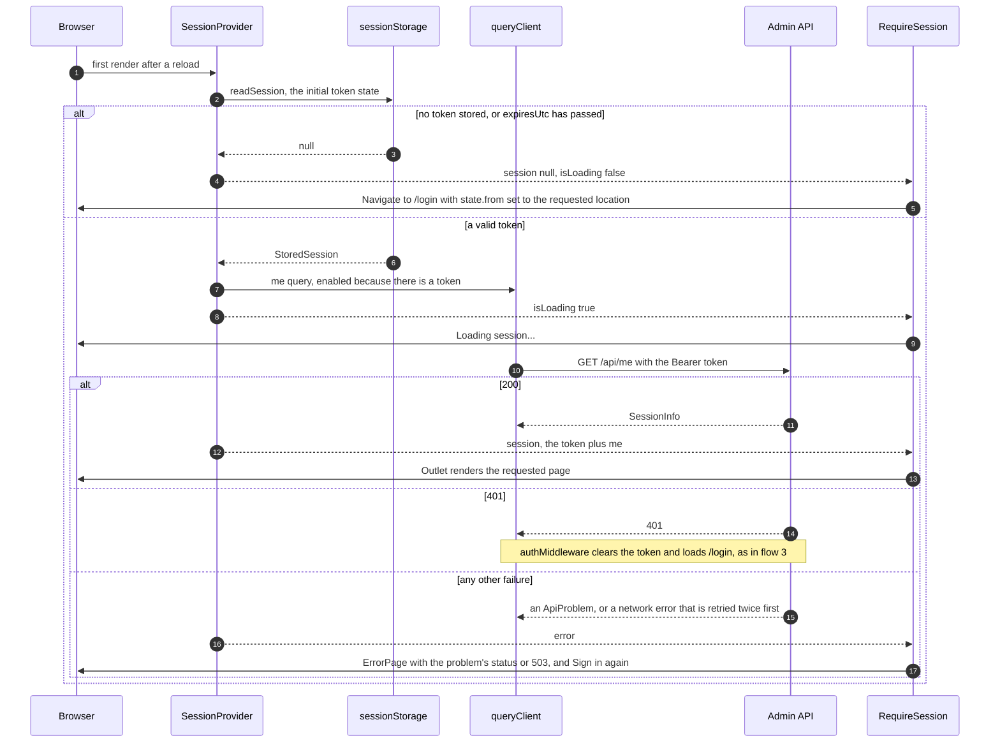

- "Sign in again" calls `signOut`: `clearSession`, `queryClient.clear()` and a null token, after which `RequireSession` redirects to `/login`.
- `LoginPage` waits on the same `isLoading` ("Restoring session...") and sends a user who already has a session to `state.from` or `/`.
- The me query has `staleTime: Infinity`, so it loads once per page load; the token lives in sessionStorage, so it is per tab and ends with the tab.

**Sources:** [SessionProvider.tsx](../../src/auth/SessionProvider.tsx), [session.ts](../../src/auth/session.ts), [useSession.ts](../../src/auth/useSession.ts), [RequireSession.tsx](../../src/auth/RequireSession.tsx), [LoginPage.tsx](../../src/auth/LoginPage.tsx), [client.ts](../../src/api/client.ts), [queryClient.ts](../../src/api/queryClient.ts).

## 3. A 401 response

Any 401 from the admin API ends the session, whatever page made the call. The drawing shows the middleware's response handler; the sign-in `fetch` does not pass through it.

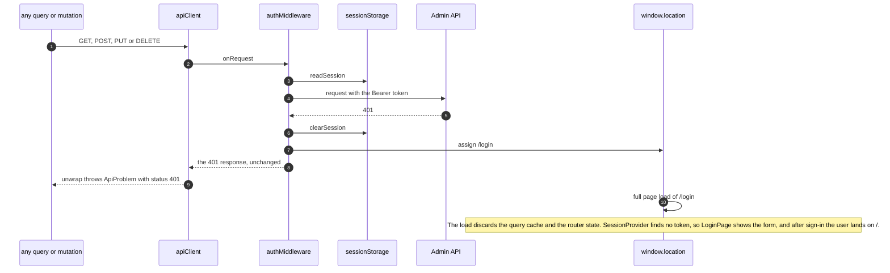

- The middleware runs outside React, so it navigates with `window.location.assign` rather than the router, and the reload resets every in-memory state.
- `queryClient` does not retry the 401, because it is an `ApiProblem`.

**Sources:** [client.ts](../../src/api/client.ts), [session.ts](../../src/auth/session.ts), [problemDetails.ts](../../src/api/problemDetails.ts), [problemDetails.test.ts](../../src/api/problemDetails.test.ts), [queryClient.ts](../../src/api/queryClient.ts), [SessionProvider.tsx](../../src/auth/SessionProvider.tsx), [LoginPage.tsx](../../src/auth/LoginPage.tsx).

## 4. Switching tenants

A SystemAdmin changes tenant from the header and stays on the same page. The drawing shows how the route change re-keys every tenant-scoped query.

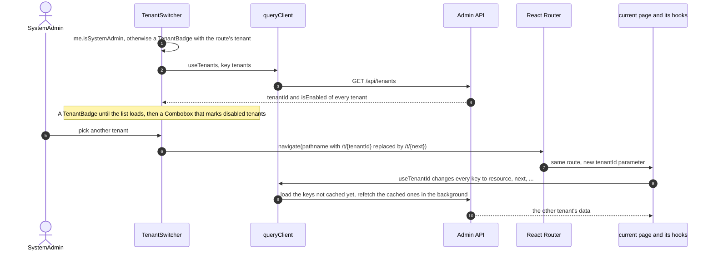

- `navigate` gets only the pathname, so the search string, such as `?version=`, is dropped, while IDs in the path, such as a dataset ID, are kept for the other tenant.
- Users who are not SystemAdmins see a badge, and the API's tenant policy keeps them on their token's tenant.
- The old tenant's queries stay cached until TanStack Query collects them.

**Sources:** [TenantSwitcher.tsx](../../src/app/TenantSwitcher.tsx), [useTenants.ts](../../src/shared/useTenants.ts), [useTenantId.ts](../../src/shared/useTenantId.ts), [queryClient.ts](../../src/api/queryClient.ts), [datasets/queries.ts](../../src/features/datasets/queries.ts).

## 5. Loading a list page

Every list page is a lazy route whose page runs the feature's list query and hands the result to `EntityListPage`. The drawing follows the datasets list from the sidebar link to a row click.

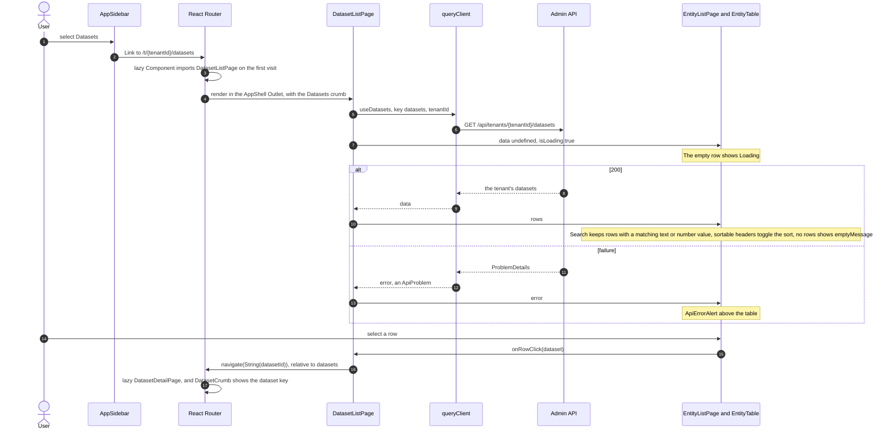

- `EntityTable` filters and sorts on the client: the list endpoints take no paging or filter parameters, so the table holds every row.
- Other list pages follow the same shape: `DimensionListPage`, `MappingSetListPage`, `BridgeListPage`, `ReleasesPage`, `AssumptionSetsPage`, `CalculationModelListPage`, `ReportListPage` and `TenantsPage`.

**Sources:** [AppSidebar.tsx](../../src/app/AppSidebar.tsx), [datasets/routes.tsx](../../src/features/datasets/routes.tsx), [DatasetListPage.tsx](../../src/features/datasets/DatasetListPage.tsx), [datasets/queries.ts](../../src/features/datasets/queries.ts), [EntityListPage.tsx](../../src/shared/EntityListPage.tsx), [EntityTable.tsx](../../src/shared/EntityTable.tsx), [DatasetCrumb.tsx](../../src/features/datasets/DatasetCrumb.tsx), [AppBreadcrumbs.tsx](../../src/app/AppBreadcrumbs.tsx), [admin-api.json](../../../api/openapi/admin-api.json).

## 6. Saving a form answered with 400

The API owns every validation rule, so a form learns about invalid input from a 400 answer and shows each message on its field. The drawing follows a sheet such as `FieldSheet` whose save the API rejects.

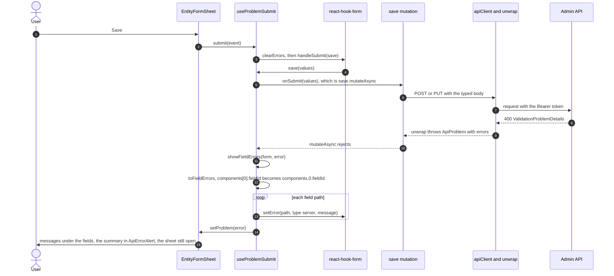

- `useFormField` reads each field's error from its `fieldState`, and `FormFieldLayout` shows it under the control; `ComponentsField` shows a component row's errors under that row.
- On success `useProblemSubmit` calls `onSuccess`, which closes the sheet; the mutation's own `onSuccess` has already invalidated the tenant's queries by then.
- `FormDialog`, the dataset `SettingsTab`, the dimension `SettingsTab` and `RangeBandsTab` take the same path. A problem without `errors`, such as a 409, only fills `ApiErrorAlert`.

**Sources:** [EntityFormSheet.tsx](../../src/shared/EntityFormSheet.tsx), [FormDialog.tsx](../../src/shared/FormDialog.tsx), [useProblemSubmit.ts](../../src/shared/form/useProblemSubmit.ts), [showFieldErrors.ts](../../src/shared/form/showFieldErrors.ts), [problemDetails.ts](../../src/api/problemDetails.ts), [useFormField.ts](../../src/shared/form/useFormField.ts), [FormFieldLayout.tsx](../../src/shared/form/FormFieldLayout.tsx), [ApiErrorAlert.tsx](../../src/shared/ApiErrorAlert.tsx), [FieldSheet.tsx](../../src/features/datasets/FieldSheet.tsx), [ComponentsField.tsx](../../src/features/measures/ComponentsField.tsx).

## 7. A version transition answered with 422

The API checks a version's rules when its status changes and answers a failure with the list of violated rules. The drawing shows how `VersionHeader` requests a change and keeps that list with the version it was for; the rules themselves are in [the API's version lifecycle](../../../api/docs/architecture/04-version-lifecycle.md).

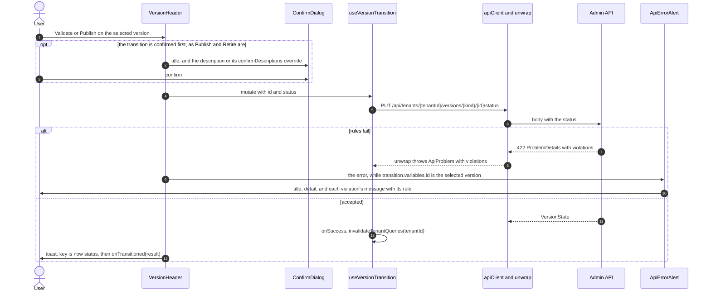

- Selecting another version hides the alert; selecting the version again shows it until the next transition, because the mutation keeps its last variables and error.
- A published living version offers "Validate" instead: `useVersionCheck` posts to `.../versions/{kind}/{id}/validation`, which runs the same rules without changing the version and answers 200 with the violations. `VersionHeader` lists them with `RuleViolationList` in a destructive alert, or shows a toast when there are none, and keeps the answer with the version it was for.
- The transition buttons are disabled while a change is pending. A 409 shows in the same alert, without a violation list.

**Sources:** [VersionHeader.tsx](../../src/shared/VersionHeader.tsx), [useVersionTransition.ts](../../src/shared/useVersionTransition.ts), [versionTransitions.ts](../../src/shared/versionTransitions.ts), [ConfirmDialog.tsx](../../src/shared/ConfirmDialog.tsx), [ApiErrorAlert.tsx](../../src/shared/ApiErrorAlert.tsx), [problemDetails.ts](../../src/api/problemDetails.ts), [problemDetails.test.ts](../../src/api/problemDetails.test.ts), [queryClient.ts](../../src/api/queryClient.ts), [ReleaseEditorPage.tsx](../../src/features/releases/ReleaseEditorPage.tsx).

## 8. Cloning a version

"Clone selected" in `VersionHeader` hands the selected version to the page, and each page clones in its own way. The drawing shows the dataset page, which clones at once, and the mapping set page, which confirms in a dialog first.

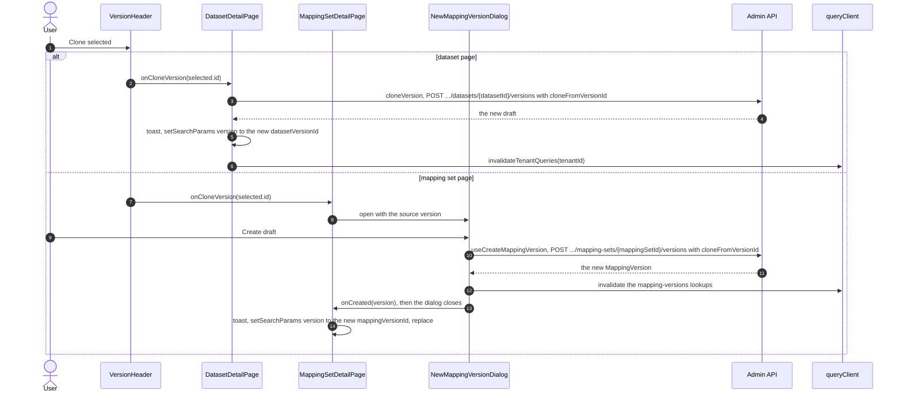

- A clone copies the source's rows as they are. Entries, bridge mappings and bindings' unknown members name members by key, and bindings name roles, which are not versioned, so nothing is dropped; the publication rules check that the keys resolve in the published versions requests read them in.
- Dimensions clone through `NewVersionSheet`, which copies levels, members and range bands. Bridges clone through `NewBridgeVersionDialog`, which copies the mappings. Calculation models and reports are not versioned and have nothing to clone; see [flow 11](#11-editable-and-read-only-versions) and [flow 12](#12-building-a-report). The release editor's "Clone selected" opens `NewReleaseSheet` with `copyFromReleaseId`, then opens the new release. Assumption sets are not versioned; "Capture" snapshots the active set and the active release under a new key.
- What the API does for a clone is drawn in [the API's key actions](../../../api/docs/architecture/06-key-actions.md).

**Sources:** [VersionHeader.tsx](../../src/shared/VersionHeader.tsx), [DatasetDetailPage.tsx](../../src/features/datasets/DatasetDetailPage.tsx), [MappingSetDetailPage.tsx](../../src/features/mappings/MappingSetDetailPage.tsx), [NewMappingVersionDialog.tsx](../../src/features/mappings/NewMappingVersionDialog.tsx), [mappings/api.ts](../../src/features/mappings/api.ts), [DimensionDetailPage.tsx](../../src/features/dimensions/DimensionDetailPage.tsx), [NewVersionSheet.tsx](../../src/features/dimensions/NewVersionSheet.tsx), [dimensions/api.ts](../../src/features/dimensions/api.ts), [BridgeDetailPage.tsx](../../src/features/bridges/BridgeDetailPage.tsx), [NewBridgeVersionDialog.tsx](../../src/features/bridges/NewBridgeVersionDialog.tsx), [ReleaseEditorPage.tsx](../../src/features/releases/ReleaseEditorPage.tsx), [NewReleaseSheet.tsx](../../src/features/releases/NewReleaseSheet.tsx), [CaptureSheet.tsx](../../src/features/assumption-sets/CaptureSheet.tsx).

## 9. Bulk paste of mapping entries

Bulk paste replaces every entry of an editable mapping version, a draft or the published one, with pasted lines. The drawing shows how the lines are read as they are typed, sent as one replace, and how the API's item errors come back on the lines they concern.

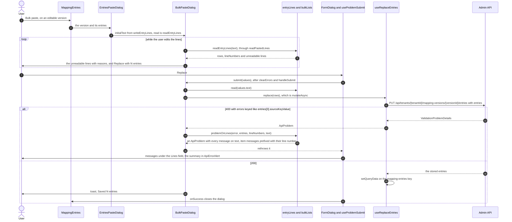

- `readPastedLines` skips blank lines, splits each line at its commas and trims the values, so leading zeros survive. `readEntryLines` expects `source_key,member_key` and keeps both keys as typed; a line without two values is listed with its reason and left out of the replace. A member key the dimension's published version lacks is reported by the publication rules, and on the published version by "Validate".
- The text starts with the current entries, so the lines the user leaves alone are kept.
- Bridge mappings use the same `BulkPasteDialog` through `BridgeMappingsPasteDialog` and `readMappingLines`.

**Sources:** [MappingEntries.tsx](../../src/features/mappings/MappingEntries.tsx), [EntriesPasteDialog.tsx](../../src/features/mappings/EntriesPasteDialog.tsx), [BulkPasteDialog.tsx](../../src/shared/BulkPasteDialog.tsx), [entryLines.ts](../../src/features/mappings/entryLines.ts), [entryLines.test.ts](../../src/features/mappings/entryLines.test.ts), [bulkLists.ts](../../src/shared/bulkLists.ts), [bulkLists.test.ts](../../src/shared/bulkLists.test.ts), [mappings/api.ts](../../src/features/mappings/api.ts), [FormDialog.tsx](../../src/shared/FormDialog.tsx), [useProblemSubmit.ts](../../src/shared/form/useProblemSubmit.ts), [BridgeMappingsPasteDialog.tsx](../../src/features/bridges/BridgeMappingsPasteDialog.tsx).

## 10. Activating a release

Activation switches the tenant's queries to a published release's dataset versions, so it is confirmed first and refreshes every query of the tenant. The drawing follows the button on the release editor.

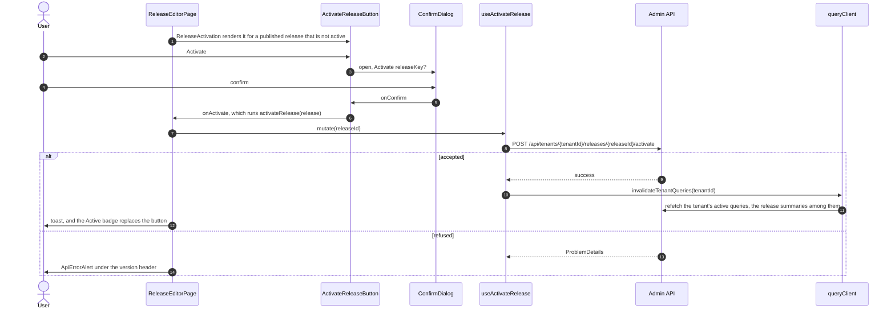

- `isActive` comes from the release summaries of `useReleases`; the active release shows an "Active" badge, and its Retire confirmation says it must not be retired while active.
- What the API changes on activation is drawn in [the API's key actions](../../../api/docs/architecture/06-key-actions.md).

**Sources:** [ReleaseEditorPage.tsx](../../src/features/releases/ReleaseEditorPage.tsx), [ActivateReleaseButton.tsx](../../src/features/releases/ActivateReleaseButton.tsx), [ConfirmDialog.tsx](../../src/shared/ConfirmDialog.tsx), [useReleases.ts](../../src/features/releases/useReleases.ts), [queryClient.ts](../../src/api/queryClient.ts).

## 11. Editable and read-only versions

A version takes content writes while it is a draft, and a living kind's published version keeps taking them, because requests read it. Every other version renders read-only while keeping its lifecycle actions. The drawing shows how the selected version's kind and status reach the tables, sheets and forms; arrows mean "decides" or "renders".

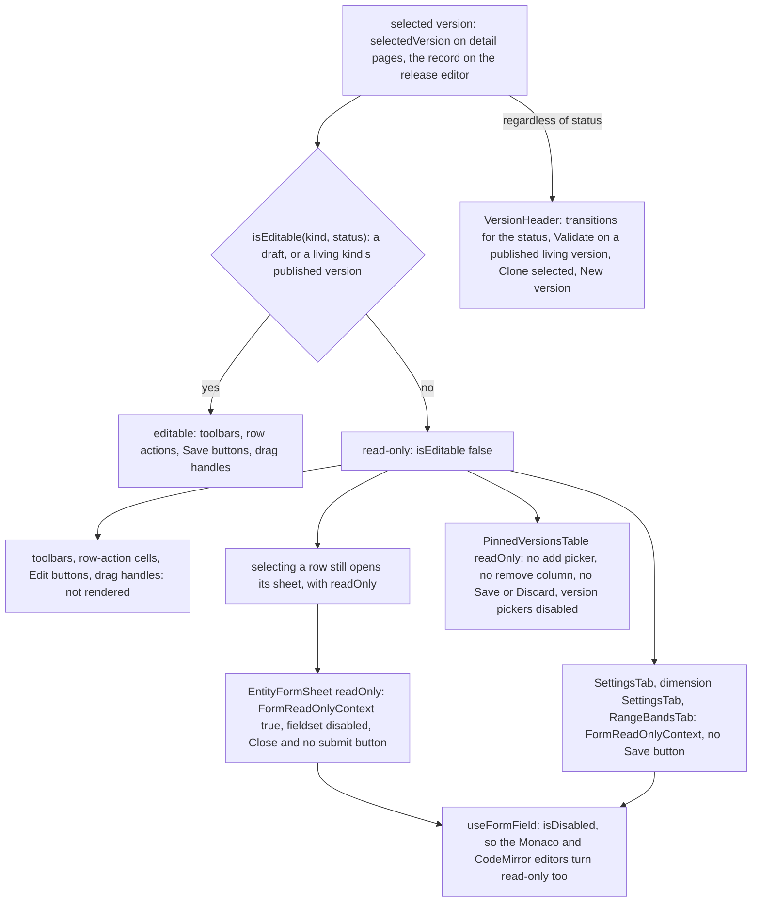

- Dimension, mapping set and bridge pages pass `isEditable(kind, selected.status)` down for the version that `selectedVersion` picks; a report bridge's page passes false, because its report's editor owns it. Dataset versions are strict, so the dataset page passes `isDraft`; the release editor compares the loaded record's `status` with `draft`.
- `PinnedVersionsTable` shows a release's manifest. `MembersTab` turns off dragging. A report has no version and no read-only state: its editor's tabs always edit, and while the report is enabled the API checks each write against the report rules instead (see [flow 12](#12-building-a-report)).
- A calculation model has no version and no read-only state either: its Variables and Calculated measures tabs, `OwnedContentTab`s keyed by the model, and its Parameters tab, a `ContentTab` whose rows `ParameterSheet` writes by key, always edit. The API checks every metric and parameter write against the model's formulas, every report's row values and the enabled reports over it, and answers a write that would break one with 422 and its violations, which the sheet or the tab shows through `ApiErrorAlert`; nothing was written. `ParameterSheet` edits a text parameter's allowed values one per line, and can fill them with the day count conventions that `YEARFRAC` reads. `AttributionSheet` offers each driver the inputs `attributionInputs` finds in the expression, or else the formula: its metrics, and both days inputs when it reads either or calls `YEARFRAC`, never a parameter.
- Assumption sets are not versioned and their pins are never edited by hand: `AssumptionPinsTable` lists them read-only, the active set follows every publish and reads the active release, and a historical set keeps the versions and the release it captured, which its page links to with the release's status. Either set can be relabelled, and a historical one deleted.
- `VersionHeader` does not read `isEditable`: it offers what `getVersionTransitions` allows for the kind and status, "Validate" on a published living version, "Clone selected" and "New version" when the page passes them, and "Delete draft" only on drafts.

**Sources:** [ParametersTab.tsx](../../src/features/calculation-models/ParametersTab.tsx), [ParameterSheet.tsx](../../src/features/calculation-models/ParameterSheet.tsx), [AttributionSheet.tsx](../../src/features/calculation-models/AttributionSheet.tsx), [attributionForm.ts](../../src/features/calculation-models/attributionForm.ts), [ContentTab.tsx](../../src/shared/ContentTab.tsx), [DatasetDetailPage.tsx](../../src/features/datasets/DatasetDetailPage.tsx), [DatasetVersionTabs.tsx](../../src/features/datasets/DatasetVersionTabs.tsx), [FieldsTab.tsx](../../src/features/datasets/FieldsTab.tsx), [FieldSheet.tsx](../../src/features/datasets/FieldSheet.tsx), [SettingsTab.tsx](../../src/features/datasets/SettingsTab.tsx), [EntityFormSheet.tsx](../../src/shared/EntityFormSheet.tsx), [FormReadOnlyContext.ts](../../src/shared/form/FormReadOnlyContext.ts), [useFormField.ts](../../src/shared/form/useFormField.ts), [ExpressionField.tsx](../../src/shared/form/ExpressionField.tsx), [JsonField.tsx](../../src/shared/form/JsonField.tsx), [PinnedVersionsTable.tsx](../../src/shared/PinnedVersionsTable.tsx), [ReleaseEditorPage.tsx](../../src/features/releases/ReleaseEditorPage.tsx), [AssumptionSetEditorPage.tsx](../../src/features/assumption-sets/AssumptionSetEditorPage.tsx), [AssumptionPinsTable.tsx](../../src/features/assumption-sets/AssumptionPinsTable.tsx), [versionTransitions.ts](../../src/shared/versionTransitions.ts), [MembersTab.tsx](../../src/features/dimensions/MembersTab.tsx), [RangeBandsTab.tsx](../../src/features/dimensions/RangeBandsTab.tsx), [dimensions/SettingsTab.tsx](../../src/features/dimensions/SettingsTab.tsx), [MappingEntries.tsx](../../src/features/mappings/MappingEntries.tsx), [BridgeVersionPanel.tsx](../../src/features/bridges/BridgeVersionPanel.tsx), [BridgeMappings.tsx](../../src/features/bridges/BridgeMappings.tsx), [VersionHeader.tsx](../../src/shared/VersionHeader.tsx), [CalculationModelDetailPage.tsx](../../src/features/calculation-models/CalculationModelDetailPage.tsx), [OwnedContentTab.tsx](../../src/shared/OwnedContentTab.tsx), [ownedContent.ts](../../src/shared/ownedContent.ts).

## 12. Building a report

A report is built in its editor, `ReportDetailPage`, in the order of its tabs: the rows, the sources that reach them and what each source gives each row, the variables each source supplies, then the profiles, calculation dimensions, scenarios, scopes, columns and the styles its rows show. Its rows are its own report dimension's members with its overlay rows among them; a bridge source maps the members of a dimension its dataset binds (the items) to rows through a bridge of its own, and a direct source reads a field of row keys. A bridge source's rules take an item alone or a folder with every item under it, each with a factor, and every rule adds into its row, so an item can add into several rows and a −1 rule takes an item a folder brings in back out. The drawing shows a row move, a rule pick and enabling the report, each answered by the API. What the API writes and checks is in [the API's report editor](../../../api/docs/architecture/05-feature-classes.md#report-editor) and [the report gate](../../../api/docs/architecture/04-version-lifecycle.md#the-report-gate).

```mermaid
sequenceDiagram
    autonumber
    actor User
    participant Page as ReportDetailPage
    participant Tree as RowTree
    participant Picker as ItemPickerSheet
    participant Hooks as editorApi.ts and api.ts
    participant Api as Admin API
    participant Cache as queryClient
    User->>Page: open a report
    Page->>Hooks: useReportEditor(reportId)
    Hooks->>Api: GET .../reports/{reportId}/editor
    Api-->>Page: rows with the rules each bridge source adds into them, each an item or a folder with a factor, and the sources with their variables
    User->>Tree: drag a row under another row
    Tree->>Tree: canDrop through canPlace, which refuses what the API would
    Tree->>Hooks: useReplaceReportRows, rowsAfterMove(rows, tree, movedKey)
    Note over Tree: the tree shows the sent rows until the API answers
    Hooks->>Api: PUT .../reports/{reportId}/rows with every row
    alt the report is enabled and the rows would break a rule
        Api-->>Tree: 422 with the violations; nothing was written
        Tree->>User: ApiErrorAlert listing them, over the stored rows
    else accepted
        Api-->>Cache: the editor view afterwards, by setQueryData
    end
    User->>Picker: Add items, in a bridge source's section of a data row
    Picker->>Api: the members of the published version of the source's item dimension
    User->>Picker: pick a folder as one rule or its current items, and click members (toggledRules)
    Picker->>Hooks: useReplaceSourceItems, rulesFrom(row, sourceId, rules)
    Hooks->>Api: PUT .../sources/{sourceId}/items with the row's key and rules
    alt the report is enabled and the rules would break a rule, such as a factor on a measure that ignores factors
        Api-->>Picker: 422 with the violations; nothing was written
    else accepted
        Api-->>Cache: the editor view afterwards, the source's other rows keeping their rules; the unmapped items refresh
    end
    User->>Page: switch Enabled on
    Page->>Hooks: useSetReportEnabled
    Hooks->>Api: PUT .../reports/{reportId}/status with isEnabled true
    alt a rule fails
        Api-->>Page: 422 with the violations; the report stays disabled
    else accepted
        Api-->>Cache: the report, now enabled
    end
```

- The header shows the report's model, with its currency and a link to the model's page, and settings, the Enabled switch, "Check", which runs every report rule and lists the violations without changing anything, "Settings", which edits the default profile, subtotal position and defaults, "Edit" and "Delete". `?source=` opens the Sources tab on one source, as a report bridge's page links to it.
- Rows and mappings: the rows sit on the left. `buildRowTree` nests them in the engine's order. "New row" offers a data row, group, section or formula row in `RowSheet`, under the selected row when it takes that kind. A new row's key is made from its label by `keyFromLabel` and is fixed once saved. `RowSheet` also picks the row's style, and sets its own value of each parameter of the report's model: a number, one of a text parameter's allowed values, or any text; an empty one shows as its placeholder the value `inheritedValue` finds as the engine resolves it: the nearest ancestor's own value, or the total's for a formula row, which the engine evaluates at the total wherever it sits, and for a section at the top, else the model's default. Every write replaces the whole tree, so `toRowInput` carries each stored row's style and values back, and `rowProblem` keys the API's errors about the sheet's row by the sheet's fields. A data row is an assignable member that takes rules, and the rows under it add to its total; a group takes none. Each data row shows how many rules add into it. The right side shows `RowSources`, one section per source for the selected data row. A bridge source's section lists its rules: an item, or a folder shown as "All of" its label with its current items under it, where "Exclude" takes an item back out of the row with a rule of the opposite factor and an item with a rule of its own says so. Each rule has a factor menu, `FactorControl`, with ×1, ×−1, ×½ and any other factor, and is removed by its trash button or added through `ItemPickerSheet`. The picker's tabs choose whether clicking a folder picks it as one rule or picks its current items; it marks the items a picked folder covers ("in" the folder) and the other rows an item adds into ("also on"). A direct source's section shows its field, whose values equal to the row's key are the row's. Below the sections, `UnmappedItems` shows each bridge source's item coverage: the items no rule reaches, each with "Assign to" the selected data row, and, from `itemReach` and `unevenItems`, the items whose factors do not add up to 1, with each rule that reaches them and their total, because the report's total counts them other than once.
- Sources: one card per source, with what it reads, its variables and, for a bridge source, how many items no rule reaches. `SourceSheet` creates a source: a key and label, a dataset, the mapping method, then a role the dataset binds into members (the `bound-roles` lookup) and optionally another bridge source over the same dimension whose rules it starts as a copy of, or a field of row keys, and a time field. Editing changes only the label and time field.
- Variables: a grid of the model's variables against the sources; each cell opens `SourceVariableDialog`, which binds the variable to a measure of the source's dataset with an optional filter and an optional override of the variable's missing behavior, such as null for a budget source, or unbinds it. Binding a variable completes the profiles, and the first one makes profile `default` the report's default.
- Scenarios: the dimensions whose members a run chooses one of, such as a plan version or a rate shock, each with its request key, the key of the dimension's one role. A scenario's dimension has exactly one role, a business rule the API keeps, so `ReportScenarioSheet` offers dimensions from the `dimensions` lookup and saves the chosen dimension's role, which `scenarioDimensionRoles` finds in the `dimension-roles` lookup. It leaves out a dimension with several roles, one whose role is a scenario already, and one whose role a calculation dimension of the report reads, because a scenario's member is chosen per run, never broken out or filtered by. Each add or delete replaces the whole list, and an enabled report's 422 lists the violations in `ApiErrorAlert`. `CalculationDimensionSheet` sets no scenario: a role is either broken out and filtered by, through a calculation dimension, or chosen per run, as a scenario.
- `ReportVariableScopeSheet` offers the members of the report dimension's version, so a scope can name any data or group row.
- Styles: a `ContentTab` of the report's styles, each name shown in its style. `StyleSheet` writes a style by key, with a `StylePreview` that `styleCss` renders from the sheet's values as they change: font, size in points, weight, italics, colors, the rules above and below, and the indent. A style can be the default of one row role; the API refuses a style a row shows from being deleted.

**Sources:** [ReportDetailPage.tsx](../../src/features/reports/ReportDetailPage.tsx), [RowsAndMappingsTab.tsx](../../src/features/reports/RowsAndMappingsTab.tsx), [RowTree.tsx](../../src/features/reports/RowTree.tsx), [RowItem.tsx](../../src/features/reports/RowItem.tsx), [RowSheet.tsx](../../src/features/reports/RowSheet.tsx), [rowTree.ts](../../src/features/reports/rowTree.ts), [rowTree.test.ts](../../src/features/reports/rowTree.test.ts), [RowSources.tsx](../../src/features/reports/RowSources.tsx), [FactorControl.tsx](../../src/features/reports/FactorControl.tsx), [ItemPickerSheet.tsx](../../src/features/reports/ItemPickerSheet.tsx), [UnmappedItems.tsx](../../src/features/reports/UnmappedItems.tsx), [itemMappings.ts](../../src/features/reports/itemMappings.ts), [itemMappings.test.ts](../../src/features/reports/itemMappings.test.ts), [SourcesTab.tsx](../../src/features/reports/SourcesTab.tsx), [SourceSheet.tsx](../../src/features/reports/SourceSheet.tsx), [VariablesTab.tsx](../../src/features/reports/VariablesTab.tsx), [SourceVariableDialog.tsx](../../src/features/reports/SourceVariableDialog.tsx), [editorApi.ts](../../src/features/reports/editorApi.ts), [api.ts](../../src/features/reports/api.ts), [queryKeys.ts](../../src/features/reports/queryKeys.ts), [ReportScenariosTab.tsx](../../src/features/reports/ReportScenariosTab.tsx), [ReportScenarioSheet.tsx](../../src/features/reports/ReportScenarioSheet.tsx), [scenarioDimensions.ts](../../src/features/reports/scenarioDimensions.ts), [scenarioDimensions.test.ts](../../src/features/reports/scenarioDimensions.test.ts), [CalculationDimensionSheet.tsx](../../src/features/reports/CalculationDimensionSheet.tsx), [ReportVariableScopeSheet.tsx](../../src/features/reports/ReportVariableScopeSheet.tsx), [ReportSettingsSheet.tsx](../../src/features/reports/ReportSettingsSheet.tsx), [StylesTab.tsx](../../src/features/reports/StylesTab.tsx), [StyleSheet.tsx](../../src/features/reports/StyleSheet.tsx), [StylePreview.tsx](../../src/features/reports/StylePreview.tsx), [styleForm.ts](../../src/features/reports/styleForm.ts).
